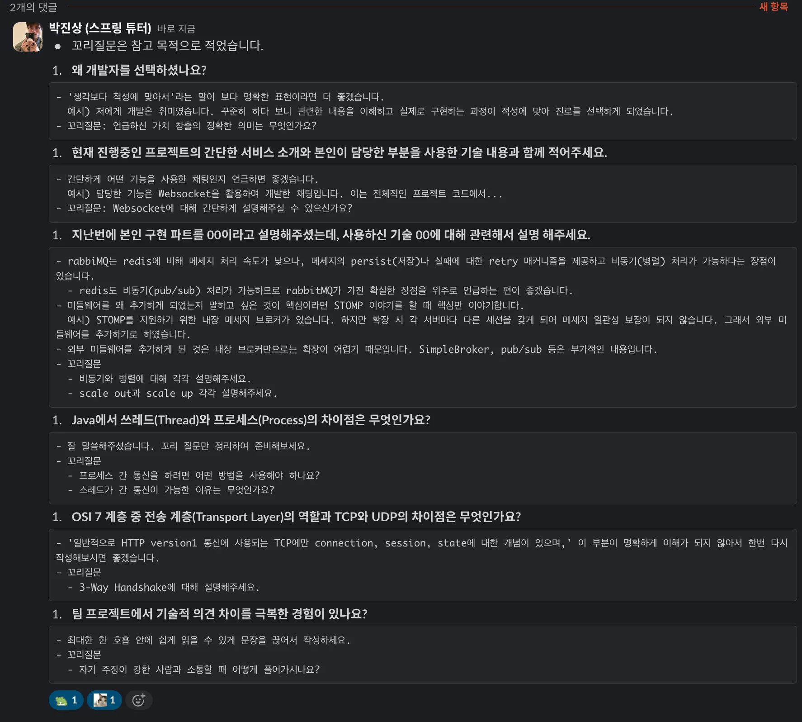

<details>
<summary>피드백</summary>

- 꼬리질문은 참고 목적으로 적었습니다&#46;

1. <strong>왜 개발자를 선택하셨나요?</strong>

<a id="190eda9b0fe180a0a5bacba8566e5b58"></a>

```plaintext
- '생각보다 적성에 맞아서'라는 말이 보다 명확한 표현이라면 더 좋겠습니다.
  예시) 저에게 개발은 취미였습니다. 꾸준히 하다 보니 관련한 내용을 이해하고 실제로 구현하는 과정이 적성에 맞아 진로를 선택하게 되었습니다.
- 꼬리질문: 언급하신 가치 창출의 정확한 의미는 무엇인가요?
```

1. <strong>현재 진행중인 프로젝트의 간단한 서비스 소개와 본인이 담당한 부분을 사용한 기술 내용과 함께 적어주세요&#46;</strong>

<a id="190eda9b0fe18030bd96d047504c929a"></a>

```plaintext
- 간단하게 어떤 기능을 사용한 채팅인지 언급하면 좋겠습니다.
  예시) 담당한 기능은 Websocket을 활용하여 개발한 채팅입니다. 이는 전체적인 프로젝트 코드에서...
- 꼬리질문: Websocket에 대해 간단하게 설명해주실 수 있으신가요?
```

1. <strong>지난번에 본인 구현 파트를 00이라고 설명해주셨는데, 사용하신 기술 00에 대해 관련해서 설명 해주세요&#46;</strong>

<a id="190eda9b0fe18091a7bdf9eacc2fcdd3"></a>

```plaintext
- rabbiMQ는 redis에 비해 메세지 처리 속도가 낮으나, 메세지의 persist(저장)나 실패에 대한 retry 매커니즘을 제공하고 비동기(병렬) 처리가 가능하다는 장점이 있습니다.
  - redis도 비동기(pub/sub) 처리가 가능하므로 rabbitMQ가 가진 확실한 장점을 위주로 언급하는 편이 좋겠습니다.
- 미들웨어를 왜 추가하게 되었는지 말하고 싶은 것이 핵심이라면 STOMP 이야기를 할 때 핵심만 이야기합니다.
  예시) STOMP를 지원하기 위한 내장 메세지 브로커가 있습니다. 하지만 확장 시 각 서버마다 다른 세션을 갖게 되어 메세지 일관성 보장이 되지 않습니다. 그래서 외부 미들웨어를 추가하기로 하였습니다.
- 외부 미들웨어를 추가하게 된 것은 내장 브로커만으로는 확장이 어렵기 때문입니다. SimpleBroker, pub/sub 등은 부가적인 내용입니다.
- 꼬리질문
  - 비동기와 병렬에 대해 각각 설명해주세요.
  - scale out과 scale up 각각 설명해주세요.
```

1. <strong>Java에서 쓰레드(Thread)와 프로세스(Process)의 차이점은 무엇인가요?</strong>

<a id="190eda9b0fe1806f92eff1b2065f482a"></a>

```plaintext
- 잘 말씀해주셨습니다. 꼬리 질문만 정리하여 준비해보세요.
- 꼬리질문
  - 프로세스 간 통신을 하려면 어떤 방법을 사용해야 하나요?
  - 스레드가 간 통신이 가능한 이유는 무엇인가요?

```

1. <strong>OSI 7 계층 중 전송 계층(Transport Layer)의 역할과 TCP와 UDP의 차이점은 무엇인가요?</strong>

<a id="190eda9b0fe18019a1e8e32fc44f288b"></a>

```plaintext
- '일반적으로 HTTP version1 통신에 사용되는 TCP에만 connection, session, state에 대한 개념이 있으며,' 이 부분이 명확하게 이해가 되지 않아서 한번 다시 작성해보시면 좋겠습니다.
- 꼬리질문
  - 3-Way Handshake에 대해 설명해주세요.

```

1. <strong>팀 프로젝트에서 기술적 의견 차이를 극복한 경험이 있나요?</strong>

<a id="190eda9b0fe1807488f5eb4d067b301e"></a>

```plaintext
- 최대한 한 호흡 안에 쉽게 읽을 수 있게 문장을 끊어서 작성하세요.
- 꼬리질문
  - 자기 주장이 강한 사람과 소통할 때 어떻게 풀어가시나요?
```

</details>
