

### 디스코드

[Discord &#45; Group Chat That’s All Fun &#38; Games]()

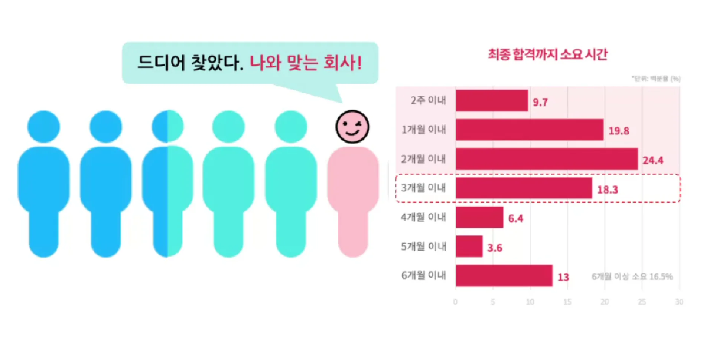

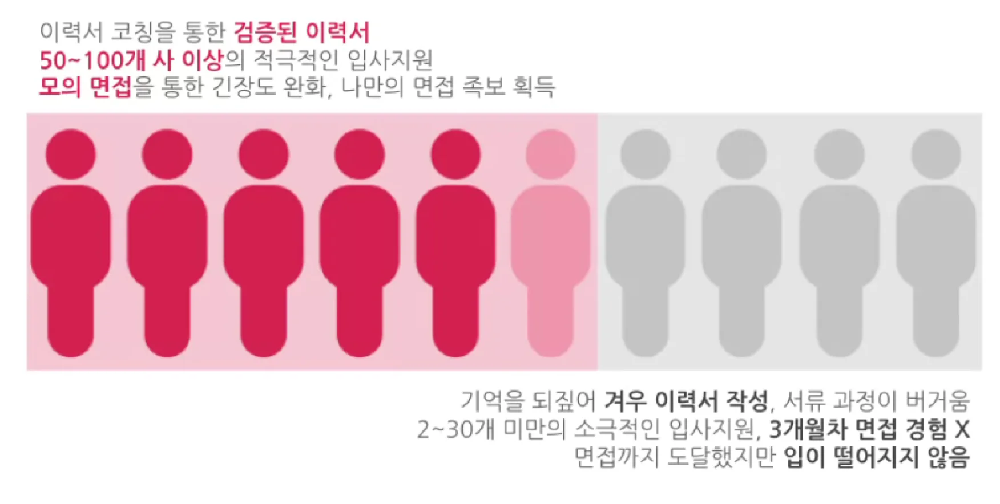

### 커리어 톤

### 이력서

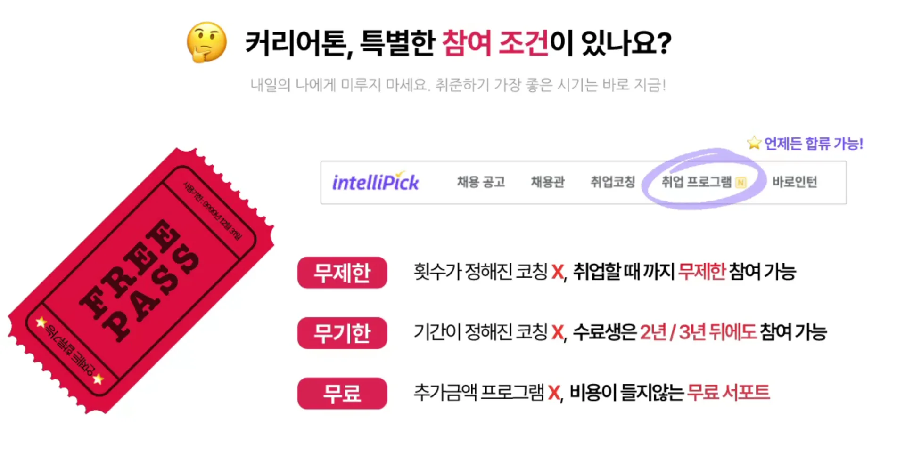

### 단계

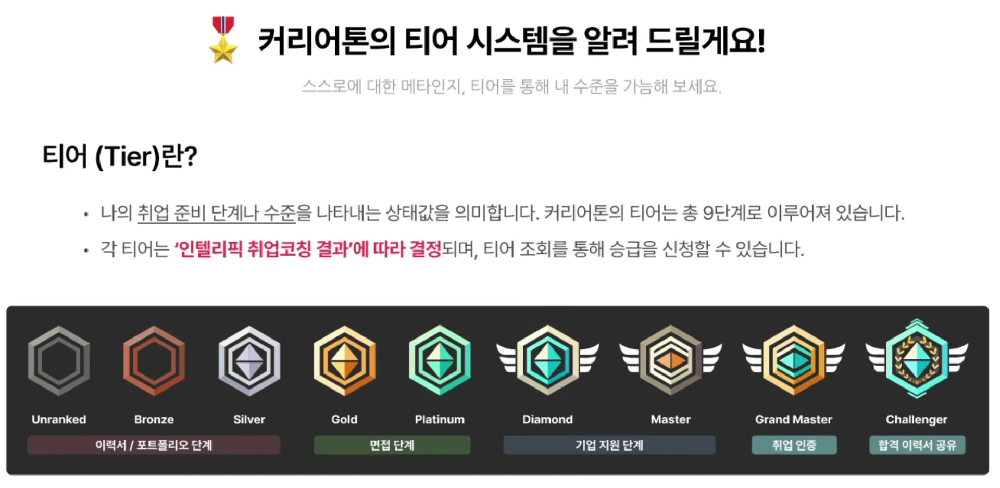

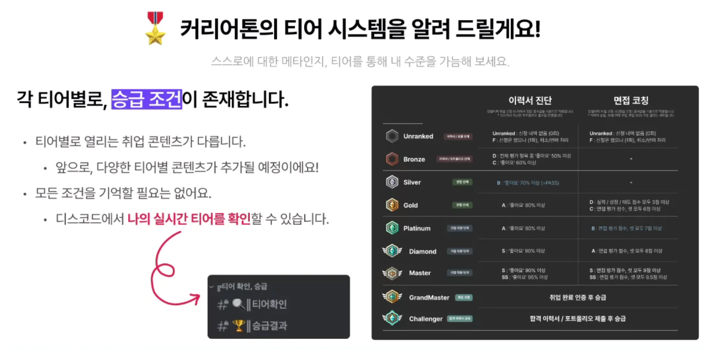

### 인텔리픽 플랫폼

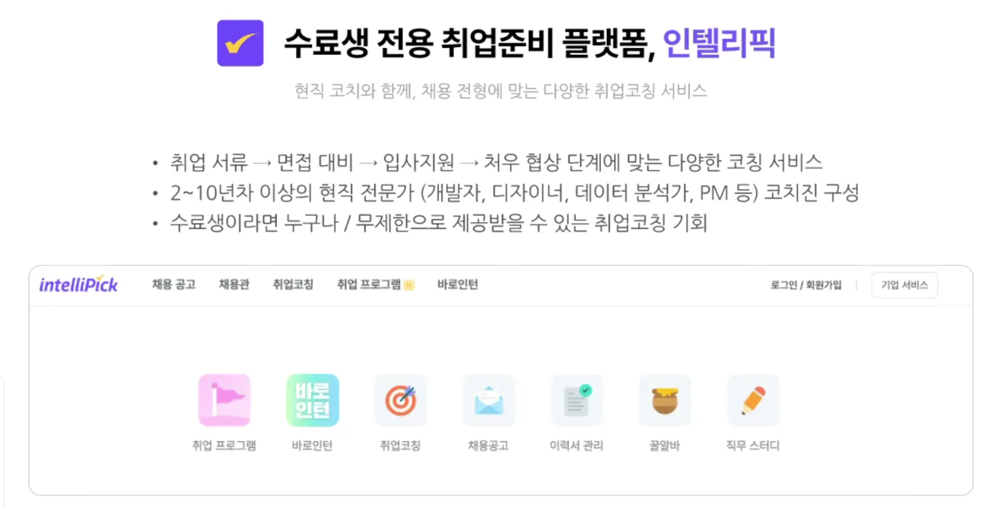

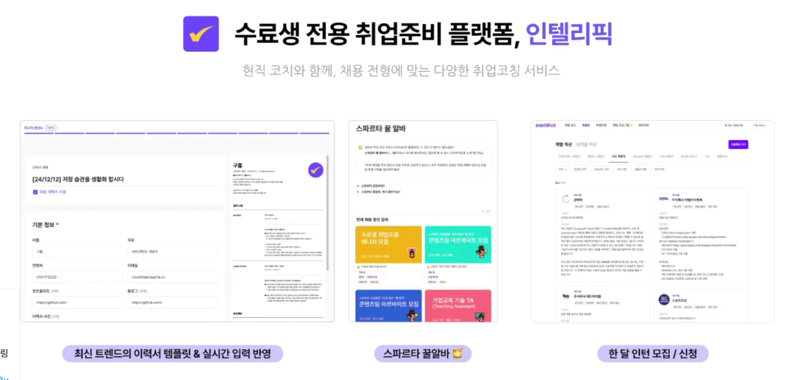

- 꿀알바

- 한달 인턴 모집

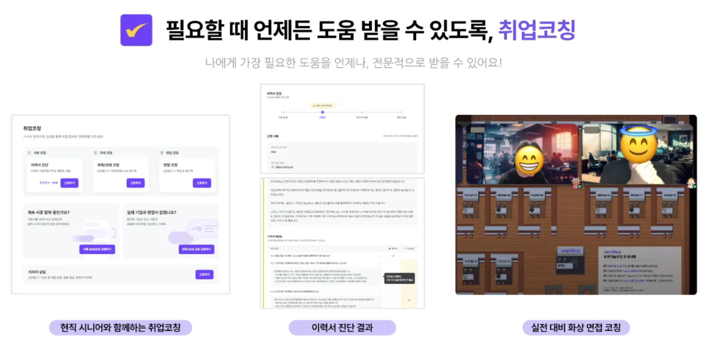

### 커리어톤 합류

---

코어 타입이 있다&#46;

- 미션형

아르바이트나 직업 병행 가능

### 티어 콘텐츠

---

티어에 맞게 단계별로 콘텐츠가 해금된다&#46; 

이력서/ 면접 AI 도우미 &#91; 디스코드 &#93;

- 예상 면접 질문

- 도움 봇 

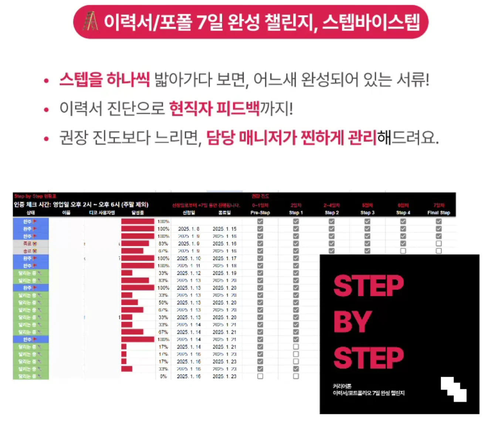

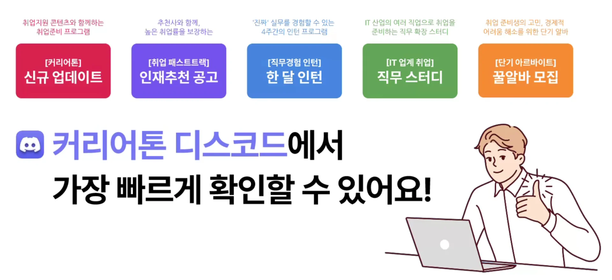

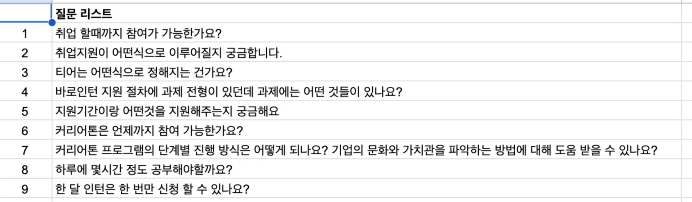

### 질문

---

하루에 4시간 정도 취업에 투자

남는 시간에 공부

한달 인턴 

- 신청 자체는 여러번 가능

취업 준비 &#45; 자격증 취득

- 정보처리기사

- SQLD

면접, 이력서 

지방 &#45; 자택 인턴 가능

- 매일 매주, 오전 
    - 스크럼 &#45; 진행 사항 파악 후, 피드백
