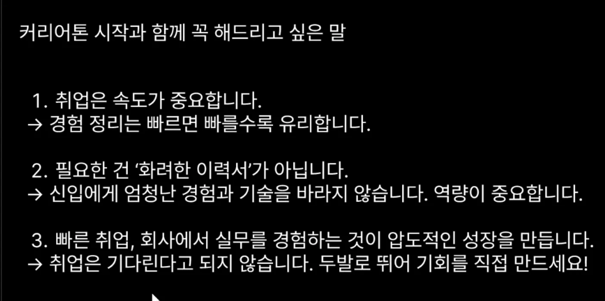
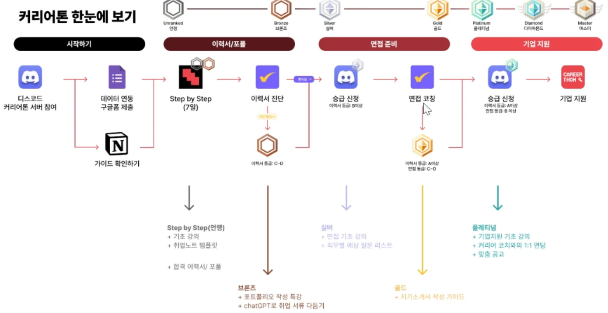

---

<a href="https://beautiful-college-c84.notion.site/1602dc3ef51480719990ee71b155629b">페이지</a> 

설명 내용

- 데이터 연동

### 디스코드 사용법

- 역할
    - 역할에 따라 부여받을 수 있는, 채널이 다르다&#46; 

### 채널 사용법

- 출석 체크

- 스터디룸
    - 2 &#45; 6 시 코어 타임

취업 준비, 디코 &#45; 꾸준히 → 이벤트 

### 인텔리픽 취업 코칭으로 티어 올린다&#46; 

### 티어 안내

- 이력서 진단

- 면접 코칭
    

    → 티어를 올릴 수 있다&#46; 

이력서, 면접 준비에 대한 등급을 받을 수 있다&#46; 

B &#45; 실버

- 최소 기준

- 인텔리픽

- 면접 코칭 

 ⇒ 인텔리픽에서 진단을 받을 수 있다&#46; 

이력서 진단을 받기 

한번 패스를 받고 안주하지 말고 계속해서 수정해야 한다&#46; 

횟수 제한도 없다&#46; → 취업 코칭 둘러보고 다른 것도 서비스 받아보기

디코안에서 티어를 올릴 필요도 있다&#46; 

- 티어에 따라 접근 가능한 정보가 다르다&#46; 

승급 신청 해야, 수동으로 승급이 된다&#46; 

### STEP BY STEP

---

신청해야지 강의 지급 가능

취업은 속도가 중요하다

- 경험 정리를 빠르게 할 수 있는 것이 중요하다&#46; 

필요한 것은 화려한 이력서가 아니다&#46; 

- 신입이한테 요구 담당자 들이 요구하는 것은, 눈에 두드러지는 경험이나 기술이 있는 경우가 거의 없다&#46; 

역량이 중요하다&#46; 역량을 강조해라

기준을 알기 어렵다&#46;

뭐가 필요하고, 뭘 덜어내야하는지 아는 것이 중요하다&#46; 

→ 코칭을 통해 불필요한 것을 덜어낼 수 있다&#46; 

### 바로 인턴

---

- 실무를 바로 경험하는 것이 실력 성장에 있어서 가장 좋다&#46; 

- 질문하기 

- 디코 승급 신청 중요
