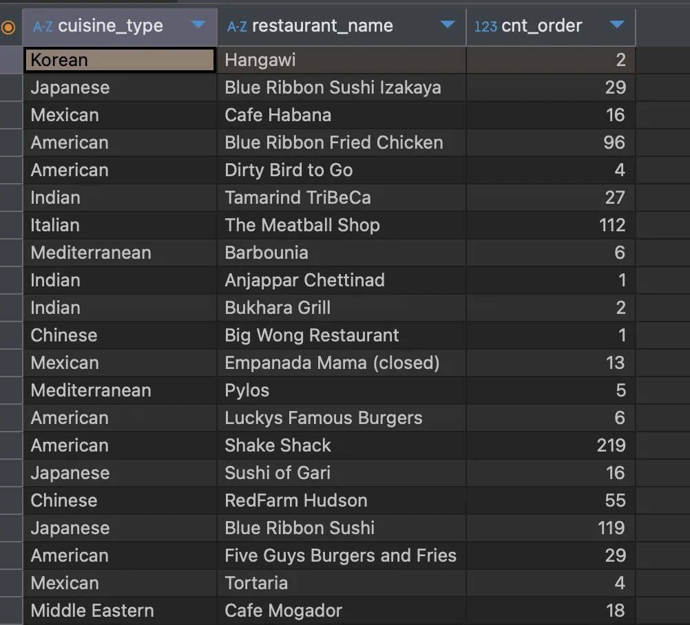
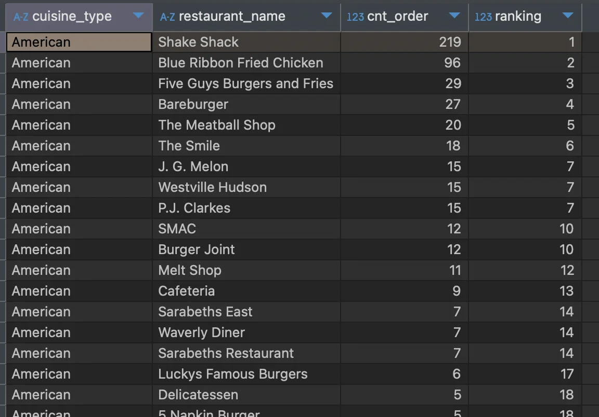
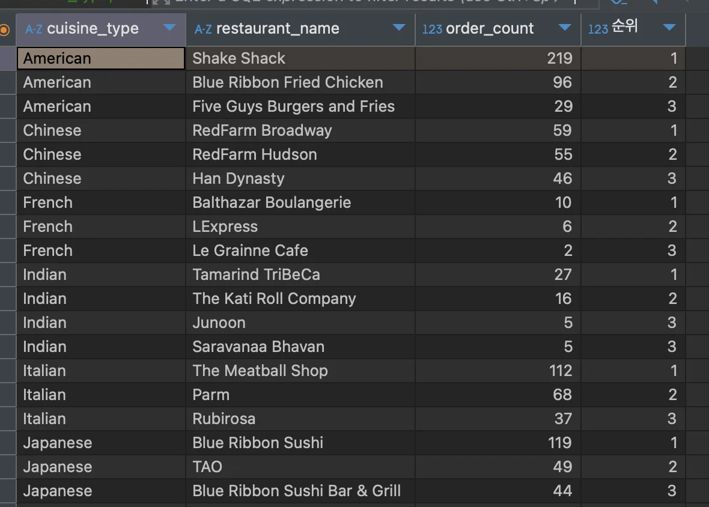
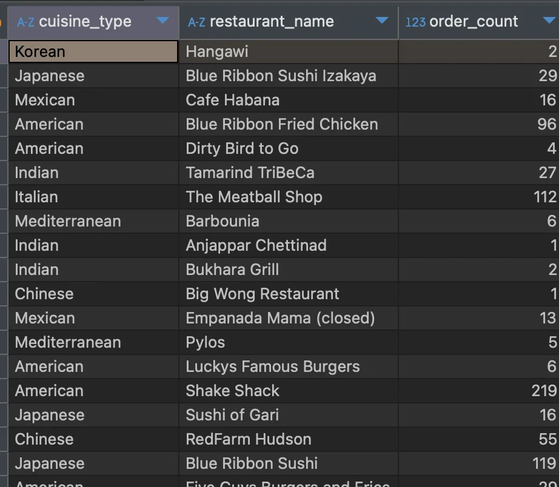
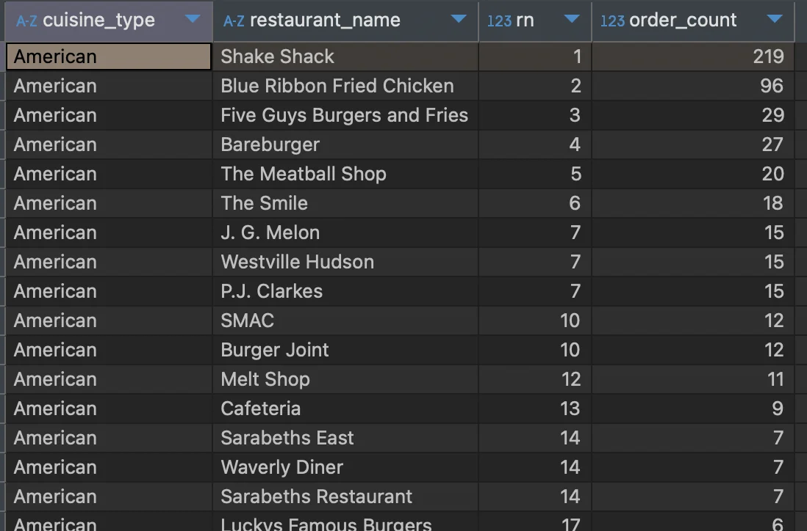
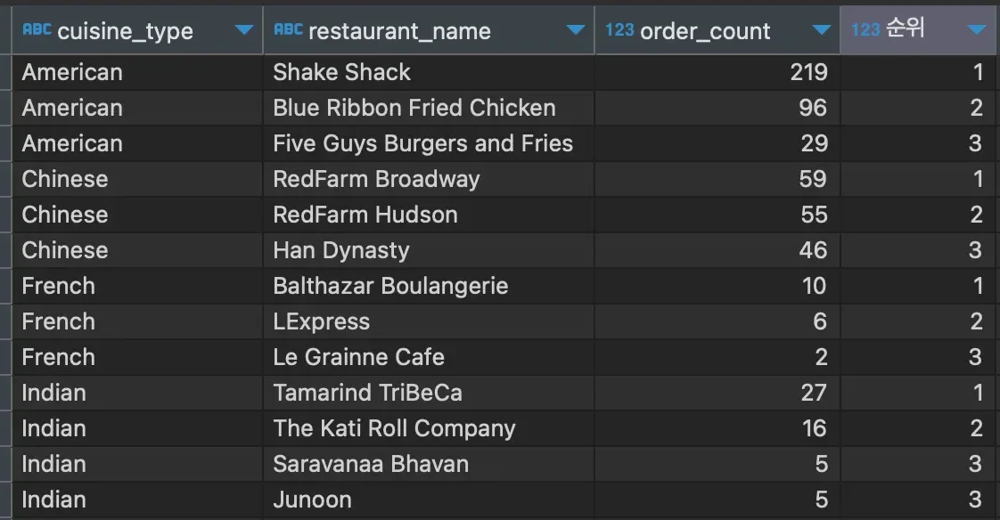
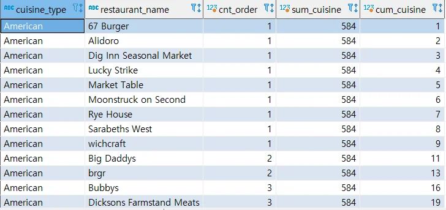

<a id="10feda9b0fe180faa207ddf0d8043a03"></a>

### 업무 시작 단축 (<code>Window Function &#45; RANK</code>, <code>SUM</code>)

> 📌 
> 
> <a id="bf02214b7ad9488794564bf62aa80efb"></a>
> 
> <strong>Window Function</strong>
> 
> - 순위 구하기(<code>rank</code>)
> 
> - 누적 값 계산하기(<code>sum</code>)

<details>
<summary>1&#46; Window Function 기본 문법</summary>

<a id="110eda9b0fe180b1ae19f5b08f77c90a"></a>

```sql
window_function(argument) over (partition by 그룹 기준 컬럼 order by 정렬 기준)
```

- 기능명&#58; window&#95;function

- 인자(argument)&#58; optional

- partition by&#58; 그룹을 나누기 위한 기준 ( <code>≒</code> <strong><u>group by</u></strong> )

- order by&#58; 정렬 할 기준 컬럼

</details>

<details>
<summary>2&#46;  순위(rank) 구하기 &#45; <code>Window Function = rank</code></summary>

<details>
<summary>랭크(rank) 함수</summary>

<a id="110eda9b0fe180b089d6ce2f2db557ea"></a>

```sql
rank() over (partition by  order by ) 
```

</details>

---

<details>
<summary>&#91; 실습 &#93;   음식 타입별로 주문 건수가 가장 많은 상점 3개씩 조회하기</summary>

<details>
<summary>1&#46; 나라별, 식당별 주문 수 집계 </summary>

<a id="110eda9b0fe18033bf2dc28dd7f0b1bb"></a>

```sql
select cuisine_type,
   restaurant_name,
   count(1) cnt_order
from food_orders
group by 1, 2
```



<a id="110eda9b0fe1801c9d52e1fab9e1c34e"></a>

 

</details>

<details>
<summary>2&#46; 집계한 주문 수로 순위 구하기 &#45; <code>rank() over (…)</code></summary>

<a id="110eda9b0fe180ef9331f6017eadad65"></a>

```sql
select cuisine_type,
	   restaurant_name,
	   cnt_order,
	   rank() over (partition by cuisine_type order by cnt_order desc) ranking
from
(
select cuisine_type,
	   restaurant_name,
	   count(1) cnt_order
from food_orders
group by 1, 2
) a
```



</details>

<details>
<summary>3&#46; 3위까지 조회하고, 음식 타입별, 순위별로 정렬</summary>

<a id="110eda9b0fe1805da075ddae53e02a74"></a>

```sql
select cuisine_type,
       restaurant_name,
       order_count,
       rn "순위"
from
(
select cuisine_type,
       restaurant_name,
       rank() over (partition by cuisine_type order by order_count desc) rn,
       order_count
from
(
select cuisine_type, restaurant_name, count(1) order_count
from food_orders
group by 1, 2
) a
) b
where rn<=3
order by 1, 4
```



</details>

</details>

</details>

<details>
<summary>3&#46; 누적 값 계산하기  &#45; <code>Window Function = sum</code></summary>

<details>
<summary>누적 값 계산(sum)  함수</summary>

<a id="110eda9b0fe180d1baeff8289da46f2c"></a>

```sql
sum() over (partition by  order by ) 
```

</details>

---

<details>
<summary>&#91; 실습 &#93;  각 음식점의 주문건이 해당 음식 타입에서 차지하는 비율을 구하고, 주문건이 낮은 순으로 정렬했을 때 누적 합 구하기</summary>

<details>
<summary>1&#46; 음식 타입별, 음식별 주문 건수 집계</summary>

<a id="110eda9b0fe1806b9fa6e1d44f930b9b"></a>

```sql
select cuisine_type, 
			 restaurant_name, 
			 count(1) order_count
from food_orders
group by 1, 2
```



</details>

<details>
<summary>2&#46; Rank 함수 적용</summary>

<a id="110eda9b0fe18041ace3c1a02d46e23a"></a>

```sql
select cuisine_type,
       restaurant_name,
       rank() over (partition by cuisine_type order by order_count desc) rn,
       order_count
from
(
select cuisine_type, restaurant_name, count(1) order_count
from food_orders
group by 1, 2
) a
```



</details>

<details>
<summary>3&#46; 3위까지 조회하고, 음식 타입별, 순위별로 정렬하기 </summary>

<a id="110eda9b0fe180248590d1725735884b"></a>

```sql
select cuisine_type,
       restaurant_name,
       order_count,
       rn "순위"
from
(
select cuisine_type,
       restaurant_name,
       rank() over (partition by cuisine_type order by order_count desc) rn,
       order_count
from
(
select cuisine_type, restaurant_name, count(1) order_count
from food_orders
group by 1, 2
) a
) b
where rn<=3
order by 1, 4
```



</details>

<details>
<summary>학습자료 추가 (24/08/21) &#58; 누적합 고쳐보기</summary>

<details>
<summary>정답</summary>

<a id="120ff5aabe4e490fae1923ae56fc26d6"></a>

위 정답에서 order&#95;count가 동일한 값을 일괄로 더해 cum&#95;sum으로 출력되는 문제가 있었어요&#46;

- 문제 상황 이해
    <a id="d4e735967943493589d1354fff768207"></a>

    이 상황은 SQL에서 <code>WINDOW</code> 함수(<code>SUM</code> 등)를 사용할 때, <code>SUM</code>으로 동일한 <code>cnt&#95;order</code> 값을 가진 여러 행이 있을 경우, SQL 엔진은 이 값을 한꺼번에 더하는 현상이 발생합니다&#46; cnt&#95;order의 순서를 결정할 명확한 기준이 없으므로 발생한 문제입니다&#46;

- 해결 방법 
    <a id="42bfa19eaec145e288820c6a844cd31a"></a>

    이 문제를 해결하려면 <code>ORDER BY</code> 절에 <code>cnt&#95;order</code> 외에 추가적인 열에 순서를 부여할 수 있는 <code>restaurant&#95;name</code>을 포함시켜야 합니다&#46; 이렇게 하면 동일한 <code>cnt&#95;order</code> 값을 가진 행들이 명확하게 순서가 정해져 누적합이 정상적으로 처리됩니다&#46;

    <a id="6a3f54db00364dc0af33a7911b672b1f"></a>

    누적합을 순서대로 표기하기 위해 order by에 cum&#95;cuisine 을 추가해줍니다&#46;

<a id="6c596dc17b68446b8233e034b4f0890e"></a>

```sql
select cuisine_type,
       restaurant_name,
       cnt_order,
       sum(cnt_order) over (partition by cuisine_type) sum_cuisine,
       sum(cnt_order) over (partition by cuisine_type order by cnt_order, restaurant_name) cum_cuisine
from
(
select cuisine_type, 
	restaurant_name, 
	count(1) cnt_order
from food_orders
group by 1, 2
) a
order by cuisine_type , cnt_order, cum_cuisine
```



</details>

</details>

<details>
<summary>🧐 다른 window functopn 학습 후 정리하기</summary>


</details>

</details>

</details>
