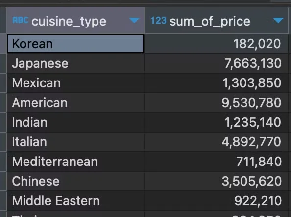
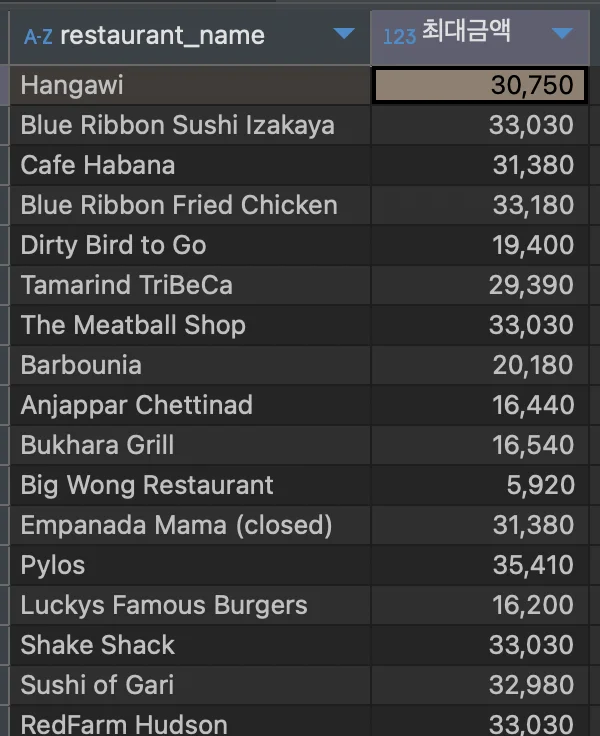
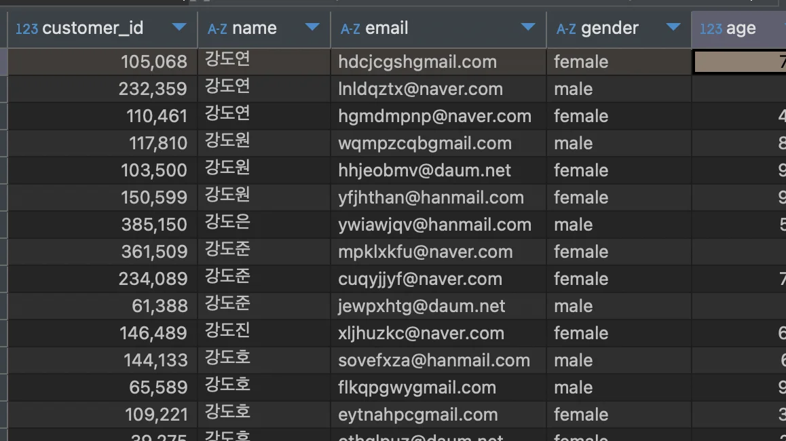

<a id="10ceda9b0fe1804d9d1ce6acad9a9afc"></a>

### <strong>정렬 ( </strong><strong><code>ORDER BY</code></strong><strong> )</strong>

---

<details>
<summary><strong>기본 문법</strong></summary>

<a id="10aeda9b0fe18011b03ffb222e29aac1"></a>

```sql
ORDER BY 필드 정렬 # (ASC), DESC
```

- <code>ASC</code>&#58; 오름차순 정렬, 기본값으로써 생략함

- <code>DESC</code>&#58;  내림차순 정렬

</details>

<details>
<summary><strong>정렬 종류</strong></summary>

| <strong>종류</strong> | <strong>구문</strong> | <strong>예시</strong> |
| --- | --- | --- |
| <strong>오름차순</strong> | <code>생략</code>, ASC | ORDER BY sum(price) |
| <strong>내림차순</strong> | <code>DESC</code> | ORDER BY sum(price) DESC |

</details>

<details>
<summary><strong>복합 정렬</strong></summary>

> <strong><u>정렬 조건을 2개 이상</u></strong> 가질 시, <strong><u>상위 전재 조건이 동일</u></strong>한 경우 <strong><u>하위 조건으로 정렬</u></strong>된다&#46; 

<a id="f2c573ba576d4e66ad4d9ccb74a01914"></a>

```sql
SELECT price, quantity
FROM food_orders
ORDER BY price DESC, quantity (ASC);
```

- 정렬1&#58; 가격(<code>price</code>) 내림차순

- 정렬2&#58; 양(<code>quantity</code>) 오름차순

</details>

<details>
<summary>예시1) 각 나라별 주문 총 가격 합계 구하기</summary>

> ✏️ 
> 
> - <strong>테이블</strong>&#58; <code>food&#95;orders</code>
> 
> - <strong>컬럼</strong>
>     - 음식 유형(국가 별)&#58; <code>cuisine&#95;type</code>
> 
>     - 가격&#58; <code>price</code>
> 
> - 그룹&#58; 음식 유형 별
> 
> - 정렬&#58; 총 가격 합, 오름차순

<a id="1baeda9b0fe180a088ece9118447d7f5"></a>

<strong>SQL</strong>

<a id="d03d019dd59f41f1bcf2902c24bfe1b1"></a>

```sql
SELECT cuisine_type,
       SUM(price) sum_of_price
FROM food_orders
GROUP BY cuisine_type
ORDER BY sum_of_price;
```

<a id="10aeda9b0fe18096bd5cdfa7586cedc7"></a>

<strong>실행 결과</strong>



</details>

<a id="1fea4a4605c34d43aa764238b8490066"></a>

### &#91; 실습&#93;

---

<details>
<summary>1&#46; 음식점별 주문 금액 최댓값 조회하기 &#45; 최댓값 기준으로 내림차순 정렬</summary>

<details>
<summary>🧐 음식점 당 최댓값을 어떻게 지정하는가? </summary>

- <code>GROUP BY</code>를 통해 특정 컬럼 for문 처리 가능
    <a id="5b1a284ffa4b42f29d3e41ba2c1e6a35"></a>

    즉, 특정 컬럽 타입들에 대해 집계합수 처리가 차례대로 반복되어 할당됨

    > <code>group by restaurant&#95;name</code>

</details>

> ✏️ 
> 
> - <strong>테이블</strong>&#58; <code>food&#95;orders</code>
> 
> - <strong>컬럼</strong>
>     - 음식점 이름&#58;<code>restaurant&#95;name</code>
> 
>     - 주문 금액&#58; <code>price</code>
> 
> - 그룹&#58; 음식점 이름
> 
> - 정렬&#58; 최대 가격, 내림차순

<a id="feb22c7c8969402a99d23bbcd01a1480"></a>

<strong>SQL</strong>

<a id="1baeda9b0fe180d6bd22c9c088e43f95"></a>

```sql
SELECT restaurant_name, MAX(price) '최대금액'
FROM food_oders
GROUP BY restaurant_name
ORDER BY '최대금액' DESC
```

<a id="1baeda9b0fe1800d9c8ffbd974477136"></a>

<strong>실행 결과</strong>



</details>

<details>
<summary>2&#46; 고객을 이름 순으로 오름차순으로 정렬하기</summary>

> ✏️ 
> 
> - <strong>테이블</strong>&#58; <code>food&#95;orders</code>
> 
> - <strong>컬럼</strong>
>     - 이름&#58; <code>name</code>
> 
> - 정렬&#58; 이름, 오름차순

<a id="1baeda9b0fe18071a8befdd283856964"></a>

<strong>SQL</strong>

<a id="1baeda9b0fe18000bd7fc8f7779e25d7"></a>

```sql
SELECT * 
FROM food_orders
ORDER BY name;
```

<a id="1baeda9b0fe1802faad8dbc60e01f4c5"></a>

<strong>실행 결과</strong>



</details>
