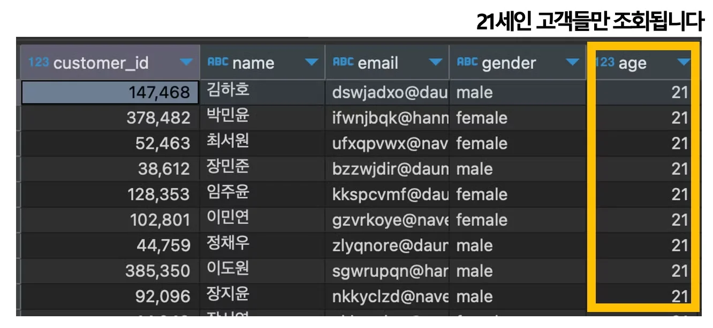
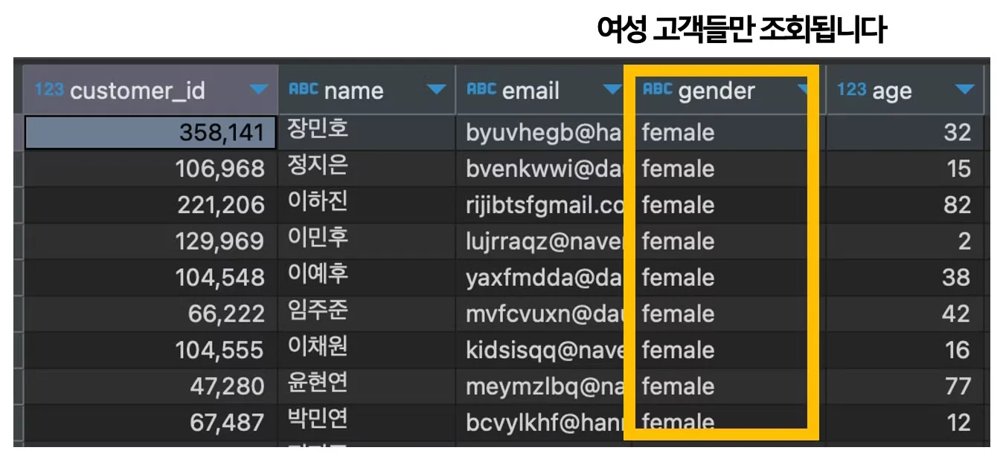
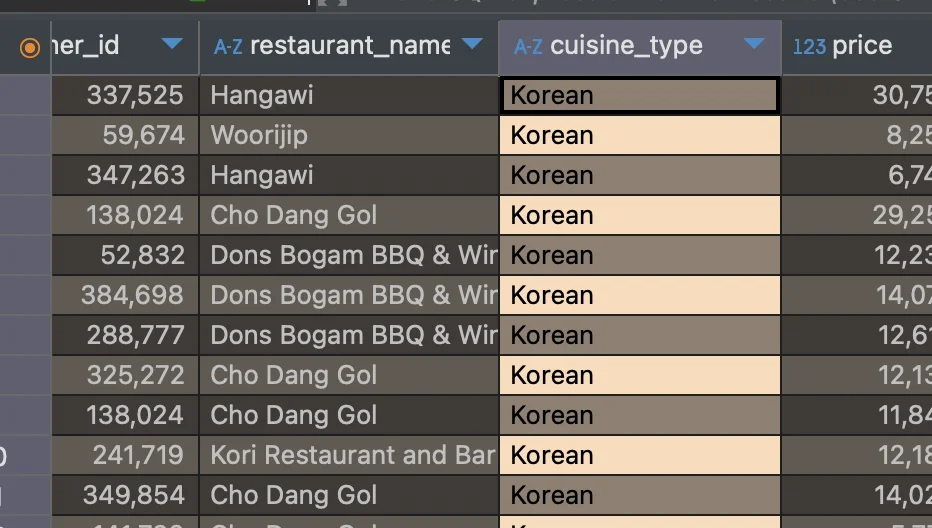
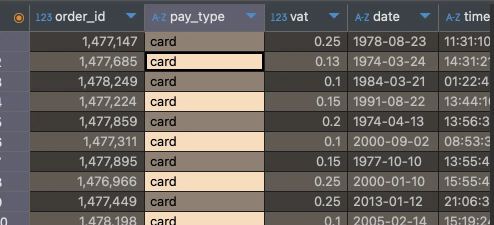
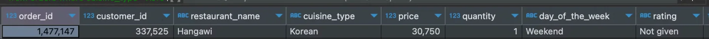
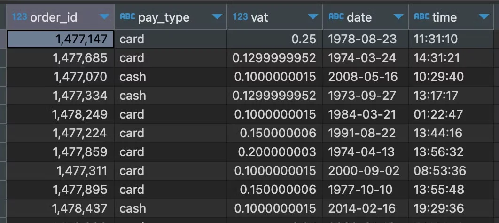

<a id="10aeda9b0fe180308b4afce83f13f819"></a>

## <strong>필터링 (</strong><strong><code>WHERE</code></strong><strong> )</strong>

---

<a id="10aeda9b0fe180589decfddcbfbf8152"></a>

### <strong>WHERE</strong>

<a id="1baeda9b0fe180fe940fefb597be5012"></a>

<strong>기본 문법</strong>

<a id="10aeda9b0fe180dd9936ca0267314d6b"></a>

```sql
SELECT *
FROM 테이블
WHERE 필터링 조건 (eg. 20살 이상)
```

<a id="10aeda9b0fe180e09f08fe23ae90137a"></a>

### <strong>기본 조건,  ‘</strong><strong><code>=</code></strong><strong>&#39;</strong>

<details>
<summary>🧐 대소문자 구분 ❌  </summary>

- MYSQL 환경에서 대소문자 상관없이 사용 가능

- 관련한 자세한 내용은 아래 링크 확인 <br>‣

</details>

<details>
<summary><strong>1&#46;  필터링 </strong><strong><code>숫자</code></strong><strong> &#45; </strong>고객(customer) 테이블, 21살인 사람 </summary>

<a id="10aeda9b0fe180009816cd51ca0f265c"></a>

```sql
select *
from customer
where age=21;
```



</details>

<details>
<summary><strong>2&#46;  필터링 </strong><strong><code>문자</code></strong><strong> &#45; </strong>고객(customer) 테이블, 여성</summary>

> ☝🏻 
> 
> <a id="1baeda9b0fe18029a014dafeaafe5fb4"></a>
> 
> 문자 사용 시 <strong><u>작은 따옴표</u></strong>(<code>’’</code> ) 사용

<a id="10aeda9b0fe1804ab00dc2b00aba8944"></a>

```sql
select *
from customers
where gender='female'
```



</details>

<a id="10aeda9b0fe1801c89c4c1a381f45256"></a>

### &#91; 실습 &#93;

<details>
<summary>1&#46; 주문(food&#95;orders) 테이블에서 한국 음식만 조회</summary>

- 테이블&#58; <code>food&#95;orders</code>

- 필터링 조건&#58; 한국 음식(<code>KOREAN</code>)

<details>
<summary>SQL Query</summary>

<a id="43a09e08cd7c49f69549b5c6aeb94c06"></a>

```sql
select *
from food_orders
where cuisine_type="KOREAN";
```

</details>

<details>
<summary>실행결과</summary>



</details>

</details>

<details>
<summary>2&#46; 결제(payments) 테이블에서 카드로 결제한 경우만 조회</summary>

- 테이블&#58; payments

- 필터링 조건&#58; 카드 결제 

<details>
<summary>SQL Query</summary>

<a id="c1772742b77549a88f626fb7977ba699"></a>

```sql
select *
from payments
WHERE pay_type="card";
```

</details>

<details>
<summary>실행결과</summary>



</details>

</details>

<a id="10aeda9b0fe180ebb1a7fb8f1ff12fb4"></a>

### <strong>1&#46; </strong><strong><code>비교 연산자</code></strong>

---

<a id="1baeda9b0fe180129fcefe42b300425b"></a>

<strong>기본 문법</strong>

<a id="10aeda9b0fe180a294ddfb9accf8e6d1"></a>

```sql
WHERE 필드_[비교연산자]_조건값
```

<details>
<summary>🧐 비교연산자 종류</summary>

| <strong>비교연산자</strong> | <strong>의미</strong> | <strong>예시</strong> |
| --- | --- | --- |
| <strong>=</strong> | 같다 | age=21<br>gender=’female’ |
| <strong>&#60;&#62;</strong> | 같지 않다 (다르다) | age&#60;&#62;21<br>gender&#60;&#62;’female’ |
| <strong>&#62;</strong> | 크다 | age&#62;21 |
| <strong>&#62;=</strong> | 크거나 같다 | age&#62;=21 |
| <strong>&#60;</strong> | 작다 | age&#60;21 |
| <strong>&#60;=</strong> | 작거나 같다 | age&#60;=21 |

</details>

<a id="1baeda9b0fe1808d89dfcd8288bdd07f"></a>

<strong>예시</strong>

<details>
<summary>1&#46;  나이가 21세 미만인 고객 조회</summary>

<a id="10aeda9b0fe18037b440f1bef385d9eb"></a>

```sql
SELECT *
FROM customers
WHERE age<21
```

</details>

<details>
<summary>2&#46;  나이가 25이하이고, 여성인(남성이 아닌) 고객 조회</summary>

<a id="10aeda9b0fe180d3b997e9338c8ba46d"></a>

```sql
SELECT *
FROM customers
WHERE age<=25 AND gender<>'male';
```

</details>

<a id="5613e0b3c33845a6879fbaf5ca966cf1"></a>

### 2&#46;  <code>BETWEEM</code>, A 와 B 사이

---

<a id="1baeda9b0fe1802da921da1c572c065d"></a>

<strong>기본 문법</strong>

<a id="9686053c8dc94943ab1a0f356eb4f81e"></a>

```sql
WHERE 필드 BETWEEN 조건값1 AND 조건값2
```

<a id="667d5e1c4c5b49f9ae7188dc671790e1"></a>

<strong>예시</strong>

<a id="8f57cbe083024d1cbad60cbac22b6ac3"></a>

```sql
#  10 < age < 20 
WHERE age between 10 and 20
```

<a id="10aeda9b0fe1803eb016e6c1a2ecab4d"></a>

### 3&#46; <strong><code>IN</code></strong>, 포함 

---

<a id="1baeda9b0fe1803994b9d87b6509d7e1"></a>

<strong>기본 문법</strong>

<a id="10aeda9b0fe180fea557d295d575da62"></a>

```sql
WHERE 필드 in (조건 값) # 여러개 가능
```

<a id="1baeda9b0fe180dcb8f2cb915dd9da23"></a>

<strong>예시</strong>

<a id="1baeda9b0fe180b48d2dc333438544f3"></a>

```sql
# 예시 1: 나이가 15, 21, 31 세인 경우
WHERE age in (15, 21, 31)
```

<a id="1baeda9b0fe18079b1ffde0f87182d20"></a>

```sql
# 예시 2: 음식 종류가 한식, 일식 인 경우
WHERE cuisine_type in ('Korean', 'Japanese')
```

<a id="e0fe52aa5bc14b6d80af9db724c549c1"></a>

### 4&#46; <strong><code>LIKE</code></strong><strong>,</strong> 유사 값<strong> ( </strong><strong><code>%</code></strong><strong> )</strong>

---

<a id="1baeda9b0fe180c4949dffff9989cb35"></a>

<strong>기본 문법</strong>

<a id="10aeda9b0fe180058d62e93d8611c46e"></a>

```sql
WHERE 필드 like 조건
```

<a id="f01422b5582f43cf937c9f379209f698"></a>

### 유사한 값 찾기

<details>
<summary>1&#46; <strong><u>특정한 문자로</u></strong> <strong><u>시작</u></strong>하는 경우&#58; <strong><code>‘시작문자</code></strong><strong><code>%</code></strong><code>’</code></summary>

<a id="10aeda9b0fe180cdbaccc3cade10efdb"></a>

```sql
# 예시: ‘김’으로 시작하는 이름
WHERE name LIKE '김%'
```

</details>

<details>
<summary>2&#46; <strong><u>특정한 문자</u></strong><strong>를 </strong><strong><u>포함</u></strong>하는 경우&#58; <code>‘</code><strong><code>%</code></strong><code>포함문자</code><strong><code>%</code></strong><code>’</code></summary>

<a id="10aeda9b0fe180929067cf6d2f62906b"></a>

```sql
# 예시: 식당 이름에 ‘Next’ 를 포함하는 경우
WHERE restaurant_name LIKE '%Next%'
```

</details>

<details>
<summary>3&#46; <strong><u>특정한 문자로</u></strong><strong> </strong><strong><u>끝</u></strong>나는 경우&#58; <strong><code>‘</code></strong><strong><code>%</code></strong><strong><code>끝나는문자’</code></strong></summary>

<a id="10aeda9b0fe1804fbe69c322cb45e4bf"></a>

```sql
# 예시: ‘임’ 으로 끝나는 이름
WHERE name LIKE '%임'
```

</details>

<a id="10aeda9b0fe180febb2cd7a355a089bd"></a>

### 5&#46; <strong><code>논리연산</code></strong><strong> &#45;  </strong>조건 여러개 

---

<a id="1baeda9b0fe1804c8e2ac4ec13fe37f6"></a>

<strong>기본 문법</strong>

<a id="10aeda9b0fe1806892dacd1ea2a3de27"></a>

```sql
WHERE 조건1 AND 조건2;
```

<details>
<summary>🧐 <strong><u>논리연산자</u></strong> 종류</summary>

| <strong>논리연산자</strong> | <strong>의미</strong> | <strong>예시</strong> |
| --- | --- | --- |
| <strong><code>AND</code></strong> | 그리고 | age&#62;20 <strong>and</strong> gender=’female’<br>→ 나이가 20세 이상이고, 여성 |
| <strong><code>OR</code></strong> | 또는 | age&#62;20 <strong>or</strong> gender=’female’<br>→ 나이가 20세 이상이거나, 여성 |
| <strong><code>NOT</code></strong> | 아닌 | not gender=’female’<br>→ 여성이 아닌 |

</details>

<a id="10aeda9b0fe1808284bfd4b593b8ae02"></a>

<strong>예시</strong>

<details>
<summary>1&#46;  주문(food&#95;orders) 테이블에서 한국음식이면서, 가격이 30,000원 이상인 경우</summary>

<a id="10aeda9b0fe180b6abbdcd9b892f1f26"></a>

```sql
SELECT*
FROM food_ordes
WHERE cuisine_type='KOREAN' and price >= 30000;
```

- <code>조건</code>&#58; 한국 음식,  가격 3만원 이상



</details>

<details>
<summary>2&#46;  결제(payments) 테이블에서 카드로 결제했거나, vat 율이 0&#46;2 이하인 경우</summary>

<a id="cb671ef8cb4e4e578e95434d130f4eb6"></a>

```sql
SELECT *
FROM payments
WHERE pay_type='card' or vat<=0.2
```

- <code>조건</code>&#58; 결제 시 카드로, 세금(vat)율 <code>0&#46;2</code> 이하



</details>
