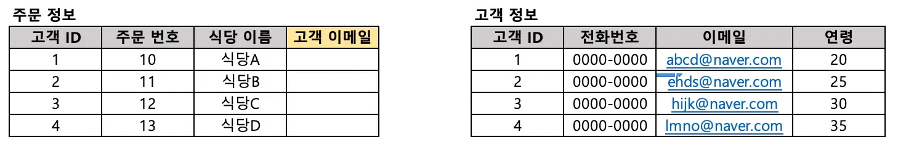
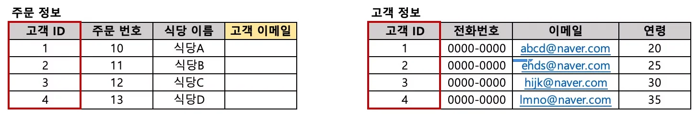
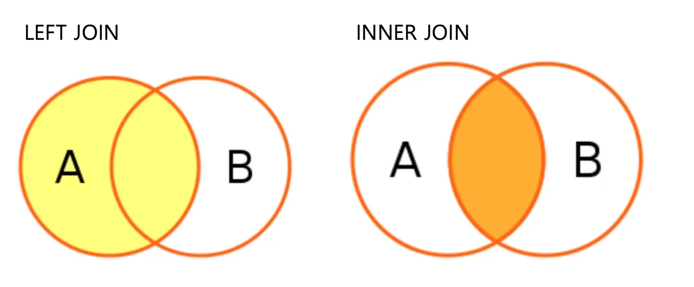
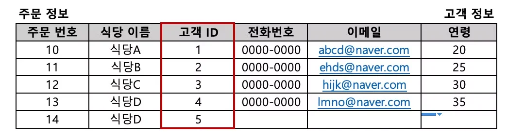
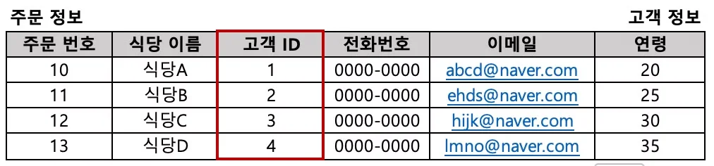
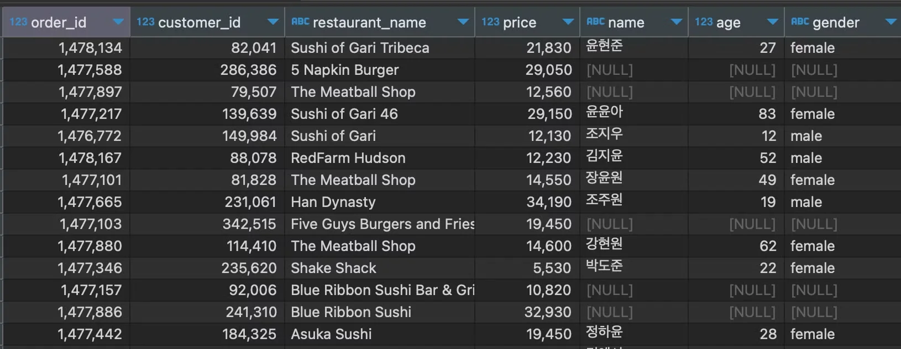
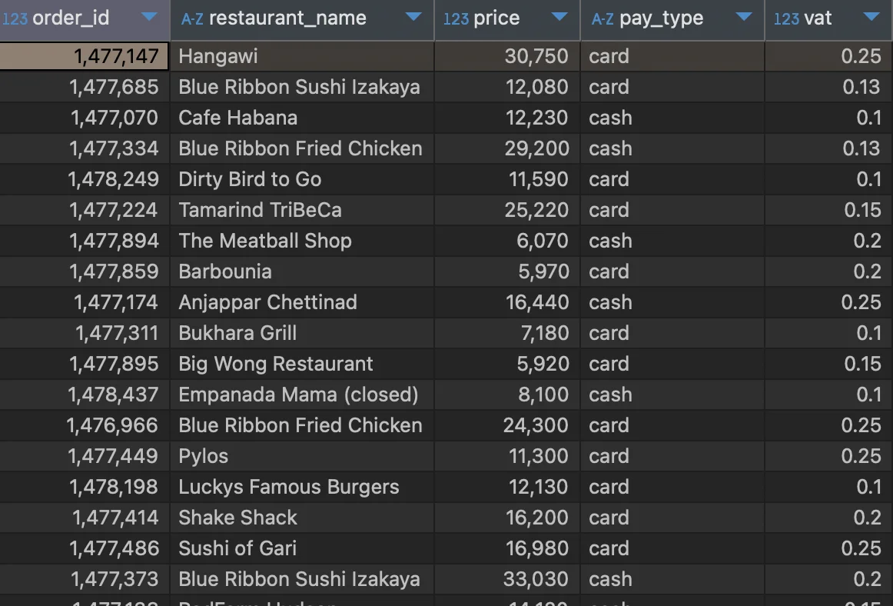
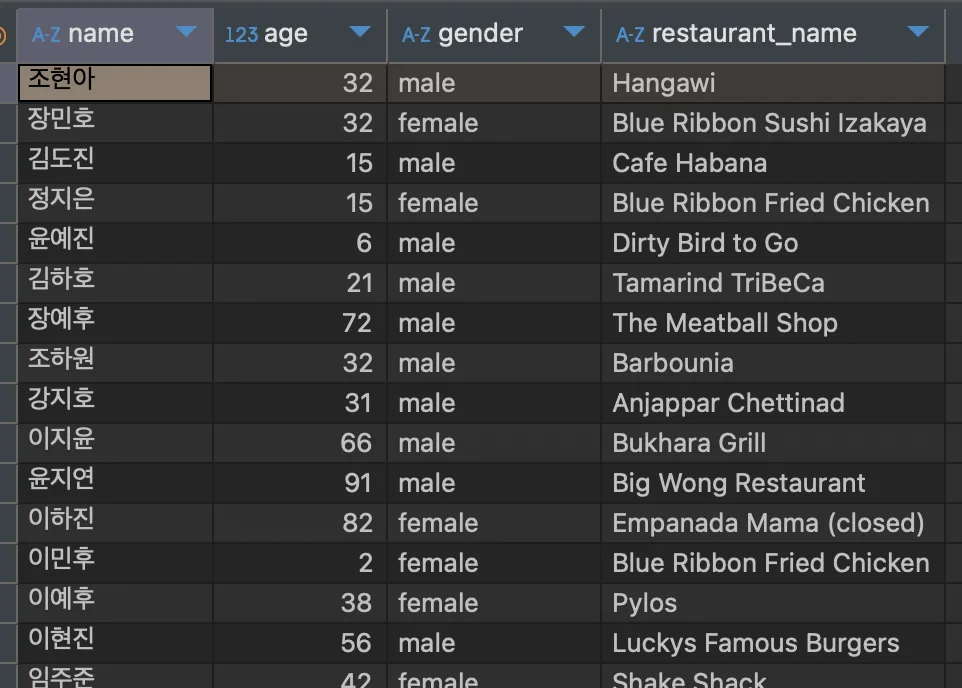
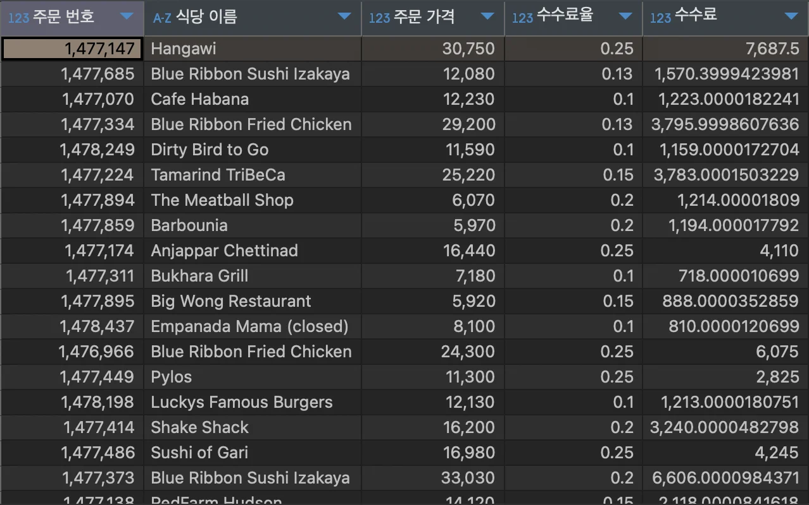
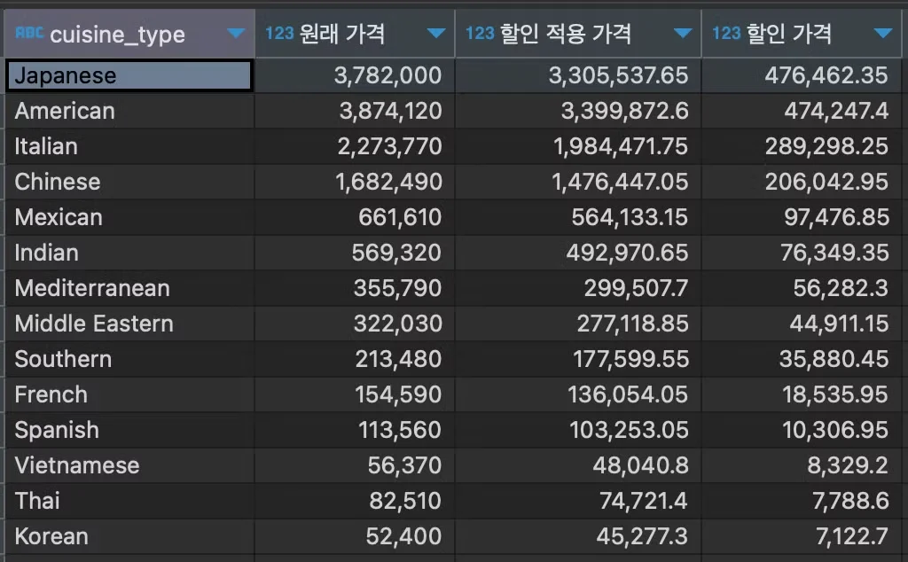

<a id="88c4e12771fa49e088613756f822b0ee"></a>

### 테이블 합치기, 필요한 데이터가 서로 다른 테이블이 있는 경우( <code>JOIN</code> )

> /icons/checkmark-line_lightgray.svg <strong><u>여러 테이블</u></strong>에서 <strong><u>필요한 데이터(컬럼) 조회</u></strong>

<details>
<summary>사용 예시 </summary>

<details>
<summary>1) 주문 시 결제 방법 확인 </summary>

- 주문 → 주문테이블

- 결제 → 결제 테이블

</details>

<details>
<summary>2) 주문을 한 고객 확인</summary>

- 주문 → 주문 테이블

- 고객 → 고객 테이블

</details>

<details>
<summary>3) 주문 건 별 수수료 계산</summary>

- 주문 → 주문 테이블

- 수수료율 → 결제 테이블

<a id="10ceda9b0fe1806aa860dcbbac92e3a3"></a>

 

</details>

</details>

<details>
<summary><strong><code>JOIN</code></strong> 기본 구조</summary>

>  엑셀 &#45;  Vlookup  유사

<details>
<summary>🧐 JOIN 동작 방식</summary>

- 주문 테이블, 고객 테이블 
    

- 공통 컬럼(<code>고객 ID</code>)을 기준으로 묶인(<code>join</code>)다
    

    

</details>

<details>
<summary>🧐 <code>LEFT JOIN</code> vs <code>INNER JOIN</code></summary>



- <code>LEFT JOIN</code>&#58; 공통 컬럼 (키값) 을 기준으로, 하나의 테이블에 <strong><u>값이 없더라도 모두 조회</u></strong>됨
    

- <code>INNER JOIN</code>&#58; 공통 컬럼 (키값) 을 기준으로, <strong><u>두 테이블 모두에 있는 값만 조회</u></strong>
    - 주문번호 14의 경우, 고객에 대한 정보가 없음 → 제외

    

</details>

<a id="10ceda9b0fe180f89afcebf02cccca1f"></a>

```sql
-- LEFT JOIN
select 조회 할 컬럼
from 테이블1 a left join 테이블2 b on a.공통컬럼명=b.공통컬럼명

-- INNER JOIN
select 조회 할 컬럼
from 테이블1 a inner join 테이블2 b on a.공통컬럼명=b.공통컬럼
```

> ☝🏻 
> 
> <a id="16fcb4e7fb32476fb7aa2b0b66fe1558"></a>
> 
> 공통컬럼은 묶어주기 위한 ‘공통 값’ 이기 때문에 두 테이블의 컬럼명은 달라도 된다&#46; 
> 
> <a id="10ceda9b0fe180368ad9d0ef6e7ba2e0"></a>
> 
> ex)  <code>고객테이블&#46;고객ID = 주문테이블&#46;고객아이디</code> 

</details>

<details>
<summary>연습해보기 </summary>

<details>
<summary>한번에 주문 테이블, 고객 테이블 데이터 조회하기 </summary>

<a id="10ceda9b0fe18062bc3bd69009f0edee"></a>

<strong>SQL Query</strong>

<a id="10ceda9b0fe1804d9d6fc89fe9689a92"></a>

```sql
select a.order_id,
       a.customer_id,
       a.restaurant_name,
       a.price,
       b.name,
       b.age,
       b.gender
from food_orders a left join customers b on a.customer_id=b.customer_id
```

<a id="10ceda9b0fe180aa98cdf4704dca7264"></a>

<strong>실행 결과</strong>



</details>

</details>

---

<details>
<summary>&#91; 실습 &#93; 두 테이블의 데이터 조회 </summary>

<details>
<summary>1&#46; 한국 음식의 주문별 결제 수단, 수수료율 조회하기</summary>

- 테이블&#58; 주문(<code>food&#95;orders</code>), 결제(<code>payments</code>)

- 컬럼 &#58; 주문 번호, 식당 이름, 주문 가격, 결제 수단, 수수료율

<a id="10ceda9b0fe180cd8981ff08505d245e"></a>

<strong>SQL Query</strong>

<a id="10ceda9b0fe180e8b5c0d41be1264eed"></a>

```sql
select f.order_id, 
			 f.restaurant_name, 
			 f.price, 
			 p.pay_type, 
			 p.vat 
from food_orders f 
			left join payments p 
			on f.order_id = p.order_id
```

<a id="10ceda9b0fe180e5b07fc11573cb4af1"></a>

<strong>실행 결과</strong>



</details>

<details>
<summary>2&#46; 고객의 주문 식당 조회하기 </summary>

- 테이블&#58; 주문(<code>food&#95;orders</code>), 고객(<code>customers</code>)

- 컬럼 &#58; 고객 이름, 연령, 성별, 주문 식당

<a id="10ceda9b0fe180c1b7faf90f6d06d288"></a>

<strong>SQL Query</strong>

<a id="10ceda9b0fe18027b424d95d65157dfd"></a>

```sql
select c.name, 
			 c.age, 
			 c.gender, 
			 f.restaurant_name 
from food_orders f 
		  left join customers c 
			on f.customer_id=c.customer_id
```

<a id="10ceda9b0fe1803e9897c91eedd1715f"></a>

<strong>실행 결과</strong>



</details>

</details>

<details>
<summary>&#91; 실습 &#93; 두 테이블의 값을 연산 </summary>

<details>
<summary>1&#46; 주문 가격과 수수료율을 곱하여 주문별 수수료 구하기</summary>

- 테이블&#58; 주문, 결제 

- 컬럼 &#58; 주문 번호, 식당 이름, 주문 가격, 수수료율, 수수료
    - 수수료율이 있는 경우만 조회

<a id="10ceda9b0fe180028ea7ea41f52370cb"></a>

<strong>SQL Query</strong>

<a id="10ceda9b0fe180af817df636df3ab77f"></a>

```sql
SELECT f.order_id '주문 번호', 
	   f.restaurant_name '식당 이름', 
	   f.price '주문 가격', 
	   p.vat '수수료율',
	   f.price * p.vat as '수수료'
FROM payments p inner join food_orders f on p.order_id = f.order_id 
```

<a id="10ceda9b0fe1802aa469ef2e01976a3e"></a>

<strong>실행 결과 </strong>



</details>

<details>
<summary>2&#46; 50세 이상 고객의 연령에 따라 경로 할인율을 적용하고, 음식 타입별로 원래 가격과 할인 적용 가격 합을 구하기 </summary>

- 테이블&#58; 고객, 주문

- 컬럼 &#58; 음식 타입, 원래 가격, 할인 적용 가격, 할인 가격

- 할인률&#58; 나이 50 이상 → 0&#46;5% 할인
    > 고객 정보가 없는 경우도 포함하여 조회, 할인 금액이 큰 순서대로 정렬

<a id="10ceda9b0fe1809cadade5176c728347"></a>

<strong>SQL Query</strong>

<a id="10ceda9b0fe1802a947dfc7e6e114994"></a>

```sql
select cuisine_type,
       sum(price) "원래 가격",
       sum(price)-sum(discount_price) "할인 적용 가격",
       sum(discount_price) "할인 가격" 
from 
(
select a.cuisine_type,
       price,
       price*((b.age-50)*0.005) discount_price
from food_orders a inner join customers b on a.customer_id=b.customer_id
where b.age>=50
) t
group by 1
order by 4 desc
```

<a id="10ceda9b0fe180f8a355f1c7a1e7c4d2"></a>

<strong>실행 결과 </strong>



</details>

</details>
