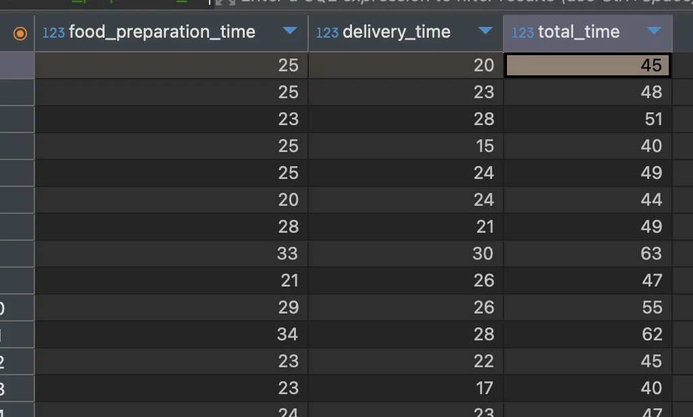
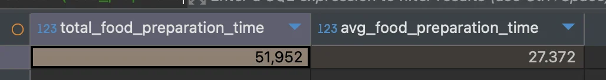
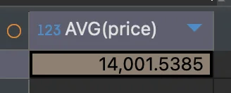

<a id="1baeda9b0fe18071ac58c897f9fe0c03"></a>

## 집계 함수 ( 계산 )

---

<a id="10aeda9b0fe180b7816efc1bf7c681c6"></a>

### <strong><code>산술연산자</code></strong><strong> ( &#43;, &#45;, /, &#42; )</strong>

---

<a id="abadbcf49c854d1bbf6e1c2b571b62a6"></a>

<strong>기본 문법</strong>

<a id="10aeda9b0fe180a4b53ce4e61e087288"></a>

```sql
SELECT 컬럼 + 컬럼 (AS) 별칭
FROM 테이블
```

<details>
<summary>🧐 <strong>산술연산자 종류</strong></summary>

| <strong>연산자</strong> | <strong>설명</strong> |
| --- | --- |
| <strong><code>&#43;</code></strong> | 더하기 |
| <strong><code>&#45;</code></strong> | 빼기 |
| <strong><code>&#42;</code></strong> | 곱하기 |
| <strong><code>/</code></strong> | 나누기 |

</details>

<details>
<summary><strong> 예시) </strong>총 시간 구하기 &#45;  <code>음식 준비시간</code> &#43; <code>배달시간</code></summary>

> ✏️ 
> 
> <a id="1baeda9b0fe180e88c1ed83b6722a0e3"></a>
> 
> <strong>테이블</strong>&#58; <code>food&#95;oders</code>
> 
> <a id="1baeda9b0fe18072bf3cdcc334f3070f"></a>
> 
> <strong>컬럼</strong>
> 
> - 음식 준비 시간&#58; <code>food&#95;preparation&#95;time</code>
> 
> - 배달 시간&#58; <code>delivery&#95;tiem</code>

<a id="10aeda9b0fe180db8c90ddae90b1b5fc"></a>

SQL

<a id="10aeda9b0fe1800d999ede66fc1ff5d4"></a>

```sql
SELECT food_preparation_time,
			 delivery_time,
  		 food_preparation_time + delivery_time AS total_time
FROM food_orders;
```

<a id="10aeda9b0fe1804c8bfff3f614b30227"></a>

실행 결과  



</details>

<a id="10aeda9b0fe180d596c4ebeb7b5563f7"></a>

### <strong><code>합계(SUM)</code></strong>, <strong><code>평균(AVG)</code></strong>

---

<a id="10aeda9b0fe180bd9dd8eb926671155c"></a>

```sql
// 합계
SUM(컬럼)

// 평균
AVG(평균)
```

<details>
<summary>예시) 음식 준비 시간 &#45; 합계, 평균</summary>

> ✏️ 
> 
> <a id="1baeda9b0fe18091bbe6fad8afffe68e"></a>
> 
> <strong>테이블</strong>&#58; <code>food&#95;oders</code>
> 
> <a id="1baeda9b0fe180c9a72cf93e245afd1f"></a>
> 
> <strong>컬럼&#58; </strong><code>food&#95;preparation&#95;time</code> ( 음식 준비 시간 )
> 
> <a id="1baeda9b0fe180cba696f417e99c9c4a"></a>
> 
> → 합계, 평균 구하기

<a id="1baeda9b0fe180e8a81dccad3aeff966"></a>

SQL

<a id="09aa6699eb014fc7bf6907ecc8befb77"></a>

```sql
SELECT SUM(food_preparation_time) total_food_preparation_time,
       AVG(food_preparation_time) avg_food_preparation_time
FROM food_orders
```

<a id="10aeda9b0fe180438e20c304ecdbd6ed"></a>

<strong>실행 결과</strong>



</details>

<a id="10aeda9b0fe180ec9ebdda8fd1969860"></a>

### <strong><code>데이터 갯수(COUNT)</code></strong>

---

<a id="1baeda9b0fe1804e8f11f72e71fd10bb"></a>

<strong>기본 문법</strong>

<a id="579ef9c2b8c849279791bb5dc81835a9"></a>

```sql
COUNT(컬럼) * 컬럼명 대신 1 혹은 * 사용 가능
```

<details>
<summary>🧐 DISTINCT</summary>

- 중복된 값을 제거하고 고유한 값만 반환

- 동일한 값이 여러 번 있을 때, 1번만 카운트 함

</details>

<details>
<summary>예시) 주문(food&#95;orders) 테이블의 <strong><u>전체 주문 건수</u></strong>와, <strong><u>주문한 고객 수</u></strong> 구하기 </summary>

> ✏️ 
> 
> <a id="1baeda9b0fe1801496a4e922e4ca7687"></a>
> 
> <strong>테이블</strong>&#58; <code>food&#95;oders</code>
> 
> <a id="1baeda9b0fe1800ea595f1f6534a4395"></a>
> 
> <strong>컬럼&#58; </strong><code>customer&#95;id</code> ( 고객 아이디 ) 
> 
> <a id="10aeda9b0fe180199d7ffdcc12e901c3"></a>
> 
> <strong>주문한 고객 수</strong>
> 
> - 한 고객이 여러 번 중복으로 주문 가능하다&#46;
> 
> - 따라서  <code>distinct</code> 키워드를 사용하여 <strong><u>중복된 고객들은 1번만 카운트</u></strong> 되도록 처리한다&#46; 

<a id="1baeda9b0fe18043a1fcec80763eeb62"></a>

<strong>SQL</strong>

<a id="10aeda9b0fe180239e83fd7769b24dfc"></a>

```sql
SELECT COUNT(1) count_of_orders,
       COUNT(DISTINCT customer_id) count_of_customers
FROM food_orders;
```

- 전체 주문 개수를 파악하기 위해서는 주문 테이블의 전체 컬럼 수를 구하면 된다&#46;

- 고객의 경우, 여러 번 주문이 가능하기 때문에 <code>distinct</code> 키워드를 사용하여 중복된 경우 카운팅 되지 않게 처리한다&#46; 

<a id="2cc173ce65f64a6495b8d470c099ddff"></a>

<strong>실행 결과</strong>


</details>

<a id="fb1c69b0c2554a6bbe8174127a9223d7"></a>

### <strong><code>최솟값(MIN)</code></strong>, <strong><code>최댓값(MAX)</code></strong>

<a id="10aeda9b0fe180118715e2a4b28c43bc"></a>

```sql
// 최솟값
MIN(컬럼)

// 최댓값 
MAX(컬럼)
```

<details>
<summary>예시) 주문 테이블의 가격 컬럼의 최솟값, 최댓값 구하기 </summary>

> ✏️ 
> 
> <a id="1baeda9b0fe1808e8a38c3cf8aa50efa"></a>
> 
> <strong>테이블</strong>&#58; <code>food&#95;oders</code>
> 
> <a id="1baeda9b0fe180118132f3437dcc5e3f"></a>
> 
> <strong>컬럼&#58; </strong><code>price</code> ( 가격)

<a id="1baeda9b0fe180bd9e64db3d2f382e1d"></a>

<strong>SQL</strong>

<a id="10aeda9b0fe180bbbfa6fde8d7af9411"></a>

```sql
SELECT MIN(price) min_price,
       MAX(price) max_price
FROM food_orders;
```

<a id="1baeda9b0fe18034b9a7d26025b52926"></a>

<strong>실행 결과</strong>


</details>

<a id="10aeda9b0fe180e6a624f183c2995a46"></a>

### &#91; 실습 &#93; 

<details>
<summary>1&#46; 주문 금액이 30,000원 이상인 주문건의 갯수 구하기 </summary>

> ✏️ 
> 
> - <strong>테이블</strong>&#58; <code>food&#95;orders</code>
> 
> - <strong>컬럼</strong>&#58; <code>order&#95;id</code> (주문 번호), <code>price</code> ( 가격 )
> 
> - <strong>조건</strong>&#58; 30,000 원 이상
> 
> - <strong>함수(수식)</strong>&#58; 카운팅 &#45; <code>COUNT()</code>

<a id="10aeda9b0fe180d4bfa4d1a118442021"></a>

<strong>SQL</strong>

<a id="913e9bf96e2c47088e7558ca0e809f9a"></a>

```sql
SELECT COUNT(1) count_of_orders
FROM food_orders
WHERE price >= 30000;
```

<a id="1baeda9b0fe18050ba15eac6b17108d6"></a>

<strong>실행 결과</strong>


</details>

<details>
<summary>2&#46; 한국 음식의 주문 당 평균 음식가격 구하기</summary>

> ✏️ 
> 
> - <strong>테이블</strong>&#58; <code>food&#95;orders</code>
> 
> - <strong>컬럼</strong>
>     - 음식 유형(나라별)&#58; <code>cuisine&#95;type</code>
> 
>     - 가격&#58; <code>price</code>
> 
>     - 주문량&#58; <code>quantity</code>
> 
> - 조건&#58; <code>한국 음식</code>
> 
> - <strong>함수(수식)</strong>&#58; 평균 가격&#45; <code>AVG()</code>

<a id="1baeda9b0fe180a1a201f9aae91b663e"></a>

<strong>SQL</strong>

<a id="1baeda9b0fe180489ed4d38533f11e0b"></a>

```sql
SELECT AVG(price)
FROM food_orders
WHERE cusine_typ = 'KOREAN'
```

<a id="1baeda9b0fe180fbb6daf06d9098abb1"></a>

<strong>실행 결과</strong>



</details>
