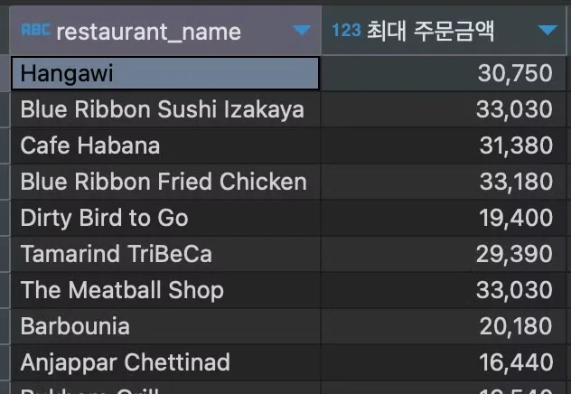

<a id="10aeda9b0fe18000a63ee23ca5b6c199"></a>

## 그룹화( <code>GROUP BY</code>) 

---

> ✏️ 
> 
> <a id="1baeda9b0fe180b3a0b7d5f971d5bffa"></a>
> 
> <strong><code>GROUP BY</code></strong>
> 
> <a id="10aeda9b0fe1809bbca4ccaee3f334a2"></a>
> 
> 테이블의 <strong><u>특정 열(컬럼)</u></strong>을 기준으로 <strong>데이터의 그룹 생성</strong>
> 
> <a id="10aeda9b0fe180c090d3e2ea02e586b1"></a>
> 
> 이때, <strong>그룹으로 묶인 데이터</strong>를 <strong><u>계산(SUM, COUNT, AVG …)</u></strong>  할 수 있다&#46;
> 
> <a id="10aeda9b0fe180d0848be886b06e4931"></a>
> 
> ```sql
> # 기본 구조
> SELECT 열1, 열2, 집계함수(열3)
> FROM 테이블명
> WHERE 조건
> GROUP BY 열1, 열2;
> ```

<a id="1baeda9b0fe180088d7de8c60984072b"></a>

### &#91; 예시 &#93;

<details>
<summary>1&#46;  학생들의 성적 학년별로 평균 내기</summary>

<a id="1baeda9b0fe1808c8c71e978cb94fe94"></a>

<strong>예시</strong>

| id | name | grade | score |
| --- | --- | --- | --- |
| 1 | A | 1 | 80 |
| 2 | B | 1 | 90 |
| 3 | C | 2 | 70 |
| 4 | D | 2 | 85 |
| 5 | E | 1 | 75 |

<a id="10aeda9b0fe180958484c683d82d4cd3"></a>

<strong>SQL</strong>

<a id="10aeda9b0fe180299388e3879ee3105e"></a>

```sql
SELECT grade, AVG(score) AS average_score
FROM students
GROUP BY grade;
```

<a id="1d3f5974797f4477bcdb0a7e75f04e3c"></a>

<strong>결과</strong>

|  |  |
| --- | --- |
| grade | average&#95;score |
| 1 | 81&#46;67 |
| 2 | 77&#46;5 |

</details>

<details>
<summary>2&#46;  직원의 부서별로 인원 수 세기</summary>

<a id="1baeda9b0fe1807ab766fa9ebdb50e19"></a>

<strong>예시</strong>

| id | name | department |
| --- | --- | --- |
| 1 | John | HR |
| 2 | Jane | IT |
| 3 | Mike | IT |
| 4 | Sara | HR |
| 5 | Tom | Sales |

<a id="10aeda9b0fe18039a5b0caf83be0ecbf"></a>

<strong>SQL</strong>

<a id="10aeda9b0fe18001a474d3639d3e3309"></a>

```sql
SELECT department, COUNT(*) AS num_of_employees
FROM employees
GROUP BY department;
```

<a id="10aeda9b0fe180c3bcd1c160d66164e9"></a>

<strong>결과</strong>

| department | num&#95;of&#95;employees |
| --- | --- |
| HR | 2 |
| IT | 2 |
| Sales | 1 |

</details>

<details>
<summary>3&#46;  음식 종류(각 나라) 별 주문 금액 합계</summary>

<a id="1baeda9b0fe1801bbdabf6de16ace844"></a>

<strong>SQL</strong>

<a id="ec31e90d1e3b4e0698c4a030c21f9d75"></a>

```sql
SELECT cuisine_type, SUM(price) as sum_price
FROM food_orders
GROUP BY cuisine_type;
```

<a id="10aeda9b0fe18088959ac02c284f3d25"></a>

<strong>결과</strong>


</details>

<a id="10aeda9b0fe180fe8a31e62b02a970c1"></a>

### &#91; 실습 &#93; 

<details>
<summary>1&#46; 음식점별로 주문 금액 최댓값 조회하기 </summary>

> 💬 
> 
> <a id="1d9eda9b0fe180f4a8c7f7324a030609"></a>
> 
> 1&#46; 어떤 테이블에서 데이터를 뽑을 것인가 
> 
> - 주문 테이블&#58; <code>from food&#95;orders</code>
> 
> <a id="1d9eda9b0fe1803e983bde04979df5a2"></a>
> 
> 2&#46; 어떤 컬럼을 이용할 것인가
> 
> - 음식점 이름, 가격&#58; <code>restarant&#95;name</code>, <code>price</code>
> 
> <a id="1d9eda9b0fe18035b24fc16dcb1fdbf2"></a>
> 
> 3&#46; 어떤 함수 (수식) 을 사용할 것인가?
> 
> - 최댓값, 컬럼 For문&#58; MAX, group by

<a id="1baeda9b0fe180f88cb5e89b0f31a169"></a>

<strong>SQL</strong>

<a id="10aeda9b0fe180fda17be26990b0f000"></a>

```sql
SELECT restaurant_name, MAX(price) as '최대금액'
FROM food_orders
GROUP BY restaurant_name;
```

<a id="10aeda9b0fe1808c8666c7a5e0339eb0"></a>

<strong>실행 결과</strong>



</details>

<details>
<summary>2&#46; 결제 타입별 가장  최근 결제일 조회하기 </summary>

> 💬 
> 
> <a id="1d9eda9b0fe180bb9c7fe330583bc701"></a>
> 
> 1&#46; 어떤 테이블에서 데이터를 뽑을 것인가 
> 
> - 결제 테이블&#58; <code>from payments</code>
> 
> <a id="1d9eda9b0fe1802a9dc2ef1949d7ed7d"></a>
> 
> 2&#46; 어떤 컬럼을 이용할 것인가
> 
> - 결제 타입, 결제일, 결제 시간&#58; <code>pay&#95;type</code>, <code>date</code>
> 
> <a id="1d9eda9b0fe180a0ac66e9cec880564b"></a>
> 
> 3&#46; 어떤 함수 (수식) 을 사용할 것인가?
> 
> - 최솟값, 컬럼 for문&#58; <code>min(컬럼)</code>, <code>group by 컬럼</code>

<a id="7c553ef833d3478db9424a0dcc917f8a"></a>

<strong>SQL</strong>

<a id="8bf0c8646e004611a344a7c291d117c1"></a>

```sql
SELECT pay_type, MIN(date) as '최근_결제일'
FROM payments
GROUP BY pay_type;
```

<a id="1baeda9b0fe18087814be1ced8b3a17f"></a>

실행 결과


</details>
