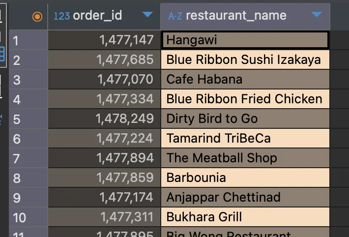
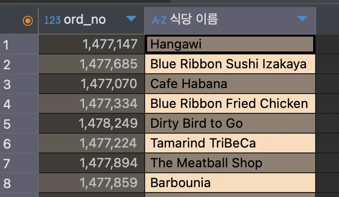
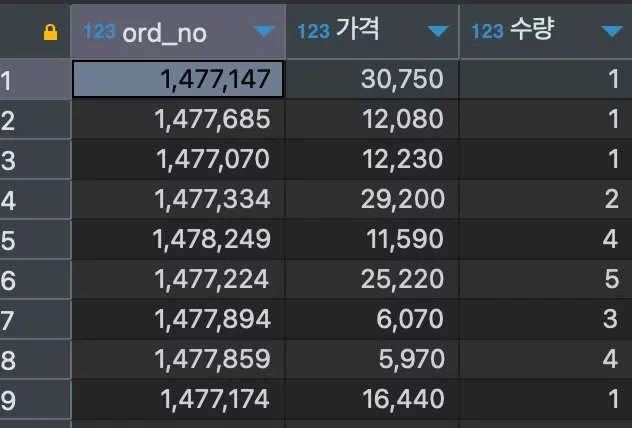
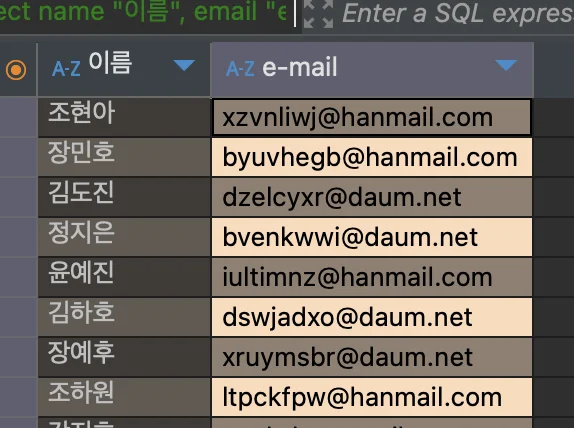

<a id="1baeda9b0fe1803fb215d6d1e0563c6d"></a>

## <strong>필요한 컬럼(항목)들을  지정하여  조회,  별명(alias)</strong>

---

<a id="109eda9b0fe180e69249c685df1ef8ae"></a>

### 테이블에서 컬럼(들)을 지정하여 조회 ( 중복 선택 가능 )

<a id="109eda9b0fe18088a36ad8aa9dfe8bb1"></a>

```sql
select 컬럼1, 컬럼2
from 테이블
```

<details>
<summary>ex)  컬럼들 지정하여 조회</summary>

<a id="10aeda9b0fe18019a71de64ae4013d7b"></a>

```sql
select order_id, restaurant_name
from food_orders
```

<a id="a5d9279ca35f428d82de994ccb224df5"></a>

아래와 같이 <code>order&#95;id</code>, <code>restaurant&#95;name</code> 컬럼만을 조회



</details>

<a id="10aeda9b0fe1806aa073f0ae491e2a68"></a>

### 별칭 ( <code>alias</code> )&#58; 컬럼명 재할당

- <strong>기본 사용</strong>
    <a id="ad98aec3ba22408a882062a29a3eb73c"></a>

    ```sql
    # 방법1
    컬럼1 as 별명1

    # 방법2: as 생략
    컬럼2 별명2
    ```

- <strong>유의사항</strong>
    | <strong>구분</strong> | <strong>영문, 언더바</strong> | <strong>특수문자, 한글</strong> |
    | --- | --- | --- |
    | <strong>방법</strong> | 별명만 적음 | <code>“별명”</code> 으로, <strong><code>큰 따옴표</code></strong> 안에 적어줌 |
    | <strong>예시</strong> | <code>ord&#95;no</code> | <code>“ord no”</code> |

- 예시
    <a id="10aeda9b0fe180c9a730d3d4803aed69"></a>

    ```sql
    select order_id as ord_no,
           restaurant_name "식당 이름"
    from food_orders
    ```

    <a id="10aeda9b0fe18027a611eea2585ca659"></a>

    아래와 같이 컬럼명이 변경되는 것을 확인 가능하다&#46; 

    

<a id="10aeda9b0fe1805aa981d889e874fa19"></a>

### &#91; 실습 &#93;  특정 컬럼 <code>별칭</code>(<code>Alias</code>) 붙여서 조회하기

<details>
<summary>1&#46; 주문(food&#95;orders)테이블에서 <code>order&#95;id</code>, <code>price</code>, <code>quantity</code> 컬럼 조회 및 컬럼명 수정하기</summary>

> ✏️ 
> 
> <a id="1baeda9b0fe180319c4bd9ee058ad2f2"></a>
> 
> <strong>테이블&#58; </strong><code>food&#95;orders</code>
> 
> <a id="1baeda9b0fe18019aa6edd3bb04b040b"></a>
> 
> <strong>조회할 컬럼</strong>
> 
> - <code>order&#95;id</code>, <code>price</code>, <code>quantity</code>
> 
> <a id="1baeda9b0fe18036b97efe61fae2490e"></a>
> 
> <strong>별명(alias)</strong>
> 
> - order&#95;id  → <code>ord&#95;no</code>
> 
> - price → <code>가격</code>
> 
> - quantity  → <code>수량</code>

- <strong>SQL Query</strong>
    <a id="e088a8cbb4a447c48eb87815a1716fb1"></a>

    ```sql
    select order_id ord_no,
           price "가격",
           quantity "수량"
    from food_orders
    ```

- <strong>실행 결과</strong>
    

</details>

<details>
<summary>2&#46; 고객(<code>customers</code>) 테이블에서 <code>name</code>, <code>email</code> 컬럼 조회 및 컬럼명 수정하기 </summary>

> ✏️ 
> 
> <a id="1baeda9b0fe18014a8bde434089075f3"></a>
> 
> <strong>테이블</strong>&#58; <code>customers(고객)</code>
> 
> <a id="1baeda9b0fe180ebafc0ce3c91618249"></a>
> 
> <strong>컬럼</strong>&#58; <code>name</code>, <code>email</code>
> 
> <a id="1baeda9b0fe1800ba9aacb0eb4b4dcf0"></a>
> 
> <strong>별명(alias)</strong>
> 
> - name → <code>이름</code>
> 
> - email → <code>e&#45;mail</code>

- <strong>SQL Query</strong>
    >  <code>“”</code> 안에 재할당되는 이름 작성  

    <a id="10aeda9b0fe18063bc6ee4240d512650"></a>

    ```sql
    select name "이름",
           email "e-mail"
    from customers
    ```

- <strong>실행결과</strong>
    

</details>
