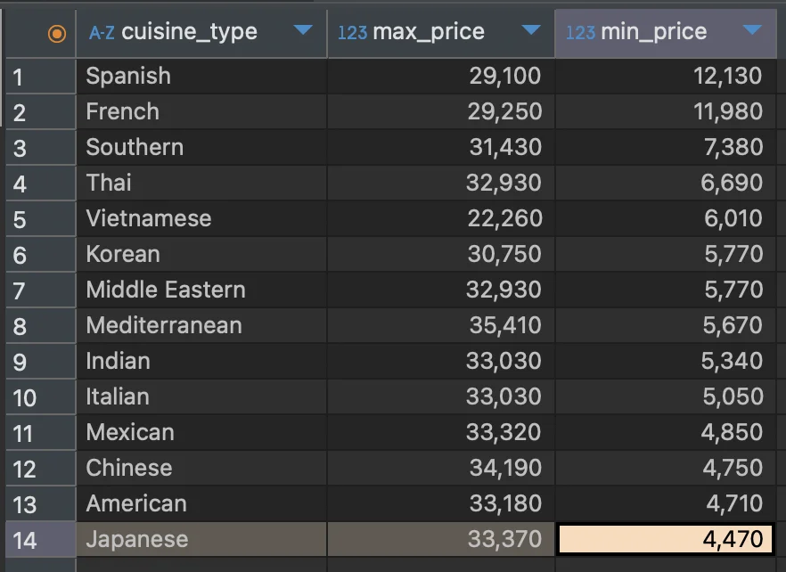

<a id="10ceda9b0fe180e79090d9a39cfdbcd5"></a>

### &#91; 숙제 &#93; 음식 종류별 가장 높은 주문 금액과 가장 낮은 주문금액을 조회하고, 가장 낮은 주문금액 순으로 내림차순 정렬하기

---

<details>
<summary>1&#46; 어떤 테이블에서 데이터를 뽑을 것인가 </summary>

- 주문 테이블&#58; <code>from food&#95;orders</code>

</details>

<details>
<summary>2&#46; 어떤 컬럼을 이용할 것인가</summary>

- 음식 종류(나라별), 가격&#58; <code>cuisine&#95;type</code>, <code>price</code>

</details>

<details>
<summary>3&#46; 어떤 함수 (수식) 을 이용해야 하는가</summary>

- 최대, 최소, group by, order by desc<br>

</details>

> ✏️ 
> 
> - 테이블&#58; <code>food&#95;orders</code>
> 
> - 컬럼
>     - 음식 유형(국가 별)&#58; <code>cuisine&#95;type</code>
> 
>     - 가격&#58; <code>price</code>
> 
> - 그룹&#58; <code>cuisine&#95;type</code>
> 
> - 정렬&#58; <code>MIN(price)</code>, 내림차순 

<a id="1baeda9b0fe1808e9218d69a95a0214e"></a>

<strong>SQL</strong>

<a id="1a77a2375a6a4297b822ad7fe123c6d2"></a>

```sql
SELECT cuisine_type, 
			 MAX(price) as 'max_price',
			 MIN(price) as 'min_price'
FROM food_orders
GROUP BY cuisine_type
ORDER BY MIN(price) DESC; 
```

<a id="1baeda9b0fe180128e7af65d9c1bae35"></a>

<br><strong>실행 결과</strong>


