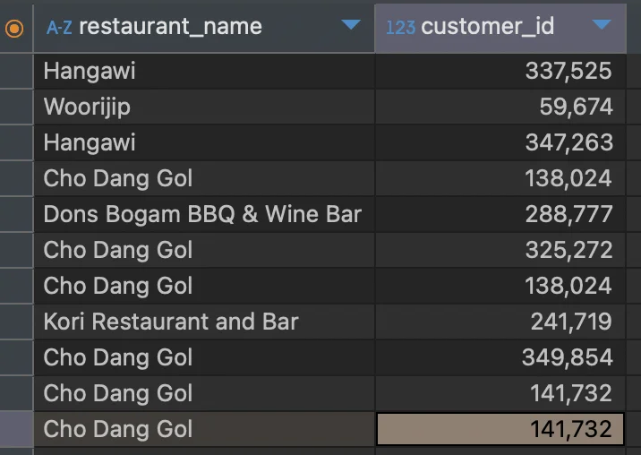

<a id="10aeda9b0fe180499bb1ebf0cd26cff3"></a>

## &#91; 숙제 &#93; <strong>상품 준비시간이 20&#126;30분 사이인, 한국음식점의 식당명과 고객번호 조회</strong>

---

> ✏️ 
> 
> <a id="1baeda9b0fe180f08238c7cfd6140ed9"></a>
> 
> <strong>테이블</strong>&#58; <code>food&#95;orders</code>
> 
> <a id="1baeda9b0fe1808fa91ee062d73c92fe"></a>
> 
> <strong>컬럼</strong>
> 
> - 식당명&#58; <code>restaurant&#95;name</code>
> 
> - 고객번호&#58; <code>customer&#95;id</code>
> 
> - 상품 준비 시간&#58; <code>food&#95;preparation&#95;time</code>
> 
> - 나라&#58; <code>cuisine&#95;type</code>
> 
> <a id="1baeda9b0fe18023a7ebc9cf30df2240"></a>
> 
> <strong>조건</strong>
> 
> - 상품 준비시간 20 &#126; 30 분 사이
> 
> - 한국 음식점

<a id="e8f695af820c4805be6288a2d9bec57d"></a>

<strong>SQL</strong>

<a id="10aeda9b0fe180538074dd4626a714fc"></a>

```sql
select restaurant_name, customer_id
from food_orders
WHERE food_preparation_time BETWEEN 20 AND 30  # 조건1: 상품 준비 시간 20 ~ 30분 사이
	AND cuisine_type ="KOREAN"; # 조건2: 한국 음식점
```

<a id="10aeda9b0fe180988573d07b2d6c2c3f"></a>

<strong>실행 결과</strong>



<a id="10aeda9b0fe180d19cdbe33cff2f3f1d"></a>
