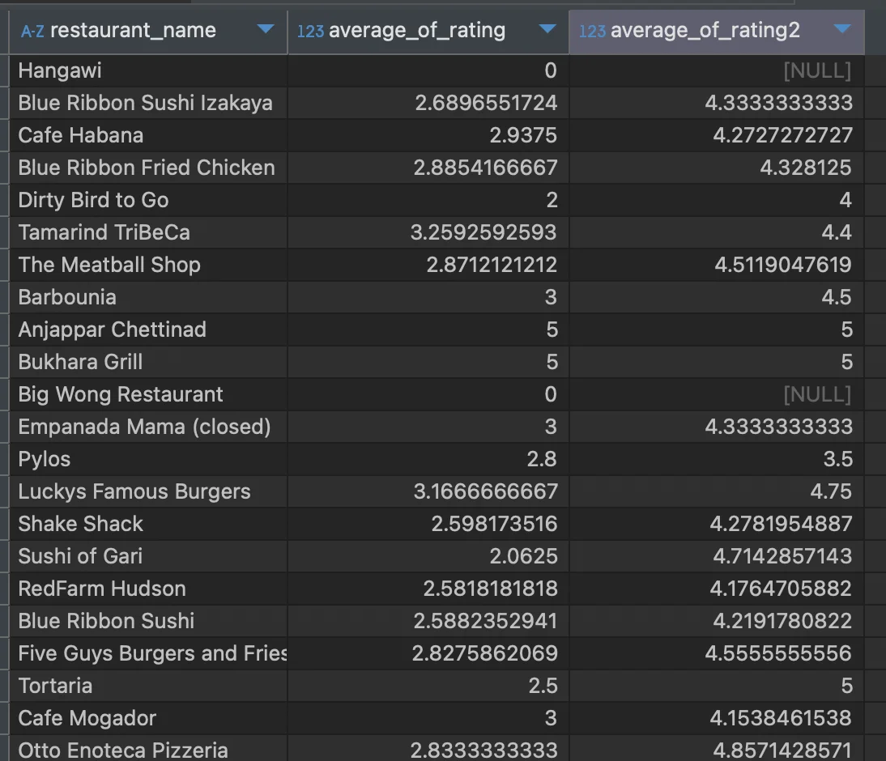
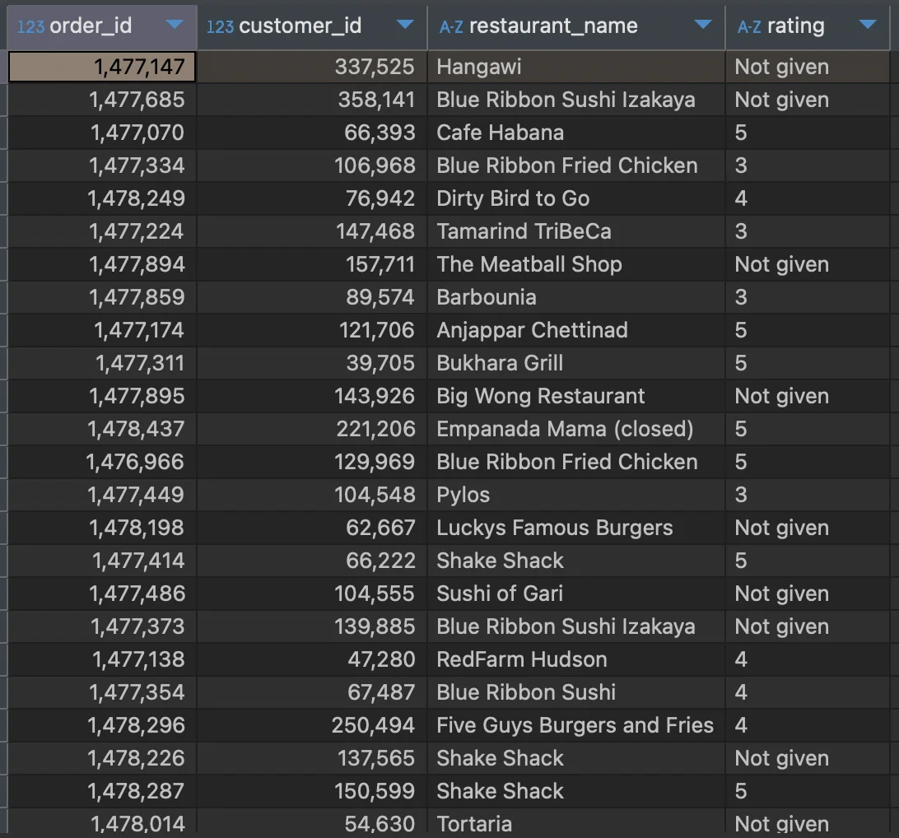
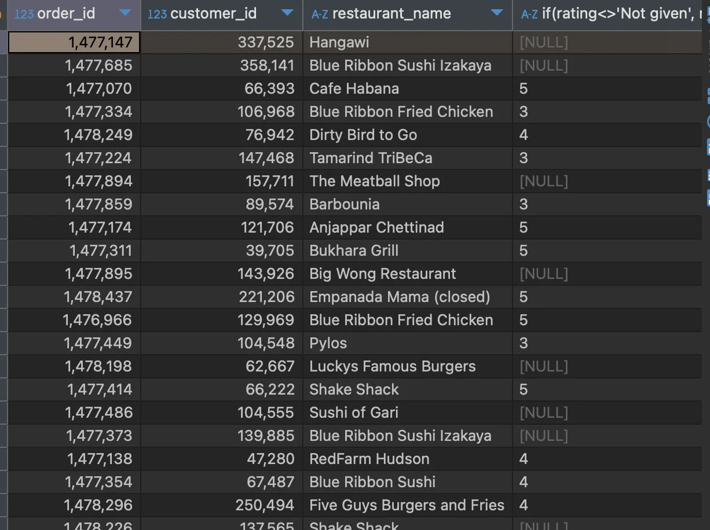
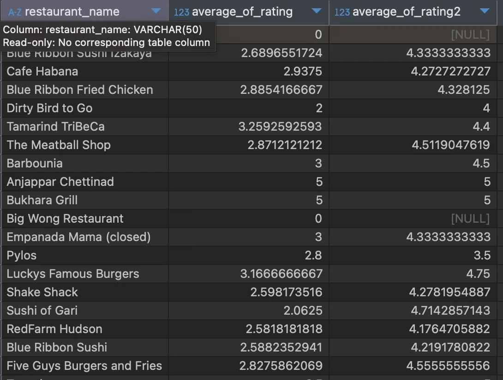
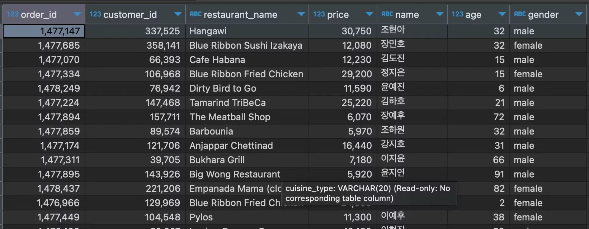
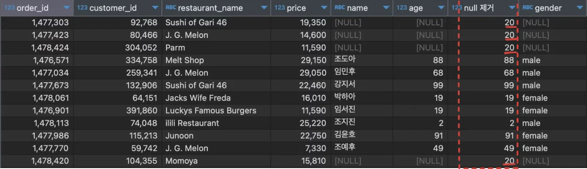

<a id="10feda9b0fe180e2addafa187fab8ff4"></a>

### 레코드에 데이터가 없는 경우 (<code>Not given</code> )

<a id="10feda9b0fe180c0bb16c0a2d96cee42"></a>

1) 값이 없는 경우 필터링(제외)

<details>
<summary>1&#45;1&#46;  암시적 연산 처리 &#45; <code>if( &#60;&#62;, truthy, falsy)</code></summary>

<details>
<summary>🧐 rate 평균 값인 <code>average&#95;of&#95;rating</code>, <code>average&#95;of&#95;rating2</code>이 동일하지 않다&#46; </summary>



<details>
<summary>평균 값을 구하기 위한 연산 처리 시, ‘Not give’은 <code>0</code>의 값으로 인식되어 처리된다&#46; </summary>

- Mysql 에서는 사용할 수 없는 값일 때, 해당 값을 연산에서 제외하다&#46; → 0으로 간주
    

</details>

<details>
<summary>MySQL <code>null</code> 값을 제외하여 평균값을 구한다&#46; <br>따라서 <code>average&#95;of&#95;rating2</code> 의 평균 값 연산 처리 시 <code>null</code> 데이터는 제외하여 연산을 한다&#46; </summary>

- <strong>‘Not given’</strong> → <code>null</code> 
    <a id="110eda9b0fe180f5bc12f22ba4749b33"></a>

    ```sql
    if(rating<>'Not given', rating, null)
    ```



</details>

</details>

- 🧐 <code>&#60;&#62;</code> = <code>≠</code>

<a id="110eda9b0fe1803a8512d3e8ccfd5c8a"></a>

<strong>SQL Query</strong>

<a id="10feda9b0fe180dc9d9bf21101791325"></a>

```sql
select restaurant_name,
       avg(rating) average_of_rating,
       avg(if(rating<>'Not given', rating, null)) average_of_rating2
from food_orders
group by 1
```



</details>

<details>
<summary>1&#45;2&#46; 명확한 연산 처리 &#45;  <u><code>is not</code></u><code> null</code></summary>

<a id="10feda9b0fe180d49afbe118b455dfa6"></a>

```sql
select a.order_id,
       a.customer_id,
       a.restaurant_name,
       a.price,
       b.name,
       b.age,
       b.gender
from food_orders a left join customers b on a.customer_id=b.customer_id
where b.customer_id is not null 
```

- null 제거를 하지 않았을 때
    

- null 제거를 했을 때 (join 시에는 inner join 과 동일함) 
    

</details>

<details>
<summary>1&#45;3&#46; <code>inner join</code> </summary>

> <strong>lef join</strong> &#43;<strong> is not </strong><strong><code>null</code></strong>  = inner join 

</details>

<a id="10feda9b0fe18045a224e2d4129c4ee4"></a>

2) 값이 없는 경우 ‘특정 값’으로 대체&#58; <code>coalesce</code>

<a id="10feda9b0fe180c89617e7f34ba0e945"></a>

```sql
coalesce(age, 대체값)  // age = null
```

<a id="10feda9b0fe1809fad96ca8139511fc2"></a>

```sql
select a.order_id,
       a.customer_id,
       a.restaurant_name,
       a.price,
       b.name,
       b.age,
       coalesce(b.age, 20) "null 제거",
       b.gender
from food_orders a left join customers b on a.customer_id=b.customer_id
where b.age is null
```


