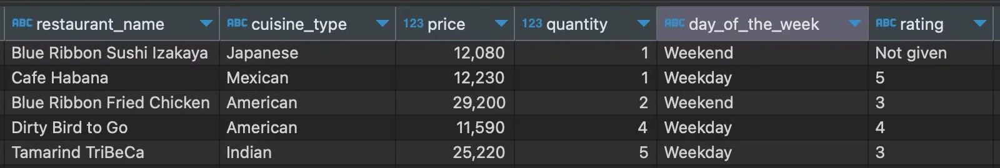

<a id="1baeda9b0fe18063a9d0eb2da117a4e0"></a>

### <strong>Data Type 오류 해결 </strong>

<details>
<summary>형변환 ( <code>cast( … as 타입)</code>)</summary>

<a id="1baeda9b0fe1809780b3c7d99ebaa677"></a>

```sql
--숫자 형변환
cast(값 as decimal) 

--문자 형변환
cast(값 as char))
```

<details>
<summary>ex) 형변환( <code>cast()</code> )</summary>

- rating&#58; 문자 타입  → <code>ABC</code>
    

<a id="1baeda9b0fe1803393d8f089c2096ab6"></a>

```sql
--숫자로 변경
cast(if(rating='Not given', '1', rating) as decimal) 

--문자로 변경
concat(restaurant_name, '-', cast(order_id as char))
```

</details>

</details>
