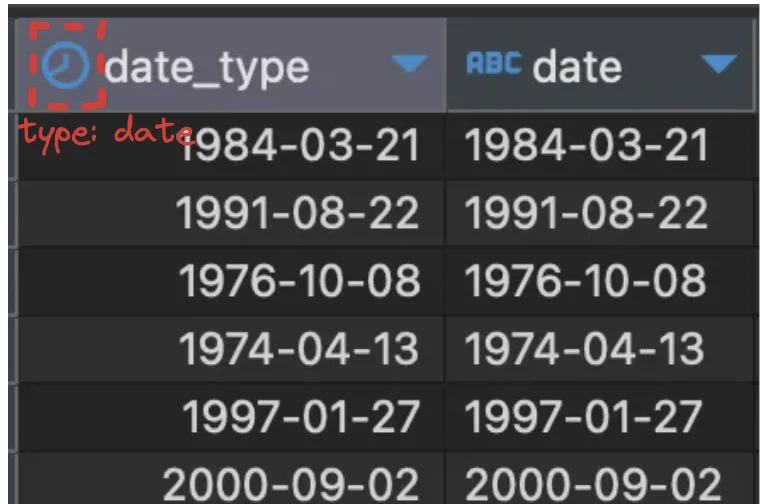
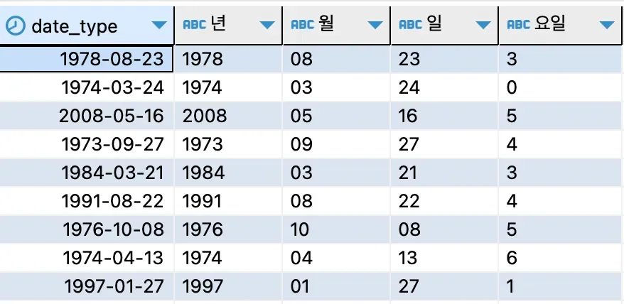
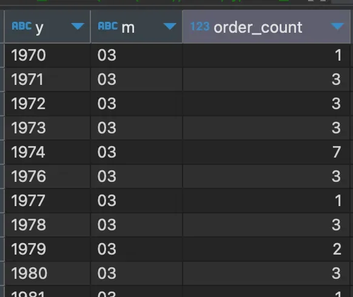

<a id="10feda9b0fe1803b91c6e8a32b8a8991"></a>

### 날짜 포맷, 조건 한번의 SQL로 끝내기 (<code>포맷 함수</code>)

> 💡 
> 
> <a id="2f256a9e59274ee497aaa8b6b3a78fbb"></a>
> 
> SQL 연산은 숫자, 문자 외 <strong><u>날짜</u></strong>까지 연산 처리가 가능하다&#46; 

<details>
<summary>날짜 데이터 </summary>

<a id="110eda9b0fe180e0aad2f33c21467978"></a>

‘문자 타입’, ‘숫자 타입’ 과 같이 날짜 데이터도 <strong><u>특정한 타입</u></strong>을 가지고 있다&#46; 

- 년, 월, 일, 시, 분, 초 … 

- 목적에 따라 ‘월’, ‘주’, ‘일’ 등으로 포맷을 변경

</details>

---

<details>
<summary>&#91; 실습 &#93; </summary>

<details>
<summary>1&#46; 날짜 데이터의 여러 포맷</summary>

<details>
<summary>1&#46; yyyy&#45;mm&#45;dd 형식의 컬럼을 date type 으로 변경하기</summary>

<a id="110eda9b0fe180789e69d0875dee277e"></a>

```sql
select date(date) date_type,
       date
from payments
```



</details>

<details>
<summary>2&#46; date type 을 <code>date&#95;format()</code> 을 이용하여 <strong><u>년, 월, 일, 주</u></strong> 로 조회</summary>

- 년&#58; <code>Y</code>(4자리), <code>y</code>(2자리)

- 월&#58; <code>M</code>, <code>m</code>

- 일&#58; <code>d</code>, <code>e</code>

- 요일&#58; <code>w</code>

<details>
<summary>ex) 날짜 예시 </summary>

<a id="110eda9b0fe18053af91f97d301483f3"></a>

```sql
select date(date) date_type,
       date_format(date(date), '%Y') "년",
       date_format(date(date), '%m') "월",
       date_format(date(date), '%d') "일",
       date_format(date(date), '%w') "요일"
from payments
```



</details>

</details>

</details>

<details>
<summary>2&#46; 3월에 주문한 주문건수 연도별로 오름차순으로 구하기 </summary>

<details>
<summary>1&#46; &#91; 년, 월 &#93; 포함한 데이터로 가공</summary>

<a id="110eda9b0fe180fbb18be2fdae7a5fee"></a>

```sql
select date_format(date(date), '%Y') y,
       date_format(date(date), '%m') m,
       order_id
from food_orders a inner join payments b on a.order_id=b.order_id
```

</details>

<details>
<summary>2&#46; &#91; 년, 월 &#93; 별 주문건수 구하기 </summary>

<a id="77c8cfc65e4b4b2cb6637cb606e7962f"></a>

```sql
select date_format(date(date), '%Y') y,
       date_format(date(date), '%m') m,
       count(1) order_count
from food_orders a inner join payments b on a.order_id=b.order_id
group by 1, 2
```

</details>

<details>
<summary>3&#46; 3월 조건으로 지정하고, 년도별로 정렬하기 </summary>

<a id="c19082570f52409fbeb534f3288feb08"></a>

```sql
select date_format(date(date), '%Y') y,
       date_format(date(date), '%m') m,
       count(1) order_count
from food_orders a inner join payments b on a.order_id=b.order_id
where date_format(date(date), '%m')='03'
group by 1, 2
order by 1
```



</details>

</details>

</details>
