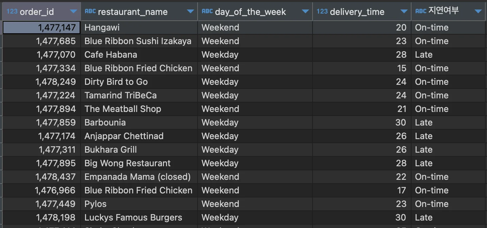

<a id="10beda9b0fe1805980b6c8793edbef0b"></a>

### <strong>&#91; </strong><strong>숙제</strong><strong> &#93; </strong>배달시간이 늦었는지 판단

---

> ✏️ 
> 
> <a id="1baeda9b0fe180829cedfa1d15218de8"></a>
> 
> 배달 늦음
> 
> - 주중&#58; <code>25분 이상</code>
> 
> - 주말&#58; <code>30분 이상</code>

<a id="10beda9b0fe1807586d6e2103d7efd0f"></a>

<strong>SQL Quey</strong>

<a id="10beda9b0fe1803097e5e59e6f3c9d41"></a>

```sql
SELECT order_id,
			 restaurant_name,
		   day_of_the_week,
		   delivery_time,
		   case 
				    when day_of_the_week='weekday' And delivery_time >=25 then 'Late'
			 			when day_of_the_week='weekend' And delivery_time >=30 then 'Late'
			 			else 'On-time'
		   end "지연여부"
FROM food_orders;
```

<a id="10beda9b0fe18046bd20f3cc163d99a9"></a>

<strong>실행 결과</strong>


