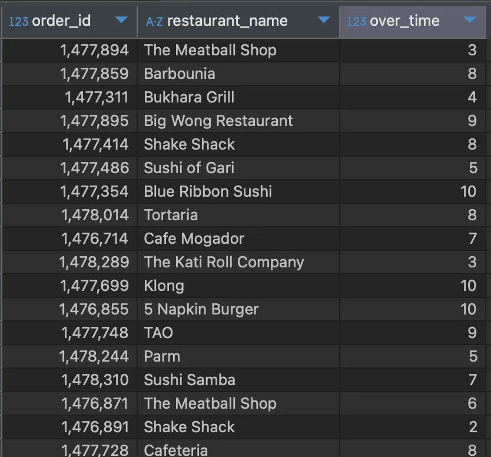
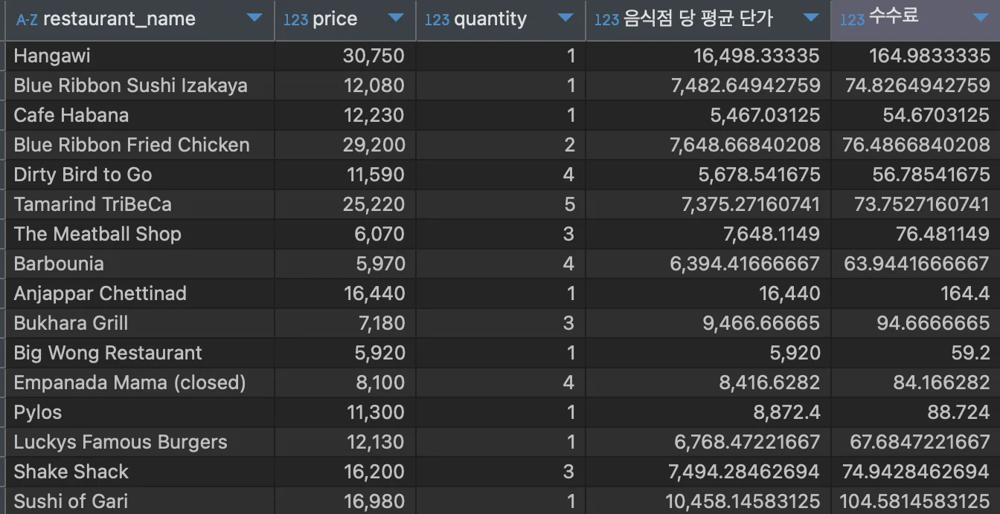
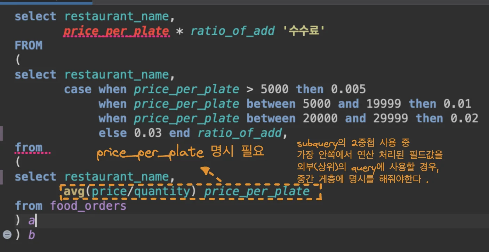
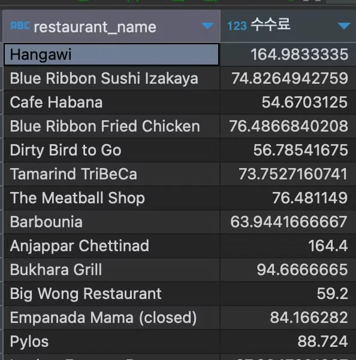
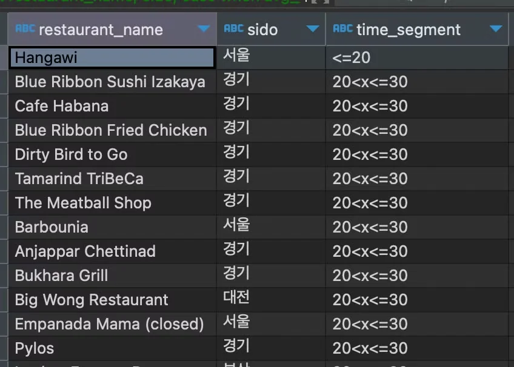
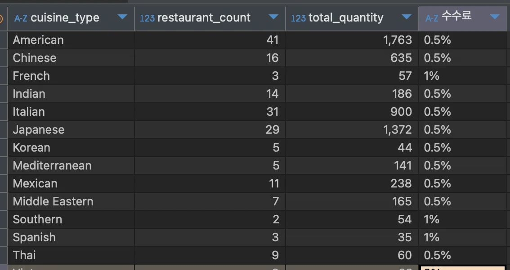
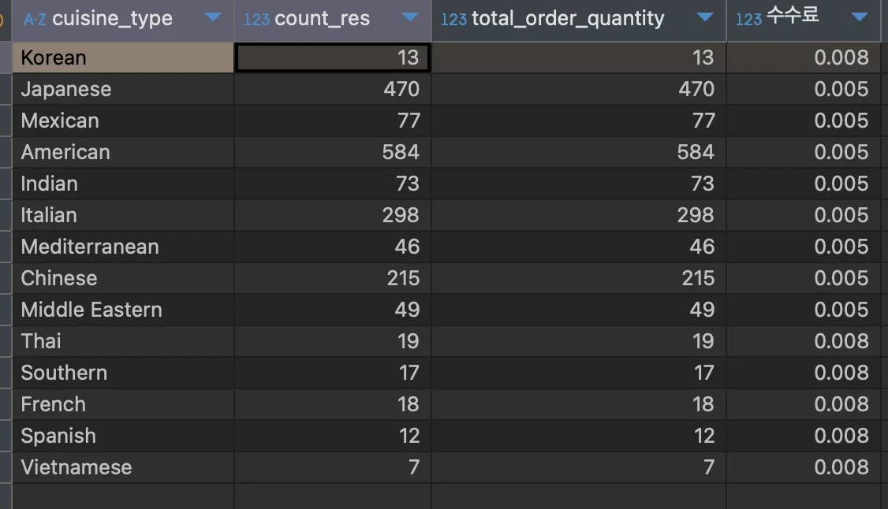
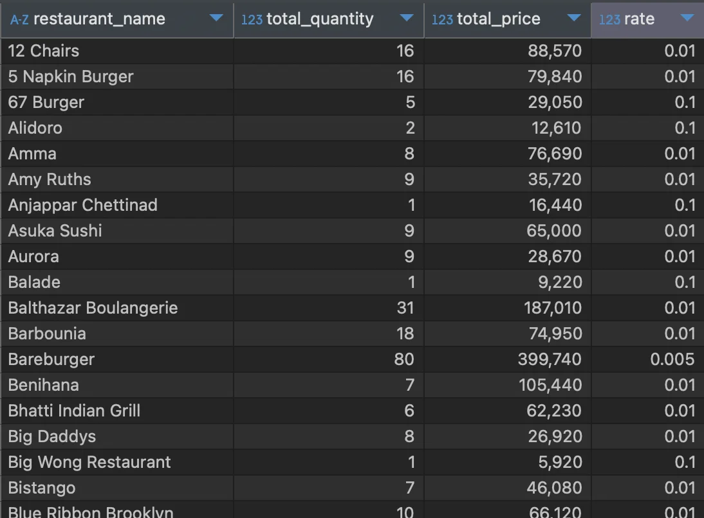
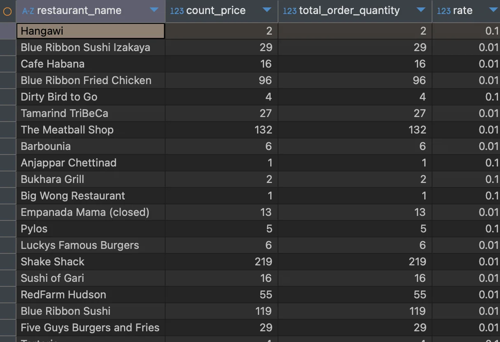
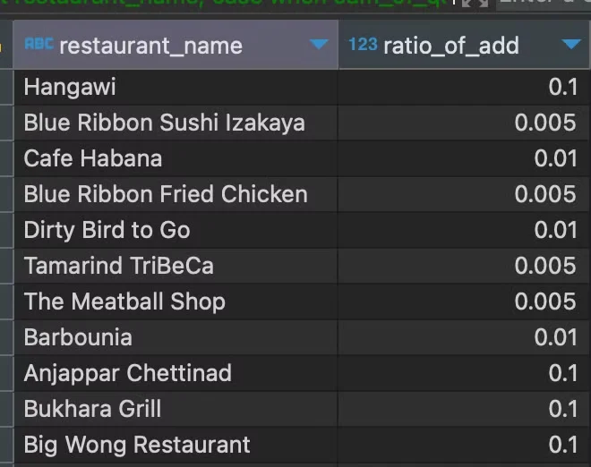

<a id="10beda9b0fe18073bf2acc7d0ea70cb7"></a>

### 쿼리 합치기, 여러 번의 연산 <strong><u>한 번의 쿼리</u></strong>로 수행 ( <code>subquery</code> )

<details>
<summary>사용 예시’</summary>

<details>
<summary>1) 여러 번의 연산 수행</summary>

> /icons/checkmark-line_lightgray.svg 수수료를 부과할 수 있는 시간 구하기<br>구해진 시간에 주문 금액별로 가중치 주기<br>가중치를 적용한 결과로 최종 예상 배달비 계산

<details>
<summary>수수료 계산</summary>

-  시간 
    - 25분 초과하면 음식 가격의 5%

    - 30분 초과하면 음식 가격의 10%

- 금액
    - 9500 미만 → 배달 불가

    - 9500 이상 → 배달 수수료&#58; 3500

    - 50000 이상 → 무료 

<a id="92f460b0207342bfa6ad04c5da1eec62"></a>

⇒ 최종 배달비 계산

</details>

<details>
<summary>SQL Query</summary>

<a id="e15242418b3b47cb9ce84bdd9df0d07f"></a>

```sql

```

</details>

</details>

<details>
<summary>2) 조건문에 연산 결과 사용</summary>

> /icons/checkmark-line_lightgray.svg 음식 타입별 평균 음식 주문금액 따라 음식비 상/중/하 를 나누고 싶을 때

</details>

<details>
<summary>3) 조건에 Query 결과 사용</summary>

> /icons/checkmark-line_lightgray.svg 30대 이상이 주문한 결과만 조회하고 싶을 때

</details>

</details>

<details>
<summary><strong><code>subquery</code></strong> 기본 구조</summary>

- 여러번의 연산 수행
    <a id="d5ec990e6155482fa54dbc44e16ab0ea"></a>

    ```sql
    select column1, special_column
    from
    ( /* subquery */
    select column1, column2 special_column
    from table1
    ) a
    ```

    <a id="110eda9b0fe18004aa34c4621d2223f7"></a>

    ```sql
    select column1, special_column   // 마직막(last) 연산 
    from
    ( /* subquery 1 */               // 두번째(2) 연산 수행
    select column1, column2 special_column
    from
    ( /* subquery 2 */               // 첫번째(1) 연산 수행
    select column1, column2 special_column
    from table1
    ) a
    ) a
    ```

- 조건문에 연산 결과 적용
    <a id="f47d506a53de43918a10fac141c9c1be"></a>

    ```sql
    select column1, column2
    from table1
    where column1 = (select col1 from table2)
    ```

</details>

<details>
<summary>연습해보기</summary>

<details>
<summary><strong>예시) </strong>주문시간이 25분보다 초과 시, 초과된 시간 보여주기 ( 초과되지 않은 경우는 0으로 표현)</summary>

1. <strong>주문 테이블에서 주문번호, 음식점명, 음식 준비시간 가져오기</strong>
    - <strong>select 가져올 컬럼들</strong>

    - <strong>subquery에 추가</strong>

    <a id="e491676cfac74900ac69fdc452090370"></a>

    ```sql
    select order_id, restaurant_name, food_preparation_time
    from
    (
    	select order_id, restaurant_name, food_preparation_time
    	from food_orders
    ) a
    ```

1. subquery 문 수정하여, 음식 주문시간이 25분보다 초과한 시간 가져오기
    <a id="a5a5df18082e42f89b6912264fd75e22"></a>

    ```sql
    select order_id, restaurant_name, if(over_time>=0, over_time, 0) over_time 
    from
    (
    	select order_id, restaurant_name, food_preparation_time-25 over_time
    	from food_orders
    ) a
    WHERE over_time > 0
    ```

<a id="359e22fbc5384b5997aeae7213f77608"></a>

<strong>실행 결과 </strong>



</details>

</details>

---

<details>
<summary>&#91; 실습 &#93; <code>User Segmentation</code>, <code>조건별 수수료</code>  Subquery 로 결합</summary>

<details>
<summary>1&#46; 음식점의 평균 단가별 segmentation 을 진행하고, 그룹에 따라 수수료 연산하기</summary>

> 수수료 구간

- 5000원 미만 0&#46;05%

- 20000원 미만 1%

- 30000원 미만 2%

- 30000원 초과 3%

<details>
<summary>풀이1) 중첩</summary>

- 테이블&#58; food&#95;orders

- 컬럼&#58; restaurant&#95;name, price, quantity

- 조건&#58; X

- 수식&#58; avg(price/quantity), case when, group by

<a id="e27476c496914287b93964eb61dddc23"></a>

<strong>SQL Query</strong>

<a id="ecc3e8f364884871a541edfce8c859a6"></a>

```sql
select restaurant_name, price, quantity, average_price '음식점 당 평균 단가',
	   case when average_price < 5000 then average_price * 0.005
	   		when average_price between 5000 and 19999 then average_price * 0.01
	   		when average_price between 19999 and 29999 then average_price * 0.02
	   		else average_price * 0.03
	   end '수수료'
from 
( 
	select restaurant_name, price, quantity, 
		   avg(price/quantity) as average_price 
	from food_orders
	group by restaurant_name
) a
```

<a id="8e31a50952224ef795f0350ee73c22a7"></a>

<strong>실행 결과 </strong>



</details>

<details>
<summary>강의 풀이 &#45; subquery  중첩 ( 더 직관적인 방법)</summary>

<details>
<summary>🤬 <strong>Error </strong><strong>&#45; 2중첩 사용 시 주의점</strong></summary>



</details>

<a id="48b4e32585e84cb18dff39bf3314da7b"></a>

<strong>SQL Query</strong>

<a id="b31308e19922456d990c863dcb744488"></a>

```sql
select restaurant_name,
       price_per_plate*ratio_of_add "수수료"
from 
(
select restaurant_name,
       case when price_per_plate<5000 then 0.005
            when price_per_plate between 5000 and 19999 then 0.01
            when price_per_plate between 20000 and 29999 then 0.02
            else 0.03 end ratio_of_add,
       price_per_plate
from 
(
select restaurant_name, avg(price/quantity) price_per_plate
from food_orders
group by 1
) a
) b
```

<a id="50fa6c58c7fc4693ae1d4f3cb129e680"></a>

<strong>실행 결과</strong> 



</details>

</details>

<details>
<summary>2&#46; 음식점의 지역과 평균 배달시간으로 segmentation 하기</summary>

> 예시가 애매하다&#46;&#46; 

- 테이블&#58; food&#95;orders

- 컬럼&#58; restaurant&#95;name, addr, delivery&#95;time

- 조건&#58; 

- 함수(수식)&#58; avg(delivery&#95;time), substring(addr, 1, 2), case when, group by

<a id="58c872536d3d4b97b71fc2a2054d7863"></a>

<strong>SQL Query</strong>

<a id="0ad1173db67c444588810b2d154864f2"></a>

```sql

select restaurant_name,
       sido,
       case when avg_time<=20 then '<=20'
            when avg_time>20 and avg_time <=30 then '20<x<=30'
            when avg_time>30 then '>30' end time_segment
from 
(
select restaurant_name,
       substring(addr, 1, 2) sido,
       avg(delivery_time) avg_time
from food_orders
group by 1, 2
) a
```

<a id="25cd0caf72694370ba31c7ec3028c2ac"></a>

<strong>실행 결과 </strong>



</details>

</details>

<details>
<summary>&#91; 실습 &#93; <code>복잡한 연산</code> Subquery로 수행</summary>

<details>
<summary>1&#46; 음식 타입(지역)별 총 주문수량과 음식점 수를 연산하고, 주문수량과 음식점수 별 수수료율을 산정하기   </summary>

<details>
<summary>수수료 계산</summary>

- 음식점수 5개 이상, 주문수 30개 이상 → 수수료 0&#46;5%

-  음식점수 5개 이상, 주문수 30개 미만 → 수수료 0&#46;8%

-  음식점수 5개 미만, 주문수 30개 이상 → 수수료 1%

-  음식점수 5개 미만, 주문수 30개 미만 → 수수로 2%

</details>

<details>
<summary>내 풀이  (강의 풀이 로직 동일)&#92;</summary>

> 🧐 문제의 조건이 명확하지 않다&#46;<br>→ 주문 수량의 구분 기준이 ‘지역’인지, ‘식당’인지 명확치 않다&#46; <br>⇒  ‘지역’별로 구분하여 계산

- 테이블&#58; food&#95;orders

- 컬럼&#58; cuisine&#95;type, quantity, 

- 조건&#58;

- 함수(수식)&#58; count,  case when, group by

<a id="0076257476f046a993a6c264ee222e4d"></a>

<strong>SQL Query</strong>

<a id="83d94618549b4ccc99647b83c12de3a3"></a>

```sql
SELECT cuisine_type,
	   restaurant_count,
	   total_quantity,
	   case when restaurant_count >= 5 and total_quantity >= 30 then '0.5%'
			when restaurant_count >= 5 and total_quantity < 30 then '0.8%'
			when restaurant_count < 5 and total_quantity >= 30 then '1%'
			when restaurant_count < 5 and total_quantity < 30 then '2%'
	   end '수수료'
from (
	select cuisine_type,
	   SUM(quantity) total_quantity,
	   COUNT(distinct restaurant_name) restaurant_count
	from food_orders
	group by cuisine_type
) a
```

<a id="ffd2adde41c044cd8d8eb1127f49bb3a"></a>

<strong>실행 결과</strong>



</details>

<details>
<summary>풀이2) 2중첩 </summary>

- 2중첩으로 깔끔하게 출력 필드만 설정

<a id="10feda9b0fe1807f9ca8e9f2dcd8e2b2"></a>

```sql
SELECT cuisine_type,
	   count_res,
	   total_order_quantity,
	   ratio_of_add
FROM 
(
SELECT cuisine_type,
	   count_res,
	   total_order_quantity,
	   case when count_res >= 5 and total_order_quantity >= 30 then 0.005
	   		when count_res >= 5 and total_order_quantity < 30 then 0.008
	   		when count_res < 5 and total_order_quantity >= 30 then 0.01
	   		else 0.02 end ratio_of_add
FROM
(
SELECT  cuisine_type,
		count(*) count_res,
		count(quantity) total_order_quantity
FROM food_orders fo 
group by cuisine_type
)a
)b
```



</details>

</details>

<details>
<summary>2&#46; 음식점의 총 주문수량과 주문 금액을 연산하고, 주문 수량을 기반으로 수수료 할인율 구하기 </summary>

<details>
<summary>수수료 할인률 계산</summary>

- <code>수량</code> 5개 이하 → 10%

- <code>수량</code> 5개 초과, <code>총 주문 금액</code> 300000 이상 → 0&#46;5%

- 외 일괄 1% 

</details>

<details>
<summary>내 풀이</summary>

- 테이블&#58; food&#95;orders

- 컬럼&#58; restaurant&#95;name, quantity, price

- 조건&#58; X

- 함수(수식)&#58; sum, count, case when, group by 

<a id="c78f10050de54e5aa988a780eacb817d"></a>

<strong>SQL Query</strong>

<a id="c78cda48ae934ba594f214eaefe84634"></a>

```sql
select restaurant_name,
       total_quantity,
       total_price,
       case when total_quantity <= 5 then 0.1
       		when total_quantity > 5 and total_price >= 300000 then 0.005
       		else 0.01
       end 'rate'
from
(
select restaurant_name,
       sum(quantity) total_quantity,
       sum(price) total_price
from food_orders
group by 1
order by 1
) a
```

<a id="894d50f285f64504a94ed907e8e377d9"></a>

<strong>실행 결과</strong>



</details>

<details>
<summary>풀이2</summary>

<a id="10feda9b0fe18031ad0adc19555985f1"></a>

```sql
SELECT restaurant_name,
	   count_price,
	   total_order_quantity,
	   rate
FROM 
(
SELECT restaurant_name,
	   count_price,
	   total_order_quantity,
	   case when total_order_quantity <= 5 then 0.1
	   		when total_order_quantity > 5 and count_price >= 30000 then 0.05
	   		else 0.01 end rate
FROM
(
SELECT  restaurant_name,
		count(price) count_price,
		count(quantity) total_order_quantity
FROM food_orders fo 
group by restaurant_name
)a
)b
```

</details>




<details>
<summary>강의 풀이 (로직 동일)</summary>

<a id="2412d87ec02349fdab538cd0b9a4d98b"></a>

<strong>SQL Query</strong>

<a id="3f291941899043659c87062d6297b31d"></a>

```sql
select restaurant_name,
       case when sum_of_quantity<=5 then 0.1
            when sum_of_quantity>15 and sum_of_price>=300000 then 0.005
            else 0.01 end ratio_of_add
from 
(
select restaurant_name,
       sum(quantity) sum_of_quantity,
       sum(price) sum_of_price
from food_orders
group by 1
) a
```

<a id="30872d983c754c6cb89284ad54bc9c13"></a>

<strong>실행 결과 </strong>



</details>

</details>

</details>
