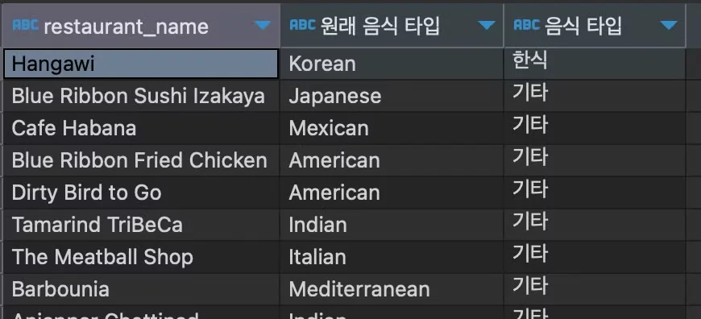
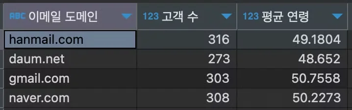
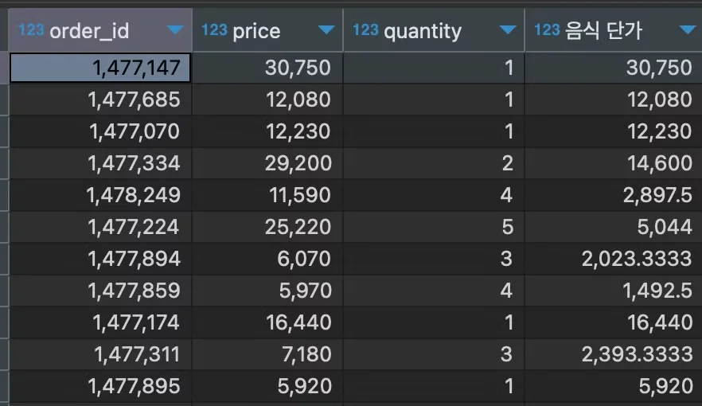
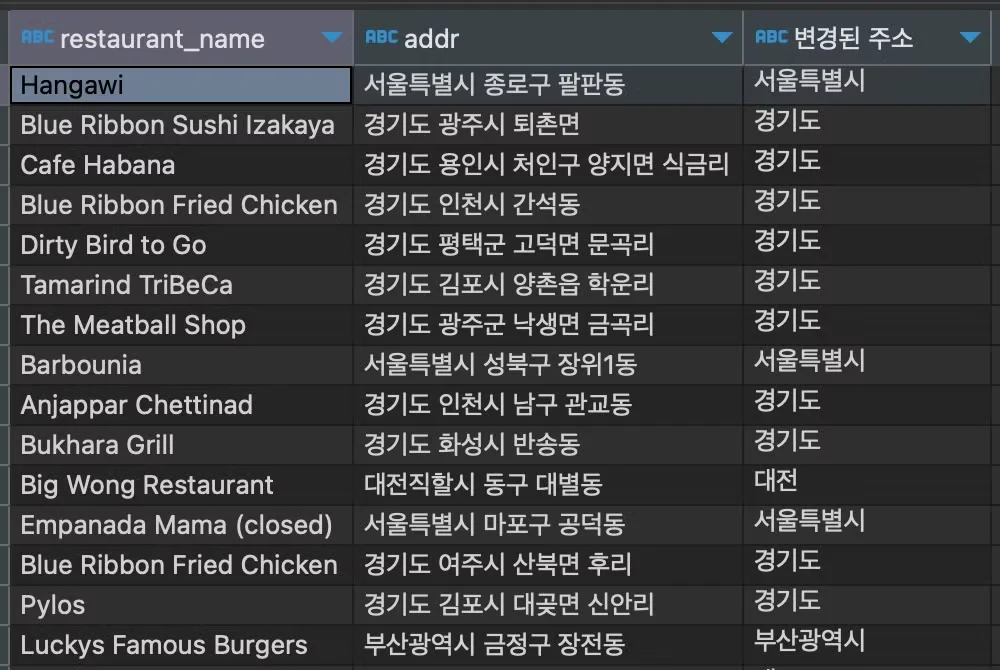
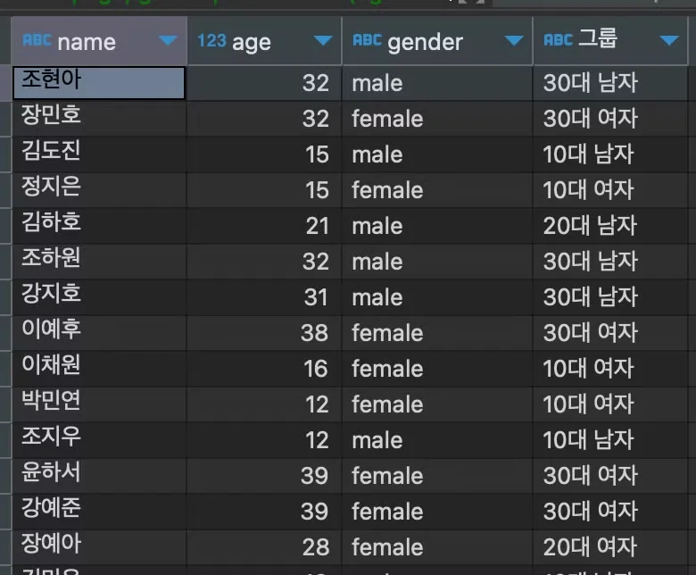
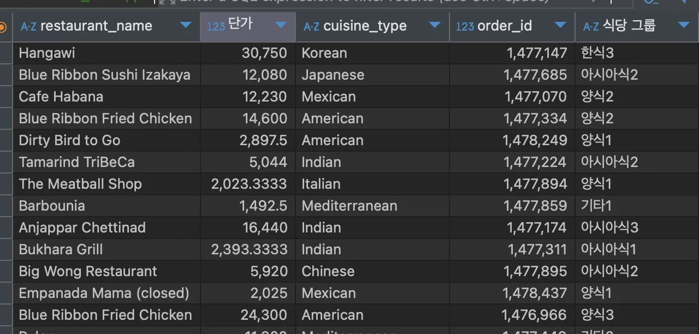
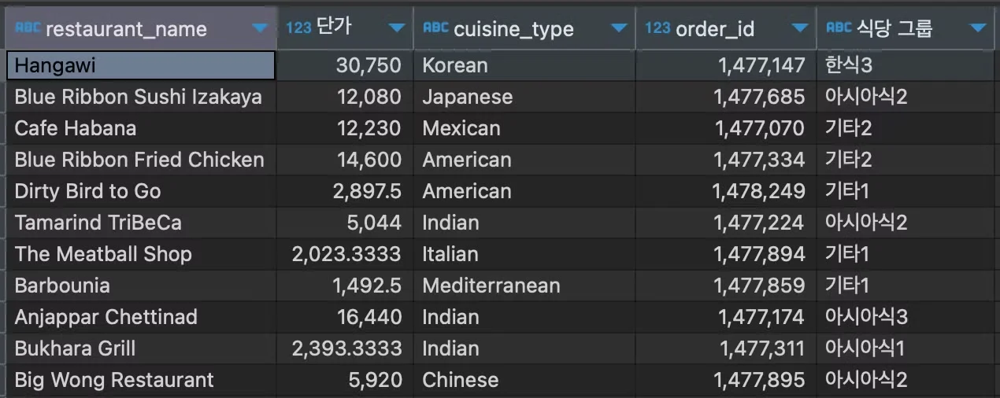
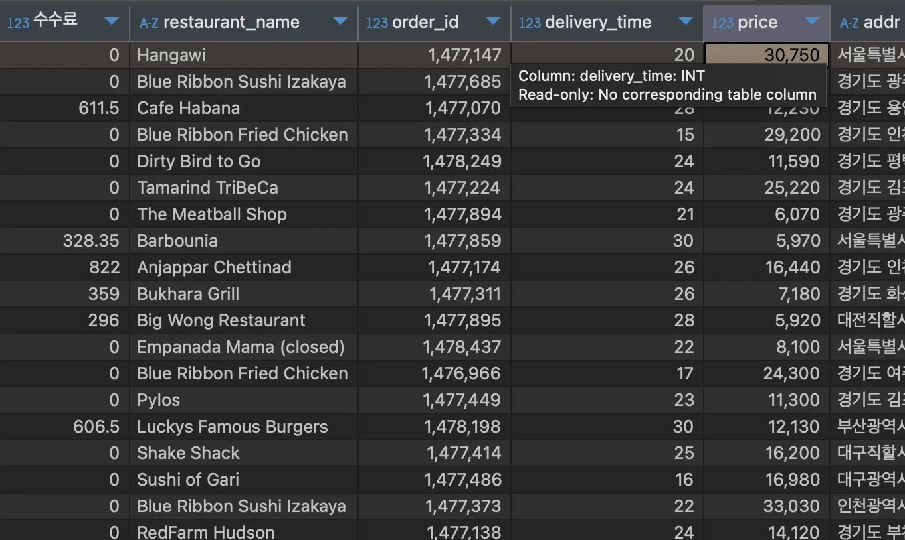
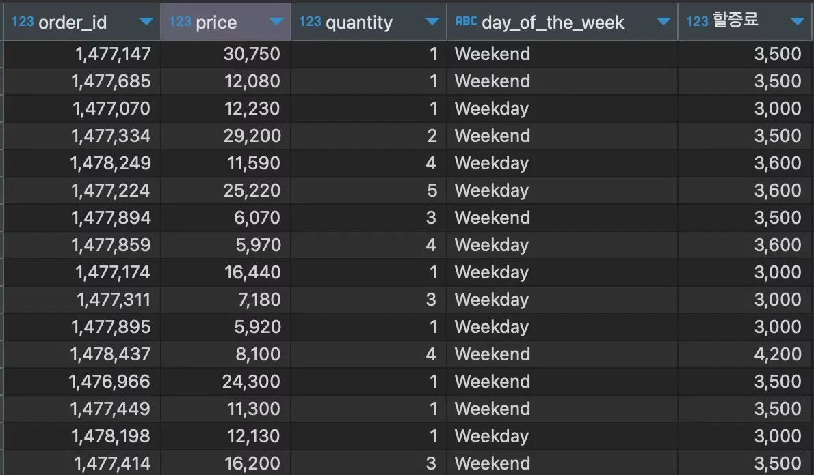

<a id="1baeda9b0fe18096bee2e7c63548c112"></a>

### <strong>조건에 따라 포맷 변경 (</strong><strong><code>IF</code></strong><strong>, </strong><strong><code>CASE</code></strong><strong>)</strong>

<details>
<summary>🧐 조건(<code>if</code>, <code>case</code>)을 사용할 수 있는 경우 알아보기</summary>

<details>
<summary>1) 새로운 카테고리 만들기</summary>

- 음식 타입
    - 각 나라별 음식 타입 별로 새로운 카테고리 생성 가능

    - ex)  <code>한국 음식, 아시아 음식, 미국 음식, 유럽 음식</code> 

- 고객들의 분류
    - 성별과 나이별로 새로운 고객 군 카테고리를 생성 가능

    - ex) <code>10대 여성, 10대 남성, 20대 여성, 20대 남성 등</code>

</details>

<details>
<summary>2) 연산식을 적용할 조건 지정하기 </summary>

- 수수료를 계산할 때  →  현금, 카드
    - 현금일 때의 수수료율과 카드일 때의 수수료율이 다르다면, 

    - 연산식을 만들 때 <code>if 문</code> 혹은 <code>case 문</code>으로 <br>각각 다른 수수료율 혹은 수수료 계산 방식을 적용 가능

</details>

<details>
<summary>3) 다른 문법 안에서 적용하기</summary>

- <code>if</code>, <code>case</code> 문 안에 다른 문법이나 연산 처리 가능

- 다른 문법 안에 조건문 사용 가능

<details>
<summary>예시 ) concat 문으로 여러 컬럼 을 합칠 때, concat 안에 if 문 사용</summary>

- <code>if(rating≠null(or &#39;&#39;), rating, ‘’)</code>
    - rating 이 있을 때는 rating 값 넣기

    - 없을 때는 아무것도 넣지 않음

</details>

</details>

</details>

<details>
<summary>1) 조건에 따라 다른 방법 적용 (<code>if</code>) </summary>

<a id="1baeda9b0fe18099b7ffd1a00487ce9b"></a>

```sql
if(조건, 조건을 충족할 때, 조건을 충족하지 못할 때)
```

<details>
<summary>&#91; 실습 &#93;</summary>

<details>
<summary>1&#46; 음식 타입을 ‘Korean’ 일 때는 ‘한식’, ‘Korean’ 이 아닌 경우에는 ‘기타’ 라고 지정</summary>

<a id="1baeda9b0fe180489a48d2e9cbb87174"></a>

<strong>SQL Query</strong>

<a id="1baeda9b0fe180629445d73c5f782de1"></a>

```sql
select restaurant_name,
       cuisine_type "원래 음식 타입",
       if(cuisine_type='Korean', '한식', '기타') "음식 타입"
from food_orders
```

<a id="1baeda9b0fe18002a140f0cef9b32409"></a>

<strong>실행 결과</strong>



<a id="1baeda9b0fe180369618e4474c5fc5d9"></a>

<strong><br></strong>

</details>

<details>
<summary>2&#46; 문곡리’ 가 평택에만 해당될 때, 평택 ‘문곡리’ 만 ‘문가리’ 로 수정</summary>

<a id="1baeda9b0fe1808b930dcf1043d61b06"></a>

<strong>SQL Query</strong>

<a id="1baeda9b0fe18063acacc3b16c5d50e0"></a>

```sql
select addr "원래 주소",
       if(addr like '%평택군%', replace(addr, '문곡리', '문가리'), addr) "바뀐 주소"
from food_orders
where addr like '%문곡리%'
```

<a id="1baeda9b0fe180878500ca416bc21edf"></a>

<strong>실행 결과</strong>


</details>

<details>
<summary>3&#46;  잘못된 이메일 주소 (gmail) 만 수정을 해서 사용</summary>

<a id="1baeda9b0fe18086a448fc97b2fffe48"></a>

<strong>SQL Query</strong>

<a id="1baeda9b0fe18058a2b1c4d45af977d2"></a>

```sql
select substring(if(email like '%gmail%', replace(email, 'gmail', '@gmail'), email), 10) "이메일 도메인",
       count(customer_id) "고객 수",
       avg(age) "평균 연령"
from customers
group by 1
```

<a id="1baeda9b0fe1806a8274e96550d70168"></a>

<strong>실행 결과</strong>



</details>

</details>

</details>

<details>
<summary>2) 조건을 여러가지 지정 (<code>case</code>)</summary>

<a id="1baeda9b0fe1803a9519da7e9a903ac5"></a>

```sql
case when 조건1 then 값(수식)1
     when 조건2 then 값(수식)2
     else 값(수식)3
end
```

<details>
<summary>&#91; 실습 &#93;</summary>

<details>
<summary>1&#46; 음식 타입을 ‘Korean’ 일 때는 ‘한식’, ‘Japanese’ 혹은 ‘Chienese’ 일 때는 ‘아시아’, 그 외에는 ‘기타’ 라고 지정</summary>

<a id="1baeda9b0fe180f185e4c2798fcd3fa3"></a>

<strong>SQL Query</strong>

<a id="1baeda9b0fe1801fa353c2311bc871d7"></a>

```sql
select restaurant_name,
       cuisine_type AS "원래 음식 타입",
       case 
		       when (cuisine_type='Korean') then '한식'
			     else '기타'
       end as " 음식 타입"
from food_orders
```

<a id="1baeda9b0fe180f68e20e0fe31d9506b"></a>

<strong>실행 결과</strong>


<a id="1baeda9b0fe180fb9484d6f03f7362d1"></a>

<strong><br></strong>

</details>

<details>
<summary>2&#46; 음식 단가를 주문 수량이 1일 때는 음식 가격, 주문 수량이 2개 이상일 때는 음식가격/주문수량 으로 지정</summary>

<a id="1baeda9b0fe1802993e9c88441c17043"></a>

<strong>SQL Query</strong>

<a id="1baeda9b0fe180c9918bc627dde5e870"></a>

```sql
SELECT order_id, 
		   price, 
		   quantity, 
		   case 
			    when quantity=1 then price 
				  when quantity>1 then price/quantity 
		   end '음식 단가'
FROM food_orders
```

<a id="1baeda9b0fe18042be32eafe2772c3f0"></a>

<strong>실행 결과</strong>



</details>

<details>
<summary>3&#46;  주소의 시도를 ‘경기도’ 일때는 ‘경기도’, ‘특별시’ 혹은 ‘광역시’ 일 때는 붙여서, 아닐 때는 앞의 두 글자만 사용</summary>

<details>
<summary>내 풀이</summary>

<a id="1baeda9b0fe180019838d2aa2ce02eb1"></a>

<strong>SQL Query</strong>

<a id="1baeda9b0fe180c0b0b7f84169ae41e5"></a>

```sql
SELECT restaurant_name , 
	   addr,  
	   case 
		    when addr like '%경기도%' then '경기도'
			when addr like '%광역시%' then substring(addr, 1, 5)
			when addr like '%특별시%' then substring(addr, 1, 5)
			else substring(addr, 1, 2)
	   end '변경된 주소'
FROM food_orders fo 
```

</details>

<details>
<summary>강의 풀이 &#45; 논리연산자 <code>or</code></summary>

<a id="1baeda9b0fe180a482e1e404ecac1755"></a>

<strong>SQL Query</strong>

- 논리연산자 <code>or</code> &#58; 중복 조건  처리
    - <code>when </code><u><code>addr like &#39;%특별%&#39;</code></u><code> or </code><u><code>addr like &#39;%광역%&#39;</code></u><code> then substring(addr, 1, 5)</code>

<a id="1baeda9b0fe1800d96baed25677e18f5"></a>

```sql
select restaurant_name,
       addr,
       case when addr like '%경기도%' then '경기도'
            when addr like '%특별%' or addr like '%광역%' then substring(addr, 1, 5)
            else substring(addr, 1, 2) end "변경된 주소"
from food_orders
```

</details>

<a id="1baeda9b0fe180278778de937a11c7b7"></a>

<strong>실행 결과</strong>



</details>

</details>

</details>

---

<details>
<summary><strong>&#91; 실습 &#93; 간단한 User Segmentation 처리</strong></summary>

<details>
<summary>🧐 <strong>User Segmentation </strong></summary>

- Segmentation&#58; 분할 

<a id="1baeda9b0fe1809b95a2e82a794440d7"></a>

<code>user segmentation</code> 은 회원을 세부사항으로 분할하여 구분하는 것을 말한다&#46; 

- ex) User Segmentation 
    - 10세 이상의 남성 고객

    - 20세 이상 40세 미만의 여성 고객

</details>

<details>
<summary>🧐 세부사항으로 구분이 늘어날 수록 중복되는 로직이 너무 많다&#46;&#46; 줄이는 방법은?</summary>

- 4주차 &#45; subqeury 참조 

</details>

> /icons/checkmark-line_lightgray.svg 
> 
> <a id="1baeda9b0fe180a19574e28c1530fa57"></a>
> 
> &#91;  조건문, 수식 &#93; 새로운 카테고리 만들기 &#45; User Segmentation 

<details>
<summary>1&#46; 10세 이상, 40세 미만의 고객의 나이와 성별로 그룹 나누기 (이름도 같이 출력)</summary>

<details>
<summary>내풀이 &#45; <code>산술연산자</code></summary>

<a id="1baeda9b0fe180078426e881df2ac751"></a>

<strong>SQL Query</strong>

<a id="1baeda9b0fe1806da497f3ea02570ee0"></a>

```sql
SELECT name,
	   age,
	   gender,
	   case 
	   		when age>=10 and age<20 and gender='male' then '10대 남자'
	   		when age>=10 and age<20 and gender='female' then '10대 여자'
	   		when age>=20 and age<30 and gender='male' then '20대 남자'
	   		when age>=20 and age<30 and gender='female' then '20대 여자'
	   		when age>=30 and age<40 and gender='male' then '30대 남자'
	   		when age>=30 and age<40 and gender='female' then '30대 여자'
	   end as '그룹'
FROM customers
WHERE age >= 10 and age < 40
```

</details>

<details>
<summary>강의 풀이  &#45; <code>between</code></summary>

<a id="1baeda9b0fe180ea9794cd65cfc1f749"></a>

```sql
select name,
       age,
       gender,
       case when (age between 10 and 19) and gender='male' then "10대 남자"
            when (age between 10 and 19) and gender='female' then "10대 여자"
            when (age between 20 and 29) and gender='male' then "20대 남자"
            when (age between 20 and 29) and gender='female' then "20대 여자"
            when (age between 30 and 39) and gender='male' then "30대 남자"
            when (age between 30 and 39) and gender='female' then "30대 여자"  
       end "그룹" 
from customers
where age between 10 and 39
```

</details>

<a id="1baeda9b0fe180309063f169c066119e"></a>

<strong>실행 결과</strong>



<a id="1baeda9b0fe1800ead32c456274e01bf"></a>

<strong><br></strong>

</details>

<details>
<summary>2&#46; 음식 단가, 음식 종류 별로 음식점 그룹 나누기 ( 문제 수정, <code>양식</code> 카테고리 추가)</summary>

> <strong>그룹</strong>

- 한식&#58; Korean 

- 아시아식&#58; Japanese, Chinese, Thai, Vietnamese, Indian 

- 양식&#58; American, Mexican, Italian, Spanish, French

- 기타&#58; 그외( Mediterranean, Middle Eastern)

<details>
<summary>내 풀이 &#45; 논리연산자 OR ( bad case)</summary>

- 문제 조건 중 평균 가격에 따른 구분을 빼먹음

<a id="1baeda9b0fe18091ae80fa4e5da25961"></a>

<strong>SQL Query</strong>

<a id="1baeda9b0fe180c48293c975b5767a2a"></a>

```sql
SELECT restaurant_name,
	   price/quantity "단가",
	   cuisine_type,
	   order_id,
	   case 
	   		when cuisine_type = 'Korean' then '한식'
	   		when cuisine_type = 'Japanese' OR 
	   			 cuisine_type = 'Chinese' OR
	   			 cuisine_type = 'Thai' OR
	   			 cuisine_type = 'Vietnamese' OR
	   			 cuisine_type = 'Indian'
	   			 then '아시아식'
	   		when cuisine_type = 'American' OR 
	   			 cuisine_type = 'Mexican' OR
	   			 cuisine_type = 'Italian' OR
	   			 cuisine_type = 'Spanish' OR
	   			 cuisine_type = 'Frenc'
	   			 then '양식'
	   		else '양식'
	   end "식당 그룹"
FROM food_orders
GROUP BY restaurant_name 
```

</details>

<details>
<summary>강의 풀이 &#45; <code>in</code></summary>

<details>
<summary>기존 양식 그룹을 제거한 풀이</summary>

<a id="1baeda9b0fe180228f38dec20ab80311"></a>

```sql
select restaurant_name,
       price/quantity "단가",
       cuisine_type,
       order_id,
       case when (price/quantity <5000) and cuisine_type='Korean' then '한식1'
            when (price/quantity between 5000 and 15000) and cuisine_type='Korean' then '한식2'
            when (price/quantity > 15000) and cuisine_type='Korean' then '한식3'
            
            when (price/quantity <5000) and cuisine_type in ('Japanese', 'Chinese', 'Thai', 'Vietnamese', 'Indian') then '아시아식1'
            when (price/quantity between 5000 and 15000) and cuisine_type in ('Japanese', 'Chinese', 'Thai', 'Vietnamese', 'Indian') then '아시아식2'
            when (price/quantity > 15000) and cuisine_type in ('Japanese', 'Chinese', 'Thai', 'Vietnamese', 'Indian') then '아시아식3'
            
            when (price/quantity <5000) and cuisine_type not in ('Korean', 'Japanese', 'Chinese', 'Thai', 'Vietnamese', 'Indian') then '기타1'
            when (price/quantity between 5000 and 15000) and cuisine_type not in ('Korean', 'Japanese', 'Chinese', 'Thai', 'Vietnamese', 'Indian') then '기타2'
            when (price/quantity > 15000) and cuisine_type not in ('Korean', 'Japanese', 'Chinese', 'Thai', 'Vietnamese', 'Indian') then '기타3' 
            
            end "식당 그룹"
from food_orders
```

</details>

<details>
<summary>양식 그룹 추가한 풀이 </summary>

<a id="1baeda9b0fe18056848ac1b26a124328"></a>

```sql
select restaurant_name,
       price/quantity "단가",
       cuisine_type,
       order_id,
       case when (price/quantity <5000) and cuisine_type='Korean' then '한식1'
            when (price/quantity between 5000 and 15000) and cuisine_type='Korean' then '한식2'
            when (price/quantity > 15000) and cuisine_type='Korean' then '한식3'
            
            when (price/quantity <5000) and cuisine_type in ('Japanese', 'Chinese', 'Thai', 'Vietnamese', 'Indian') then '아시아식1'
            when (price/quantity between 5000 and 15000) and cuisine_type in ('Japanese', 'Chinese', 'Thai', 'Vietnamese', 'Indian') then '아시아식2'
            when (price/quantity > 15000) and cuisine_type in ('Japanese', 'Chinese', 'Thai', 'Vietnamese', 'Indian') then '아시아식3'
            
            when (price/quantity <5000) and cuisine_type in ('American', 'Mexican', 'Italian', 'Spanish', 'French') then '양식1'
            when (price/quantity between 5000 and 15000) and cuisine_type in ('American', 'Mexican', 'Italian', 'Spanish', 'French') then '양식2'
            when (price/quantity > 15000) and cuisine_type in ('American', 'Mexican', 'Italian', 'Spanish', 'French') then '양식3'
            
            
            when (price/quantity <5000) and cuisine_type in ('Middle Eastern', 'Mediterranean') then '기타1'
            when (price/quantity between 5000 and 15000) and cuisine_type in ('Middle Eastern', 'Mediterranean') then '기타2'
            when (price/quantity > 15000) and cuisine_type in ('Middle Eastern', 'Mediterranean') then '기타3' 
            
            end "식당 그룹"
from food_orders
```



</details>

</details>

<a id="1baeda9b0fe180338964cfac07c28906"></a>

<strong>실행 결과</strong>



<a id="1baeda9b0fe1800b9515ffb70e382fb5"></a>

<strong><br></strong>

</details>

</details>

<details>
<summary><strong>&#91;실습&#93; 조건문 →  서로 다른 식을 적용한 수수료 구하기</strong></summary>

> /icons/checkmark-line_lightgray.svg 
> 
> <a id="1baeda9b0fe18046a85bdae0faeabf83"></a>
> 
> 조건문을 이용하여 다른 수식을 적용

<details>
<summary>1&#46; 지역과 배달시간을 기반으로 배달수수료 구하기 (식당 이름, 주문 번호 함께 출력)</summary>

> 수수료 계산

-  시간 
    - 25분 초과하면 음식 가격의 5%

    - 30분 초과하면 음식 가격의 10%

- 지역
    - 서울&#58; 수수료 계산 &#42; 1&#46;1

    - 기타&#58;  곱하는 값 없음

<details>
<summary>SQL Query</summary>

<a id="1baeda9b0fe180ada87bfb63c64265f4"></a>

```sql
SELECT case 
						when delivery_time > 30 then price * 0.1 * if(addr like '서울%', 1.1, 1)
						when delivery_time between 26 and 30 then price * 0.05 * if(addr like '서울%', 1.1, 1)
						else 0
		   end "수수료",
		   restaurant_name,
		   order_id,
		   delivery_time,
		   price,
		   addr
FROM food_orders fo;
```

</details>

<a id="1baeda9b0fe18088a9a3f9d4f74fd013"></a>

<strong>실행 결과</strong>



</details>

<details>
<summary>2&#46; 주문 시기와 음식 수를 기반으로 배달할증료 구하기</summary>

> 배달할증료 계산

- 주문 시기 
    - 평일&#58;기본료 = 3000 

    - 주말&#58; 기본료 = 3500

- 음식 수 
    - 3개 이하이면 할증 없음 

    - 3개 초과이면 기본료 &#42; 1&#46;2

<a id="1baeda9b0fe180f9955af48f67802bda"></a>

<strong>SQL Query</strong>

<details>
<summary>풀이 &#45; <code>case</code> </summary>

<a id="1baeda9b0fe180d3bde4de9e7673e7fb"></a>

```sql
SELECT order_id,
		   price,
		   quantity,
		   day_of_the_week,
		   case when day_of_the_week='weekday' then 3000 * if(quantity>3, 1.2, 1)
			 			when day_of_the_week='weekend' then 3500 * if(quantity>3, 1.2, 1)
		   end "힐증료"
FROM food_orders fo;
```

</details>

<details>
<summary>풀이 &#45; <code>if</code><br></summary>

<a id="1baeda9b0fe18009aa43d9b40fbd24a3"></a>

```sql
SELECT order_id,
       price,
       quantity,
       day_of_the_week,
       if(day_of_the_week='Weekday', 3000, 3500)*(if(quantity<=3, 1, 1.2)) "할증료"
FROM food_orders
```

</details>

<a id="1baeda9b0fe180e48d0ccf6bc7f5d579"></a>

<strong>실행 결과</strong>



</details>

</details>
