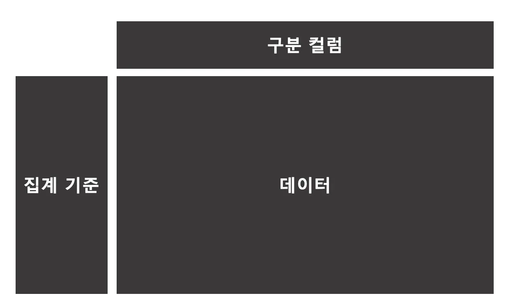
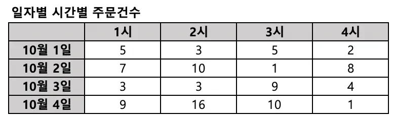
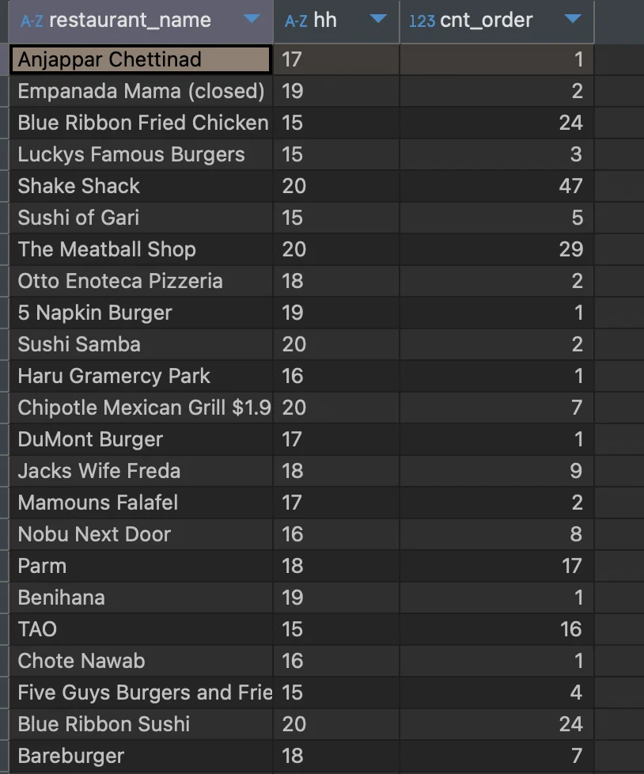
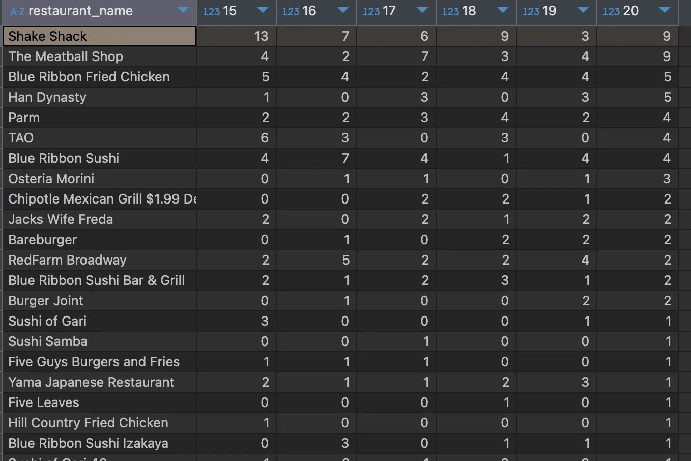
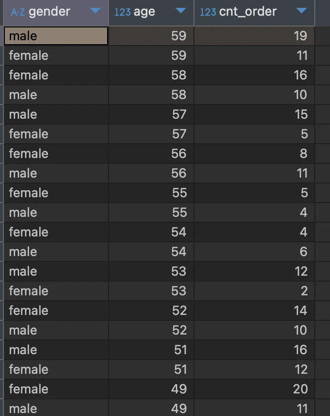
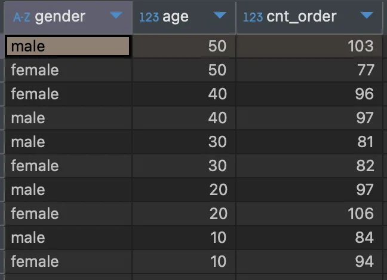

<a id="10feda9b0fe1801082f5d96e795f5f55"></a>

### Pivot Table  ( 표 )

> ✏️ 
> 
> <a id="1ddeda9b0fe180efa2f6cc7bc3d7db18"></a>
> 
> Pivot table
> 
> ---
> 
> 
> 
> > 2개 이상의 기준으로 데이터를 집계할 때, 보기 쉽게 배열하여 보여주는 것
> 
> <details>
> <summary>예시) Pivot table </summary>
> 
> - 집계 기준&#58; 일자, 시간
>     
> 
> </details>

<a id="110eda9b0fe18080b6dcfc115dd25d0c"></a>

&#91; 실습 &#93;

<details>
<summary>🧐 집계 기준 별 데이터 조회 후 pivot table 만드는 방법</summary>

- 2개의 실습 예시가 동일한 패턴으로 풀이가 전계된다&#46; <br>즉, 패턴이 존재한다&#46; 해당 부분을 정리

</details>

<details>
<summary>🧐 왜 <code>max()</code>를  사용하는 것 인가?</summary>


</details>

<details>
<summary>1&#46; 음식점별 시간별 주문건수 Pivot Table 뷰 만들기 </summary>

- 집계 기준&#58;  음식점, 시간

- 조건
    - 시간&#58; 15&#126;20시 사이

    - 20시 주문건수 기준 내림차순

<details>
<summary>1&#46;  식당별, 시간별 주문 수 집계</summary>

<a id="110eda9b0fe1802b911ecf831955331b"></a>

```sql
select a.restaurant_name,
	   substring(b.time, 1, 2) hh,
	   count(1) cnt_order
from food_orders a inner join payments b on a.order_id = b.order_id
where substring(b.time, 1, 2) between 15 and 20
group by restaurant_name 
```



</details>

<details>
<summary>2&#46; Pivot table</summary>

<a id="110eda9b0fe1801f8471fc918bc65bf7"></a>

```sql
select restaurant_name,
       max(if(hh='15', cnt_order, 0)) "15",
       max(if(hh='16', cnt_order, 0)) "16",
       max(if(hh='17', cnt_order, 0)) "17",
       max(if(hh='18', cnt_order, 0)) "18",
       max(if(hh='19', cnt_order, 0)) "19",
       max(if(hh='20', cnt_order, 0)) "20"
from 
(
select a.restaurant_name,
       substring(b.time, 1, 2) hh,
       count(1) cnt_order
from food_orders a inner join payments b on a.order_id=b.order_id
where substring(b.time, 1, 2) between 15 and 20
group by 1, 2
) a
group by 1
order by 7 desc
```



</details>

</details>

<details>
<summary>2&#46; 성별, 연령별 주문건수 Pivot Table 뷰 만들기</summary>

- 집계 기준&#58; 나이, 성별

- 조건
    - 나이&#58; 10&#126;59세 사이

    - 연령 순으로 내림차순

<details>
<summary>1&#46;  성별, 연령 별 주문수 집계</summary>

<details>
<summary>1차 작성 &#45; 나이 구문 X</summary>

<a id="110eda9b0fe180768e7dd797ec0e1178"></a>

```sql
select b.gender,
	   b.age,
	   COUNT(1) cnt_order
from food_orders a inner join customers b on a.customer_id =b.customer_id
where b.age between 10 and 59
group by 1, 2
order by 2 desc

```



</details>

<a id="110eda9b0fe18095b3dfccf00bbc9b84"></a>

```sql
select b.gender,
       case when age between 10 and 19 then 10
            when age between 20 and 29 then 20
            when age between 30 and 39 then 30
            when age between 40 and 49 then 40
            when age between 50 and 59 then 50 end age,
       count(1) cnt_order
from food_orders a inner join customers b on a.customer_id=b.customer_id
where b.age between 10 and 59
group by 1, 2
order by 2 desc
```



</details>

<details>
<summary>2&#46; Pivot table </summary>

<a id="110eda9b0fe180358465e6266868e3a9"></a>

```sql
select gender,
	   max(if(age='10', cnt_order, 0)) "10",
	   max(if(age='20', cnt_order, 0)) "20",
	   max(if(age='30', cnt_order, 0)) "30",
	   max(if(age='40', cnt_order, 0)) "40",
	   max(if(age='50', cnt_order, 0)) "50"
from
(
select b.gender,
       case when age between 10 and 19 then 10
            when age between 20 and 29 then 20
            when age between 30 and 39 then 30
            when age between 40 and 49 then 40
            when age between 50 and 59 then 50 end age,
       count(1) cnt_order
from food_orders a inner join customers b on a.customer_id=b.customer_id
where b.age between 10 and 59
group by 1, 2
order by 2 desc
) a
group by 1
order by 5 desc
```


</details>

</details>
