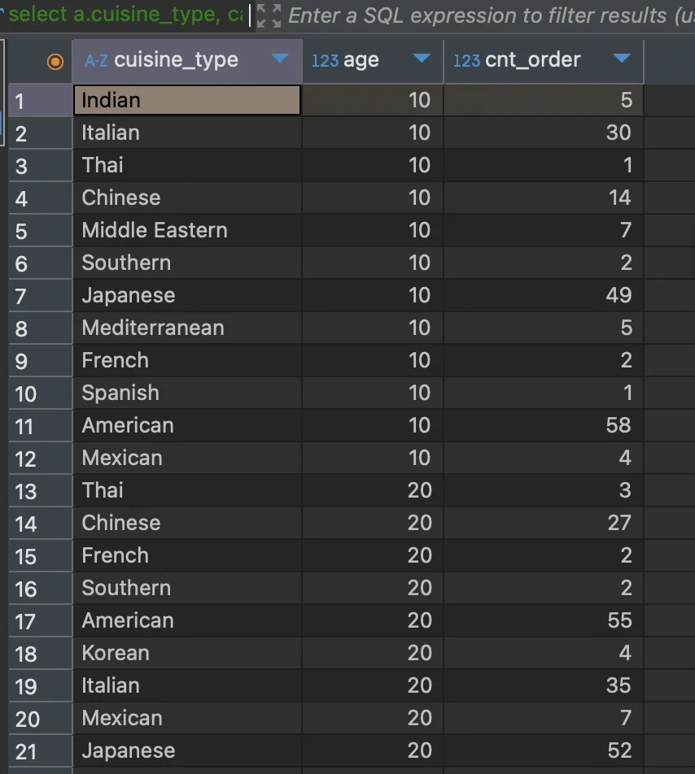
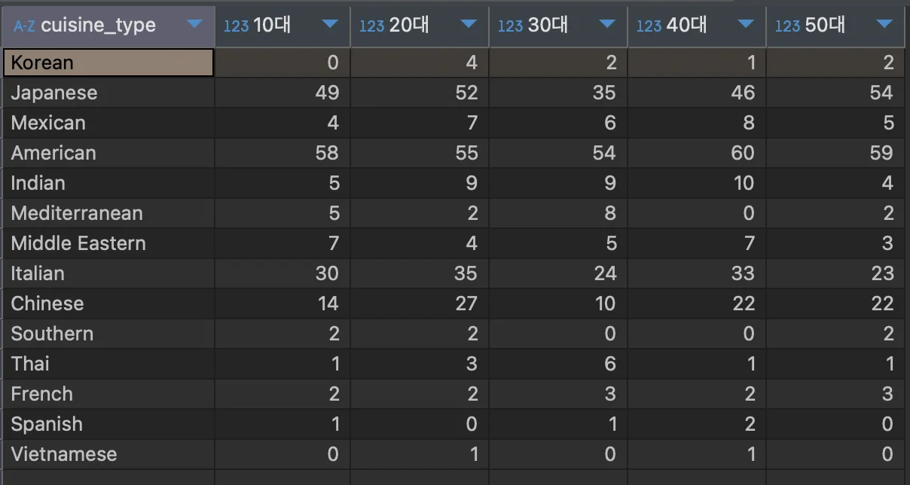

<a id="110eda9b0fe18034b538c0bae476f10d"></a>

### &#91; 숙제 &#93; 음식 타입별, 연령별 주문건수 pivot view 만들기

---

<a id="110eda9b0fe180cf9d4af2685dc28118"></a>

### 1&#46;  음식 타입 및 <strong><u>연령대</u></strong>에 따른 주문 수 집계

<a id="1baeda9b0fe1802db8a5fe44b55c47c1"></a>

<strong>SQL</strong>

<a id="110eda9b0fe1809ab491dc2258df8d22"></a>

```sql
select a.cuisine_type,
		   case when age between 10 and 19 then 10
            when age between 20 and 29 then 20
            when age between 30 and 39 then 30
            when age between 40 and 49 then 40
            when age between 50 and 59 then 50 end age,
		   count(1) cnt_order
from food_orders a inner join customers b on a.customer_id = b.customer_id 
where age between 10 and 59
group by 1, 2
order by 2
```

<a id="110eda9b0fe180aab868d9e04f68e87f"></a>

<strong>실행 결과</strong>



<a id="110eda9b0fe180c7bdd6cd3dc4809648"></a>

### 2&#46; pivot table

<a id="110eda9b0fe180658d3ceeb05ae6075f"></a>

```sql
select cuisine_type,
			 max(if(age=10, cnt_order, 0)) "10대",
			 max(if(age=20, cnt_order, 0)) "20대",
			 max(if(age=30, cnt_order, 0)) "30대",
			 max(if(age=40, cnt_order, 0)) "40대",
			 max(if(age=50, cnt_order, 0)) "50대"
from
(
select a.cuisine_type,
		   case when age between 10 and 19 then 10
            when age between 20 and 29 then 20
            when age between 30 and 39 then 30
            when age between 40 and 49 then 40
            when age between 50 and 59 then 50 end age,
		   count(1) cnt_order
from food_orders a inner join customers b on a.customer_id = b.customer_id 
where age between 10 and 59
group by 1, 2
) t
group by 1
```


