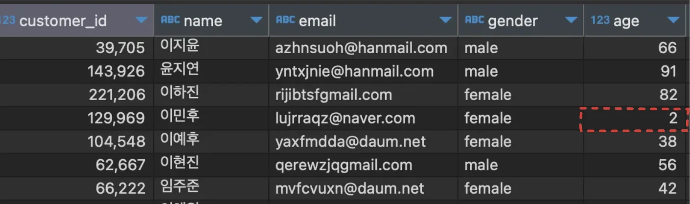
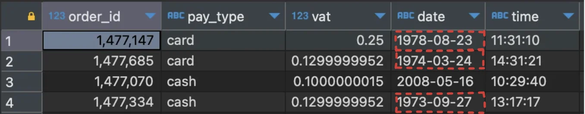
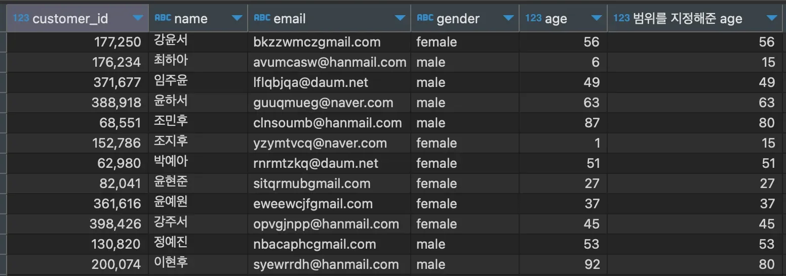

<a id="10feda9b0fe1808da002f189c9df6abe"></a>

### 상식적이지 않은 데이터군 제외 → 범위 지정

<a id="110eda9b0fe180919e1bea4fb1f02ddf"></a>

<strong>상식적이지 않는 데이터 예시</strong>

<details>
<summary>case1) 주문 고객 나이</summary>

- 보통 음식을 주문한 고객은 20세 이상인 성인 경우가 많다&#46;  ( age ≥20 )

- 그러나 아래의 데이터를 보면  ‘나이 = 2세 (age=2)’  와 같은 상식적이지 않는 값을 확인할 수 있다&#46; 
    

</details>

<details>
<summary>case2) 결제 일자</summary>

- 결제의 경우, 비교적 최근인 일자가 있어야 상식적이다&#46;

- 하지만, 아래의 데이터를 보면 1970년대와 같이 상식적이지 않는 값들을 확인할 수 있다&#46; 
    

</details>

<a id="110eda9b0fe18023b0fdf4086891167d"></a>

범위 지정 → 조건문 case 활용

<details>
<summary>예시) 주문이 가능할 것 같은 데이터 분포군 ( 15 ≤ age ≤ 80 )</summary>

<a id="110eda9b0fe18073ad43dca69e06aba0"></a>

```sql
select customer_id, name, email, gendor, age,
       case when age<15 then 15
            when age>80 then 80
            else age end "범위를 지정해준 age"
from customers
```



</details>
