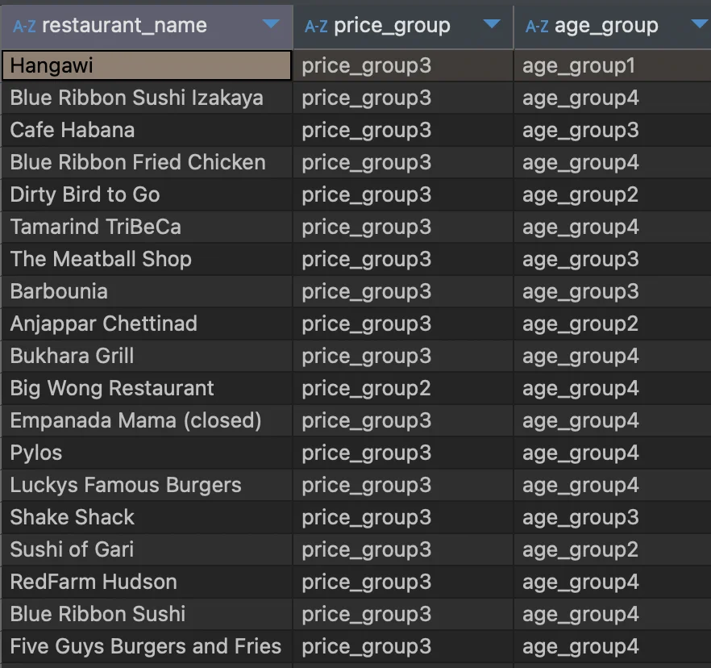
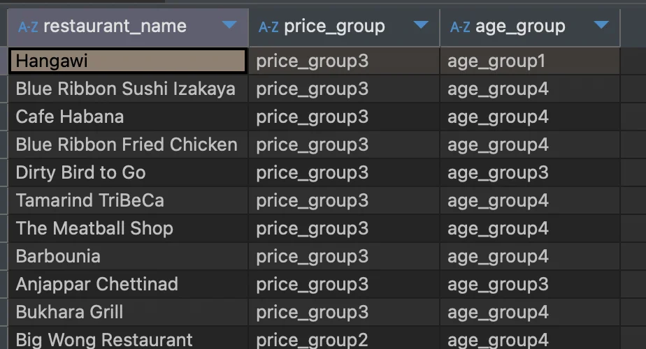

<a id="1baeda9b0fe180c5af4ed2ec344a0d13"></a>

### &#91; 숙제 &#93;  식당별 평균 음식 주문 금액과 주문자의 평균 연령을 기반으 Segmentation 하기

---

> ✏️ 
> 
> - 테이블&#58; 주문, 고객
> 
> - 컬럼&#58; restaurant&#95;name, price, quantity, age
> 
> - 조건
>     - 평균 음식 주문 금액 기준&#58; 5,000 / 10,000 / 30,000 / 30,000 초과
> 
>     -  평균 연령&#58; &#126; 20대 / 30대 / 40대 / 50대 이상
> 
> - 그룹&#58; 
> 
> - 함수(수식)&#58; avg

<a id="10ceda9b0fe180d38d35e6863c6272e2"></a>

### 강의 풀이

<a id="10ceda9b0fe180c1a052d6cdaca8f23c"></a>

<strong>SQL </strong>

<a id="10ceda9b0fe1806290b3f267f4cbbaf2"></a>

```sql
select restaurant_name,
       case when price <=5000 then 'price_group1'
            when price >5000 and price <=10000 then 'price_group2'
            when price >10000 and price <=30000 then 'price_group3'
            when price >30000 then 'price_group4' end price_group,
       case when age <30 then 'age_group1'
            when age between 30 and 39 then 'age_group2'
            when age between 40 and 49 then 'age_group3'
            else 'age_group4' end age_group
from
(
	select a.restaurant_name,
	       avg(price) price,
	       avg(age) age
	from food_orders a inner join customers b on a.customer_id=b.customer_id
	group by 1
) t
```

<a id="10ceda9b0fe180d39627e1b5d51fcc63"></a>

<strong>실행 결과 </strong>



<a id="10feda9b0fe180a1a441c2aef1eecb6b"></a>

### 내풀이

<a id="10feda9b0fe1801ebf5dc4713bf63160"></a>

SQL Query

<a id="10feda9b0fe180ea96abc907f2dcec26"></a>

```sql
SELECT restaurant_name,
	   price_group,
	   age_group
FROM 
(
SELECT restaurant_name,
	   case when average_price < 5000 then 'price_group1'
	   		when average_price between 5000 and 9999 then 'price_group2'
	   		when average_price between 10000 and 29999 then 'price_group3'
	   		else 'price_group4' end price_group,
   	   case when average_age < 20 then 'age_group1'
	   		when average_age between 20 and 29 then 'age_group2'
	   		when average_age between 30 and 39 then 'age_group3'
	   		when average_age between 40 and 49 then 'age_group4'
	   		else 'age_group4' end age_group	
FROM 
(
SELECT restaurant_name,
	   avg(f.price) average_price,
	   avg(c.age) average_age
FROM food_orders f left join customers c on f.customer_id = c.customer_id
GROUP BY restaurant_name
) a
) b
```

<a id="10ceda9b0fe180d6a24bc2289bb76c25"></a>

실행 결과 


