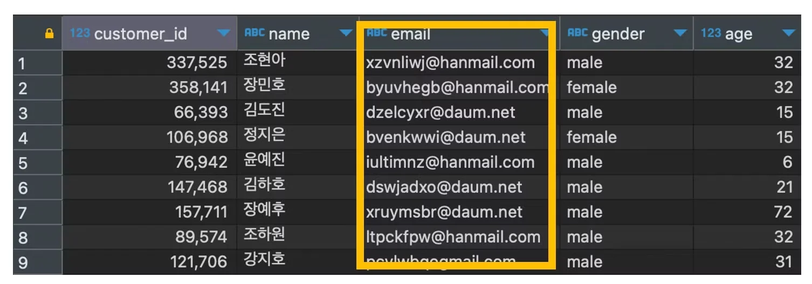

<a id="108eda9b0fe18046aa55e3af0b49fce3"></a>

### <strong>SQL</strong>

> 데이터베이스와 <strong><u>상호작용(대화)</u></strong>하기 위한 언어

<a id="108eda9b0fe1802badb4dac49a4aed93"></a>

주로 데이터베이스에 데이터를 저장, 수정, 삭제, 검색하는 등의 작업을 할 때 사용한다&#46; <br>

<a id="108eda9b0fe1809c8b57ecf49967f239"></a>

### <strong>Query</strong>

> <strong><u>SQL</u></strong>을 사용하여 <strong><u>DB에게 특정 작업을 요청</u></strong>하는 명령어

<a id="108eda9b0fe180ea856dc7fdb76980b1"></a>

쉽게 말해, <strong><u>데이터베이스에게 질문을 던지는 것</u></strong>으로

<a id="47c3487ac63b4f0d9415fc3708f7b99c"></a>

예를 들어, 데이터베이스에 ‘어떤 데이터를 조회해줘라’, ‘어던 데이터를 추가해줘라’는 요청을 보내는 것이 쿼리이다&#46; 

<a id="108eda9b0fe1808faeb4ed24cdb45b92"></a>

### <strong>테이블, 컬럼, 필드 </strong>

<details>
<summary>🧐 필드, 레코드 </summary>


</details>

- 엑셀과 유사한 구조

- 각 열을 <strong><u>‘컬럼’</u></strong> or <strong><u>‘필드’</u></strong>라 부름
    

- ex)
    <details>
    <summary>음식 주문 정보 테이블(food&#95;orders)</summary>

    - order&#95;id &#58; 주문 번호

    - customer&#95;id &#58; 고객 번호

    - restaurant&#95;name &#58; 음식점 이름

    - cuisine&#95;type &#58; 음식 종류

    - price &#58; 음식 가격

    - quantity &#58; 주문 수량

    - day&#95;of&#95;the&#95;week &#58; 주말 구분

    - rating &#58; 음식점 평점

    - food&#95;preparation&#95;time &#58; 음식 준비 시간 (분)

    - delivery&#95;time &#58; 음식 배달 시간 (분)

    </details>

    <details>
    <summary>결제 정보 테이블(payments)</summary>

    - order&#95;id&#58; 주문 번호

    - pay&#95;type&#58; 결제 수단

    - vat&#58; 수수료

    - date&#58; 결제 일자(년&#45;월&#45;일)

    - time&#58; 현제 시간 (시&#58;분&#58;초)

    </details>

    <details>
    <summary>고객 정보 테이블(customers)</summary>

    - customer&#95;id&#58; 고객 번호

    - name&#58; 고객 이름

    - email&#58; 이메일 주소

    - gender&#58; 성별

    - age&#58; 나이

    </details>

<a id="109eda9b0fe180b98731e175544ae0cd"></a>

### <strong>데이터 조회 (SELECT, FROM)</strong>

> 📌 
> 
> - <strong><code>SELECT</code></strong>&#58; 조회 명령어
> 
> - <strong><code>FROM</code></strong>&#58; 데이터를 가져올 테이블 지정
> 
> - <strong><code>&#42;</code></strong>&#58; <u>‘모든’</u><strong> 컬럼을 의미</strong> 

- ex
    > food&#95;orders 테이블의 모든 컬럼을 조회

    <a id="1898ca4399784d53b9a823fada362bfb"></a>

    ```sql
    SELECT * FROM food_orders;
    ```
