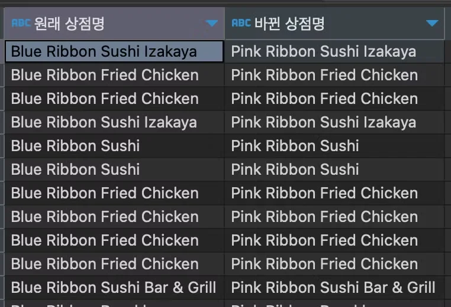
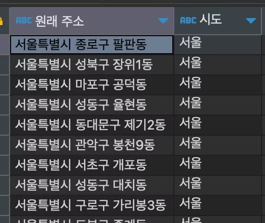
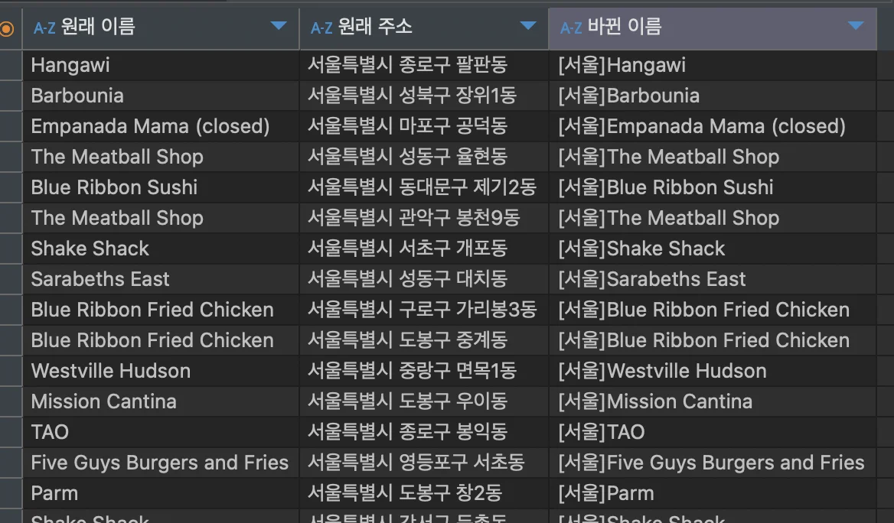
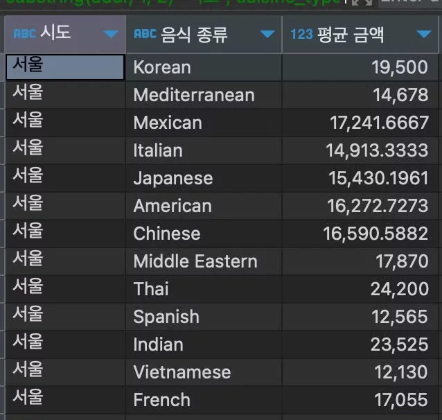
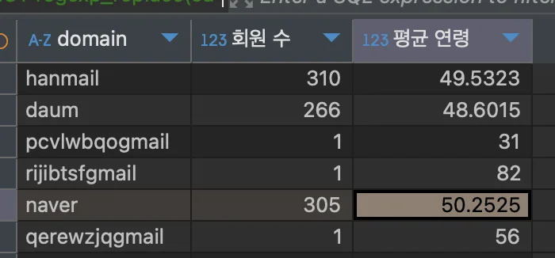
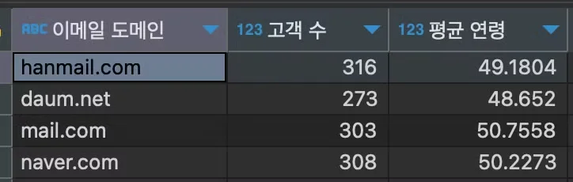
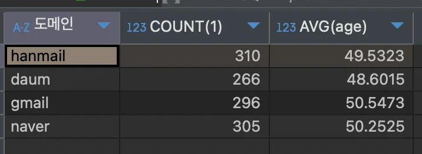
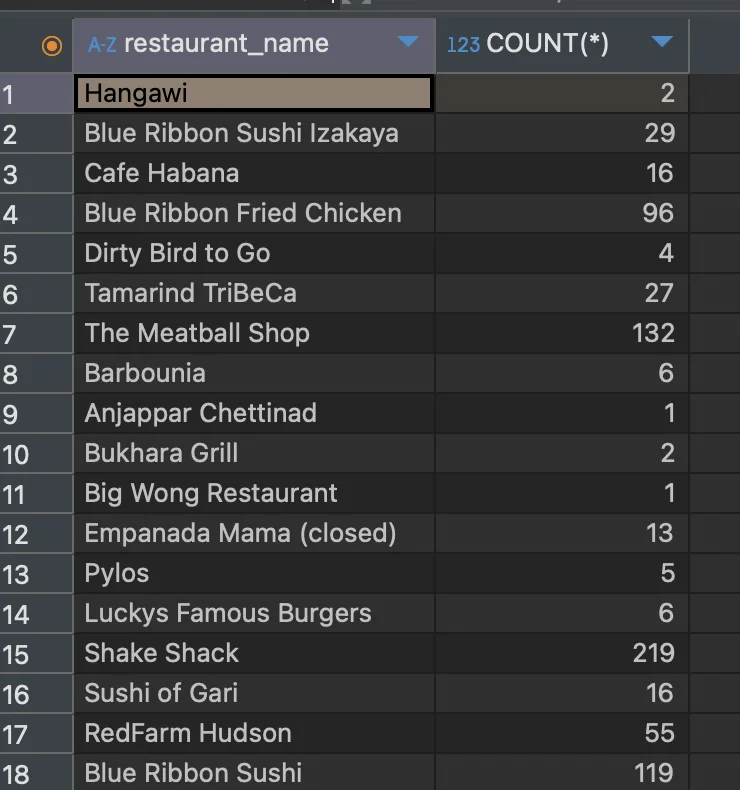
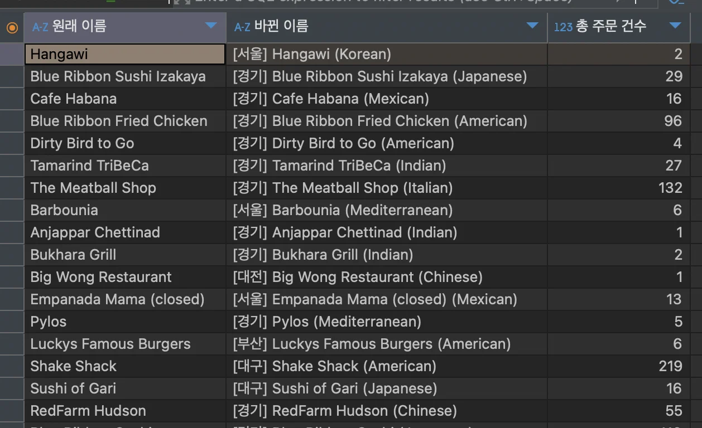

<a id="10beda9b0fe180d29f0bc8e2ebac5530"></a>

### String 가공

<details>
<summary><strong>특정 문자 다른 문자로 변경 ( </strong><strong><code>replace()</code></strong><strong> )</strong></summary>

<a id="10beda9b0fe18029ba50dec7881c1f4f"></a>

```sql
replace(바꿀 컬럼, 현재 값, 바꿀 값)
```

- 잘못된 정보를 수정 시

- 특정 포맷으로 변경 시

<details>
<summary>&#91; 실습 &#93;</summary>

<details>
<summary>1&#46;  식당명 변경&#58;  ‘Blue Ribbon’  →  ‘Pink Ribbone’</summary>

- 테이블&#58; <code>food&#95;orders</code>

- 컬럼&#58; <code>restaurant&#95;name</code>

- 조건 
    - ‘Blue’를 포함하는 식당명 

    - <code>where resturant&#95;name like ‘Blue%’</code>

- 수식
    - 문자 데이터 변경&#58; ‘Blue’  →  ‘Pink’ 

    - <code>replace(restaurant&#95;name, ‘Blue’, ‘Pink’)</code>

<a id="b3175810df2344c39d1edf97147dadde"></a>

<strong>SQL Query</strong>

<a id="10beda9b0fe180f0a383c0fa6109e360"></a>

```sql
SELECT restaurant_name as '원래 상점명', 
			 REPLACE(restaurant_name, 'Blue', 'Pibk') as '바뀐 상점명'
FROM food_orders
where restaurant_name like 'Blue%';
```

<a id="10beda9b0fe180cea3d1e74617d2b408"></a>

<strong>실행 결과</strong>



</details>

<details>
<summary>2&#46;  주소 변경&#58;  ‘문곡리  →  ‘문가리’ </summary>

- 테이블&#58; <code>food&#95;orders</code>

- 컬럼&#58;  주소 ( <code>addr</code> )

- 조건 
    - ‘문곡리’를 포함하는 주소명

    - <code>where addr like ‘%문곡리%’</code>

- 수식
    - 문자 데이터 변경&#58;  ‘문곡리’ → ‘문가리’ 

    - <code>replace(restaurant&#95;name, ‘문곡리’, ‘문가리’)</code>

<a id="1e61d7d16dcc4713b659d820dd29544c"></a>

<strong>SQL Query</strong>

<a id="10beda9b0fe180d497efc3143f0914b0"></a>

```sql
select addr "원래 주소",
       replace(addr, '문곡리', '문가리') "바뀐 주소"
from food_orders
where addr like '%문곡리%'
```

<a id="1d7df726d7e9469cbc5d4c200e5f57a9"></a>

<strong>실행 결과</strong>


</details>

</details>

</details>

<details>
<summary><strong>원하는 문자만 남기기 ( substring, </strong><strong><code>substr()</code></strong><strong> )</strong></summary>

<a id="10beda9b0fe1803d941cc481520f1294"></a>

```sql
substr(조회 할 컬럼, 시작 위치, 글자 수)
```

<details>
<summary>&#91; 실습 &#93; &#45;  서울 음식점들의 주소를 전체가 아닌 ‘시도’ 만 나오도록 수정</summary>

<a id="10beda9b0fe180be8d25c0f16741a3c4"></a>

```sql
select addr "원래 주소",
       substr(addr, 1, 2) "시도"
from food_orders
where addr like '%서울특별시%'
```



</details>

</details>

<details>
<summary><strong>여러 컬럼의 문자 합치기 ( </strong><strong><code>concat()</code></strong><strong> )</strong></summary>

<a id="10beda9b0fe18051b5a7d20525622cd3"></a>

```sql
concat(붙이고 싶은 값1, 붙이고 싶은 값2, 붙이고 싶은 값3, .....)
```

<details>
<summary>붙일 수 있는 문자 종류</summary>

- 컬럼

- 한글

- 영어

- 숫자

- 기타 특수 문자

</details>

<details>
<summary>&#91; 실습 &#93; &#45;  서울 시에 있는 음식점 ‘&#91;서울&#93; 음식점 명’ 이라고 수정</summary>

- 테이블&#58; <code>food&#95;orders</code>

- 컬럼&#58; 음식점 명 (<code>restaurant&#95;name</code>), 주소 ( <code>addr</code>)

- 조건
    - 서울 시에 있는 음식점
        - <code>where addr like ‘서울특별시%’</code>

- 수식
    - 주소에서 ‘서울’ 문자 추출, ‘&#91;’ , ‘&#93;’ , ‘restaurant&#95;name’ 합치기
        - <code>cancat(’&#91;’, substring(addr, 1, 2), ‘&#93;’, restaurant&#95;name) ‘바뀐 이름’</code>

<a id="9dc2d7c508bf48b5883c75a18ca954d0"></a>

<strong>SQL Query</strong>

<a id="3ba275390ac545b0bd4ae684c2c2c249"></a>

```sql
SELECT restaurant_name '원래 이름', addr '원래 주소', concat('[', substring(addr, 1, 2), ']', restaurant_name) "바뀐 이름"
FROM food_orders
WHERE addr like "서울특별시%"
```

<a id="10beda9b0fe180edb50cd2c2dfe87271"></a>

<strong>실행 결과 </strong>



</details>

</details>

---

<details>
<summary><strong>&#91; 실습 &#93; 문자 데이터를 바꾸고, GROUP BY 사용</strong></summary>

<details>
<summary>1&#46; 서울 지역의 음식 타입별 평균 음식 주문금액 구하기 </summary>

- 테이블&#58; <code>food&#95;orders</code>

- 컬럼&#58; 주소(<code>addr</code>), 음식 타입(<code>cuisine&#95;type</code>), 음식 주문 금액(<code>price</code>)

- 조건
    - 서울 지역

    - <code>where addr like ‘서울특별시%’</code>

- 수식
    - 음식 타입에 따라 평균 음식값 구하기

    - <code>group by cuisine&#95;type</code>, <code>avg(price)</code>

<a id="10beda9b0fe18060957cf6c9bc0797c4"></a>

<strong>SQL Query</strong>

<a id="10beda9b0fe18008954dd160cf9d8f52"></a>

```sql
select substring(addr, 1, 2) "시도",
       cuisine_type "음식 종류",
       avg(price) "평균 금액"
from food_orders
where addr like '%서울%'
group by 1, 2a
```

<a id="10beda9b0fe180308799faafebcc73c7"></a>

<strong>실행 결과</strong>



</details>

<details>
<summary><strong>2&#46; 이메일 도메인별 고객 수와 평균 연령 구하기</strong></summary>

<details>
<summary>🧐 <u>email 문자 데이터</u>에서 <strong><u>어떻게 도메인을 추출</u></strong>해 컬럼으로 생성하는가?</summary>

> MySQL 기준

<details>
<summary>예시) email 테이블 </summary>

<details>
<summary>users 테이블 생성 및 데이터 삽입</summary>

<details>
<summary>users 테이블 생성</summary>

<a id="10beda9b0fe180d7838affd6937d56b5"></a>

```sql
CREATE TABLE users (
    id INT AUTO_INCREMENT PRIMARY KEY,
    email VARCHAR(255) NOT NULL
);
```

</details>

<details>
<summary>데이터 삽입</summary>

<a id="10beda9b0fe1803aaee8d16baccf2aaf"></a>

```sql
INSERT INTO users (email) VALUES 
('xzvnliwj@hanmail.com'),
('byuvhegb@hanmail.com'),
('dzelcyxr@daum.net'),
('bvenkwwi@daum.net'),
('iultimnz@hanmail.com'),
('dswjadxo@daum.net'),
('xruymsbr@daum.net'),
('ltpckfpw@hanmail.com'),
('pcvlwbqogmail.com'),
('azhnsuoh@hanmail.com'),
('yntxjnie@hanmail.com'),
('rijibtsfgmail.com'),
('lujrraqz@naver.com');
```

</details>

</details>

| Email |
| --- |
| xzvnliwj&#64;hanmail&#46;com |
| byuvhegb&#64;hanmail&#46;com |
| dzelcyxr&#64;daum&#46;net |
| bvenkwwi&#64;daum&#46;net |
| iultimnz&#64;hanmail&#46;com |
| dswjadxo&#64;daum&#46;net |
| xruymsbr&#64;daum&#46;net |
| ltpckfpw&#64;hanmail&#46;com |
| pcvlwbqogmail&#46;com |
| azhnsuoh&#64;hanmail&#46;com |
| yntxjnie&#64;hanmail&#46;com |
| rijibtsf&#64;gmail&#46;com |
| lujrraqz&#64;naver&#46;com |

</details>

---

<details>
<summary>방법 1) <strong><code>SUBSTRING&#95;INDEX 함수</code></strong></summary>

- <code>SUBSTRING&#95;INDEX(email, &#39;&#64;&#39;, &#45;1)</code>
    - email 칼럼에서 ‘&#64;’ 뒤의 도메인 부분만 추출

- <code>COUNT(&#42;)</code>
    - 해당 도메인에 속하는 이메일 주소의 개수 카운팅

- <code>GROUP BY domain</code>
    - 도메인별로 회원 수를 계산하기 위해 도메인별로 그룹화

<a id="10beda9b0fe18039beabf80cd83bc38c"></a>

<strong>SQL Query</strong>

<a id="d689c119bb7e4e6ba1162b0052c330d0"></a>

```sql
SELECT 
    SUBSTRING_INDEX(email, '@', -1) AS domain,
    COUNT(*) AS member_count
FROM 
    users
GROUP BY 
    domain;
```

<a id="10beda9b0fe18007b3efd27b6445656f"></a>

<strong>실행 결과 </strong>

| domain | member&#95;count |
| --- | --- |
| hanmail&#46;com | 6 |
| daum&#46;net | 4 |
| naver&#46;com | 1 |
| gmail&#46;com | 2 |

</details>

<details>
<summary><strong>방법 1&#46;1) </strong><strong><code>REPLACE</code></strong><strong> </strong></summary>

- 2중첩 replace&#58; 도메인에서 <code>&#46;com</code>, <code>&#46;net</code> 제거
    - <code>REPLACE(REPLACE( … &#39;&#46;com&#39;, &#39;&#39;), &#39;&#46;net&#39;, &#39;&#39;)</code> 

<a id="39ed793e13ae46c589a6f032c5c96773"></a>

<strong>SQL Query</strong>

<a id="10beda9b0fe1801cacecc8a90bb5f221"></a>

```sql
SELECT
    REPLACE(REPLACE(SUBSTRING_INDEX(email, '@', -1), '.com', ''), '.net', '') AS domain, 
    COUNT(*) AS user_count
FROM
    your_table_name
GROUP BY
    domain;
```

<a id="1199c257557646d6a4db83133531e308"></a>

<strong>실행 결과 </strong>

| domain | member&#95;count |
| --- | --- |
| hanmail | 6 |
| daum | 4 |
| naver | 1 |
| gmail | 2 |

</details>

<details>
<summary><strong>방법 1&#46;2)</strong> <strong><code>REGEXP&#95;REPLACE </code></strong><strong>(MySQL 8&#46;0 이상)</strong></summary>

- <code>&#46;com</code>, <code>&#46;net</code> 을 정규표현식으로 제거

<a id="10beda9b0fe180659087ec0ce6fb0230"></a>

```sql
SELECT
    REGEXP_REPLACE(SUBSTRING_INDEX(email, '@', -1), '\\.com|\\.net', '') AS domain,  
    COUNT(*) AS user_count
FROM
    your_table_name
GROUP BY
    domain;
```

<a id="10beda9b0fe1804983fdce1f33044390"></a>

실행 결과 

| domain | member&#95;count |
| --- | --- |
| hanmail | 6 |
| daum | 4 |
| naver | 1 |
| gmail | 2 |

</details>

---

<details>
<summary>방법 2) <strong><code>REGEXP&#95;SUBSTR </code></strong><strong>&#43; </strong><strong><code>REGEXP&#95;REPLACE</code></strong></summary>

- <code>REGEXP&#95;SUBSTR(email, &#39;&#64;(&#46;&#43;)&#36;&#39;)</code>
    - 이메일 주소에서 &#64; 이후의 문자열을 추출

    - <code>(&#46;&#43;)&#36;</code>&#58; 모든 문자를 포함하는 그룹을 캡처
        <a id="10beda9b0fe180d4b28fc339939ae38b"></a>

        ⇒  &#64;hanmail&#46;com or  &#64;daum&#46;net …

- <code>REGEXP&#95;REPLACE(&#46;&#46;&#46;, &#39;&#92;&#92;&#46;com&#124;&#92;&#92;&#46;net&#39;, &#39;&#39;)</code>
    - 정규 표현식을 사용하여 특정 패턴(<code>&#92;&#92;&#46;com</code>,<code>&#92;&#92;&#46;net</code>)  을 다른 문자열(<code>&#39;&#39;</code>)로 대체
        <a id="909421e4a903489581a893f13d532acf"></a>

        ⇒ 도메인에서 &#46;<code>com</code>이나 <code>&#46;net</code>이 제거

<a id="10beda9b0fe1804bb157f277d773e7f9"></a>

<strong>SQL Query</strong>

<a id="10beda9b0fe180cf90aee841335e34c6"></a>

```sql
SELECT
    REGEXP_REPLACE(
        REGEXP_SUBSTR(email, '@(.+)$'),   -- '@' 이후의 모든 문자열을 추출
        '\\.com|\\.net', ''                -- .com 또는 .net을 제거
    ) AS domain,
    COUNT(*) AS user_count
FROM
    your_table_name                       -- 이메일이 저장된 테이블 이름
GROUP BY
    domain;                               -- 도메인별로 그룹화
```

<a id="5e7ce6b5a2b3456db61e2b3d1ac57170"></a>

<strong>실행 결과 </strong>

| domain | member&#95;count |
| --- | --- |
| hanmail | 6 |
| daum | 4 |
| naver | 1 |
| gmail | 2 |

</details>

</details>

<details>
<summary>내 풀이</summary>

- 테이블&#58; 고객 테이블 ( <code>customers</code> )

- 컬럼&#58; <code>email</code>, 

- 조건
    - email 문자에서 도메인 추출
        - <code>substring&#95;index(email, ‘&#64;’, &#45;1) as ‘domain’</code>

    - 추출한 도메인 값에서 <code>&#46;com</code>, <code>&#46;net</code> 제거
        - 1) replace
            - <code>replace(replace( …, ‘&#46;com’, ‘’), ‘&#46;net’&#46; ‘’)</code>

        - 2) 정규식&#58; regexp&#95;replace
            - <code>regexp&#95;replace(…, &#39;&#92;&#92;&#46;com&#124;&#92;&#92;&#46;net&#39;, &#39;&#39;)</code>

- 수식
    - domain 마다 
        - <code>group by domain</code>

        ---

        - <u>domain 마다</u> 회원 수 구하기 
            - <code>count(&#42;)</code>

        - <u>domain 마다</u> 평균 연령
            - <code>avg(age)</code>

<a id="0d732f200dee4e13ae57263148ef0897"></a>

<strong>SQL Query</strong>

<a id="dbe4e43485e948068e6066ac360d8fd9"></a>

```sql
SELECT regexp_replace(substring_index(email, '@', -1), '\\.com|\\.net','') as 'domain',
			 count(*) as "회원 수", 
			 avg(age) as "평균 연령"
FROM customers
group by domain
```

<a id="1bd9965dd2884657b55d2b17728cb9e3"></a>

<strong>실행 결과</strong>

> 테이블 오류) gmail에 ‘&#64;’ 빠짐<br>⇒ <code>조건(if)</code> &#91;실습&#93; 에서 해결



</details>

<details>
<summary>강의 풀이</summary>

- group by 인덱싱 가능
    - select한 컬럼의 인덱싱 가능하다&#46; 

    - ex) 1 → 도메인, 3 → 평균 연령

- <code>substring(email, 10)</code>
    - 문자열의 10 인덱스 부터 끝까지

    > ⚠️ 
    > 
    > <a id="72841a45e697400cba2f1692cc605cac"></a>
    > 
    > 문제점
    > 
    > <a id="10beda9b0fe180a08d4dd96abea2922b"></a>
    > 
    > 해당하는 테이블 예시는 회원 아이디를 10개의 문자로 고정해서 만들어서 가능하지만,
    > 
    > <a id="10beda9b0fe180f4abd1e0d3bd5ffb45"></a>
    > 
    > 실제 실무에서는 그렇지 않기 때문에 오류가 발생할 수 있는 방법이다&#46; <br><br>⇒  <code>substring&#95;index(email, ‘&#64;’, &#45;1)</code>  

<a id="10beda9b0fe180879cfcf32798b2a750"></a>

<strong>SQL Query</strong>

<a id="10beda9b0fe180efafd0dd5e8e2e6dd3"></a>

```sql
select substring(email, 10) "도메인",
       count(customer_id) "고객 수",
       avg(age) "평균 연령"
from customers
group by 1
```

<a id="10beda9b0fe180c480ded236eaca765b"></a>

<strong>실행 결과</strong>



</details>

<details>
<summary>if 문을 통해 잘못된 email(gmail)  수정</summary>

<a id="963652dce7144a898c21f6db33208e20"></a>

<strong>SQL Query</strong>

<a id="10beda9b0fe180478d67efe36339660f"></a>

```sql
SELECT 
			REGEXP_REPLACE(
					SUBSTRING_INDEX(
							if(
									email like '%gmail%',
									REPLACE(email, 'gmail', '@gmail'), 
									email 
							), 
							'@', -1
					), 
					'\\.com|\\.net', ''
			) as '도메인'
, COUNT(1)
, AVG(age) 
FROM customers
group by 1

```

<a id="1a6882c75bef40359ea96f6c50d85134"></a>

<strong>실행 결과 </strong>



</details>

</details>

<details>
<summary>3&#46; ‘&#91;지역(시도)&#93; 음식점이름 (음식종류)’ 컬럼을 만들고, 총 주문건수 구하기</summary>

<details>
<summary>🧐 음식점 마다 주문 건 수 구하기 </summary>

<a id="bfc54068915c432f8be637aaca56bf0e"></a>

```sql
SELECT restaurant_name, COUNT(*) 
FROM food_orders
group by restaurant_name 
```



</details>

- 테이블&#58; <code>food&#95;orders</code>

- 컬럼&#58; 주소(<code>addr</code>), 음식점 명(<code>restaurant&#95;name</code>),  음식 종류(<code>cuisine&#95;type</code>)

- 조건
    - <strong><u>‘&#91;지역(시도)&#93; 음식점이름 (음식종류)’</u></strong><strong>  </strong>컬럼 생성
        - <code>concat(’&#91;’, substring(addr, 1, 2), ‘&#93;’, restaurant&#95;name, ‘(’, cuisine&#95;type, ‘)’)</code>

    - 음식점 마다 총 주문 건 수 구하기 
        - <code>count(1)</code> → <code>group by restaurant&#95;name</code>

- 수식
    - 음식점 마다 
        - <code>group by restaurant&#95;name</code>

<a id="1df58136ed4948f896b5e45059bfb3d7"></a>

<strong>SQL Query</strong>

<a id="ded0a2c440b346e098631e60d11de02f"></a>

```sql
SELECT restaurant_name "원래 이름", 
			 CONCAT('[', SUBSTRING(addr, 1, 2), '] ', restaurant_name, ' (', cuisine_type, ')')  as "바뀐 이름", 
			 COUNT(*) "총 주문 건수"
FROM food_orders
group by restaurant_name 
```

<a id="ab9b8a5d9e084ae79615bf60e400f4d9"></a>

<strong>실행 결과</strong>



</details>

</details>
