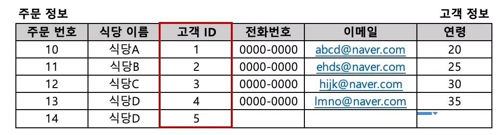

<a id="110eda9b0fe1806882abcbc51bde265a"></a>

## 4주차 복습

---

<a id="110eda9b0fe180ceb037f44a0c852c6b"></a>

### 1&#46; subquery

> query 중첩, query 결과를 다른 query에 활용

- 1 중첩
    <a id="110eda9b0fe180b69407dca516e270e5"></a>

    ```sql
    select column1, column2, column3
    from 
    (  // subquery 
    select column1, column2, column3
    from table1
    ) a
    ```

-  2중첩 
    <a id="110eda9b0fe1807ebd33c37502915a14"></a>

    ```sql
    select column1, column2, column3
    from 
    (  // subquery 1
    select column1, column2, column3
    from 
    (  // subquery 2
    select column1, column2, column3
    from table1
    ) a
    ) b
    ```

<a id="110eda9b0fe180f097dae12e4667c297"></a>

### 2&#46; join

> 2개 이상의 테이블을 결합해 사용

<details>
<summary>Left Join</summary>

<a id="110eda9b0fe180ffb648df4dd56694ce"></a>

```sql
-- LEFT JOIN
select 조회 할 컬럼
from 테이블1 a left join 테이블2 b on a.공통컬럼명 = b.공통컬럼명
```

<a id="110eda9b0fe180f6ab59e8d796dad1c7"></a>

공통 컬럼을 키 값으로 <strong><u>하나의 테이블에 값이 존재하지 않</u></strong>아도 조회



</details>

<details>
<summary>Inner Join</summary>

<a id="110eda9b0fe18040a076dd4494bd220b"></a>

```sql
-- INNER JOIN
select 조회 할 컬럼
from 테이블1 a inner join 테이블2 b on a.공통컬럼명 = b.공통컬럼명
```

<a id="110eda9b0fe18014aa06ff6c6cae78c7"></a>

공통컬럼을 키 값으로 <strong><u>양쪽 모두에 존재하는 값만 조</u></strong>회함


</details>
