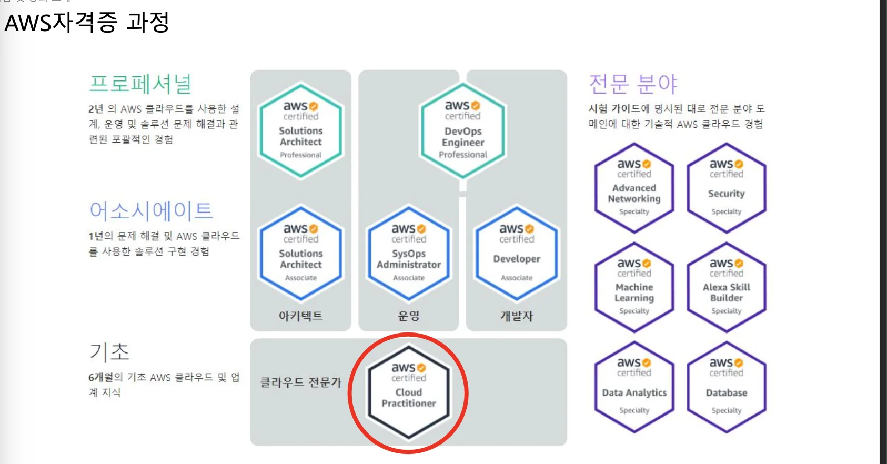
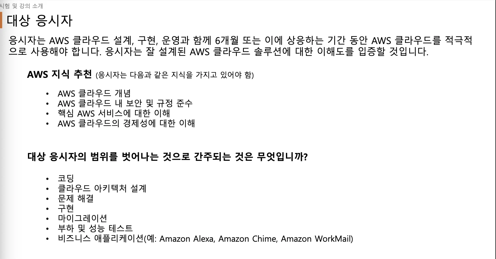
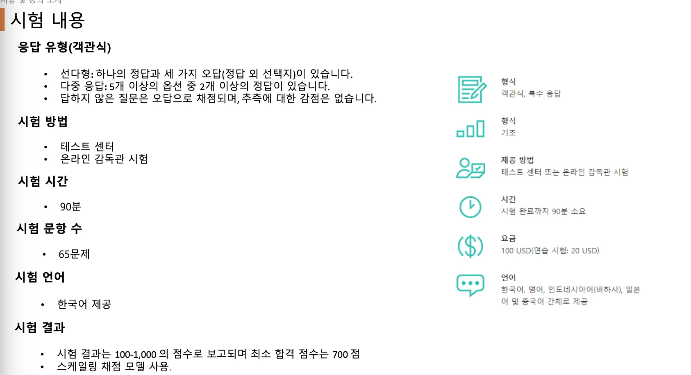
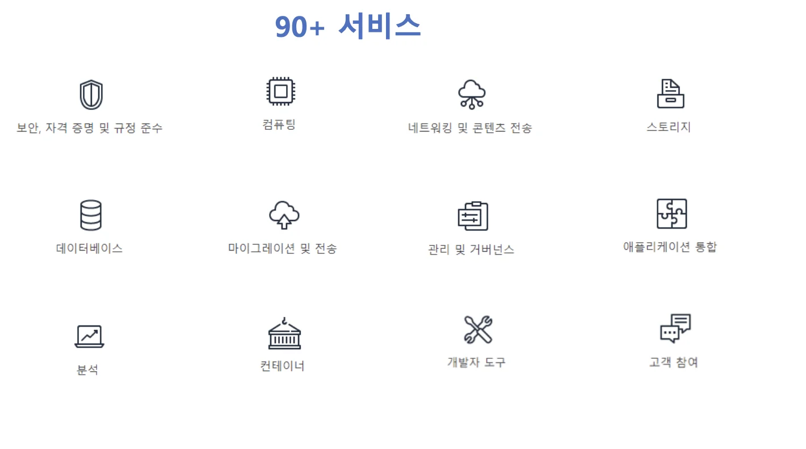
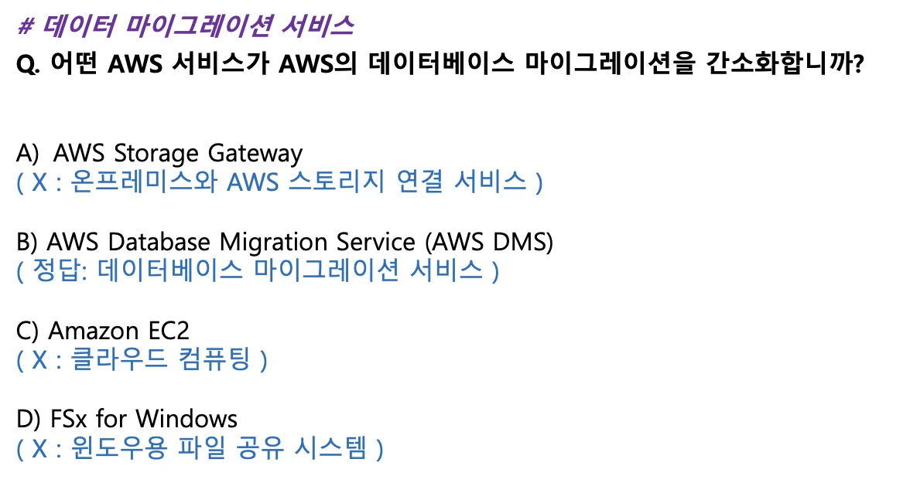

> 📌 <a href="https://www.inflearn.com/course/aws-%EC%9E%90%EA%B2%A9%EC%A6%9D-%ED%81%B4%EB%9D%BC%EC%9A%B0%EB%93%9C-%EA%B8%B0%EC%B4%88/dashboard">&#91; 인프런 &#45; </a><strong><a href="https://www.inflearn.com/course/aws-%EC%9E%90%EA%B2%A9%EC%A6%9D-%ED%81%B4%EB%9D%BC%EC%9A%B0%EB%93%9C-%EA%B8%B0%EC%B4%88/dashboard">AWS Certified Cloud Practitioner 자격증 준비</a></strong><a href="https://www.inflearn.com/course/aws-%EC%9E%90%EA%B2%A9%EC%A6%9D-%ED%81%B4%EB%9D%BC%EC%9A%B0%EB%93%9C-%EA%B8%B0%EC%B4%88/dashboard"> &#93;</a>  학습 및 정리

### 시험

시험 범위 

약 200개 이상의 서비스 중 90개 정도

ex) 문제

### 🍀 Chapter

[01. AWS 클라우드](#/post/1c3eda9b-0fe1-8121-82c3-cd82c67ae795)

[02. Identity and Access Management (IAM)](#/post/1c3eda9b-0fe1-8158-8900-fc31fa7f0bb9)

[03. Amazon Elastic Compute Cloud (Amazon EC2)](#/post/1c3eda9b-0fe1-8126-af35-d1528aef718b)

[04. EC2 스토리지](#/post/1c3eda9b-0fe1-816d-b788-f77dda370f01)

[05. Elastic Load Balancing & Auto Scaling](#/post/1c3eda9b-0fe1-8109-a86e-e1f93adea3f7)

[06. 컴퓨팅 서비스](#/post/1c3eda9b-0fe1-8177-a94f-c1a000a8f363)

[07. Amazon Simple Storage Service (Amazon S3)](#/post/1c3eda9b-0fe1-81d2-9273-f30d94365fe2)

[08. 스토리지 및 데이터 전송](#/post/1c3eda9b-0fe1-81e5-9615-f84b6e9168f5)

[09. 데이터베이스](#/post/1c3eda9b-0fe1-811c-925e-fba4fdfd7577)

[10. 데이터 분석 서비스](#/post/1c3eda9b-0fe1-81fb-a931-ed6308cb8abb)

[11. 네트워킹 및 콘텐츠 전송](#/post/1c3eda9b-0fe1-8178-83b5-e1c8399ac9df)

[12. 애플케이션 통합](#/post/1c3eda9b-0fe1-8153-97ba-dd0872688b95)

[13. 보안, 자격 증명 및 규정 준수](#/post/1c3eda9b-0fe1-8123-8a93-ff83c8b11886)

[14. 관리, 모니터링 및 거버넌스](#/post/1c3eda9b-0fe1-81f7-9d75-e61627441a49)

[15. 마이그레이션 서비스](#/post/1c3eda9b-0fe1-8142-936e-eabf244ebc68)

[16. 개발자 도구](#/post/1c3eda9b-0fe1-816a-952c-dd6eed0aaec7)

[17. 머신 러닝](#/post/1c3eda9b-0fe1-81b0-86c9-ef3b777cdcda)

[18. 인프라 자동화](#/post/1c3eda9b-0fe1-8178-8321-ca767f582298)

[19. AWS 기술지원](#/post/1c3eda9b-0fe1-81ab-bd75-e9b63ceb417c)

[20. AWS 비용관리](#/post/1c3eda9b-0fe1-8192-81c4-d55f3adf51ea)

[21. AWS Well-Architected Framework](#/post/1c3eda9b-0fe1-81e7-b777-e80d1052c216)

[22. AWS Cloud Adoption Framework ( AWS CAF )](#/post/1c3eda9b-0fe1-810e-9030-cd526615634f)

[23. 문제풀이](#/post/1c3eda9b-0fe1-812a-9948-c68ec35f0c75)

[24. 시험 예약](#/post/1c3eda9b-0fe1-8195-aea2-d42f1d092930)
