<a id="1d4eda9b0fe180d78075d82c72d4cf99"></a>

###  Map

---

> ✏️ 
> 
> <a id="1d4eda9b0fe180d19767eb3da7eb8b9e"></a>
> 
> <strong>Map</strong>
> 
> ---
> 
> 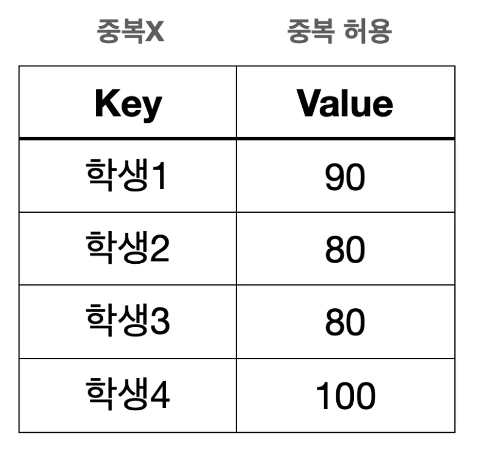
> 
> <a id="1d4eda9b0fe180d59926d521536b19db"></a>
> 
> <code>Map</code>은 <code>key&#58;value</code>의 쌍으로 저장하는 자료구조이다&#46; 
> 
> - <strong><code>키</code></strong>는 맵 내에서 <strong><u>유일</u></strong>해야한다&#46; &#45; 키(Key)&#58; 중복 ❌
> 
> - 키를 통해 값을 빠르게 검색할 수 있다&#46; <code>O(1)</code>
> 
> - 키는 중복될 수 없지만, 값은 중복될 수 있다&#46;  &#45; 값(Value)&#58; 중복 <strong>O</strong>
> 
> - <code>Map</code>은 순서를 유지하지 않는다&#46; 

<a id="1d4eda9b0fe18073b765d38917d347eb"></a>

### 컬렉션 프레임워크 &#45; Map

> ✏️ 
> 
> <a id="1d4eda9b0fe18055bf09f215cebcee48"></a>
> 
> 자바는 <code>HashMap</code>, <code>TreeMap</code>, <code>LinkedHashMap</code> 등 다양한 <code>Map</code> 구현체를 제공한다&#46; 
> 
> <a id="1d4eda9b0fe180e68004c39af68056dd"></a>
> 
> 이들은 <code>Map</code> 인터페이스의 메서드를 구현하며, 다른 특성과 성능 특징을 가지고 있다&#46; 

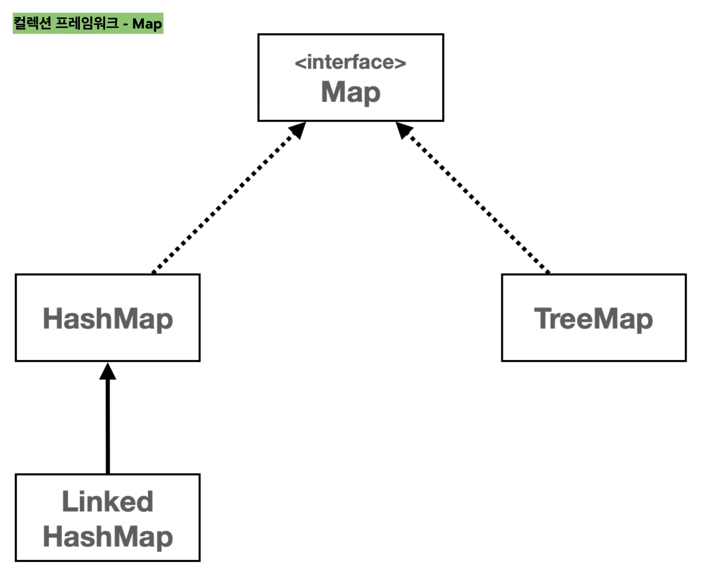

<a id="1d4eda9b0fe180789e79f55873838eb1"></a>

### <strong>Map 인터페이스의 </strong><strong>주요 메서드</strong>

| 메서드 | 설명 |
| --- | --- |
| <strong><code>put(K key, V value)</code></strong> | 지정된 키와 값을 맵에 저장한다&#46; <br>(같은 키가 있으면 값을 변경 ) |
| <strong><code>putAll(Map&#60;? extends K, ? extends V&#62; m)</code></strong> | 지정된 맵의 모든 매핑을 현재 맵에 복사한다&#46; |
| <strong><code>putIfAbsent(K key, V value)</code></strong> | 지정된 키가 없는 경우에 키와 값을 맵에 저장한다&#46; |
| <strong><code>get(Object key)</code></strong> | 지정된 키에 연결된 값을 반환한다&#46;  |
| <strong><code>getOrDefault(Object key, V defaultValue)</code></strong> | 지정된 키에 연결된 값을 반환한다&#46; <br>키가 없는 경우 <code>defaultValue</code>로 지정된 값을 대신 반환한다&#46; |
| <strong><code>remove(Object Key)</code></strong> | 지정된 키와 그에 연결된 값을 맵에서 제거헌다&#46; |
| <strong><code>clear()</code></strong> | 맵에서 모든 키와 값을 제거한다  |
| <strong><code>containsKey(Object key)</code></strong> | 맵이 지정된 키를 포함하고 있는지 여부를 반환한다&#46; |
| <strong><code>containsValue(Object value)</code></strong> | 맵이 하나 이상으 키에 지정된 값을 연결하고 있는지 여부를 반환한다&#46;  |
| <strong><code>keySet()</code></strong> | 맵의 키들을 <code>Set</code> 형태로 반환한다&#46;  |
| <strong><code>values()</code></strong> | 맵의 값들을 <code>Collection</code> 형태로 반환한다&#46; |
| <strong><code>entrySet()</code></strong> | 맵의 키&#45;값 쌍을 <code>Set&#60;Map&#46;Entry&#60;K, V&#62;&#62;</code> 형태로 반환한다&#46;  |
| <strong><code>size()</code></strong> | 맵에 있는 키&#45;값 쌍의 개수를 반환한다&#46;  |
| <strong><code>isEmpty()</code></strong> | 맵이 비어 있는지 여부를 반환한다&#46;   |

<a id="1d4eda9b0fe180218079cf34f631980d"></a>

### HashMap 예제

> 💬 
> 
> <a id="1d4eda9b0fe180d88728d8d6fba768d6"></a>
> 
> Map 구현체들 중 HashMap을 가장 많이 사용한다&#46; 

<details>
<summary>예제 1</summary>

<details>
<summary>&#91; 코드 &#93; MapMain1</summary>

<a id="1d4eda9b0fe18007ba56d7f23a70f1d4"></a>

```java
package collection.map;

import java.util.Collection;
import java.util.HashMap;
import java.util.Map;
import java.util.Set;

public class MapMain1 {

    public static void main(String[] args) {
        Map<String, Integer> studentMap = new HashMap<>();

        // 학생 성적 데이터 추가
        studentMap.put("studentA", 90);
        studentMap.put("studentB", 80);
        studentMap.put("studentC", 80);
        studentMap.put("studentD", 100);
        System.out.println(studentMap);

        // 특정 학생의 값 조회
        Integer result = studentMap.get("studentD");
        System.out.println("result = " + result);

        System.out.println("keySet 활용");
        Set<String> keySet = studentMap.keySet();
        for (String key : keySet) {
            Integer value = studentMap.get(key);
            System.out.println("key=" + key + ", value=" + value);
        }

        System.out.println("entrySet 활용");
        Set<Map.Entry<String, Integer>> entries = studentMap.entrySet();
        for (Map.Entry<String, Integer> entry : entries) {
            String key = entry.getKey();
            Integer value = entry.getValue();
            System.out.println("key=" + key + ", value=" + value);
        }

        System.out.println("values 활용");
        Collection<Integer> values = studentMap.values();
        for (Integer value : values) {
            System.out.println("value = " + value);
        }
    }
}

```

</details>

<details>
<summary>실행 결과</summary>

<a id="1d4eda9b0fe180a1918fefde56a11f46"></a>

```plaintext
studentB=80, studentA=90, studentD=100, studentC=80} 
result = 100

KeySet 활용 
key=studentB, value=80 
key=studentA, value=90 
key=studentD, value=100 
key=studentC, value=80

entrySet 활용 
key=studentB, value=80 
key=studentA, value=90 
key=studentD, value=100
key=studentC, value=80

values 활용 
value = 80 
value = 90 
value = 100 
value = 80
```

</details>

</details>

<details>
<summary>예제 2</summary>

<details>
<summary>&#91; 코드 &#93; MapMain2</summary>

<a id="1d4eda9b0fe180feb202cf412cf669cd"></a>

```java
package collection.map;

import java.util.HashMap;
import java.util.Map;

public class MapMain2 {

    public static void main(String[] args) {
        Map<String, Integer> studentMap = new HashMap<>();

        // 학생 성적 데이터 추가
        studentMap.put("studentA", 90);
        System.out.println(studentMap);


        studentMap.put("studentA", 100); //같은 키에 저장시 기존 값 교체
        System.out.println(studentMap);

        boolean containsKey = studentMap.containsKey("studentA");
        System.out.println("containsKey = " + containsKey);

        // 특정 학생의 값 삭제
        studentMap.remove("studentA");
        System.out.println(studentMap);
    }
}
```

</details>

<details>
<summary>실행 결과</summary>

<a id="1d4eda9b0fe180839d19d06546e74da4"></a>

```plaintext
 {studentA=90}
 {studentA=100}
 containsKey = true
 {}
```

</details>

</details>

<details>
<summary>예제 3</summary>

<details>
<summary>&#91; 코드 &#93; MapMain3</summary>

<a id="1d4eda9b0fe1809ab888e5774b565374"></a>

```java
package collection.map;

import java.util.HashMap;
import java.util.Map;

public class MapMain3 {

    public static void main(String[] args) {
        HashMap<String, Integer> studentMap = new HashMap<>();

        // 학생 성적 데이터 추가
        studentMap.put("studentA", 50);
        System.out.println(studentMap);

        // 학생이 없는 경우에만 추가1
        if (!studentMap.containsKey("studentA")) {
            studentMap.put("studentA", 100);
        }
        System.out.println(studentMap);

        // 학생이 없는 경우에만 추가2
        studentMap.putIfAbsent("studentA", 100);
        studentMap.putIfAbsent("studentB", 100);
        System.out.println(studentMap);
    }
}
```

</details>

<details>
<summary>실행 결과</summary>

<a id="1d4eda9b0fe180f49f23e1cccd264bec"></a>

```plaintext
{studentA=50}
{studentA=50}
{studentB=100, studentA=50}
```

</details>

</details>

<a id="1d4eda9b0fe180809400e3a0e9fa1535"></a>

### NOTES

<details>
<summary>키 목록 조회</summary>

> ✏️ 
> 
> <a id="1d4eda9b0fe18035806cf5d58b8513c0"></a>
> 
> <code>Map</code> 의 키는 중복을 허용하지 않는다&#46;
> 
> <a id="1d4eda9b0fe18071acceda07ce758459"></a>
> 
>  따라서 <code>Map</code> 의 모든 키 목록을 조회하는 <code>keySet()</code> 을 호출하면, 중복을 허용하지 않는 자료 구조인 <code>Set</code> 을 반환한다&#46;

<a id="1d4eda9b0fe1800bb822f092917c2dfd"></a>

```java
Set<String> keySet = studentMap.keySet()
```

</details>

<details>
<summary>키와 값 목록 조회</summary>

<a id="1d4eda9b0fe1807b929ffc25346d4864"></a>

<strong>Entry Key&#45;Value Pair</strong>

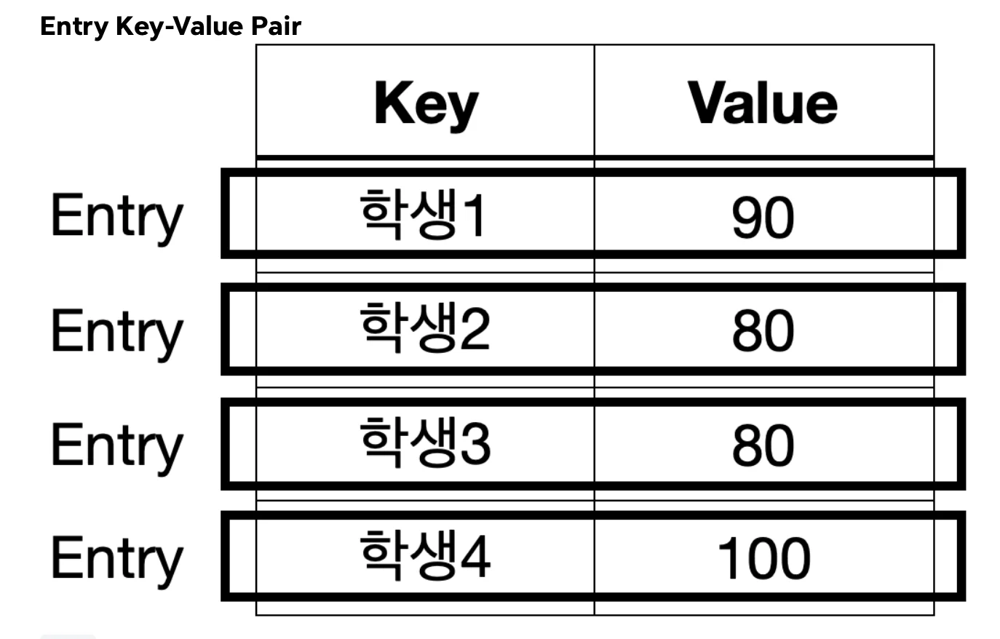

- <strong><code>Map</code></strong><strong>은 키와 값을 보관하는 자료구조이다&#46;<br> 따라서 </strong><strong>키와 값을 하나로 묶을 수 있는 방법</strong><strong>이 필요하다&#46;  이때 </strong><strong><u>Entry</u></strong><strong><u>를 사용</u></strong><strong>한다&#46;</strong>

- <strong><code>Entry</code></strong><strong>는 키&#45;값의 쌍으로 이루어진 간단한 객체이다&#46; </strong>
    - <strong><code>Map</code></strong><strong> 내부에서  키와 값을 함께 묶어서 저장할 때 사용한다&#46;</strong>

- <strong>쉽게 이야기해서 우리가 </strong><strong><code>Map</code></strong><strong> 에 키와 값으로 데이터를 저장하면 </strong><strong><code>Map</code></strong><strong>은 내부에서 키와 값을 하나로 묶는 </strong><strong><code>Entry</code></strong><strong> 객체를 만들어서 보관한다&#46; </strong>

- <strong>참고로 하나의 </strong><strong><code>Map</code></strong><strong> 에 여러 </strong><strong><code>Entry</code></strong><strong> 가 저장될 수 있다&#46;</strong>

<a id="1d4eda9b0fe18098a403c76e0bc94e8b"></a>

<strong><br><br></strong><br>	<br>

</details>

<details>
<summary>값 목록 조회</summary>

<a id="1d4eda9b0fe1809cb07bc63b82a69a18"></a>

```java
Collection<Integer> values = studentMap.values()
```

<a id="1d4eda9b0fe180bc85e4cf7891a1b5e7"></a>

<code>Map</code> 의값 목록을 중복을 허용한다 &#46;따라서 중복을 허용하지 않는 <code>Set</code>으로 반환할 수는 없다&#46; 그리고 입력 순서를 보장하지 않기 때문에 <code>List</code>로 반환하기도 애매하다&#46;

<a id="1d4eda9b0fe18074a18bc2dc88a8dae4"></a>

따라서 단순히 값의 모음이라는 의미의 상위 인터페이스인 <code>Collection</code>으로 반환한다&#46;

</details>

<details>
<summary><code>putIfAbsent()</code></summary>

- 영어 그대로 없는 경우에만 입력하라는 뜻이다&#46; 

- 해당 메서드를 사용하면 키가 없는 경우에만 데이터를 저장하고 싶을 때<br> 코드 한줄로 편리하게 처리할 수 있다&#46;

</details>

<a id="1d4eda9b0fe1801c84ebdb8c21e0c221"></a>

### <strong>컬렉션 프레임워크 </strong>&#45; Map <strong>구현체</strong>

> ✏️ 
> 
> <a id="1d4eda9b0fe18058babdda4cdaa04438"></a>
> 
> 자바의 <code>Map</code> 인터페이스는 키&#45;값 쌍을 저장하는 자료 구조이다&#46; <code>Map</code> 은 인터페이스이기 때문에, 직접 인스턴스를 생성 할 수는 없고, 대신 <code>Map</code> 인터페이스를 구현한 여러 클래스를 통해 사용할 수 있다&#46; 대표적으로 <code>HashMap</code> , <code>TreeMap</code> , <code>LinkedHashMap</code> 이 있다&#46;

<a id="1d4eda9b0fe18024a6b6dec229c0eeb4"></a>

### 🧐 <code>Map</code> vs <code>Set</code>

> ✏️ 
> 
> - <code>Map</code> 의 키는 중복을 허용하지 않고 순서를 보장하지 않는다&#46;
> 
> - <code>Map</code>의 키가 바로 <code>Set</code>과 같은 구조이다&#46; 그리고 <code>Map</code> 은 모든 것이 <code>Key</code>를 중심으로 동작한다&#46;
> 
> - <code>Value</code>는 단순히 <code>Key</code> 옆에 따라 붙은 것 뿐이다&#46; <br><code>Key</code> 옆에 <code>Value</code>만 하나 추가해주면 <code>Map</code>이 되는 것이다&#46;
> 
> - <code>Map</code>과 <code>Set</code>은 거의 같다&#46; 단지 옆에 <code>Value</code>를 가지고 있는가 없는가의 차이가 있을 뿐이다&#46;

> <strong>Set 자료구조</strong>

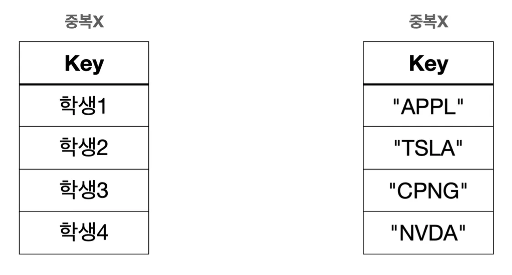

> <strong>Map 자료구조</strong>

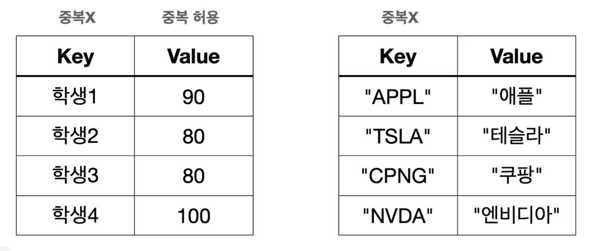

<a id="1d4eda9b0fe1807fae93c860f02f8046"></a>

이런 이유로 <code>Set</code> 과 <code>Map</code> 의 구현체는 거의 같다&#46; 

- <code>HashSet</code> → <code>HashMap</code> 

- <code>LinkedHashSet</code> →  <code>LinkedHashMap</code>

- <code>TreeSet</code> → <code>TreeMap</code>

> ☝🏻 
> 
> <a id="1d4eda9b0fe180e5944ce3345509a00d"></a>
> 
> <strong>참고</strong>
> 
> ---
> 
> <a id="1d4eda9b0fe180a48f91ce2520cfaa56"></a>
> 
> 실제로 자바 <code>HashSet</code> 의 구현은 대부분 <code>HashMap</code> 의 구현을 가져다 사용한다&#46;<br><code>Map</code> 에서 <code>Value</code> 만 비워두면 <code>Set</code> 으로 사용할 수 있다&#46;

<a id="1d4eda9b0fe18095b175d271aee361e6"></a>

### 1&#46; HashMap

- <strong><code>구조</code></strong>
    - <code>HashMap</code>은 해시를 사용해서 요소를 저장한다&#46; 

    - 키( <code>Key</code> ) 값은 해시 함수를 통해 해시 코드로 변환되고, 해당 해시 코드는 데이터를 저장하고 검색하는 데 사용된다&#46;

- <strong><code>특징</code></strong>
    - <u>삽입, 삭제, 검색</u> 작업은 해시 자료 구조를 사용하므로 일반적으로 상수 시간( <code>O(1)</code> )의 복잡도를 가진다&#46;

- <strong><code>순서</code></strong>
    - 순서를 보장하지 않는다&#46;

<a id="1d4eda9b0fe180f88cc0f68fc7425dd3"></a>

### 2&#46; LinkedHashMap

- <strong><code>구조</code></strong>
    - <code>LinkedHashMap</code> 은 <code>HashMap</code> 과 유사하지만, 연결 리스트를 사용하여 삽입 순서 또는 최근 접근 순서에 따라 요소를 유지한다&#46;

- <strong><code>특징</code></strong>
    - 입력 순서에 따라 순회가 가능하다&#46;

    - <code>HashMap</code>과 같지만 입력 순서를 링크로 유지해야 하므로 조금 더 무겁다

- <strong><code>성능</code></strong>
    -  <code>HashMap</code>과 유사하게 <u>대부분의 작업은 </u><u>O(1)</u>의 시간 복잡도를 가진다&#46;

- <strong><code>순서</code></strong>
    - 입력 순서를 보장한다&#46;

<a id="1d4eda9b0fe180d48690e8a8c03e9d28"></a>

### 3&#46; TreeMap

- <strong><code>구조</code></strong>
    - <code>TreeMap</code> 은 <strong><u>레드&#45;블랙 트리를 기반</u></strong>으로 한 구현이다&#46;

- <strong><code>특징</code></strong>
    - 모든 키는 자연 순서 또는 생성자에 제공된 <code>Comparator</code>에 의해 정렬된다

- <strong><code>성능</code></strong>
    -  <code>get</code> , <code>put</code> , <code>remove</code> 와 같은 <strong><u>주요 작업들은 </u></strong><strong><u>O(log n)</u></strong><strong><u>의 시간 복잡도</u></strong>를 가진다

- <strong><code>순서</code></strong>
    - 키는 정렬된 순서로 저장된다&#46;

<a id="1d4eda9b0fe180979f81d6b7c765c841"></a>

### 코드 예제

<details>
<summary>&#91; 코드 &#93; JavaMapMain</summary>

<a id="1d4eda9b0fe1809c83fad8feab0ba2ca"></a>

```java
package collection.map;

import java.util.*;


public class JavaMapMain {

    public static void main(String[] args) {
        run(new HashMap<>());
        run(new LinkedHashMap<>());
        run(new TreeMap<>());
    }

    private static void run(Map<String, Integer> map) {
        System.out.println("map = " + map.getClass());
        map.put("C", 10);
        map.put("B", 20);
        map.put("A", 30);
        map.put("1", 40);
        map.put("2", 50);

        Set<String> keySet = map.keySet();
        Iterator<String> iterator = keySet.iterator();
        while (iterator.hasNext()) {
            String key = iterator.next();
            System.out.print(key + "=" + map.get(key) + " ");
        }
        System.out.println();
    }
}

```

</details>

<details>
<summary>실행 결과</summary>

<a id="1d4eda9b0fe1802bae84f8ea3967f39e"></a>

```plaintext
map = class java.util.HashMap
A=30 1=40 B=20 2=50 C=10 

map = class java.util.LinkedHashMap
C=10 B=20 A=30 1=40 2=50 

map = class java.util.TreeMap
1=40 2=50 A=30 B=20 C=10 
```

- <code>HashMap</code> &#58; 입력한 순서를 보장하지 않는다&#46;

-  <code>LinkedHashMap</code> &#58; 키를 기준으로 입력한 순서를 보장한다&#46;

-  <code>TreeMap</code> &#58; 키 자체의 데이터 값을 기준으로 정렬한다&#46;

</details>

<a id="1d4eda9b0fe18053a60ef480c6ef4c98"></a>

### <strong>자바 </strong>HashMap <strong>작동 원리</strong>

> ✏️ 
> 
> <a id="1d4eda9b0fe1807c974dfd311d60b01c"></a>
> 
> 자바의 <code>HashMap</code> 은 <code>HashSet</code> 과 작동 원리가 같다&#46; <br><code>Set</code> 과 비교하면 다음과 같은 차이가 있다&#46;
> 
> - <code>Key</code>를 사용해서 해시 코드를 생성한다&#46;
> 
> - <code>Key</code> 뿐만 아니라 값( <code>Value</code> )을 추가로 저장해야 하기 때문에<br> <code>Entry</code> 를 사용해서 <code>Key</code> , <code>Value</code> 를 하나로 묶 어서 저장한다&#46;

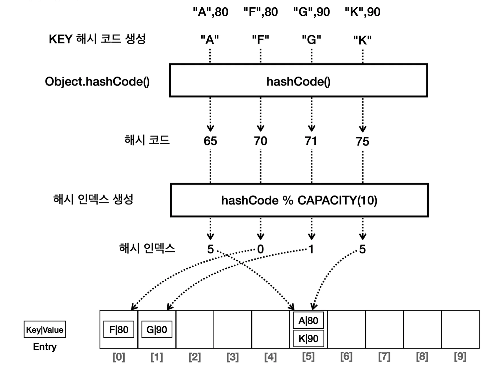

<a id="1d4eda9b0fe1808093ecda0ede6f65c3"></a>

위와 같이 해시를 사용해서 키와 값을 저장하는 자료 구조를 일반적으로 해시 테이블이라 한다&#46;

- 동작은 Set 과 동일하지만, 저장되는 데이터가 <code>key&#58;value</code>형태이다&#46;

> ☝🏻 
> 
> <a id="1d4eda9b0fe1804eb97dd2bf7f95492b"></a>
> 
> <strong>주의</strong>
> 
> ---
> 
> <a id="1d4eda9b0fe180bcaee2e3bcb1bdf9d3"></a>
> 
> <code>Map</code> 의 <code>Key</code> 로 사용되는 객체는 <code>hashCode()</code> , <code>equals()</code> 를 반드시 구현해야 한다&#46;
> 
> - <code>Set</code>과 동작이 동일하다&#46; 
> 
> - Key를 Set으로 사용하고 value를 더 했을 뿐이다&#46; 
> 
> - 동일하게 직접 만든 객체를 key로 사용하는 경우 <code>hashCode()</code> , <code>equals()</code> 를 구현해야 한다&#46;

<a id="1d4eda9b0fe18057b250f6d32eb7fdc1"></a>

<br>	<br>

> 🗒️ 
> 
> <a id="1d4eda9b0fe180818d68e498efb5b0e5"></a>
> 
> <strong>정리</strong>
> 
> ---
> 
> - 실무에서는 <code>Map</code> 이 필요한 경우 <code>HashMap</code> 을 많이 사용한다&#46; 
> 
> - 순서 유지, 정렬의 필요에 따라서<code>LinkedHashMap</code> , <code>TreeMap</code> 을 선택하여 사용하면 된다&#46; 

<a id="1d4eda9b0fe18011b3c7fe2f39cbef2f"></a>

###  스택 ( Stack )

---

> ✏️ 
> 
> <a id="1d4eda9b0fe1802b9abcc996ce323198"></a>
> 
> <strong>스택 ( Stack )</strong>
> 
> ---
> 
> - <strong><code>후입 선출</code></strong><strong> (</strong><strong><code>LIFO</code></strong><strong>, </strong><strong><code>Last In First Out</code></strong><strong> )</strong>
>     - 가장 마지막 요소가 가장 먼저 나온다&#46;<br>

<a id="1d4eda9b0fe18010ac69ccdadeaf3a01"></a>

### NOTES

<details>
<summary><strong>스택 ( Stack ) 동작&#58;  </strong><strong><code>후입 선출</code></strong><strong> (</strong><strong><code>LIFO</code></strong><strong>, </strong><strong><code>Last In First Out</code></strong><strong> )</strong></summary>

- ex) Stack = &#91; 1, 2, 3 &#93;
    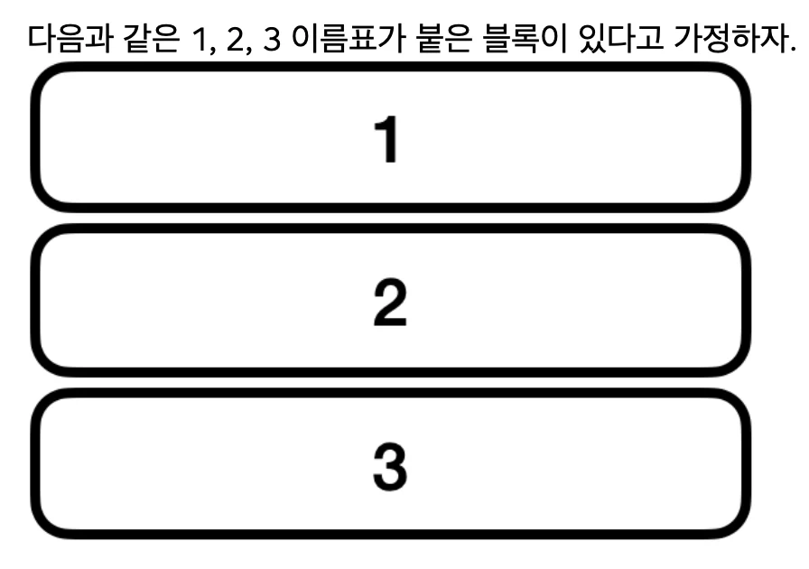

- <strong>push</strong>
    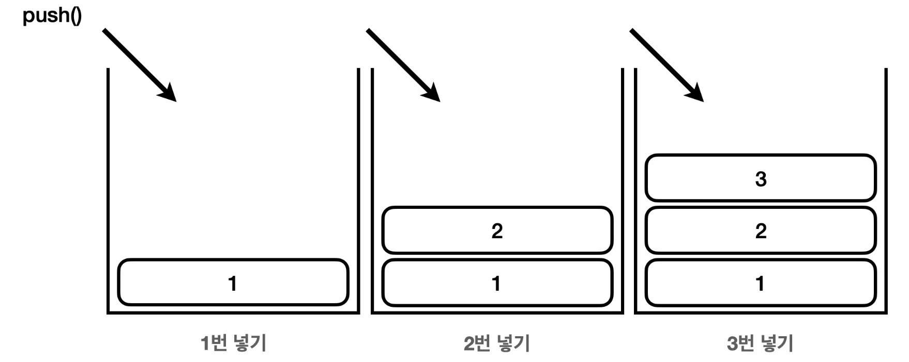

    - 블록은 1, 2, 3 순서대로 넣을 수 있다&#46;

- <strong>pop</strong>
    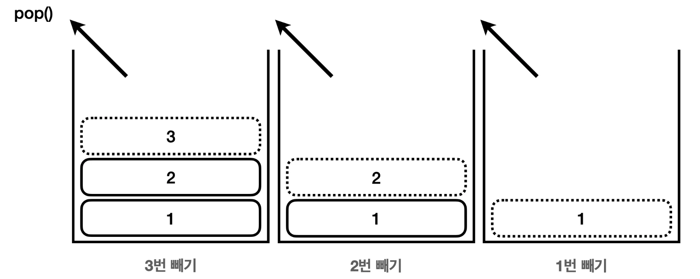

    - 블록은 3, 2, 1 순서로 뺄 수 있다&#46;

</details>

<a id="1d4eda9b0fe18062a662fb681ed88ed8"></a>

### 코드 

<details>
<summary>&#91; 코드 &#93; StackMain</summary>

<a id="1d4eda9b0fe1802bb513d50a3a1ff997"></a>

```java
package collection.stack;

import java.util.Stack;

public class StackMain {

    public static void main(String[] args) {
        Stack<Integer> stack = new Stack<>();

        stack.push(1);
        stack.push(2);
        stack.push(3);
        System.out.println(stack);

        // 다음 꺼낼 요소 확인(꺼내지 않고 단순 조회만)
        System.out.println("stack.peek() = " + stack.peek());
        
        // 스택 요소 뽑기
        System.out.println("stack.pop() = " + stack.pop());
        System.out.println("stack.pop() = " + stack.pop());
        System.out.println("stack.pop() = " + stack.pop());
        System.out.println(stack);
    }
}
```

</details>

<details>
<summary>실행 결과</summary>

<a id="1d4eda9b0fe180f68593cc075f8b4cb0"></a>

```plaintext
[1, 2, 3]
stack.peek() = 3
stack.pop() = 3
stack.pop() = 2
stack.pop() = 1
[]
```

- 입력&#58; 1 → 2 → 3

- 출력&#58; 3 → 2 → 1

</details>

> ☝🏻 
> 
> <a id="1d4eda9b0fe180a7b98fc0f3c3e5c457"></a>
> 
> <strong>주의</strong>
> 
> ---
> 
> <a id="1d4eda9b0fe180e4a81ae3303a3b2239"></a>
> 
> 자바의 <code>Stack</code> 클래스는 내부에서 <code>Vector</code> 라는 자료 구조를 사용한다&#46;
> 
> <a id="1d4eda9b0fe180888f25e0ce09e838cb"></a>
> 
> 해당 자료구조는 는 자바 1&#46;0에 개발되었는데, 지금은 사용되지 않고 하위 호환을 위해 존재한다&#46;
> 
> <a id="1d4eda9b0fe180abbc36cdc1a05ef22c"></a>
> 
> 지금은 더 빠른 좋은 자료 구조가 많다&#46; 따라서 <code>Vector</code> 를 사용하는<br><code>Stack</code> 도 사용하지 않는 것을 권장한다
> 
> <a id="1d4eda9b0fe180bb8536e6651be4afb7"></a>
> 
> 대신에 이후에 설명할 <code>Deque</code> 를 사용하는 것이 좋다&#46;

<a id="1d4eda9b0fe180cca15cd46b1fe2d547"></a>

###  큐 ( Queue )

---

> ✏️ 
> 
> <a id="1d4eda9b0fe1807b8ecde688910989eb"></a>
> 
> <strong>큐 ( Queue )</strong>
> 
> ---
> 
> - <strong><code>선입 선출</code></strong><strong> ( </strong><strong><code>FIFO</code></strong><strong>, </strong><strong><code>First In First Out</code></strong><strong> )</strong>
>     - 가장 먼저 넣은 요소가 가장 먼저 나온다&#46;

<a id="1d4eda9b0fe1803082d0db9504fff556"></a>

### NOTES

<details>
<summary> 큐 ( Queue ) 동작&#58; <strong><code>선입 선출</code></strong><strong> ( </strong><strong><code>FIFO</code></strong><strong>, </strong><strong><code>First In First Out</code></strong><strong> )</strong></summary>

> ☝🏻 
> 
> <a id="1d4eda9b0fe1804aa175c3d0256e48a5"></a>
> 
> 전통적으로 큐에 값을 넣는 것을 <code>offer</code> 라 하고, 큐에서 값을 꺼내는 것을 <code>poll</code> 이라 한다&#46;

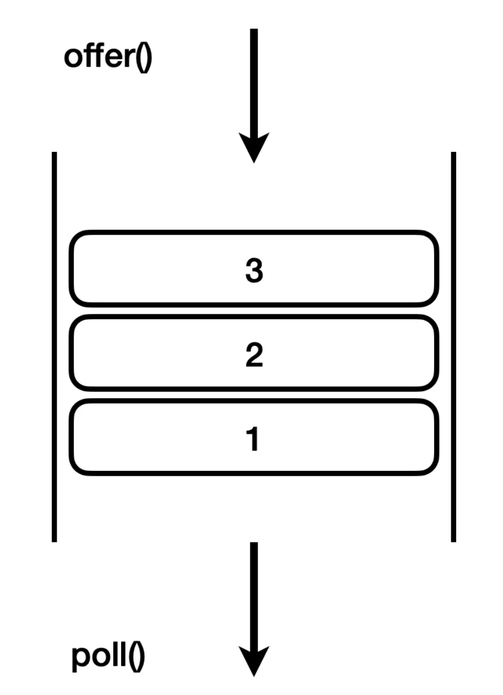

- <code>offer()</code>&#58; 1(넣기) → 2(넣기) → 3(넣기) 

- <code>poll()</code>&#58; 1(빼기) → 2(빼기) → 3(빼기)

</details>

<a id="1d4eda9b0fe180b49875d934435f0c56"></a>

### 컬렉션 프레임워크 &#45; 큐 ( <strong>Queue )</strong>

---

> ✏️ 
> 
> 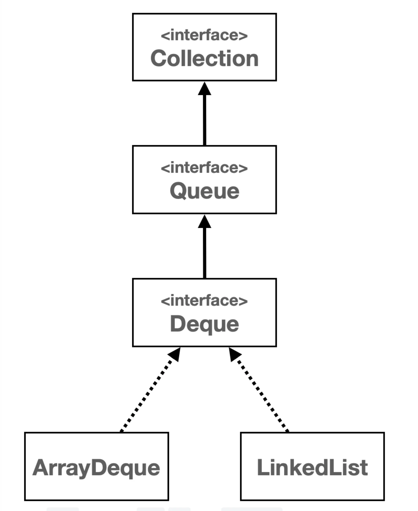
> 
> - <code>Queue</code> 인터페이스는 <code>List</code>, <code>Set</code>과 같이 <code>Collection</code>의 자식이다&#46; 
> 
> - <code>Queue</code>의 대표적인 구현체는 <code>ArrayDeque</code>, <code>LikedList</code> 가 있다&#46; 
>     - Deque는 뒤에서 설명

> ☝🏻 
> 
> <a id="1d4eda9b0fe180c6af44d97ca5923a76"></a>
> 
> <strong>&#91;참고&#93; </strong><code>LinkedList</code> 는 <code>Deque</code> 와 <code>List</code> 인터페이스를 모두 구현한다&#46;
> 
> <a id="1d4eda9b0fe180dca500ce28dbc71719"></a>
> 
> ```java
>  public class LinkedList<E> extends AbstractSequentialList<E>
>      implements List<E>, Deque<E>, Cloneable, java.io.Serializable {}
> ```

<a id="1d4eda9b0fe18019b2b1cd0ceb8b5934"></a>

### 코드

<details>
<summary>&#91; 코드 &#93; QueueMain</summary>

<a id="1d4eda9b0fe180b99e28d3d6f88af79f"></a>

```java
package collection.deque;

import java.util.ArrayDeque;
import java.util.Queue;

public class QueueMain {

    public static void main(String[] args) {
        Queue<Integer> queue = new ArrayDeque<>();
        //Queue<Integer> queue = new LinkedList<>();

        //데이터 추가
        queue.offer(1);
        queue.offer(2);
        queue.offer(3);
        System.out.println(queue);

        //다음 꺼낼 데이터 확인(꺼내지 않고 단순 조회만)
        System.out.println("queue.peek() = " + queue.peek());

        //데이터 꺼내기
        System.out.println("poll = " + queue.poll());
        System.out.println("poll = " + queue.poll());
        System.out.println("poll = " + queue.poll());
        System.out.println(queue);
    }
}
```

</details>

<details>
<summary>실행 결과</summary>

<a id="1d4eda9b0fe180638690eb6e2f7df3e3"></a>

```plaintext
[1, 2, 3]
queue.peek() = 1
poll = 1
poll = 2
poll = 3
[]
```

- 입력&#58; 1 → 2 → 3

- 출력&#58; 1 → 2 → 3 
    <a id="1d4eda9b0fe1807db8abea391d242600"></a>

    → &#46; 가장 먼저 입력한 값이 가장 먼저 나온다, first in first out

</details>

<a id="1d4eda9b0fe1801ea171d348bf05ca66"></a>

###  Deque

---

<a id="1d4eda9b0fe180779d4fe7d154238492"></a>

### Deque 자료구조

> ✏️ 
> 
> <a id="1d4eda9b0fe18024bd11e51449e02efd"></a>
> 
> <strong>Deque</strong>
> 
> ---
> 
> > <code>Deque</code>는 <em>&#34;Double Ended Queue&#34; </em>의 약자로, <br>이름에서 알 수 있듯이 <strong><u>양쪽 끝</u></strong><u>에서 </u><strong><u>요소를 추가하거나 제거</u></strong>할 수 있다&#46;
> 
> - 일반적인 <u>큐(Queue)</u>와 <u>스택(Stack)</u>의 기능을 모두 포함하고 있어, 매우 유연한 자료 구조이다&#46;  
> 
> - 데크, 덱 등으로 불린다&#46;
> 
> - <code>Deque</code> 의 대표적인 구현체는 <code>ArrayDeque</code> , <code>LinkedList</code> 가 있다

<a id="1d4eda9b0fe1806ca592ffe5afb3f59e"></a>

### NOTES

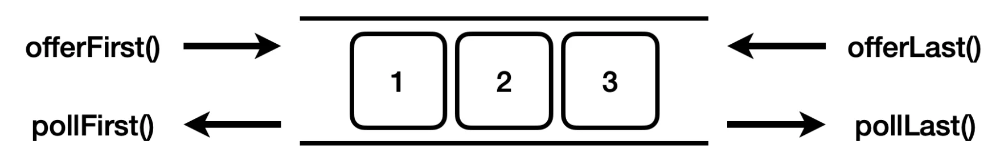

- <code>offerFirst()</code> &#58; 앞에 추가한다&#46;

- <code>offerLast()</code> &#58; 뒤에 추가한다&#46;

- <code>pollFirst()</code> &#58; 앞에서 꺼낸다&#46;

- <code>pollLast()</code> &#58; 뒤에서 꺼낸다&#46;

<a id="1d4eda9b0fe1804080b6ffdb8d31b2b7"></a>

### 코드 

<details>
<summary>&#91; 코드 &#93; DequeMain</summary>

<a id="1d4eda9b0fe180a797bffb0adeebc624"></a>

```java
package collection.deque;

import java.util.ArrayDeque;

public class DequeMain {

    public static void main(String[] args) {
        ArrayDeque<Integer> deque = new ArrayDeque<>();
        // Deque<Integer> deque = new LinkedList<>();

        // 데이터 추가
        deque.offerFirst(1);
        System.out.println(deque);
        deque.offerFirst(2);
        System.out.println(deque);
        deque.offerFirst(3);
        System.out.println(deque);
        deque.offerFirst(4);
        System.out.println(deque);

        // 다음 꺼낼 데이터 확인(꺼내지 않고 단순 조회만)
        System.out.println("deque.peekFirst() = " + deque.peekFirst());
        System.out.println("deque.peekLast() = " + deque.peekLast());

        // 데이터 꺼내기
        System.out.println("pollFirst = " + deque.pollFirst());
        System.out.println("pollFirst = " + deque.pollFirst());
        System.out.println("pollLast = " + deque.pollLast());
        System.out.println("pollLast = " + deque.pollLast());
        System.out.println(deque);
    }
}
```

</details>

<details>
<summary>실행 결과</summary>

<a id="1d4eda9b0fe180f8b336d691e922e3d4"></a>

```plaintext
[1]
[2, 1]
[3, 2, 1]
[4, 3, 2, 1]
deque.peekFirst() = 4
deque.peekLast() = 1
pollFirst = 4
pollFirst = 3
pollLast = 1
pollLast = 2
[]
```

</details>

<a id="1d4eda9b0fe180b9b02cd345d2b7a4ce"></a>

### Deque <strong>구현체, 성능 테스트</strong>

> ✏️ 
> 
> <a id="1d4eda9b0fe180a68f9eca634dde3d97"></a>
> 
> <code>Deque</code> 의 대표적인 구현체는 <code>ArrayDeque</code> , <code>LinkedList</code> 가 있다&#46; 
> 
> <a id="1d4eda9b0fe1803e913ed450064c6bf1"></a>
> 
> 이 둘 중에 <strong><u>ArrayDeque </u></strong><u>가 </u><strong><u>모든 면에서 더 빠르다&#46;</u></strong>

> <strong>100만 건 입력(앞, 뒤 평균)</strong>

- <code>ArrayDeque</code> &#58; 110ms

- <code>LinkedList</code> &#58; 480ms

> <strong>100만 건 조회(앞, 뒤 평균)</strong>

- <code>ArrayDeque</code> &#58; 9ms

- <code>LinkedList</code> &#58; 20ms

<a id="1d4eda9b0fe180918d9ecd0d761ca2c5"></a>

둘의 차이는 <code>ArrayList</code> vs <code>LinkedList</code> 의 차이와 비슷한데, 작동 원리가 <strong><u>하나는 배열</u></strong>을 <strong><u>하나는 동적 노드 링크를 사용</u></strong>하기 때문이다&#46;

<a id="1d4eda9b0fe180b4bc25eb9c820b1b01"></a>

<code>ArrayDeque</code>는 추가로 <strong><u>특별한 원형 큐 자료 구조를 사용</u></strong>하는데, 덕분에 앞, 뒤 입력 모두 <code>O(1)</code>의 성능을 제공한다&#46;<br>물론 <code>LinkedList</code>도 앞 뒤 입력 모두 <code>O(1)</code>의 성능을 제공한다&#46;<br>이론적으로 <code>LinkedList</code>가 삽입 삭제가 자주 발생할 때 더 효율적일 수 있지만, 현대 컴퓨터 시스템의 메모리 접근 패턴, CPU 캐시 최적화 등을 고려할 때 배열을 사용하는 <code>ArrayDeque</code>가 실제 사용 환경에서 더 나은 성능을 보여주는 경우가 많다&#46;

- 자세한 내용은  자료 구조와 알고리즘 학습

<a id="1d4eda9b0fe180f4a677d520cb0e2653"></a>

### Deque &#45; Stack 

> ✏️ 
> 
> <a id="1d4eda9b0fe1805c9cb7d7ae2b85b77c"></a>
> 
> <code>Deque</code> 에서 <code>Stack</code> 을 위한 메서드 이름까지 제공하는 것을 확인할 수 있다&#46; <br>자바의 <code>Stack</code> 클래스는 <u>성능이 좋지 않</u>고 <strong><u>하위 호환을 위해서 남</u></strong>겨져 있다&#46;
> 
> <a id="1d4eda9b0fe180f0a24af60f0266d054"></a>
> 
> 따라서 <strong><code>Stack</code></strong><strong> </strong><strong><u>자료 구조가 필요</u></strong>하면 <code>Deque</code> 에 <strong><u>ArrayDeque</u></strong><u> </u><strong><u>구현체를 사</u></strong><u>용</u>하는 것을 권장한다&#46;

<a id="1d4eda9b0fe180109805eddfa7538b54"></a>

### 코드 

<details>
<summary>&#91; 코드 &#93; DequeStackMain</summary>

<a id="1d4eda9b0fe180149461da70673e9d7f"></a>

```java
package collection.deque;


import java.util.ArrayDeque;
import java.util.Deque;

public class DequeStackMain {

    public static void main(String[] args) {
        Deque<Integer> deque = new ArrayDeque<>();
        //Deque<Integer> deque = new LinkedList<>();

        // 데이터 추가
        deque.push(1);
        deque.push(2);
        deque.push(3);
        System.out.println(deque);
        // 다음 꺼낼 데이터 확인(꺼내지 않고 단순 조회만)
        System.out.println("deque.peek() = " + deque.peek());

        // 데이터 꺼내기
        System.out.println("pop = " + deque.pop());
        System.out.println("pop = " + deque.pop());
        System.out.println("pop = " + deque.pop());
        System.out.println(deque);
    }
}
```

</details>

<details>
<summary>실행 결과</summary>

<a id="1d4eda9b0fe18068a573e84647311121"></a>

```plaintext
[3, 2, 1]
deque.peek() = 3
pop = 3
pop = 2
pop = 1
[]
```

</details>

<a id="1d4eda9b0fe180168effe53f5546bb87"></a>

### Deque &#45; Queue

> ✏️ 
> 
> - <code>Deque</code>에서 <code>Queue</code> 을 위한 메서드 이름까지 제공하는 것을 확인할 수 있다
>     - <strong><code>offer()</code></strong><strong>, </strong><strong><code>peek()</code></strong><strong>, </strong><strong><code>poll()</code></strong>
> 
> - <code>Deque</code> 인터페이스는 <code>Queue</code> 인터페이스의 자식이기 때문에, 단순히 <code>Queue</code>의 기능만 필요하면 <code>Queue</code> 인터페이스를 사용하고, 더 많은 기능이 필요하다면 <code>Deque</code> 인터페이스를 사용하면 된다
> 
> - 그리고 구현체로 성능이 빠른 <code>ArrayDeque</code> 를 사용하는 것을 권장한다&#46;

<a id="1d4eda9b0fe18076954eef4024fd690e"></a>

### 코드 

<details>
<summary>&#91; 코드 &#93;  DequeQueueMain</summary>

<a id="1d4eda9b0fe1805c961af912a47669c6"></a>

```java
package collection.deque;

import java.util.ArrayDeque;
import java.util.Deque;
import java.util.LinkedList;

public class DequeQueueMain {

    public static void main(String[] args) {
        Deque<Integer> deque = new ArrayDeque<>();
        // LinkedList<Integer> deque = new LinkedList<>();

        // 데이터 추가
        deque.offer(1);
        deque.offer(2);
        deque.offer(3);
        System.out.println(deque);

        // 다음 꺼낼 데이터 확인 (꺼내지 않고 단순 조회만)
        System.out.println("deque.peek() = " + deque.peek());

        // 데이터 꺼내기
        System.out.println("deque.poll() = " + deque.poll());
        System.out.println("deque.poll() = " + deque.poll());
        System.out.println("deque.poll() = " + deque.poll());
        System.out.println(deque);
    }
}

```

</details>

<details>
<summary>실행 결과</summary>

<a id="1d4eda9b0fe180b986cdd15467f56bcc"></a>

```plaintext
[1, 2, 3]
deque.peek() = 1
deque.poll() = 1
deque.poll() = 2
deque.poll() = 3
[]
```

</details>

<a id="1d4eda9b0fe18033b7b2d31fe08528b0"></a>

### 문제 풀이

<details>
<summary>문제1) Map 1</summary>

> 💬 
> 
> <a id="1d4eda9b0fe1806fa714d612545384a7"></a>
> 
> <strong>문제 설명</strong>
> 
> ---
> 
> - 여러 정수가 입력된다&#46; 여기서 중복 값을 제거하고 값을 출력해라&#46;
> 
> - 30, 20, 20, 10, 10이 출력되면 중복을 제거하고 출력하면 된다&#46; 출력 순서는 관계없다&#46;
> 
> - ex)&#58; 30, 20, 10 또는 10, 20, 30 또는 20, 10, 30등과 같이 출력 순서는 관계 없다&#46;

<a id="1d4eda9b0fe180a485bcf66bc6c026d6"></a>

<strong>문제 코드</strong>

<a id="1d4eda9b0fe180c99f80cd07a23752ae"></a>

```java

```

<a id="1d4eda9b0fe1803e9371f2b8eaeebeb8"></a>

<br><strong>실행 결과</strong>

<a id="1d4eda9b0fe1803f9ba3e20bfb7530ec"></a>

```plaintext

```

<details>
<summary>&#91; 정답 &#93;</summary>

<a id="1d4eda9b0fe180bf8f41e5771e82fe5f"></a>

```java

```

</details>

</details>

<details>
<summary>문제2) Map 2</summary>

> 💬 
> 
> <a id="1d4eda9b0fe180af8a2ed298565f1665"></a>
> 
> <strong>문제 설명</strong>
> 
> ---
> 
> - 여러 정수가 입력된다&#46; 여기서 중복 값을 제거하고 값을 출력해라&#46;
> 
> - 30, 20, 20, 10, 10이 출력되면 중복을 제거하고 출력하면 된다&#46; 출력 순서는 관계없다&#46;
> 
> - ex)&#58; 30, 20, 10 또는 10, 20, 30 또는 20, 10, 30등과 같이 출력 순서는 관계 없다&#46;

<a id="1d4eda9b0fe180f289d0d248ba4f5664"></a>

<strong>문제 코드</strong>

<a id="1d4eda9b0fe180ea8158dfa35d38cc51"></a>

```java

```

<a id="1d4eda9b0fe18066a57dd64bc8e4e6fc"></a>

<br><strong>실행 결과</strong>

<a id="1d4eda9b0fe18007b349c878defce136"></a>

```plaintext

```

<details>
<summary>&#91; 정답 &#93;</summary>

<a id="1d4eda9b0fe18045b782f69fb5132871"></a>

```java

```

</details>

</details>

<details>
<summary>문제3) Stack</summary>

> 💬 
> 
> <a id="1d4eda9b0fe180b78805e6338c2f3ac7"></a>
> 
> <strong>문제 설명</strong>
> 
> ---
> 
> - 여러 정수가 입력된다&#46; 여기서 중복 값을 제거하고 값을 출력해라&#46;
> 
> - 30, 20, 20, 10, 10이 출력되면 중복을 제거하고 출력하면 된다&#46; 출력 순서는 관계없다&#46;
> 
> - ex)&#58; 30, 20, 10 또는 10, 20, 30 또는 20, 10, 30등과 같이 출력 순서는 관계 없다&#46;

<a id="1d4eda9b0fe1802dbaa2d317aeb0bb8e"></a>

<strong>문제 코드</strong>

<a id="1d4eda9b0fe180058889fe5e1c32beae"></a>

```java

```

<a id="1d4eda9b0fe1808c8d6eee0115e51876"></a>

<br><strong>실행 결과</strong>

<a id="1d4eda9b0fe180e98c91db73637e4469"></a>

```plaintext

```

<details>
<summary>&#91; 정답 &#93;</summary>

<a id="1d4eda9b0fe180db99eae52bfd61ce0d"></a>

```java

```

</details>

</details>

<details>
<summary>문제4) Queue</summary>

> 💬 
> 
> <a id="1d4eda9b0fe1809d9091f93c1e1e3a42"></a>
> 
> <strong>문제 설명</strong>
> 
> ---
> 
> - 여러 정수가 입력된다&#46; 여기서 중복 값을 제거하고 값을 출력해라&#46;
> 
> - 30, 20, 20, 10, 10이 출력되면 중복을 제거하고 출력하면 된다&#46; 출력 순서는 관계없다&#46;
> 
> - ex)&#58; 30, 20, 10 또는 10, 20, 30 또는 20, 10, 30등과 같이 출력 순서는 관계 없다&#46;

<a id="1d4eda9b0fe180d0a7e0ea7b02ffb1a4"></a>

<strong>문제 코드</strong>

<a id="1d4eda9b0fe18092a795cb939345983c"></a>

```java

```

<a id="1d4eda9b0fe18055aefcd4312c6d19f7"></a>

<br><strong>실행 결과</strong>

<a id="1d4eda9b0fe1808c9ea9df85e9c1377d"></a>

```plaintext

```

<details>
<summary>&#91; 정답 &#93;</summary>

<a id="1d4eda9b0fe180b48685d9a74af925e3"></a>

```java

```

</details>

</details>
