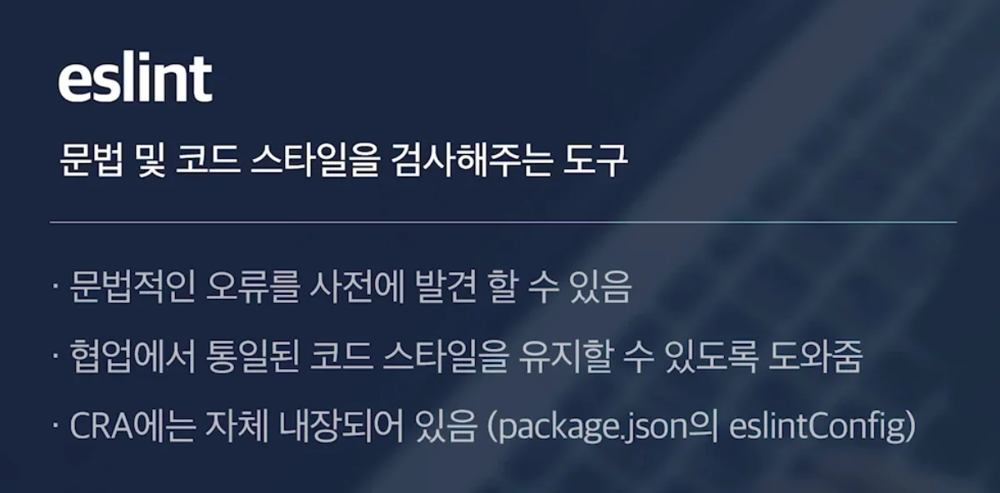
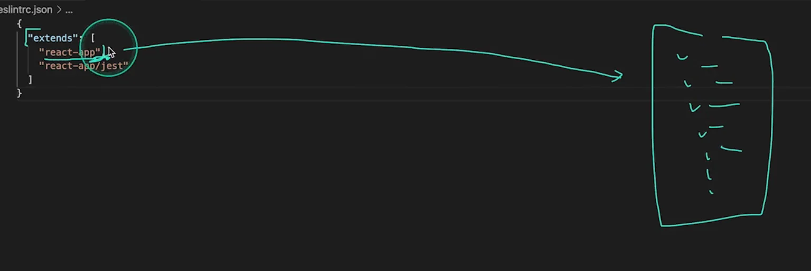
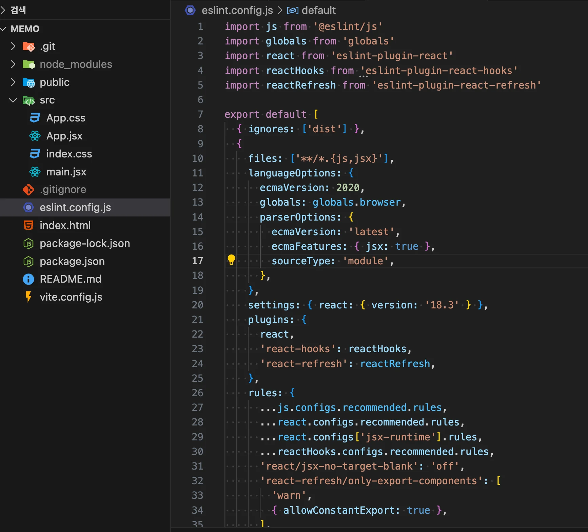
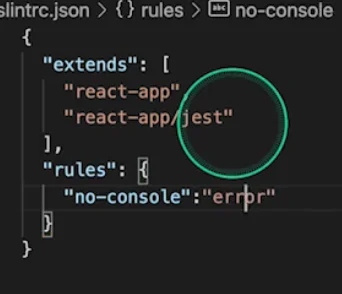
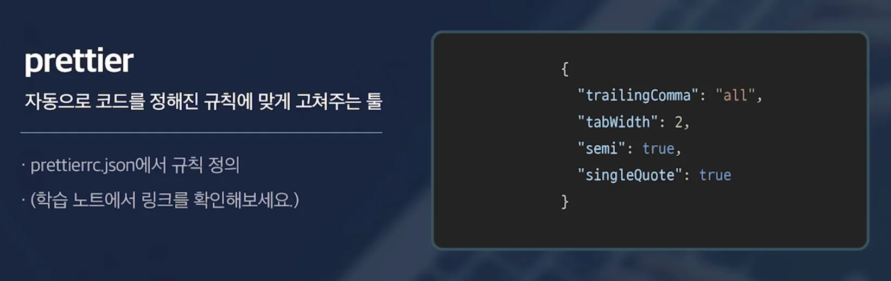
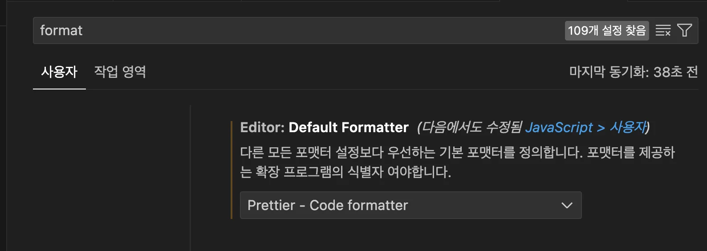

<a id="1c3eda9b0fe181e6a991cdde7b1030d4"></a>

## Lint

---

<a id="1c3eda9b0fe1817da185fd8693f27063"></a>

대부분의 프로그래밍 언어들은 <code>컴파일</code>이라는 코드를 분석해, <strong><u>기계어로 바꿔주는 과정</u></strong>이 있다&#46; 

<a id="1c3eda9b0fe181d7bfaac38fd9c2f449"></a>

이 과정 중에 문법적인 오류가 발생되면 <u>컴파일 에러</u>를 통해 개발자에게 알려주는데, 

<a id="1c3eda9b0fe181a98265f52d38391332"></a>

<strong><u>자바스크립트</u></strong>는 이런 <u>컴파일 과정이 없</u>어, <strong><u>서비스에서 </u></strong><strong><u>직접 실행하기 전</u></strong><strong><u>까지는 </u></strong><strong><u>에러 유무를 확인 할 수 없</u></strong>다&#46; 

<a id="1c3eda9b0fe1818a9a86f7c168029da7"></a>

<u>이러한 문제점을 보안</u>하기 위해 나온 것이 바로 <code>Lint</code>라는 툴이다&#46;

<a id="1c3eda9b0fe18142ac7bd2056fe9cb37"></a>

Lint가 <u>코드를 계속 모니터링</u>하고 있다고 개발자가 <u>문제가 될 법한 코드를 짜게 되면 바로 에러 메세지를 띄</u>어 알려준다&#46; 

<a id="1c3eda9b0fe1812a97dfe795c6ad7d19"></a>

이런 LInt 덕분에 문법적인 오류를 사전에 발견할 수 있고, 협업에서 통일된 코드를 짤 수 있다&#46; 

<a id="1c3eda9b0fe1815f9a53ca87c34c47e6"></a>

## ESLint

---



<a id="1c3eda9b0fe181a892f1f8c751f9e29c"></a>

자바스크립트에서 여러 종류의 Lint가 있는데, 그중 CRA는 ESLint를 사용하고 있다 

<a id="1c3eda9b0fe181b3b335e500bdf91eed"></a>

ESLint에 대한 설정은 pakage&#46;json에서 확인 가능하다&#46; 



<a id="1c3eda9b0fe1812a8c75fcfaca6e1b53"></a>

react&#45;app만 명시하면, react에서 설정해둔 다양한 ESLint 설정들을 가져다 쓸 수 있다&#46; 

<details>
<summary>ESLint 설정 별도로 빼기 </summary>

1. <code>&#46;eslintrc&#46;json</code> 파일 생성

1. pagekage&#46;json에 있는 eslint 설정 가져오기 

> ☝🏻 
> 
> <a id="1c3eda9b0fe1816eb365d9a01d3fb3ac"></a>
> 
> Vite의 경우 따로 분리되어 있음
> 
> <details>
> <summary>eslint&#46;config&#46;js</summary>
> 
> 
> 
> </details>

</details>

<details>
<summary>eslint 에 설정 추가하기 &#45; <code>no&#45;console</code></summary>



<a id="1c3eda9b0fe1810e88b1e2a62055fd04"></a>

```bash
{
		.  .  .
		
		"rules": {
				"no-console": "error"
		}
}
```

- <code>rules</code>에 <code>no&#45;console</code> 명시하면, 컴포넌트에 console 로직 작성 시, 오류를 발생 시킨다

</details>

<a id="1c3eda9b0fe181708217c015b5893eec"></a>

## prettier

---



- 말그대로 코드를 이쁘게 해주는 툴

- <code>prettier</code>는 직접 설치해야 한다&#46;
    <details>
    <summary>VS Code 플러그인 기능 사용</summary>

    1.  prettier 설치 

    1. 설정 &#45; Fomatter 에서 Prettier 명시 
        

    </details>

<details>
<summary>prettier config 설정</summary>

> prettier 설정을 추가 명시하여 정의할 수 있다&#46; 

1. <code>&#46;prettierrc&#46;json</code> 파일 생성

1. prettier rule 명시
    - <code>singleQuoto</code>&#58; 싱글 쿼터(<code>’</code>) 옵션

    - <code>semi</code>&#58; 세미콜론(<code>;</code>) 옵션

    - <code>tabWidth</code>&#58;  들여쓰기, 스페이스 개수 설정

    - <code>trailingComma</code>&#58; 마지막 요소까지 콤마(<code>,</code>)를 명시하는 설정

</details>
