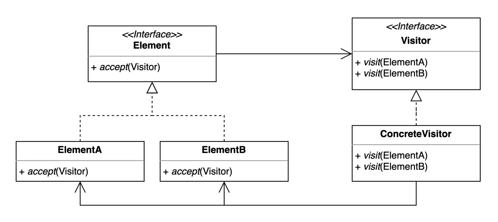

> 📝 
> 
> <a id="1e2eda9b0fe18008b628efa255637d44"></a>
> 
> <strong>질문</strong>
> 
> <details>
> <summary>비지터 패턴이란 무엇인가?</summary>
> 
> 
> 
> </details>
> 
> <details>
> <summary>비지터 패턴의 장•단점은?</summary>
> 
> 
> 
> </details>
> 
> <details>
> <summary>비지터 패턴의 실무 활용 예제는?</summary>
> 
> 
> 
> </details>

<a id="1e2eda9b0fe180a48285e3f907e94b0a"></a>

## 비지터 ( Visitor ) 패턴

---

> 📖 
> 
> <a id="1e2eda9b0fe18058825cf0ed2e94ceb6"></a>
> 
> <strong>비지터 ( Visitor ) 패턴</strong>
> 
> ---
> 
> 
> 
> > ✏️ 
> > 
> > <a id="1e2eda9b0fe1808cbc98fd79f15e378b"></a>
> > 
> > 비지터 패턴은 <u>객체 구조</u>(ex&#46; 여러 종류의 객체로 이루어진 트리, 컬렉션 …)와 그 구조 내에서 수행되는 <u>작업(알고리즘)</u>을 <strong>분리</strong>하는 디자인 패턴이다&#46; 
> > 
> > <a id="1e2eda9b0fe180a98905c8e85798ac02"></a>
> > 
> > 즉, 객체의 데이터 구조와 그 위에서 수행되는 다양한 연산(알고리즘)을 분리하여, 새로운 연산을 추가할 때 객체 구조를 변경하지 않고도 확장할 수 있다&#46; 
> > 
> > - <code>OCP</code>
> > 
> > <details>
> > <summary>더블 디스패치 ( Double Dispatch ) 활용 가능</summary>
> > 
> > > ✏️ 
> > > 
> > > <a id="1e3eda9b0fe180049546e1bf39e94cb1"></a>
> > > 
> > > <strong>더블 디스패치 ( Double Dispatch )</strong>
> > > 
> > > ---
> > > 
> > > <a id="1e3eda9b0fe1804a9f10f207aa0774e8"></a>
> > > 
> > > &#34;호출하는 객체”와 “전달받은 인자 객체” 둘 다의 타입을 고려해서 실행할 메서드를 결정한다&#46;
> > 
> > <details>
> > <summary>ex)</summary>
> > 
> > <a id="1e3eda9b0fe1800f9ae3c2fcac0c003c"></a>
> > 
> >  플레이어가 몬스터를 공격할 때 자신의 메서드를 호출하는 것이 아니라 <strong>상대방(몬스터)에게 공격받았다고 알린다&#46;</strong>
> > 
> > <a id="1e3eda9b0fe1801abf5bd7a7133368ee"></a>
> > 
> > 몬스터는 자신이 어떤 몬스터인지 알기 때문에 <strong>자신 타입에 맞는 처리</strong>를 한다&#46;
> > 
> > <a id="1e3eda9b0fe180ce8f2ad5aa682b4f40"></a>
> > 
> > ```java
> > // 공격자 (플레이어)
> > class Player {
> >     void attack(Monster monster) {
> >         monster.attackedBy(this);  // 나를 넘겨서 몬스터가 결정하게 한다!
> >     }
> > }
> > 
> > // 피공격자 (몬스터)
> > abstract class Monster {
> >     abstract void attackedBy(Player player);
> > }
> > 
> > // 오크 몬스터
> > class Orc extends Monster {
> >     @Override
> >     void attackedBy(Player player) {
> >         System.out.println("Orc was attacked by Player! (Takes 10 damage)");
> >     }
> > }
> > 
> > // 드래곤 몬스터
> > class Dragon extends Monster {
> >     @Override
> >     void attackedBy(Player player) {
> >         System.out.println("Dragon was attacked by Player! (Takes 50 damage)");
> >     }
> > }
> > 
> > // 실행
> > public class Main {
> >     public static void main(String[] args) {
> >         Player player = new Player();
> >         
> >         Monster orc = new Orc();
> >         Monster dragon = new Dragon();
> >         
> >         player.attack(orc);
> >         player.attack(dragon);
> >     }
> > 
> > ```
> > 
> > </details>
> > 
> > </details>
> 
> <details>
> <summary>구성 요소</summary>
> 
> - <code>Visitor</code> ( 방문자 )
>     - 객체 구조의 요소(Element)에 대해 수행할 작업을 정의하는 상위 클래스<br>( <code>interface</code> or <code>abstract class</code> )
> 
> - <code>Element</code> ( 요소 )
>     - Visitor를 받아들이는 인터페이스를 가지며, accept ( visitor ) 메서드를 통해 visitor를 받아들인다&#46;
> 
> - <code>ConcreteVisitor</code>
>     - Visitor 인터페이스를 실제로 구현한 클래스
> 
>     - 각 요소별로 구체적인 작업을 정의한다&#46; 
> 
> - <code>ConcreteElement</code>
>     - Element 인터페이스를 구현한 실제 데이터 객체
> 
>     -  accept(visitor) 메서드에서 Visitor의 적절한 메서드를 호출한다&#46; 
> 
> </details>
> 
> <details>
> <summary>장•단점</summary>
> 
> > 장점
> 
> - <code>알고리즘과 데이터 구조의 분리</code>
>     - 데이터 구조와 알고리즘을 분리하여, 새로운 알고리즘(Visitor)를 쉽게 확장 가능하다&#46; 
> 
> - <code>OCP 준수</code>
>     - 기존 객체 구조를 수정하지 않고 새로운 기능 추가 가능
> 
> - <code>복잡한 객체 구조 처리</code>
>     - 복잡한 객체 트리 전체에 일관된 작업을 수행할 때 유용하다&#46;
> 
> > 단점
> 
> - 요소 클래스 추가, 제거 시 Visitor 모두 수정 필요
>     - 새로운 Element(요소) 타입이 추가 및 제거되면, 모든 Visitor에 해당 타입을 처리하는 메서드를 추가하거나 제거 해야된다&#46;
> 
> - 양방향 의존성
>     - <code>Visitor</code> 와 <code>Element</code>가 서로 참조하므로 결합도가 높아질 수 있다&#46;
> 
> - 복잡성 증가
>     - 구조가 단순한 경우, 오히려 코드가 복잡해질 수 있다&#46;
> 
> </details>
> 
> <details>
> <summary>실무 활용 예시</summary>
> 
> > ✏️ 
> > 
> > - 데이터 구조는 안정적이고, 연산(알고리즘)이 자주 바뀌는 경우
> > 
> > - 여러 종류의 객체에 대해 동일하거나 유사한 작업을 반복적으로 수행해야 할 때
> > 
> > - 객체 트리, 컴파일러 구문 트리, 복잡한 문서 구조 등에서 활용
> 
> </details>

<a id="1e2eda9b0fe18071899fdaae756e509b"></a>

### 1&#46; 기본 예제

<a id="1e2eda9b0fe1805b95faef799709edc9"></a>

### 코드

> device

<details>
<summary>&#91; 코드 &#93; &#60; interface &#62; Device</summary>

<a id="1e3eda9b0fe18085972df3db42b49852"></a>

```java
package _03_behavioral_patterns._23_visitor._01_before.device;

public interface Device {
}
```

</details>

<details>
<summary>&#91; 코드 &#93; Phone</summary>

<a id="1e3eda9b0fe180efad01cf23a6c791b8"></a>

```java
package _03_behavioral_patterns._23_visitor._01_before.device;

public class Phone implements Device {
}
```

</details>

<details>
<summary>&#91; 코드 &#93; Watch</summary>

<a id="1e3eda9b0fe180ce8b91e084548667a9"></a>

```java
package _03_behavioral_patterns._23_visitor._01_before.device;

public class Watch implements Device {

}
```

</details>

> shape

<details>
<summary>&#91; 코드 &#93; &#60; interface &#62; Shape</summary>

<a id="1e2eda9b0fe18064acd1d90aa8336b47"></a>

```java
package _03_behavioral_patterns._23_visitor._01_before.shape;

import _03_behavioral_patterns._23_visitor._01_before.device.Device;

public interface Shape {
    void printTo(Device device);
}
```

</details>

<details>
<summary>&#91; 코드 &#93; Circle</summary>

<a id="1e2eda9b0fe18033beb0cad2d0e80d79"></a>

```java
package _03_behavioral_patterns._23_visitor._01_before.shape;

import _03_behavioral_patterns._23_visitor._01_before.device.Device;
import _03_behavioral_patterns._23_visitor._01_before.device.Phone;

public class Circle implements Shape {

    @Override
    public void printTo(Device device) {
        if (device instanceof Phone) {
            System.out.println("print Circle to phone");
        } else {
            System.out.println("print Circle to watch");
        }
    }
}
```

</details>

<details>
<summary>&#91; 코드 &#93; Rectangle</summary>

<a id="1e3eda9b0fe18084a4e5da435fac5fc5"></a>

```java
package _03_behavioral_patterns._23_visitor._01_before.shape;

import _03_behavioral_patterns._23_visitor._01_before.device.Device;
import _03_behavioral_patterns._23_visitor._01_before.device.Phone;

public class Rectangle implements Shape {

    @Override
    public void printTo(Device device) {
        if (device instanceof Phone) {
            System.out.println("print Rectangle to phone");
        } else {
            System.out.println("print Rectangle to watch");
        }
    }
}
```

</details>

<details>
<summary>&#91; 코드 &#93; Triangle</summary>

<a id="1e3eda9b0fe1805bbd47ff4e54ee475f"></a>

```java
package _03_behavioral_patterns._23_visitor._01_before.shape;

import _03_behavioral_patterns._23_visitor._01_before.device.Device;
import _03_behavioral_patterns._23_visitor._01_before.device.Phone;

public class Triangle implements Shape {

    @Override
    public void printTo(Device device) {
        if (device instanceof Phone) {
            System.out.println("print Triangle to phone");
        } else {
            System.out.println("print Triangle to watch");
        }
    }
}
```

</details>

---

<details>
<summary>&#91; 코드 &#93; Client</summary>

<a id="1e3eda9b0fe18019a423feaa1394df06"></a>

```java
package _03_behavioral_patterns._23_visitor._01_before;

import _03_behavioral_patterns._23_visitor._01_before.device.Device;
import _03_behavioral_patterns._23_visitor._01_before.device.Watch;
import _03_behavioral_patterns._23_visitor._01_before.shape.Circle;
import _03_behavioral_patterns._23_visitor._01_before.shape.Shape;

public class Client {

    public static void main(String[] args) {
//        Device device = new Phone();
        Device device = new Watch();
        Shape shape = new Circle();
        shape.printTo(device);
    }
}
```

</details>

<a id="1e3eda9b0fe18021b52adb18a728f401"></a>

### 문제점

<a id="1e2eda9b0fe180328b7fe1423fdb039d"></a>

### 2&#46; 패턴 적용

> ✏️ 
> 
> <a id="1e3eda9b0fe180f3a8c1f6dcfac1b37e"></a>
> 
> <code>Visitor</code>에 모든 <code>element</code> 유형과 매핑되는 <code>print()</code>(<code>visit 메서드</code>)을 생성하고 <br>다형성 및 DI(생성자 주입)를  통해 코드를 유연하게 실행 시킬 수 있다&#46;

> device

<details>
<summary>&#91; 코드 &#93; &#60; interface &#62; Device &#45; <code>Visitor</code></summary>

<a id="1e3eda9b0fe1807bb858cce1b5acc03e"></a>

```java
package _03_behavioral_patterns._23_visitor._02_after.device;


import _03_behavioral_patterns._23_visitor._02_after.shape.Circle;
import _03_behavioral_patterns._23_visitor._02_after.shape.Rectangle;
import _03_behavioral_patterns._23_visitor._02_after.shape.Triangle;

public interface Device {
    void print(Circle circle);

    void print(Rectangle rectangle);

    void print(Triangle triangle);
}

```

</details>

<details>
<summary>&#91; 코드 &#93; Pad &#45; <code>ConcreteVisitor</code></summary>

<a id="1e3eda9b0fe1806695ace399295a35a7"></a>

```java
package _03_behavioral_patterns._23_visitor._02_after.device;


import _03_behavioral_patterns._23_visitor._02_after.shape.Circle;
import _03_behavioral_patterns._23_visitor._02_after.shape.Rectangle;
import _03_behavioral_patterns._23_visitor._02_after.shape.Triangle;

public class Pad implements Device {
    @Override
    public void print(Circle circle) {
        System.out.println("Print Circle to Pad");
    }

    @Override
    public void print(Rectangle rectangle) {
        System.out.println("Print Rectangle to Pad");
    }

    @Override
    public void print(Triangle triangle) {
        System.out.println("Print Triangle to Pad");
    }
}

```

</details>

<details>
<summary>&#91; 코드 &#93; Phone &#45; <code>ConcreteVisitor</code></summary>

<a id="1e3eda9b0fe18002a28bfa843bd5da7a"></a>

```java
package _03_behavioral_patterns._23_visitor._02_after.device;


import _03_behavioral_patterns._23_visitor._02_after.shape.Circle;
import _03_behavioral_patterns._23_visitor._02_after.shape.Rectangle;
import _03_behavioral_patterns._23_visitor._02_after.shape.Triangle;

public class Phone implements Device {

    @Override
    public void print(Circle circle) {
        System.out.println("Print Circle to Phone");
    }

    @Override
    public void print(Rectangle rectangle) {
        System.out.println("Print Rectangle to Phone");
    }

    @Override
    public void print(Triangle triangle) {
        System.out.println("Print Triangle to Phone");
    }
}

```

</details>

<details>
<summary>&#91; 코드 &#93; Watch &#45; <code>ConcreteVisitor</code></summary>

<a id="1e3eda9b0fe1802dbf66f61c62b6b908"></a>

```java
package _03_behavioral_patterns._23_visitor._02_after.device;


import _03_behavioral_patterns._23_visitor._02_after.shape.Circle;
import _03_behavioral_patterns._23_visitor._02_after.shape.Rectangle;
import _03_behavioral_patterns._23_visitor._02_after.shape.Triangle;

public class Watch implements Device {

    @Override
    public void print(Circle circle) {
        System.out.println("Print Circle to Watch");
    }

    @Override
    public void print(Rectangle rectangle) {
        System.out.println("Print Rectangle to Watch");
    }

    @Override
    public void print(Triangle triangle) {
        System.out.println("Print Triangle to Watch");
    }
}

```

</details>

> shape

<details>
<summary>&#91; 코드 &#93; &#60; interface &#62; Shape &#45; <code>Eleement interface</code></summary>

<a id="1e3eda9b0fe180338df4d3fa92878c48"></a>

```java
package _03_behavioral_patterns._23_visitor._02_after.shape;

import _03_behavioral_patterns._23_visitor._02_after.device.Device;

public interface Shape {
    void accept(Device device);
}
```

</details>

<details>
<summary>&#91; 코드 &#93; Circle &#45; <code>ElementA</code></summary>

<a id="1e3eda9b0fe1804b8aa4e25f62bc6e64"></a>

```java
package _03_behavioral_patterns._23_visitor._02_after.shape;

import _03_behavioral_patterns._23_visitor._02_after.device.Device;

public class Circle implements Shape {


    @Override
    public void accept(Device device) {
        device.print(this);
    }
}
```

</details>

<details>
<summary>&#91; 코드 &#93; Rectangle &#45; <code>ElementB</code></summary>

<a id="1e3eda9b0fe1803091e9e1c179f2cc40"></a>

```java
package _03_behavioral_patterns._23_visitor._02_after.shape;

import _03_behavioral_patterns._23_visitor._02_after.device.Device;

public class Rectangle implements Shape {

    @Override
    public void accept(Device device) {
        device.print(this);
    }
}
```

</details>

<details>
<summary>&#91; 코드 &#93; Triangle &#45; <code>ElementC</code></summary>

<a id="1e3eda9b0fe18063a4eacabe3f2f2512"></a>

```java
package _03_behavioral_patterns._23_visitor._02_after.shape;

import _03_behavioral_patterns._23_visitor._02_after.device.Device;

public class Triangle implements Shape {

    @Override
    public void accept(Device device) {
        device.print(this);
    }

```

</details>

---

<details>
<summary>&#91; 코드 &#93; Client</summary>

<a id="1e3eda9b0fe18042a259ed72154d05fe"></a>

```java
package _03_behavioral_patterns._23_visitor._01_before;

import _03_behavioral_patterns._23_visitor._01_before.device.Device;
import _03_behavioral_patterns._23_visitor._01_before.device.Watch;
import _03_behavioral_patterns._23_visitor._01_before.shape.Circle;
import _03_behavioral_patterns._23_visitor._01_before.shape.Shape;

public class Client {

    public static void main(String[] args) {
//        Device device = new Phone();
        Device device = new Watch();
        Shape shape = new Circle();
        shape.printTo(device);
    }
}
```

</details>

<a id="1e2eda9b0fe180129253f4e0fd7eea7d"></a>

### 3&#46; 장•단점

- 장점
    - 기존 코드를 변경하지 않고 새로운 코드를 추가할 수 있다&#46; 

    - 추가 기능을 한 곳에 모아둘 수 있다&#46;

- 단점
    - 복잡하다&#46;

    - 새로운 Element를 추가하거나 제거할 때 모든 Visitor 코드를 변경해야 한다&#46;

<a id="1e2eda9b0fe18065beaee625764b1eca"></a>

### 4&#46; 실무 활용

> ✏️ 
> 
> > 자바
> 
> - FileVisitor, SimpleFileVisitor
> 
> - AnnotationValueVisitor
> 
> - ElementVisitor
> 
> > 스프링
> 
> - BeanDefinitionVisitor

<a id="1e2eda9b0fe180c497bac7cb8bd424b7"></a>

### 코드

<details>
<summary>&#91; 코드 &#93; SearchFileVisitor</summary>

<a id="1e2eda9b0fe1807a9358c586b3b1629c"></a>

```java
package _03_behavioral_patterns._23_visitor._03_java;

import lombok.RequiredArgsConstructor;

import java.io.IOException;
import java.nio.file.FileVisitResult;
import java.nio.file.FileVisitor;
import java.nio.file.Files;
import java.nio.file.Path;
import java.nio.file.attribute.BasicFileAttributes;


@RequiredArgsConstructor
public class SearchFileVisitor implements FileVisitor<Path> {

    private final String fileToSearch;
    private final Path startingDirectory;

    @Override
    public FileVisitResult preVisitDirectory(Path dir, BasicFileAttributes attrs) throws IOException {
        return FileVisitResult.CONTINUE;
    }

    @Override
    public FileVisitResult visitFile(Path file, BasicFileAttributes attrs) throws IOException {
        if (fileToSearch.equals(file.getFileName().toString())) {
            System.out.println("found = " + file.getFileName());
            return FileVisitResult.TERMINATE;
        }
        return FileVisitResult.CONTINUE;
    }

    @Override
    public FileVisitResult visitFileFailed(Path file, IOException exc) throws IOException {
        exc.printStackTrace(System.out);
        return FileVisitResult.CONTINUE;
    }

    @Override
    public FileVisitResult postVisitDirectory(Path dir, IOException exc) throws IOException {
        if (Files.isSameFile(startingDirectory, dir)) {
            System.out.println("search end");
            return FileVisitResult.TERMINATE;
        }
        return FileVisitResult.CONTINUE;
    }
}
```

</details>

<details>
<summary>&#91; 코드 &#93; VisitorInJava</summary>

<a id="1e3eda9b0fe1802ab26ed3e57c2c971f"></a>

```java
package _03_behavioral_patterns._23_visitor._03_java;

import java.io.IOException;
import java.nio.file.Files;
import java.nio.file.Path;

public class VisitorInJava {

    public static void main(String[] args) throws IOException {
        Path startingDirectory = Path.of("/Users/keesun/workspace/design-patterns");
        SearchFileVisitor searchFileVisitor =
                new SearchFileVisitor("Triangle.java", startingDirectory);
        Files.walkFileTree(startingDirectory, searchFileVisitor);
    }
}
```

</details>

<details>
<summary>&#91; 코드 &#93; VisitorInSpring</summary>

<a id="1e3eda9b0fe18053a850d7bfbae1b585"></a>

```java
package _03_behavioral_patterns._23_visitor._03_java;

import org.springframework.beans.factory.config.BeanDefinitionVisitor;

public class VisitorInSpring {

    public static void main(String[] args) {
        BeanDefinitionVisitor beanDefinitionVisitor;
    }
}
```

</details>
