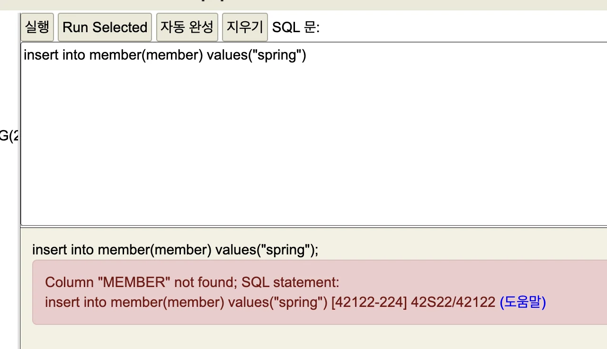
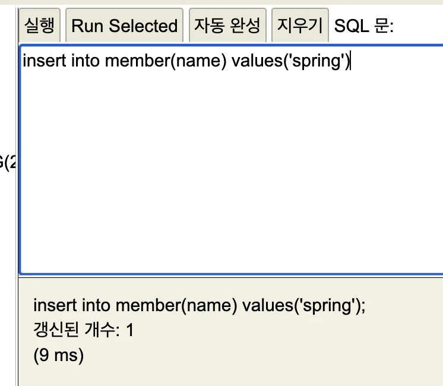
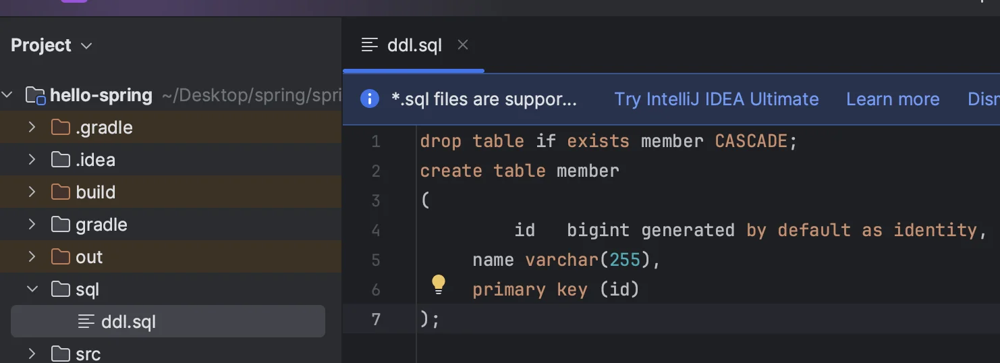
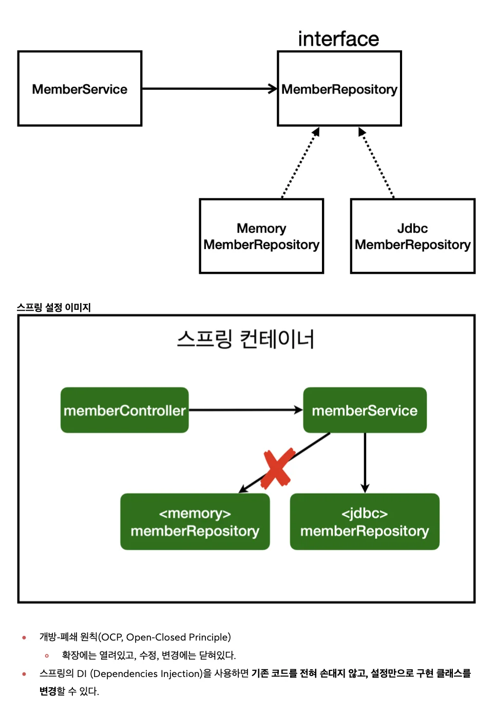
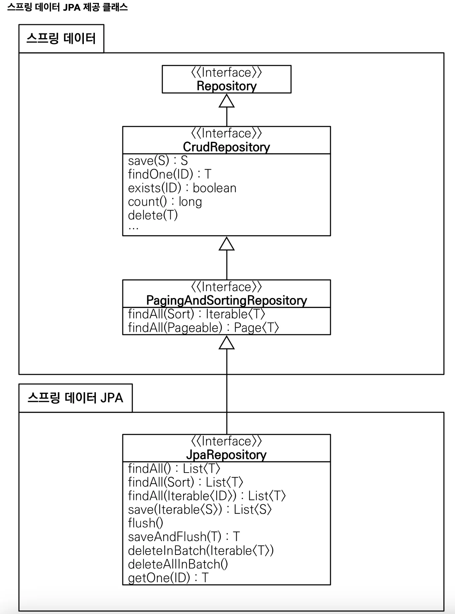

<a id="1c3eda9b0fe181dd9336d32bc3ff241a"></a>

# H2 데이터베이스 설치

<a id="1c3eda9b0fe18140aaaddd0619bf1d31"></a>

##  H2 <strong>데이터베이스 설치  </strong>

> <a href="https://www.h2database.com">h2 홈페이지</a>

> 권한 주기&#58; <code>chmod 755 h2&#46;sh<br></code>실행&#58; <code>&#46;/h2&#46;sh</code><br>→ <a href="http://localhost:8082/">http&#58;//localhost&#58;8082/</a>  화면 뜸

<a id="1c3eda9b0fe181b28928e66cc1626fde"></a>

처음 사용 시 데이터베이스 파일을 만들어야 한다&#46; 

> 데이터베이스 파일 생성 방법<br><code>jdbc&#58;h2&#58;&#126;/test</code> (최초 한번)  <br><code>&#126;/test&#46;mv&#46;db</code> 파일 생성 확인 <br>(파일 경로,  <code>home</code>(<code>&#126;</code>)에 있는 <code>test</code> 파일)<br><br>이후부터는 <code>jdbc&#58;h2&#58;tcp&#58;//localhost/&#126;/test</code>

<a id="1c3eda9b0fe18132b49afbb9502d923f"></a>

## 테이블 생성

<a id="1c3eda9b0fe181c89542d28ee959a812"></a>

테이블 관리를 위해 프로젝트 루트에 <code>sql/ddl&#46;sql</code> 파일을 생성

<a id="1c3eda9b0fe181be9c76c649ca1b95d3"></a>

H2 데이터베이스에 접근해서 <code>member</code> 테이블 생성

<a id="1c3eda9b0fe181febf83ccf914ea6fbe"></a>

```sql
drop table if exists member CASCADE;
create table member
(
		 id   bigint generated by default as identity,
     name varchar(255),
     primary key (id)
);
```

<a id="1c3eda9b0fe18141a211cbc4e459fecd"></a>

## &#91;Error&#93; insert문 생성 에러 



<a id="1c3eda9b0fe18189a49cf2750014019f"></a>

강의를 보면서 학습하는 도중 위와 같은 에러가 발생함&#46;

<a id="1c3eda9b0fe181438b72d0f10bfdfca4"></a>

오타인 줄 알고 이것저것 찾아보고, SQL 명령어도 뒤저보고… 

<a id="1c3eda9b0fe181d38ca6ffe064b535f7"></a>

<del>거의 2시간 찾아봄…</del>

<a id="1c3eda9b0fe181f0a513c682c748de85"></a>

해당 <a href="https://www.inflearn.com/questions/444761/member-table-inset-%EC%98%A4%EB%A5%98">인프런 강의 &#95; 문의 내용</a>이 있어 참조 해서 답을 찾음&#46;

<a id="1c3eda9b0fe181528373db05f6c62c35"></a>

일반적으로 string 데이터를 작성할 때 처럼, 쌍따옴표(”)로 작성했는데,<br><strong>홑따옴표(’)</strong>로 작성해야지 정상적으로 생성이 된다함&#46;



<a id="1c3eda9b0fe181e8ab03f1e1c2a3bcf0"></a>

위와 같이 정상적으로 생성이 됨&#46;

<a id="1c3eda9b0fe181cf9483ff99f2e472e4"></a>

### 그렇다면 왜 홑따옴표(’)을 통해서만 생성이 되는 것인가?

<a id="1c3eda9b0fe18104ace3d99e04247b95"></a>

### SQL 소스코드 관리

1. 프로젝트 폴더에 <code>sql</code>폴더 생성

1. sql 폴더에 <code>ddl&#46;sql</code> 파일 생성

1. 아래 그림과 같이 sql 코드 넣어 <code>소스버전(</code><strong><code>git)</code></strong><strong> 관리</strong>



<a id="1c3eda9b0fe18109b645cadf53d7636c"></a>

# 순수 Jdbc



<a id="1c3eda9b0fe18151bc69f0890cb3a778"></a>

### JdbcMemberRepository

<a id="1c3eda9b0fe181d7bf81c505ea4d58ad"></a>

```java
package hello.hellospring.repository;
import hello.hellospring.domain.Member;
import org.springframework.jdbc.datasource.DataSourceUtils;
import javax.sql.DataSource;
import java.sql.*;
import java.util.ArrayList;
import java.util.List;
import java.util.Optional;

public class JdbcMemberRepository implements MemberRepository {
    private final DataSource dataSource;

    public JdbcMemberRepository(DataSource dataSource) {
        this.dataSource = dataSource;
    }

    @Override
    public Member save(Member member) {
        String sql = "insert into member(name) values(?)";
        Connection conn = null;
        PreparedStatement pstmt = null;
        ResultSet rs = null;
        try {
            conn = getConnection();
            pstmt = conn.prepareStatement(sql, Statement.RETURN_GENERATED_KEYS);
            pstmt.setString(1, member.getName());
            pstmt.executeUpdate();
            rs = pstmt.getGeneratedKeys();
            if (rs.next()) {
                member.setId(rs.getLong(1));
            } else {
                throw new SQLException("id 조회 실패");
            }
            return member;
        } catch (Exception e) {
            throw new IllegalStateException(e);
        } finally {
            close(conn, pstmt, rs);
        }
    }

    @Override
    public Optional<Member> findById(Long id) {
        String sql = "select * from member where id = ?";
        Connection conn = null;
        PreparedStatement pstmt = null;
        ResultSet rs = null;
        try {
            conn = getConnection();
            pstmt = conn.prepareStatement(sql);
            pstmt.setLong(1, id);
            rs = pstmt.executeQuery();
            if (rs.next()) {
                Member member = new Member();
                member.setId(rs.getLong("id"));
                member.setName(rs.getString("name"));
                return Optional.of(member);
            } else {
                return Optional.empty();
            }
        } catch (Exception e) {
            throw new IllegalStateException(e);
        } finally {
            close(conn, pstmt, rs);
        }
    }

    @Override
    public List<Member> findAll() {
        String sql = "select * from member";
        Connection conn = null;
        PreparedStatement pstmt = null;
        ResultSet rs = null;
        try {
            conn = getConnection();
            pstmt = conn.prepareStatement(sql);
            rs = pstmt.executeQuery();
            List<Member> members = new ArrayList<>();
            while (rs.next()) {
                Member member = new Member();
                member.setId(rs.getLong("id"));
                member.setName(rs.getString("name"));
                members.add(member);
            }
            return members;
        } catch (Exception e) {
            throw new IllegalStateException(e);
        } finally {
            close(conn, pstmt, rs);
        }
    }

    @Override
    public Optional<Member> findByName(String name) {
        String sql = "select * from member where name = ?";
        Connection conn = null;
        PreparedStatement pstmt = null;
        ResultSet rs = null;
        try {
            conn = getConnection();
            pstmt = conn.prepareStatement(sql);
            pstmt.setString(1, name);
            rs = pstmt.executeQuery();
            if (rs.next()) {
                Member member = new Member();
                member.setId(rs.getLong("id"));
                member.setName(rs.getString("name"));
                return Optional.of(member);
            }
            return Optional.empty();
        } catch (Exception e) {
            throw new IllegalStateException(e);
        } finally {
            close(conn, pstmt, rs);
        }
    }

    private Connection getConnection() {
        return DataSourceUtils.getConnection(dataSource);
    }

    private void close(Connection conn, PreparedStatement pstmt, ResultSet rs) {
        try {
            if (rs != null) {
                rs.close();
            }
        } catch (SQLException e) {
            e.printStackTrace();
        }
        try {
            if (pstmt != null) {
                pstmt.close();
            }
        } catch (SQLException e) {
            e.printStackTrace();
        }
        try {
            if (conn != null) {
                close(conn);
            }
        } catch (SQLException e) {
            e.printStackTrace();
        }
    }

    private void close(Connection conn) throws SQLException {
        DataSourceUtils.releaseConnection(conn, dataSource);
    }
}s
```

<a id="1c3eda9b0fe18110a7b2fe81a96a263b"></a>

### SpringConfig

<a id="1c3eda9b0fe18121bf1fea76d3317f1d"></a>

```java
package hello.hellospring;

// import hello.hellospring.repository.MemoryMemberRepository;
//import hello.hellospring.repository.JdbcTemplateMemberRepository;

import hello.hellospring.repository.JdbcMemberRepository;
import hello.hellospring.repository.MemberRepository;
import hello.hellospring.service.MemberService;
import org.springframework.context.annotation.Bean;
import org.springframework.context.annotation.Configuration;
import javax.sql.DataSource;

@Configuration
public class SpringConfig {
    private final DataSource dataSource;
    public SpringConfig(DataSource dataSource) {
        this.dataSource = dataSource;
    }
    @Bean
    public MemberService memberService() {
        return new MemberService(memberRepository());
    }
    @Bean
    public MemberRepository memberRepository() {
//        return new MemoryMemberRepository();
        return new JdbcMemberRepository(dataSource);
    }
} d
```

<a id="1c3eda9b0fe181a1a258cf59a7b4334a"></a>

<code>src/main/java/hello&#46;hellospring/HelloSpringApplication</code>  실행  → 정상 동작 확인

<a id="1c3eda9b0fe181279a2ddeb8b17137ae"></a>

# <strong>스프링 통합 테스트</strong>

<a id="1c3eda9b0fe18130a780cbe020dbf92e"></a>

### <code>&#64;SpringBootTest</code>

<a id="1c3eda9b0fe1819ebf2edec0d0a403e1"></a>

스프링 컨테이너와 테스트를 함께 실행시켜줌

<a id="1c3eda9b0fe181868a3ce4315bac2879"></a>

(진짜 스프링을 띄워서 테스트 함)

<a id="1c3eda9b0fe1817cb027c04f5273497b"></a>

따라서 테스트 진행 시 시간이 오래걸림(비용낭비가 심함)

<a id="1c3eda9b0fe181aab936c4530e17bde6"></a>

통합 테스트를 진행 할 때(스프링 컨테이너, DB 연동… 등) 에서 사용

<a id="1c3eda9b0fe181e08336caa70b7df20f"></a>

### <code>&#64;Transactional</code>

<a id="1c3eda9b0fe1812cbeb6f72cd65ab17c"></a>

<a href="#/post/1c3eda9b-0fe1-8103-b16c-ff13884ad0ba">페이지</a> 참조

> 이전 챕터에서 memoryDB(MemoryMemberRepository) 테스트에서의 <strong><u><code>&#64;AfterEach</code></u></strong><strong><u>로  각 테스트 종료 시 메모리 초기화(롤백)</u></strong>하는 로직<br>→ 스프링에서 제공하는 <code>&#64;Transactional</code>으로 쉽게 가능하게 해준다&#46;

<a id="1c3eda9b0fe181cfabace32115648485"></a>

Error) 통합 테스트 재실행 시 오류 발생  <br>→ <code>&#64;Transactional</code> 어노테이션으로 해결

> ( 트랜젝션 실행 → 테스트 → 롤백 ) → ( 트렌젝션 …  ) →

<a id="1c3eda9b0fe181669c06c3b605b68748"></a>

 테스트 케이스에 <code>&#64;Transactional</code> 애노테이션이 있으면, 테스트 시작 전에 트랜잭션을 시작하고, 테스트 완료 후에 항상 롤백한다&#46; 이렇게 하면 DB에 데이터가 남지 않으므로 다음 테스트에 영향을 주지 않는다&#46;

<a id="1c3eda9b0fe181cc84a6d115d579a2a0"></a>

### <code>&#64;commit </code>

<a id="1c3eda9b0fe1813cb296e9417aed128e"></a>

끝나면 commit 함

<a id="1c3eda9b0fe18111b8fbeb75d87efa65"></a>

<a href="#/post/1c3eda9b-0fe1-8103-b16c-ff13884ad0ba">페이지</a> 참조

<a id="1c3eda9b0fe181e1a198ef960fec0b03"></a>

###  테스트는 단위테스트로 작게 작성해야 한다&#46; 

> 스프링 컨테이너, DB 연동 → 통합테스트

<a id="1c3eda9b0fe1817a8fcbc918f3340242"></a>

테스트가 많아지고, 앱이 커지면, 통합테스트 너무 많은 비용을 낭비한다&#46; <br>그래서 통합 테스트 보다 순수한 단위 테스트가 횔씬 좋은 테스트일 확률이 높다&#46;

<a id="1c3eda9b0fe1810989a5e9cc96dfcc6b"></a>

 따라서 단위 단위로 잘 쪼개서 테스트를 할 수 있도록 하고, <br>스프링 컨테이너 없이 테스트 할 수 있도록 훈련해야 된다&#46; 

<a id="1c3eda9b0fe181919c2df743a454f290"></a>

## <strong>회원 서비스 스프링 통합 테스트</strong>

<a id="1c3eda9b0fe181f189b3c5bb4ee58d38"></a>

### test/hello&#46;hellospring&#46;service<code><br></code>

<a id="1c3eda9b0fe18187a606fa4888471e2b"></a>

```java
package hello.hellospring.service;

import hello.hellospring.domain.Member;
import hello.hellospring.repository.MemberRepository;

import org.junit.jupiter.api.Test;
import org.springframework.beans.factory.annotation.Autowired;
import org.springframework.boot.test.context.SpringBootTest;
import org.springframework.transaction.annotation.Transactional;

import static org.assertj.core.api.Assertions.*;
import static org.junit.jupiter.api.Assertions.*;


@SpringBootTest
@Transactional
class MemberServiceTest {
    @Autowired MemberService memberService;
    @Autowired MemberRepository memberRepository;

    @Test
    void 회원가입() {
        //given
        Member member = new Member();
        member.setName("hello");

        //when
        Long saveId = memberService.join(member);

        //then
        Member findMember = memberService.findOne(saveId).get();
        assertEquals(member.getName(), findMember.getName());
    }

    @Test
    public void 중복_회원_예외() {
        //given
        Member member1 = new Member();
        member1.setName("spring");

        Member member2 = new Member();
        member2.setName("spring");

        //when
        memberService.join(member1);
        IllegalStateException e = assertThrows(IllegalStateException.class,
                () -> memberService.join(member2));
        assertThat(e.getMessage()).isEqualTo("이미 존재하는 회원입니다.");
    }
}
```

<a id="1c3eda9b0fe1812e976efb3488c2bacf"></a>

# 스프링 Jdbc Template

<a id="1c3eda9b0fe181f38f54e24182d232a9"></a>

디자인 패턴 중 템플릿 메서드 패턴을 많이 들어감&#46;

<a id="1c3eda9b0fe181fcbc3bee79bb263c0d"></a>

내용은 <u>Jdbc doc</u> 나, 후 <u>데이터베이스 접근 강의</u>에서 깊이 있게 정리

<a id="1c3eda9b0fe181b3b0fcc14a98691018"></a>

### Jdbc Template

<details>
<summary>JdbcTemplateMemberRepository</summary>

<a id="1c3eda9b0fe1814d8880f440da8dfea7"></a>

```java
package hello.hellospring.repository;

import hello.hellospring.domain.Member;
import org.springframework.beans.factory.annotation.Autowired;
import org.springframework.jdbc.core.JdbcTemplate;
import org.springframework.jdbc.core.RowMapper;
import org.springframework.jdbc.core.namedparam.MapSqlParameterSource;
import org.springframework.jdbc.core.simple.SimpleJdbcInsert;

import javax.sql.DataSource;
import java.sql.ResultSet;
import java.sql.SQLException;
import java.util.HashMap;
import java.util.List;
import java.util.Map;
import java.util.Optional;

public class JdbcTemplateMemberRepository implements MemberRepository{
    private final JdbcTemplate jdbcTemplate;

//    @Autowired    생성자가 하나만 있는 경우, 빈 등록되면, @Autowired 생략 가능
    public JdbcTemplateMemberRepository(DataSource dataSource) {
        jdbcTemplate = new JdbcTemplate(dataSource);
    }

    @Override
    public Member save(Member member) {
        SimpleJdbcInsert jdbcInsert = new SimpleJdbcInsert(jdbcTemplate);
        jdbcInsert.withTableName("member").usingGeneratedKeyColumns("id");
        Map<String, Object> parameters = new HashMap<>();
        parameters.put("name", member.getName());
        Number key = jdbcInsert.executeAndReturnKey(new MapSqlParameterSource(parameters));
        member.setId(key.longValue());
        return member;
    }

    @Override
    public Optional<Member> findById(Long id) {
        List<Member> result = jdbcTemplate.query("select * from member where id = ?", memberRowMapper(), id);
        return result.stream().findAny();
    }

    @Override
    public List<Member> findAll() {
        return jdbcTemplate.query("select * from member", memberRowMapper());
    }
    @Override
    public Optional<Member> findByName(String name) {
        List<Member> result = jdbcTemplate.query("select * from member where name = ?", memberRowMapper(), name);
        return result.stream().findAny();
    }

//    java8 lamda 스타일
    private RowMapper<Member> memberRowMapper() {
        return (rs, rowNum) -> {
            Member member = new Member();
            member.setId(rs.getLong("id"));
            member.setName(rs.getString("name"));
            return member;
        };
    }
}

//    private RowMapper<Member> memberRowMapper() {
//        return new RowMapper<Member>() {
//            @Override
//            public Member mapRow(ResultSet rs, int rowNum) throws SQLException {
//                Member member = new Member();
//                member.setId(rs.getLong("id"));
//                member.setName(rs.getString("name"));
//                return member;
//            }
//        }
//    }
```

</details>

<a id="1c3eda9b0fe1819a9263eb34c5bc980c"></a>

### SpringConfig

<a id="1c3eda9b0fe18155877dc28a19344cd2"></a>

```java
		    .   .   .

     @Bean
     public MemberRepository memberRepository() {
         return new JdbcTemplateMemberRepository(dataSource);
     }
```

<a id="1c3eda9b0fe18100b38ae4a18c7444cf"></a>

실무에선 내가 코드를 정말 잘 작성한다 해도, 어이없는 데서 오류가 많이 발생한다&#46;(특히 복사 붙여넣는 코드는 더 심하다고 함&#46;)

<a id="1c3eda9b0fe181878b3fe1619b4874a9"></a>

따라서 <strong>테스트 코드를 통해 한번 검증</strong>을 해야한다&#46;<br>→ <strong>테스트를 잘 작성하는 법에 대해서 항상 고민하고 잘 작성하는 것이 중요하다&#46; </strong>

<a id="1c3eda9b0fe1815b81d8d98c7e1423f1"></a>

실제 뛰어난 개발자들은 현업에서 코딩 작성 시간을 100% 라고 하면, 실제 테스트 코드 작성에 60&#126;70% 정도를 사용한다고 함&#46; 

<a id="1c3eda9b0fe18100a449f4dbf3b8a374"></a>

# JPA

<a id="1c3eda9b0fe18120972fe753280cce6a"></a>

### JPA 장점

> • 기존의 반복 코드는 물론이고, 기본적인 SQL도 JPA가 직접 만들어서 실행해준다&#46; <br>• SQL과 데이터 중심 설계 → 객체 중심 설계, 패러다임 전환<br>• 개발 생산성 크게 증가

<a id="1c3eda9b0fe181b3bf7defa83154fe0a"></a>

### <strong>build&#46;gradle 파일에 JPA, h2 데이터베이스 관련 라이브러리 추가</strong>

> <code>spring&#45;boot&#45;starter&#45;data&#45;jpa</code> 는 내부에 jdbc 관련 라이브러리를 포함함 따라서 jdbc는 제거해도 됨

<a id="1c3eda9b0fe181de9cf5fc0028771271"></a>

```json
dependencies {
     implementation 'org.springframework.boot:spring-boot-starter-thymeleaf'
     implementation 'org.springframework.boot:spring-boot-starter-web'
	// implementation 'org.springframework.boot:spring-boot-starter-jdbc'		 
		 implementation 'org.springframework.boot:spring-boot-starter-data-jpa' 
		 runtimeOnly 'com.h2database:h2' 
	 	 testImplementation('org.springframework.boot:spring-boot-starter-test') {
         exclude group: 'org.junit.vintage', module: 'junit-vintage-engine'
     }
}
```

<a id="1c3eda9b0fe18103badde535d36d339b"></a>

객체를 이전 메모리에 넣었던 것 처럼, JPA 넣으면, 중간에 JPA가 DB에 SQL을 날리고 데이터를 DB를 통해서 가져 와준다&#46; 

<a id="1c3eda9b0fe1815aa716dff5b4d6c65a"></a>

### <strong>스프링 부트에 JPA 설정 추가</strong>

> resources/application&#46;properties

<details>
<summary><strong>• spring&#46;jpa&#46;show&#45;sql = true </strong>(<strong><code>show&#45;sql</code></strong>)</summary>

<a id="1c3eda9b0fe181acac09ecbfe836d71a"></a>

JPA가 생성하는 SQL을 출력

</details>

<details>
<summary>•<strong> spring&#46;jpa&#46;hibernate&#46;ddl&#45;auto = none </strong>( <strong><code>ddl&#45;auto</code></strong>)</summary>

<a id="1c3eda9b0fe1819587b3d21fa2b4f2b6"></a>

JPA는 테이블을 자동으로 생성하는 기능을 제공하는데,<br><code>none</code> 를 사용하면 해당 기능을 끔<br><code>create</code>를 사용하면 엔티티 정보를 바탕으로 테이블도 직접 생성함&#46;

</details>

<a id="1c3eda9b0fe1813bba49f1cf2a3f0332"></a>

```json
spring.datasource.url=jdbc:h2:tcp://localhost/~/test
spring.datasource.driver-class-name=org.h2.Driver
spring.datasource.username=sa

spring.jpa.show-sql=true.   // JPA가 날리는 sql 볼 수 있음
spring.jpa.hibernate.ddl-auto=none  
```

<a id="1c3eda9b0fe181a58c3ef1f8728c919a"></a>

## <strong>JPA 엔티티 매핑</strong>

<a id="1c3eda9b0fe18181aaf2dabaec2b7798"></a>

### 아이덴티티 전략 

<a id="1c3eda9b0fe1816f904bf5455fc16514"></a>

<a href="#/post/1c3eda9b-0fe1-815b-82d2-f4632514eeb3">페이지</a> 참조

<a id="1c3eda9b0fe18136b61cf44362a45fd2"></a>

DB에 값을 넣으면, 아이디를 자동으로 생성해준다&#46; 

<a id="1c3eda9b0fe1819a80defbf21e447a99"></a>

(오라클에서는 sequence를 쓰던가, 테이블에서 체본하던가 … 여러가지 방법이 있음)

<a id="1c3eda9b0fe18131897cd5878abee6ad"></a>

```java
package hello.hellospring.domain;

import javax.persistence.*;

@Entity
public class Member {
    @Id @GeneratedValue(strategy = GenerationType.IDENTITY)
    private Long id;
    private String name;

    public Long getId(){s
        return id;
    }

    public void setId(Long id){
        this.id=id;
    }

    public String getName(){
        return name;
    }

    public void setName(String name){
        this.name=name;
    }
}
```

<a id="1c3eda9b0fe181f8859ac462c7c9aefe"></a>

## JPA를 사용한 memberRepository 구현

<a id="1c3eda9b0fe181a29ed8f14287bd4d10"></a>

JPA 는 <code>EntityManager</code> 라는 것으로 모든 걸 동작한다&#46; 

<a id="1c3eda9b0fe181319876f6f6b38ee0b6"></a>

data&#45;jpa 라이브러리를 받으면, 스프링 부트가 자동으로 현재 데이터베이스와 다 연결을 해서 <code>EntityManager</code>를 생성해준다&#46;  

<a id="1c3eda9b0fe1817eb58bdf2131889e2b"></a>

```java
package hello.hellospring.repository;

import hello.hellospring.domain.Member;

import javax.persistence.EntityManager;
import java.util.List;
import java.util.Optional;

public class JpaMemberRepository implements MemberRepository {
    private final EntityManager em;

    public JpaMemberRepository(EntityManager em) {
        this.em = em;
    }

    @Override
    public Member save(Member member) {
        em.persist(member);
        return member;
    }

    @Override
    public Optional<Member> findById(Long id) {
        Member member = em.find(Member.class, id);
        return Optional.ofNullable(member);
    }

    @Override
    public Optional<Member> findByName(String name) {
        List<Member> result = em.createQuery("select m from Member m where m.name  = :name", Member.class)
                .setParameter("name", name)
                .getResultList();
        return result.stream().findAny();
    }

    @Override
    public List<Member> findAll() {
        return em.createQuery("select m from Member m", Member.class)
                .getResultList();
    }
}
```

<a id="1c3eda9b0fe181248024c8d6b6768919"></a>

## 트랜젝션 

<a id="1c3eda9b0fe18100aee8d0f02605d69a"></a>

### J<strong>PA를 통한 모든 데이터 변경은 트랜잭션 안에서 실행해야 한다&#46;</strong>

<a id="1c3eda9b0fe18180a2f8d3e4d9a7f63e"></a>

### <strong>서비스 계층에 트랜잭션 추가</strong>

>  스프링은 해당 클래스의 메서드를 실행할 때 트랜잭션을 시작하고, <br>메서드가 정상 종료되면 트랜잭션을 커밋한다&#46; 만약 런타임 예외가 발생하면 롤백한다&#46;

<a id="1c3eda9b0fe1814c8453fb257359e08c"></a>

```java
import org.springframework.transaction.annotation.Transactional

 @Transactional
public class MemberService {}
```

<a id="1c3eda9b0fe1814ea45bec730396fc20"></a>

### <strong>JPA를 사용하도록 스프링 설정 변경</strong>

<a id="1c3eda9b0fe18191bd66dc27068fc7f0"></a>

```java
package hello.hellospring;

import hello.hellospring.repository.*;

import hello.hellospring.service.MemberService;
import org.springframework.context.annotation.Bean;
import org.springframework.context.annotation.Configuration;

import javax.persistence.EntityManager;
import javax.sql.DataSource;

@Configuration
public class SpringConfig {
    private final DataSource dataSource;
    private final EntityManager em;

    public SpringConfig(DataSource dataSource, EntityManager em) {
        this.dataSource = dataSource;
        this.em = em;
    }
    @Bean
    public MemberService memberService() {
        return new MemberService(memberRepository());
    }
    @Bean
    public MemberRepository memberRepository() {
//        return new MemoryMemberRepository();
//        return new JdbcMemberRepository(dataSource);
//        return new JdbcTemplateMemberRepository(dataSource);
        return new JpaMemberRepository(em);
    }
}
```

<a id="1c3eda9b0fe18197aa6fd202edcad419"></a>

# 스프링 데이터 JPA

> <strong>스프링 데이터 JPA는 JPA를 편리하게 사용하도록 도와주는 기술이다&#46; <br>따라서 JPA를 먼저 학습한 후, 스프링 데이터 JPA를 학습해야 함&#46;</strong>

> 스프링 데이터 JPA를 사용하면, 기존의 한계를 넘어 마치 마법처럼, 리포지토리에 구현 클래스 없이 인터페이스 만으로 개발을 완료할 수 있다&#46;<br>(<strong><u>기본 CRUD 및 조회 기능</u></strong><u>도 스프링 데이터 JPA가 모두 제공</u>함)<br><br>단순하고 반복적인 개발 코드들이 확연히 줄여, 핵심 비지니스 로직을 개발하는데 집중할 수 있어, 생산성을 증가 시킬 수 있다&#46; 

<a id="1c3eda9b0fe18157b1dafea2bb104048"></a>

### <strong>스프링 데이터 JPA 제공 기능</strong>

- 인터페이스를 통한 기본적인 CRUD

- <code>findByName()</code> , <code>findByEmail()</code> 처럼 메서드 이름 만으로 조회 기능 제공 

- 페이징 기능 자동 제공



<a id="1c3eda9b0fe181edade2d03ceccc0390"></a>

### <strong>스프링 데이터 JPA 회원 리포지토리</strong>

<a id="1c3eda9b0fe181688996cf5d2b4d2f71"></a>

```java
package hello.hellospring.repository;
 import hello.hellospring.domain.Member;
 import org.springframework.data.jpa.repository.JpaRepository;
 import java.util.Optional;

 public interface SpringDataJpaMemberRepository extends JpaRepository<Member,
 Long>, MemberRepository {
     Optional<Member> findByName(String name);
 }
```

<a id="1c3eda9b0fe1818ba7e9fd168e2fae87"></a>

### <code>SpringConfig</code>  설정 변경( <strong>스프링 데이터 JPA )</strong>

<a id="1c3eda9b0fe181ac8f64e5a9cd2c2fc3"></a>

```java
package hello.hellospring;
import hello.hellospring.repository.*;
import hello.hellospring.service.MemberService;
import org.springframework.context.annotation.Bean;
import org.springframework.context.annotation.Configuration;
 
@Configuration
public class SpringConfig {
   private final MemberRepository memberRepository;

   public SpringConfig(MemberRepository memberRepository) {
       this.memberRepository = memberRepository;
	 }

   @Bean
   public MemberService memberService() {
       return new MemberService(memberRepository);
   }
}
```

> <strong>참고)</strong>
> 
> > 실무 →  <code>JPA</code>,<code> 스프링 데이터 JPA</code>를 기본으로 사용<br> 복잡한 동적 쿼리 → <code> Querydsl</code>  라이브 러리 사용
> 
> <a id="1c3eda9b0fe181f8ae74eddbf4f163e8"></a>
> 
> Querydsl을 사용하면 쿼리도 자바 코드로 안전하게 작성할 수 있고, 동적 쿼리도 편리하 게 작성할 수 있다&#46; 
> 
> <a id="1c3eda9b0fe181f2b800ed713171de3e"></a>
> 
> 이 조합으로 해결하기 어려운 쿼리는 JPA가 제공하는 <code>네이티브 쿼리</code>를 사용하거나, 앞서 학습 한 스프링 <code>JdbcTemplate</code>를 사용하여 해결한다&#46;
