<a id="1c3eda9b0fe18149a07bdb23e75cbf55"></a>

## 1&#46; 토큰 생성, 저장 및 적용

<a id="1c3eda9b0fe181cb8972eaaf227dd617"></a>

### Personal access token 만들기

<a id="1c3eda9b0fe18196ac74d52ec05f2016"></a>

우측 상단의 프로필 &#45; <code>Settings</code>

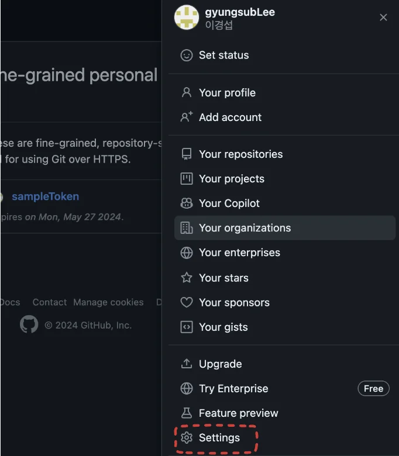

<a id="1c3eda9b0fe181c3bfa3d3281fc21942"></a>

<code>Personal access tokens</code><strong> </strong>&#45; <code>Generate a personal access token</code>

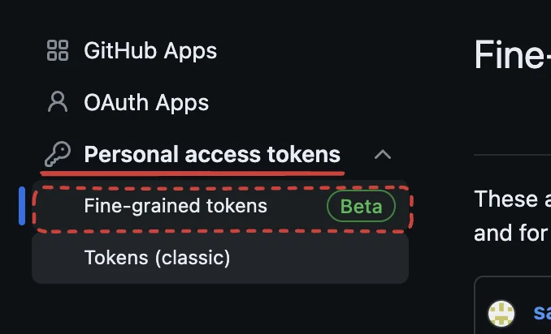

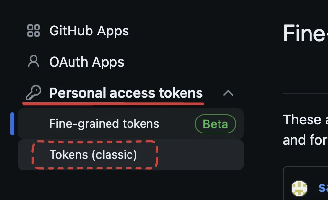

<a id="1c3eda9b0fe1813f8d80eb2e421f300a"></a>

토큰 생성 클릭

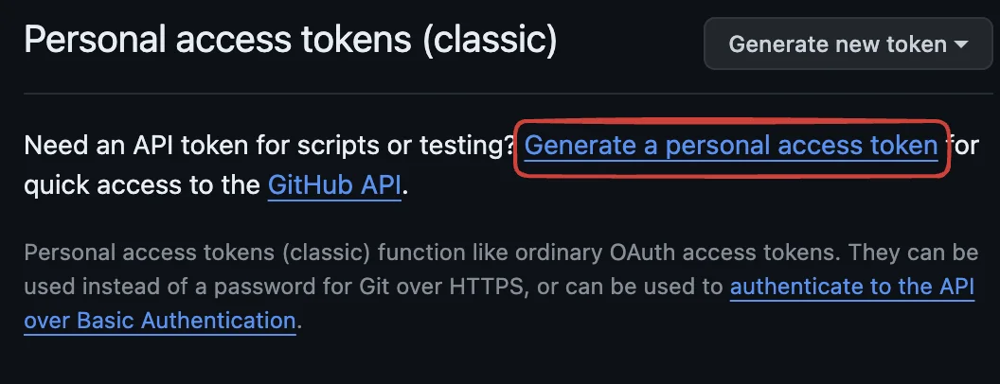

<a id="1c3eda9b0fe1812eb624d89ec1c08755"></a>

생성할 토큰의 이름 및 옵션 설정

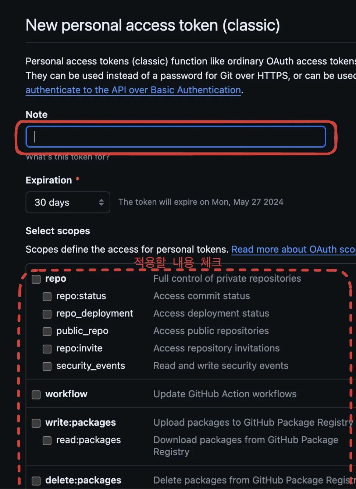

<a id="1c3eda9b0fe181a586b8f7e340c54854"></a>

토큰 생성됨

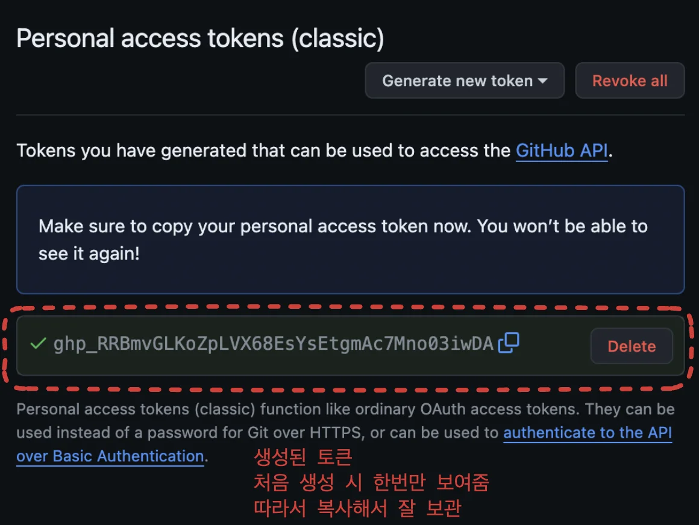

<a id="1c3eda9b0fe18171adecd10de794df63"></a>

### 토큰 컴퓨터에 저장

> 생성된 토큰을 컴퓨에터 저장하여 필요할 때마다 불러서 사용

<a id="1c3eda9b0fe18163883fe4af90f73d34"></a>

<strong><code>spotlight</code></strong> 검색  &#45; <strong><code>keychain access</code></strong><strong> &#45; 검색 github</strong>

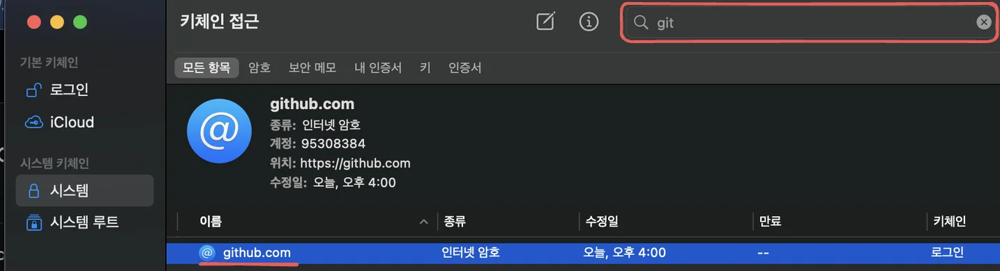

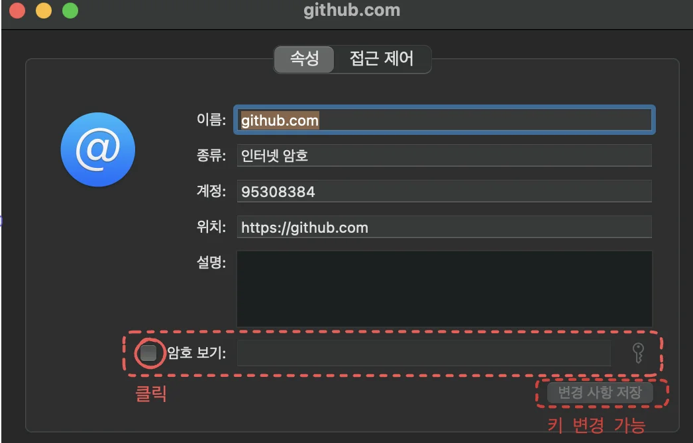

<a id="1c3eda9b0fe18161b83df69b7ff61b53"></a>

### 소스트리 &#45; github 계정 추가

> <code>설정</code> &#62; <code>계정</code> &#62; <code>추가</code> 

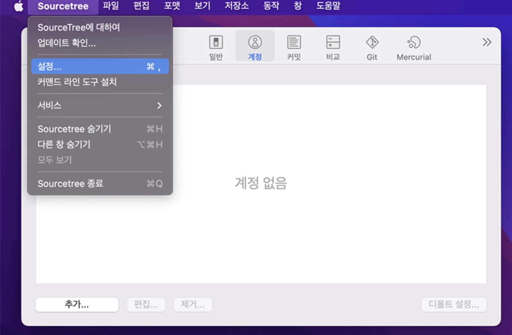

> 필요 내용 입력 후 저장

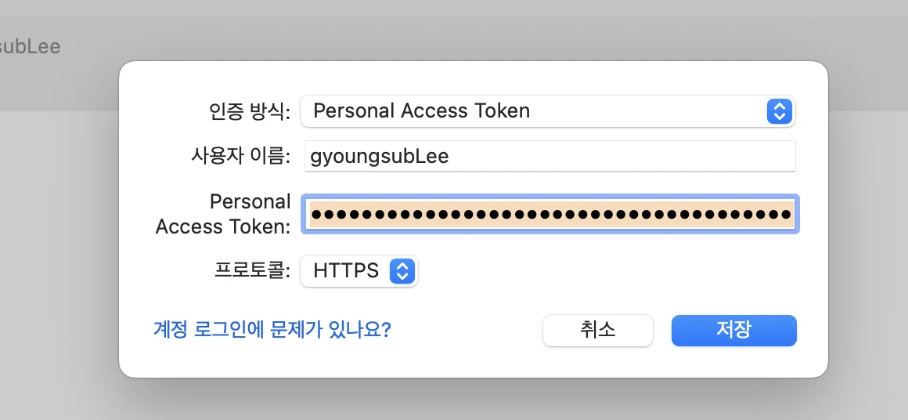

> 계정 정상 생성


<a id="1c3eda9b0fe181dc99edc3d71c448e63"></a>

### 2&#46; github  협업 &#45; repo 에 팀원 추가하기 

> 레포지토리의 <code>Settings</code>  &#45;  <code>Collaborators</code>

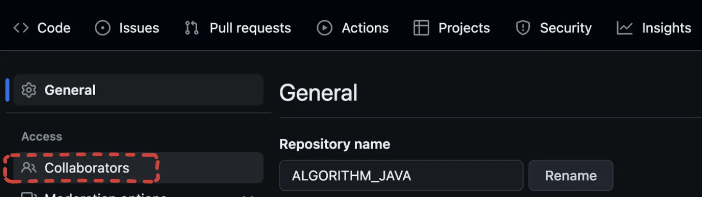

> <code>Add people</code>

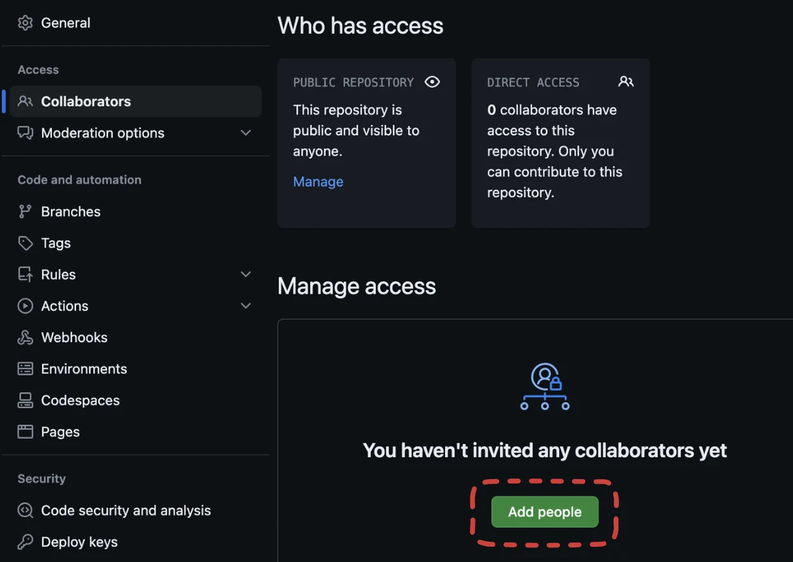

> <strong>팀원 추가</strong>

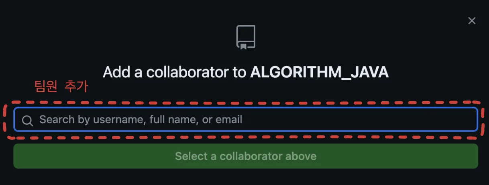

<a id="1c3eda9b0fe1818198adef2bccdcd1fb"></a>

## 3&#46; 로컬 &#45; 원격 저장소 추가 및 업로드(<code>push</code>)

<a id="1c3eda9b0fe181dbb538f6721d9a41c8"></a>

### remote &#45; CLI

<details>
<summary><strong>GitHub 레포지토리(원격 저장소) 생성 후 로컬에 연결</strong></summary>

<a id="1c3eda9b0fe181a6b660f91ee93533c1"></a>

```bash
git remote add origin (원격 저장소 주소)
```

- 원격 저장소 이름 흔히 <code>origin</code> 사용,  수정 가능

</details>

<details>
<summary><strong> GitHub 권장 &#45; 기본 브랜치명을 </strong><strong><code>main</code></strong><strong>으로 변경</strong></summary>

<a id="1c3eda9b0fe181b691e1ec1b7f8ed953"></a>

```bash
git branch -M main
```

</details>

<details>
<summary><strong>로컬 저장소의 커밋 내역들 원격으로 </strong><strong><code>push</code></strong><strong>(업로드)</strong></summary>

<a id="1c3eda9b0fe181bfa40dedcc6a6d7ffc"></a>

```bash
git push -u origin main 
```

- <code>&#45;u</code>  또는 <code>—set&#45;upstream</code>&#58; 현재 브랜치와 명시된 원격 브랜치 기본 연결

</details>

<details>
<summary><strong>최초  인자 설정도 귀찮은 경우</strong></summary>

<a id="1c3eda9b0fe1818c90e8e6e221612e09"></a>

여러 브랜치를 switch하면서 작업하는 경우 최초의 한번 인자는 넘기는 것도 귀찮다&#46;

<a id="1c3eda9b0fe181b88b96f28a886bee58"></a>

대부분의 경우 로컬repo와 원격repo가 동일한 branch 이름을 사용하기 때문에 현재 branch를 기준으로 git push 명령어가 작동되게 아래와 같이 설정

<a id="1c3eda9b0fe181228392ece4eacf37db"></a>

```bash
① git config --global push.defalut current
② git push
```

</details>

<details>
<summary><strong>연결된 원격 저장소 목록 확인</strong></summary>

<a id="1c3eda9b0fe1812199defa556bb7d62a"></a>

```bash
git remote
```

</details>

<details>
<summary><strong>원격 저장소(remote) 지우기</strong></summary>

<a id="1c3eda9b0fe18170afb7cc15ce7b37f0"></a>

```bash
 git remote remove (origin 등 원격 이름)
```

</details>

<details>
<summary><strong>원격 저장소(remote) 프로젝트 복사해  오기 </strong></summary>

> 📌 <strong>GitHub에서 프로젝트 다운받기</strong>
> 
> - <code>Download ZIP</code>&#58; 파일들만 다운받음, Git 관리내역 제외
> 
> - <code>Git clone</code>&#58; <strong>Git 관리 내역 포함</strong> 다운로드

<a id="1c3eda9b0fe181b4a488fbb8ebe6479f"></a>

```bash
git clone (원격 저장소 주소)
```

</details>

<details>
<summary>원격 저장소에 commit 내역 업로드(<code>push</code>)하기 </summary>

<a id="1c3eda9b0fe1812a882fc913c593dd51"></a>

```bash
git push
```

</details>

<a id="1c3eda9b0fe1815f9a55cdb43bf7a76e"></a>

### 로컬 저장소와 원격 저장소(github) 연결하기

1. github &#45; personal access token 생성 및 keychain 에 등록하기  <br>  → <strong>⌜1&#46; 토큰 생성 및 저장 참조⌟</strong>

1. github에 로컬과 연결할 repository 생성하기 
    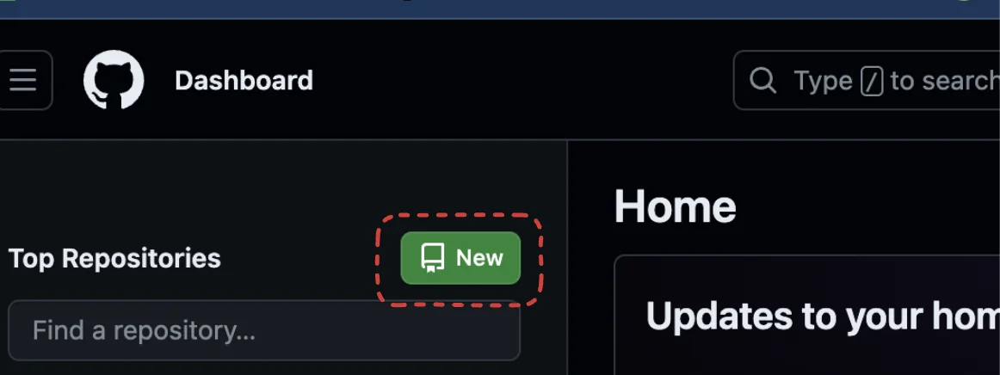


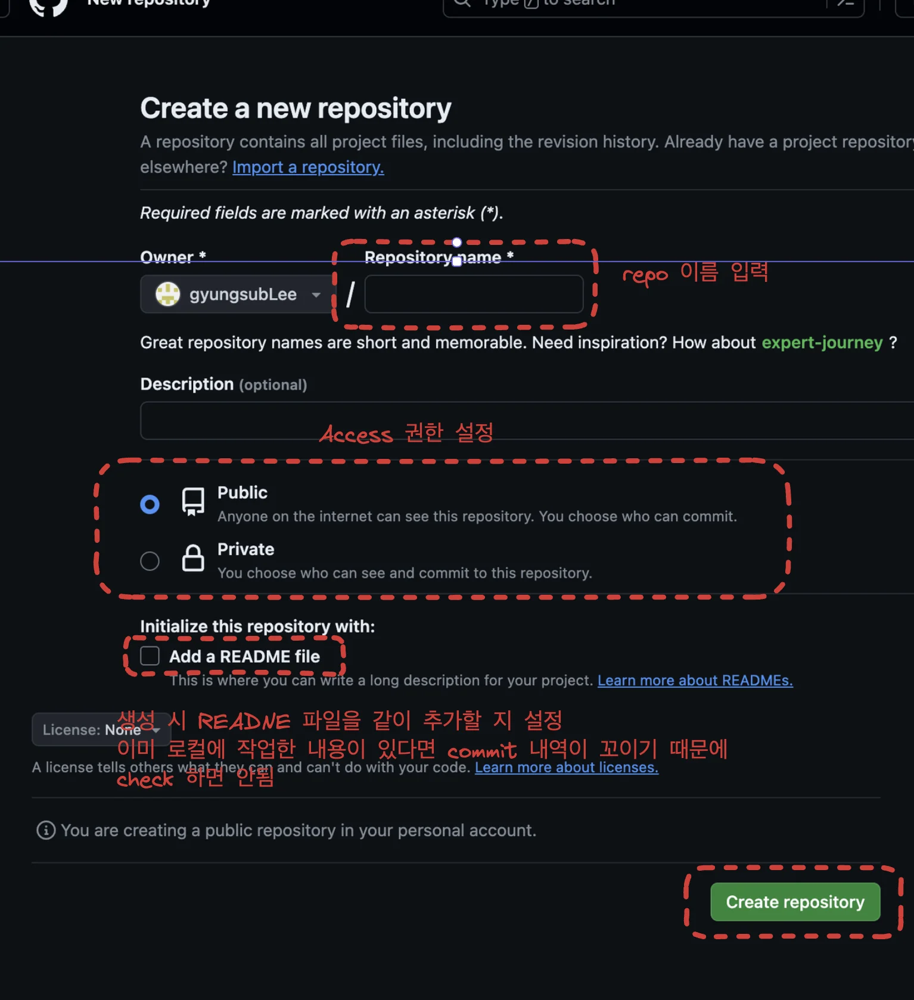

1. 로컬에 repote 연결 및 commit 내역 업로드
    > 위 <strong>⌜remote &#45; CLI 참조⌟</strong>

    - 원격 저장소 연결
        <a id="1c3eda9b0fe181218772e423c68b1832"></a>

        ```bash
        git remote add origin (원격 저장소 주소)
        ```

<a id="1c3eda9b0fe18141a0a0d4c846409f93"></a>

###  로컬 작업(commit) 내용 원격에 업데이트하기

- 업로드할 커밋 작업
    1. Leopards의 <code>members</code>에 <code>Evie</code> 추가
        - 커밋 메시지&#58; <code>Add Evie to Leopards</code><br>

- 최초 인자 설정
    <a id="1c3eda9b0fe181c49e5edf146fe5cccc"></a>

    ```bash
    git push -u origin main 
    ```

- 원격 저장소(github)에 커밋 업로드 하기 
    <a id="1c3eda9b0fe181018133db6b0c46909f"></a>

    ```bash
    git push
    ```

<a id="1c3eda9b0fe181549f43d7b90b496c0c"></a>

### 원격 저장소(github) 커밋 가져오기(<code>pull</code>)

<details>
<summary><strong>github 에서 commit 생성하기 </strong></summary>

> <strong>GitHub에서</strong> Leopards의 <code>members</code>에 <code>Dongho</code> 추가<br>  → 커밋 메시지&#58; <code>Add Dongho to Leopards</code>

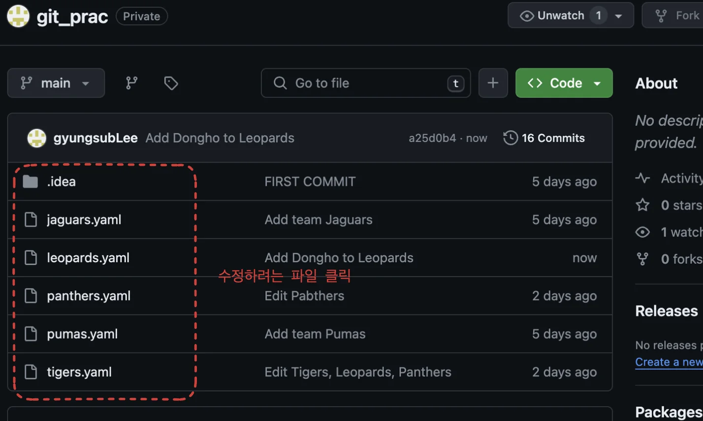

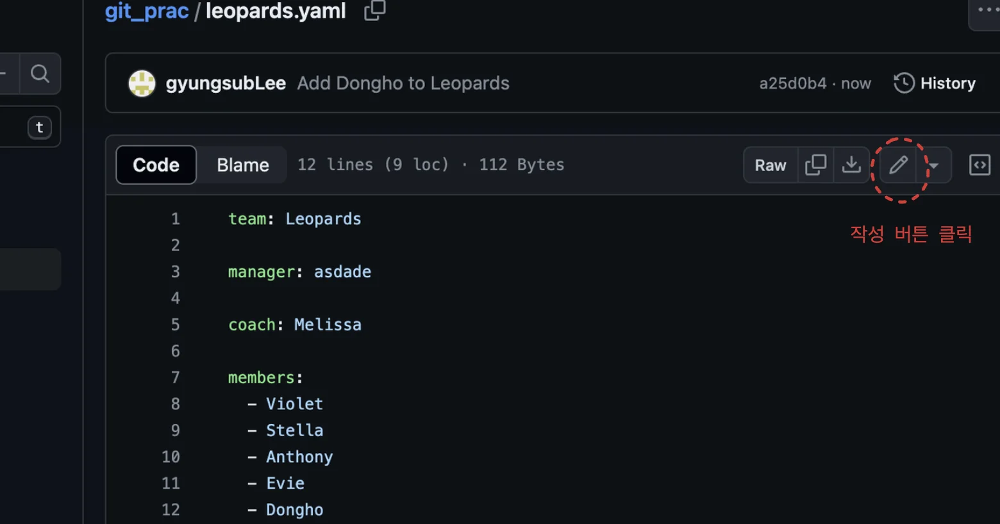

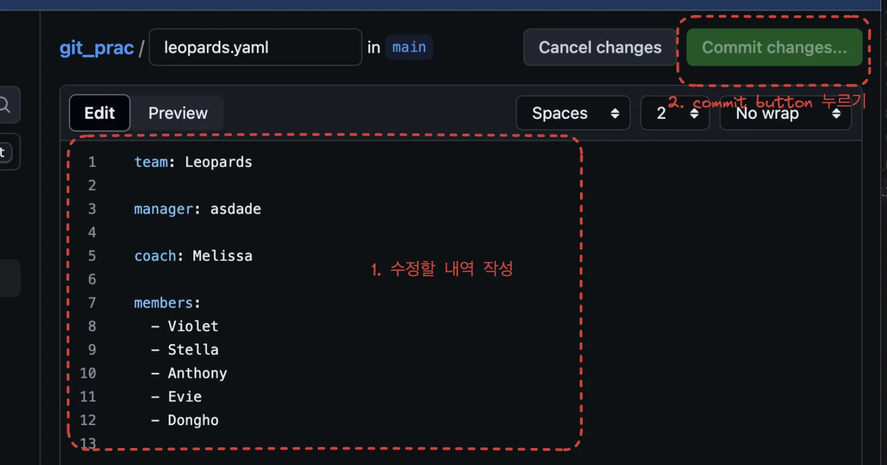

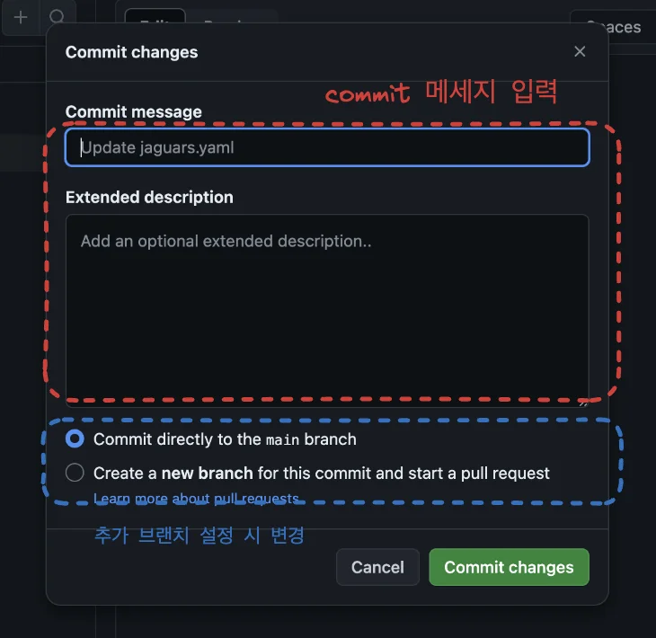

</details>

- 커밋 가져오기

<a id="1c3eda9b0fe1818dbfc1fc5fbc5bea75"></a>

```bash
git pull
```

- <u>로컬 </u><strong><u>파일</u></strong><u>과  </u><strong><u>로그 확인(</u></strong><strong><u><code>git log</code></u></strong><strong><u>)</u></strong><u> 시</u> 아래와 같이 원격 커밋을 잘 가져온 것을 알 수 있다&#46;
    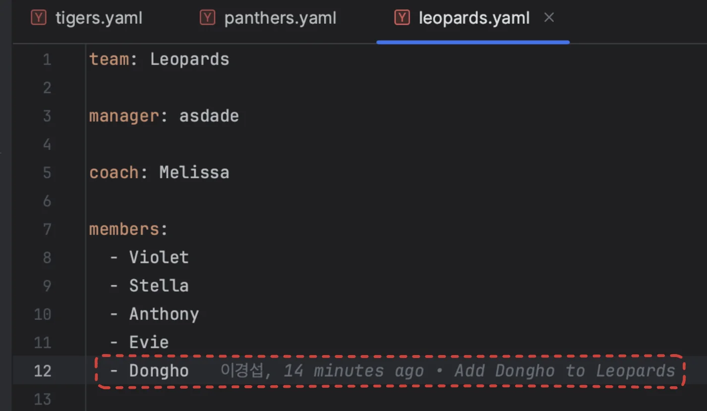

    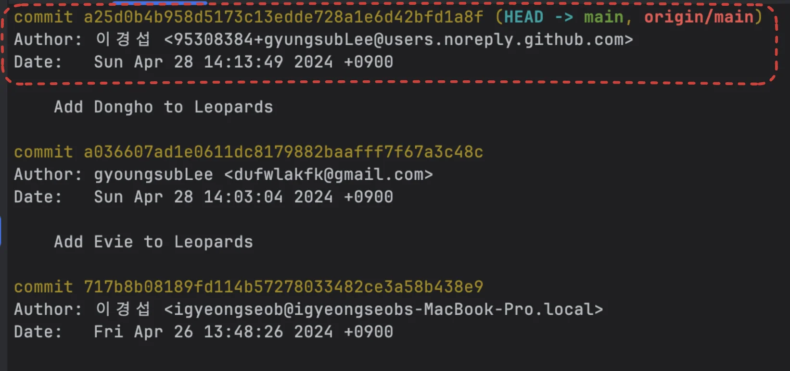

<a id="1c3eda9b0fe181978e8de182f498cf1e"></a>

## 4&#46; 협업 시 발생되는 &#91;<code>push</code>/<code>pull</code>&#93; 충돌 해결

<a id="1c3eda9b0fe1811e9f4bda09e687741b"></a>

### <code>pull</code> 해야할 내용이 있을 때, <code>push</code> 하는 경우

> 원격 저장소에 로컬에 가져오지 않은 commit 내역이 있을때, 로컬에서 commit 추가하여 원격에 업로드하는 경우 

1. <strong>로컬에서</strong> Leopards의 <code>manager</code>를 <code>Dooli</code>로 수정
    <a id="1c3eda9b0fe181579ff2e905f912e21b"></a>

    → 커밋 메시지&#58; <code>Edit Leopards manager</code>

1. <strong>GitHub에서</strong> Leopards의 <code>coach</code>를 <code>Lupi</code>로 수정

<a id="1c3eda9b0fe1815a8de0eafbc82fb2f3"></a>

     → 커밋 메시지&#58; <code>Edit Leopards coach</code>

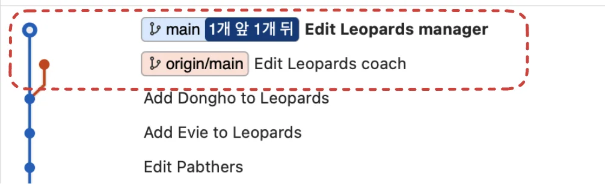

<a id="1c3eda9b0fe18140a90fc0d65d626408"></a>

위와 같은 커밋 히스토리가 생성됨

<a id="1c3eda9b0fe1817897c5e21419c7e333"></a>

여기서 로컬 commit을  업로드(<code>git pull</code>) 하면 아래와 같이 거부된다&#46; 

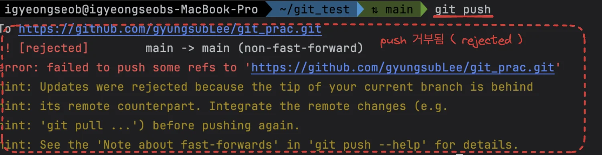

> 📌 <code>push</code>는 원격에 먼저 적용된 새 버전이 있으므로 적용 불가하다&#46;
> 
> <a id="1c3eda9b0fe18161890fdcb401326649"></a>
> 
> <code>pull</code> 해서 원격의 버전을 받아온 다음 <code>push</code>가 가능하다&#46;
> 
> - <strong>방법1) </strong><strong><code>merge</code></strong> <strong>방식&#58;</strong> <code>git pull &#45;&#45;no&#45;rebase</code>
> 
> - <strong>방법2) </strong><strong><code>rebase</code></strong><strong> 방식&#58; </strong><code>git pull &#45;&#45;rebase</code> 

<a id="1c3eda9b0fe181d2b3dfe755aee94eb6"></a>

### <strong>방법1) </strong><strong><code>merge</code></strong> <strong>방식&#58;</strong> <code>git pull &#45;&#45;no&#45;rebase</code>

<a id="1c3eda9b0fe181038059d27cde739b0a"></a>

merge 방식 사용 시 위와 같이 원격 commit 내용만 가져온다&#46; 즉, 새로운 commit을 작성하고 push를 해줘야 한다&#46;

<a id="1c3eda9b0fe1816f9727d3066e585d1a"></a>

```bash
git pull --no-rebase
```

<a id="1c3eda9b0fe181fe944ae5debd1ab780"></a>

위 명령어 입력 시 바로 commit meassage 입력 창이 바로 뜬다&#46; <code>&#58;wq</code> 로 저장 후 <code>git push</code>하면 아래와 같이 <code>merge</code> 된 것을 확인할 수 있다&#46; <br>

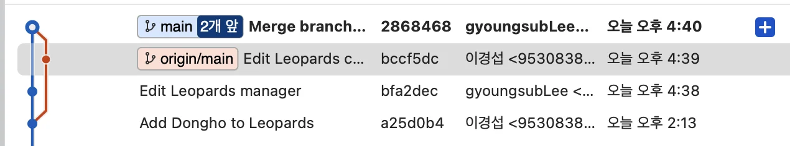

<details>
<summary>첨에 그냥 종료해서 아래와 같이 <code>pull</code> 한 내역이 <strong>staging</strong> 상태로 남았다&#46; </summary>

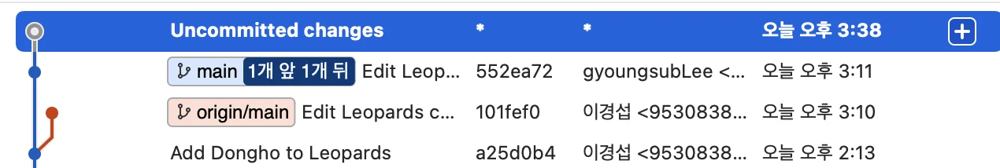

<a id="1c3eda9b0fe181178d41c10c13f9e288"></a>

아래와 같이 그냥 커밋 메시지 작성해서 커밋해주면 된다&#46;

<a id="1c3eda9b0fe1818f8be5ee21e119de93"></a>

```bash
git commit -am [commit message]
```

</details>

<details>
<summary>중간에 로컬에서 다른 파일의 내용이 수정되어서  <code>push</code> 시 <strong>거부</strong>되었다&#46; </summary>

<a id="1c3eda9b0fe18121a99bddc2df5f4f25"></a>

추가 변경 내용&#58; 실수로 다른 파일에 ‘공백 줄’ 추가함

<a id="1c3eda9b0fe1811c9af3c7e958e93bd7"></a>

→ reset으로 작성 내용 삭제 후 다시 작성

<a id="1c3eda9b0fe181698e86c94427b02bf8"></a>

→ 별로 중요한 내용이 아니라면 원격에서 다시 <code>pull</code> 해온 후 <code>push</code>

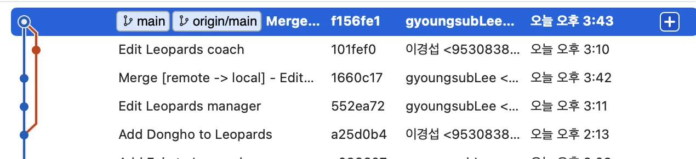

</details>

<a id="1c3eda9b0fe181e2be8efbeb3c878871"></a>

### 강제 push&#58; <code>&#45;f</code>

<a id="1c3eda9b0fe1812b93c5d1dbbf071506"></a>

<code>&#45;f</code> 옵션을 사용하면 히스토리 내역을 강제로 덮어쓸 수 있다&#46; 

> <strong>⚠️ 협업 시에는 절대로 사용하면 안된다&#33;</strong>

<a id="1c3eda9b0fe1812890c5e6b54c1a9f9b"></a>

```bash
git push -f
```

<a id="1c3eda9b0fe181259309c8b6fe9c2a65"></a>

### <strong>방법2) </strong><strong><code>rebase</code></strong><strong> 방식&#58; </strong><code>git pull &#45;&#45;rebase</code> 

> pull 상의 rebase는 다름 (협업시 사용 OK)

<a id="1c3eda9b0fe18133834fc18246ecb274"></a>

```bash
git pull --rebase
```

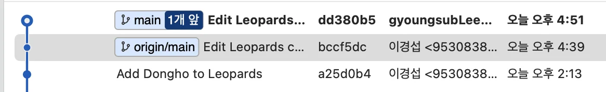

<a id="1c3eda9b0fe18142b3dcd7b51b49a472"></a>

```bash
git push
```

<a id="1c3eda9b0fe181539d5dc1818334bfe7"></a>

<code>push</code> 시 아래와 같이 로컬과 원격 commit 이 충돌 없이 <code>rebase</code> 된 것을 확인할 수 있다&#46; 


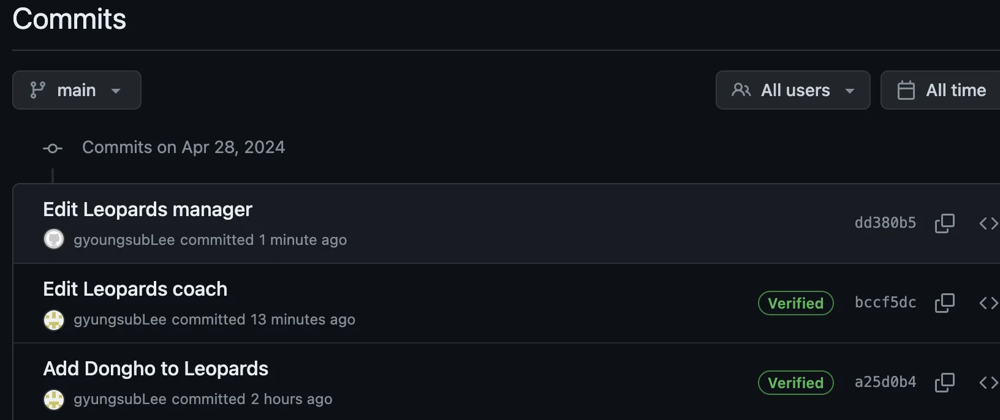

<a id="1c3eda9b0fe1814e87ede889de8ae461"></a>

## 5&#46; &#91;로컬&#45; 원격&#93; branch

<details>
<summary>브랜치 목록 살펴보기 </summary>

- github에서 목록 보기

- 아래 명령어로 로컬, 원격 브랜치 확인
    <a id="1c3eda9b0fe181109d17d29072ce1562"></a>

    ```bash
    git branch -all
    ```

</details>

<a id="1c3eda9b0fe181c1b8f7dd985edf3788"></a>

### 1&#46; 로컬에서 branch 만들어 원격에 push 하기

1. 브랜치 생성 
    <a id="1c3eda9b0fe181debd0fcf51343b5401"></a>

    ```bash
    git branch test
    ```

1. 원격에 브랜치 push
    <a id="1c3eda9b0fe18168bc6fefd6177802e0"></a>

    ```bash
    git push
    ```

    <a id="1c3eda9b0fe181e2afcdf51eef5548b4"></a>

    처음 <code>push</code> 시 위와 같이 하면, 대상을 명시하라는 메세지가 나타난다&#46; 

    <a id="1c3eda9b0fe18199a0bff90996f9b811"></a>

    그러면 아래 명령어로 원격 브랜치 명시 및 기본 설정을 해준다&#46; 

    <a id="1c3eda9b0fe1813281d8f81d84b736d7"></a>

    ```bash
    // git push -u [원격저장소 명] [로컬 브랜치 명]

    git push -u origin test
    ```

<a id="1c3eda9b0fe18111950ce064dceb8ac7"></a>

### 2&#46; 원격 브랜치 로컬에 받아오기 

1. GitHub에서 <code>test</code> 브랜치 만들기
    > <code>git branch &#45;a</code>에서 현재는 보이지 않음

1. 아래 명령어로 원격의 변경사항 확인
    <a id="1c3eda9b0fe181a2bc11d2c856c8efc9"></a>

    ```bash
    git fetch
    ```

    - <code>git branch &#45;a</code>로 확인

<a id="1c3eda9b0fe1812dae36eb5fc11bf09b"></a>

3&#46;  아래 명령어로 <strong><u>로컬</u></strong>에<strong> </strong><strong><u>같은 이름의 브랜치를 생성 및 연결, switch</u></strong>

<a id="1c3eda9b0fe181a594ccc341076b4a7a"></a>

```bash
git switch -t origin/from-remote
```

<a id="1c3eda9b0fe181c29224cc8c42e9dd82"></a>

### 3&#46; 원격 브랜치 삭제

<a id="1c3eda9b0fe1816fa437f6084ac2107e"></a>

```bash
git push [remote 명] --delete [remote의 branch 명]
```
