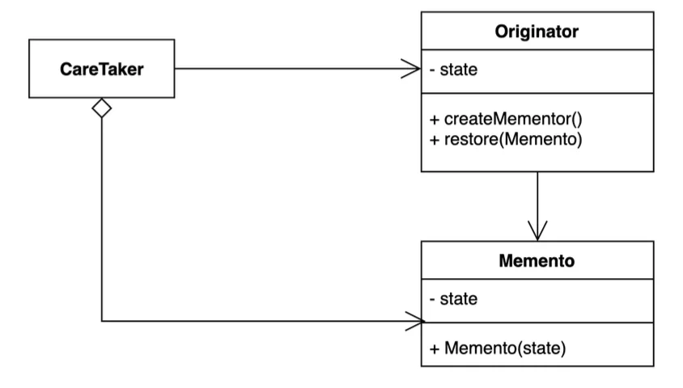

> 📝 
> 
> <a id="1dceda9b0fe180deaf54e63a612b1ffb"></a>
> 
> <strong>질문</strong>
> 
> <details>
> <summary></summary>
> 
> 
> 
> </details>

<a id="1dceda9b0fe1802f8271cd010e5ef868"></a>

## 메멘토 ( Memento ) 패턴

---

> 📖 
> 
> <a id="1dceda9b0fe180028e50ea753add80ec"></a>
> 
> <strong>메멘토 ( Memento ) 패턴</strong>
> 
> ---
> 
> > 캡슐화(불변성)를 유지하면서 객체 내부 상태를 외부에 저장하는 패턴
> 
> - <u>안전</u>하게 객<u>체의 </u><strong><u>상태를 와부에 저장</u></strong><strong>하고, </strong><strong><u>복원</u></strong><strong> 가능하다&#46;</strong>
> 
> 
> 
> <details>
> <summary>주요 특징</summary>
> 
> - <code>상태 보존</code>
>     - <code>Originator</code>가 <code>Memento</code>를 통해 현재 상태를 저장
> 
> - <code>복구</code>
>     - 저장된 <code>Memento</code>를 통해 예전 상태로 복구
> 
> - <code>캡슐화</code>
>     - <code>Memento</code>는 내부 상태를 외부에서 직접 수정하지 못하도록 캡슐화함 → Immutable ( 불변성 ) 
> 
> </details>
> 
> <details>
> <summary>구성 요소</summary>
> 
> > ✏️ 
> > 
> > <a id="1dceda9b0fe1808cb720e3849c203533"></a>
> > 
> > 동작
> > 
> > ---
> > 
> > <a id="1dceda9b0fe18036abf2e99d55ef212b"></a>
> > 
> > ```css
> > [ Originator ] ←→ [ Memento ] ←→ [ Caretaker ]
> >    (상태 생성)       (상태 저장)        (상태 관리)
> > ```
> > 
> > - <code>Originator</code>가 <code>Memento</code>를 만들어서 <code>Caretaker</code>에 맡긴다&#46; 
> > 
> > - <strong><u>undo(복원) 필요 </u></strong>시, <code>Caretaker</code>가 보관해둔 <code>Memento</code>를 다시 <code>Originator</code>에 준다&#46;
> 
> - <code>Originator</code>
>     - 상태를 저장하고 복원하려는 실제 객체&#46;
> 
>     - 자신의 상태를 메멘토  객체에 저장하거나 복원함
> 
> - <code>Memento</code>
>     - Originator의 상태 정보를 저장하는 객체
> 
>     - 외부에서는 상태에 직접 접근할 수 없다&#46;
> 
> - <code>Caretaker</code>
>     - 메멘토 객체를 관리(저장/복원)하는 역할
> 
>     - 메멘토의 내부 상태를 변경하거나 알지 못함
> 
> </details>
> 
> <details>
> <summary>장•단점</summary>
> 
> 
> 
> </details>
> 
> <details>
> <summary>실무 활용 예시</summary>
> 
> 
> 
> </details>

<a id="1dceda9b0fe180e4aaf5c70e7debedfd"></a>

메멘토 패턴은 “<strong>하는” 기능을 설계할 때 사용한다 &#46;</strong>

<details>
<summary><strong>🧐 &#91; Memento 상태 저장 전략 &#93;</strong> <strong>Memento 안에 꼭 모든 상태를 다 저장해야 하는가?</strong></summary>

> 아니다, <strong>나중에 </strong><strong><u>복원할 때 </u></strong><strong><u>필요한 만큼의 정보</u></strong><strong><u>만 저장</u></strong>한다 &#46;

- 저장할 데이터가 많으면 <u>Memento 크기가 커질 수 있</u>으므로 필요한 상태만 저장하도록 해야 한다&#46; 
    - 비효율적인 메모리 낭비 발생

- <code>Caretaker</code>가 <code>Memento</code>를 관리할 때, <strong><u>메모리 누수를 방지</u></strong>하기 위해 <strong><u>오래된 Memento를 삭제</u></strong><u>하는 전략</u>도 고려해야 한다&#46; 

<details>
<summary>ex) </summary>

> ✏️ 
> 
> <a id="1dceda9b0fe1802d8a5cf539aaa208a6"></a>
> 
> ex) 문서 에디터 
> 
> - ‘커서 위치’나 ‘변경된 부분’만 저장해도 복원이 가능할 수 있다&#46;
> 
> <a id="1dceda9b0fe18060bd0bc8bf603623bf"></a>
> 
> ex) 게임
> 
> - ‘플레이어 HP/ 경험치/좌표’ 만 저장

<a id="1dceda9b0fe180e7bfc3e295b9829452"></a>

<strong>&#91; 🤬 Bad Case &#93;</strong><strong> 모든 상태 저장하는 경우</strong>

<a id="1dceda9b0fe180deaa79dd77659938bb"></a>

```java
public class TextMemento {
    private final String fullText;  // 전체 텍스트를 통째로 저장
}
```

<a id="1dceda9b0fe180658837d6c1c7acc057"></a>

<strong>&#91; 🧐 Best Case &#93;</strong><strong> 필요한 부분만 저장하는 경우</strong>

<a id="1dceda9b0fe180eaa262f63937b02b10"></a>

```java
public class TextMemento {
    private final int cursorPosition;  // 커서 위치만 저장
    private final String changedText;  // 변경된 부분만 저장
}
```

</details>

</details>

<details>
<summary>🧐 왜 <strong><code>Caretaker</code></strong><strong> 는 </strong><strong><code>Memento</code></strong><strong>의 내용을 직접 수정하면 안되는 것인가? <br>    , 왜  </strong><strong><code>Memento</code></strong><strong> 객체를 </strong><strong><code>Immutable( 불변 )</code></strong><strong>하게 </strong><strong><code>캡슐화</code></strong><strong> 해야 하는가?</strong></summary>

<a id="1dceda9b0fe1800b9e98ddf20d1fe93f"></a>

Memento의 내용을 Caretaker가 수정하면 캡슐화(encapsulation)가 깨진다&#46; <br>즉, <strong>Memento</strong> 객체의 <u>불변성이 깨진다&#46; </u>

> 🧐 그렇다면 왜 객체의 불변성 ( 캡슐화 )를 유지해야 하는가?

<a id="1dceda9b0fe1803bbf94e4533bc67a5b"></a>

시스템에서 ‘<code>불변(Immutable)’</code>은 <strong>객체의 예상치 못한 변경을 막아 오류를 방지</strong>할 수 있다&#46;

<a id="1dceda9b0fe180d085d3f1353249af23"></a>

이러한 불변성은 캡슐화(getter, constructor)를 통해 가능하다&#46; 

- 캡슐화(getter, constructor)를 통해 <strong><u>외부에서의 데이터의 접근을 막</u></strong>아 <strong><u>데이터 상태를 안전하게 보관</u></strong>할 수 있다&#46; 

<a id="1dceda9b0fe1807e8e8cf861ba9c9d8f"></a>

Memento 패턴의 핵심 철학은 <u>“상태를 안전하게 보관”</u>하는 것이다&#46; 

<a id="1dceda9b0fe180f2b17ff988de8f498e"></a>

<strong>만약 Caretaker가 Memento 내부를 수정</strong>할 수 있으면

<a id="1dceda9b0fe180cd9e90e5fafe1852fe"></a>

<strong><u>잘못된 복원이 발생</u></strong>될 수 있으며 <strong><u>원본 상태가 훼손</u></strong>될 수 있다&#46; 

<a id="1dceda9b0fe180688130d82d4a69b020"></a>

이렇게 되면 Memento를 통한 상태 저장의 의미가 사라진다&#46; 

<a id="1dceda9b0fe180f396c6eb25968c937c"></a>

따라서 Caretaker는 오직 <u>상태를 저장</u>하고 <u>가져올</u> 수 있어야 한다&#46; 

- Memento 객체의 불변성을 유지해야 한다&#46; (  setter ❌ )

| <strong>역할</strong> | <strong>책임</strong> |
| --- | --- |
| <code>Originator</code> | 상태를 만들고, 복원할 수 있음 |
| <code>Memento</code> | 상태를 안전하게 들고 있음 &#91; 수정 ❌ &#93; |
| <code>Caretaker</code> | 메멘토를 저장하거나 꺼낼 수만 있음 &#91; 수정 ❌ &#93;  |

<details>
<summary>ex)</summary>

<a id="1dceda9b0fe180e985f5c86a399af6cd"></a>

<strong>&#91; 🤬  Bad Case &#93;</strong><strong>  외부에서 setter 사용 → 캡슐화(불변성) 깨짐</strong>

<a id="1dceda9b0fe1806b8224e9773e2b4783"></a>

```java
TextMemento memento = history.undo();
memento.setText("마음대로 수정함"); // ❌ 상태 훼손
```

<a id="1dceda9b0fe180f89ba2e0ab18cd492d"></a>

<strong>&#91; 🧐 Best Case &#93;</strong><strong> </strong><strong> </strong><strong><code>private final </code></strong><strong>&#43; </strong><strong><code>getter</code></strong>

<a id="1dceda9b0fe180a287fcc969abe88c73"></a>

```java
public class TextMemento {
    private final String text; // final로 선언해서 절대 변경 불가

    public TextMemento(String text) {
        this.text = text;
    }

    public String getText() {
        return text;
    }
}
```

</details>

</details>

<a id="1dceda9b0fe1800c9d8cce8010fb5ae2"></a>

### 1&#46; 기본 예제

<a id="1dceda9b0fe1809e9c80e0328b93d7d7"></a>

### 코드

<details>
<summary>&#91; 코드 &#93; Game</summary>

<a id="1dceda9b0fe18080b49af5242a062f4b"></a>

```java
package _03_behavioral_patterns._18_memento._01_before;

import java.io.Serializable;

public class Game implements Serializable {

    private int redTeamScore;
    private int blueTeamScore;

    public int getRedTeamScore() {
        return redTeamScore;
    }

    public void setRedTeamScore(int redTeamScore) {
        this.redTeamScore = redTeamScore;
    }

    public int getBlueTeamScore() {
        return blueTeamScore;
    }

    public void setBlueTeamScore(int blueTeamScore) {
        this.blueTeamScore = blueTeamScore;
    }
}

```

</details>

<details>
<summary>&#91; 코드 &#93; Client</summary>

<a id="1dceda9b0fe1802abc72c20bfe33237c"></a>

```java
package _03_behavioral_patterns._18_memento._01_before;

public class Client {

    public static void main(String[] args) {
        Game game = new Game();
        game.setRedTeamScore(10);
        game.setBlueTeamScore(20);

        int blueTeamScore = game.getBlueTeamScore();
        int redTeamScore = game.getRedTeamScore();

        Game restoreGame = new Game();
        restoreGame.setBlueTeamScore(blueTeamScore);
        restoreGame.setRedTeamScore(redTeamScore);
    }
}

```

</details>

<a id="1dceda9b0fe1807ea6b1e9be34b70dc6"></a>

### 2&#46; 패턴 적용

<a id="1dceda9b0fe18076a5d8f1532818e862"></a>

### 코드

<details>
<summary>&#91; 코드 &#93; GameSave</summary>

<a id="1dceda9b0fe180dbbb8bc8b50d546906"></a>

```java
package _03_behavioral_patterns._18_memento._02_after;

public class GameSave {

    private final int blueTeamScore;
    private final int redTeamScore;

    public GameSave(int blueTeamScore, int redTeamScore) {
        this.blueTeamScore = blueTeamScore;
        this.redTeamScore = redTeamScore;
    }

    public int getBlueTeamScore() {
        return blueTeamScore;
    }

    public int getRedTeamScore() {
        return redTeamScore;
    }
}

```

</details>

<details>
<summary>&#91; 코드 &#93; Game</summary>

<a id="1dceda9b0fe1800e920ed016d7f212b4"></a>

```java
package _03_behavioral_patterns._18_memento._02_after;

public class Game {

    private int redTeamScore;
    private int blueTeamScore;

    public int getRedTeamScore() {
        return redTeamScore;
    }

    public void setRedTeamScore(int redTeamScore) {
        this.redTeamScore = redTeamScore;
    }

    public int getBlueTeamScore() {
        return blueTeamScore;
    }

    public void setBlueTeamScore(int blueTeamScore) {
        this.blueTeamScore = blueTeamScore;
    }

    public GameSave save() {
        return new GameSave(this.blueTeamScore, this.redTeamScore);
    }

    public void restore(GameSave gameSave) {
        this.blueTeamScore = gameSave.getBlueTeamScore();
        this.redTeamScore = gameSave.getRedTeamScore();
    }
}
```

</details>

<details>
<summary>&#91; 코드 &#93; Client</summary>

<a id="1dceda9b0fe180249f6ce72045717a0f"></a>

```java
package _03_behavioral_patterns._18_memento._02_after;

public class Client {

    public static void main(String[] args) {
        Game game = new Game();
        game.setBlueTeamScore(10);
        game.setRedTeamScore(20);

        GameSave save = game.save();

        game.setBlueTeamScore(12);
        game.setRedTeamScore(22);

        game.restore(save);

        System.out.println(game.getBlueTeamScore());
        System.out.println(game.getRedTeamScore());
    }
}
```

</details>

<a id="1dceda9b0fe1802ca8dfd70649dc2c40"></a>

### 2&#46;2 추가  예제 1 &#45; 글쓰기 저장

<a id="1dceda9b0fe180e2b9f6e232b8f947fa"></a>

### 코드

<details>
<summary>&#91; 코드 &#93; TextMemento &#45; <code>Memento</code></summary>

<a id="1dceda9b0fe18021b539fb314dd15d38"></a>

```java
// 글쓰기 상태를 저장할 객체
public class TextMemento {
    private final String text;

    public TextMemento(String text) {
        this.text = text;
    }

    public String getText() {
        return text;
    }
}
```

</details>

<details>
<summary>&#91; 코드 &#93; TextEditor &#45; <code>Originator</code></summary>

<a id="1dceda9b0fe1809cb971ecead1c6a247"></a>

```java
// 실제 글을 작성하는 객체
public class TextEditor {
    private String text = "";

    public void write(String newText) {
        this.text += newText;
    }

    public String getText() {
        return text;
    }

    // 현재 상태 저장
    public TextMemento save() {
        return new TextMemento(text);
    }

    // 저장된 상태 복원
    public void restore(TextMemento memento) {
        this.text = memento.getText();
    }
}
```

</details>

<details>
<summary>&#91; 코드 &#93; TextEditorHistory &#45; <strong><br></strong><strong><code>Caretaker</code></strong></summary>

<a id="1dceda9b0fe1806a965deeae29b387d9"></a>

```java
import java.util.Stack;

// 메멘토를 관리하는 객체
public class TextEditorHistory {
		// Stack를 통해 마지막 Memento 부터 undo 
    private Stack<TextMemento> history = new Stack<>();

    public void save(TextMemento memento) {
        history.push(memento);
    }

    public TextMemento undo() {
        if (!history.isEmpty()) {
            return history.pop();
        }
        return null;
    }
}
```

</details>

<details>
<summary>&#91; 코드 &#93; Main &#45; <strong><br></strong><strong><code>Client</code></strong></summary>

<a id="1dceda9b0fe180d3b008d5e38de72aae"></a>

```java
public class Main {
    public static void main(String[] args) {
        TextEditor editor = new TextEditor();
        TextEditorHistory history = new TextEditorHistory();

        editor.write("안녕하세요. ");
        history.save(editor.save()); // 상태 저장

        editor.write("저는 개발자입니다. ");
        history.save(editor.save()); // 상태 저장

        editor.write("메멘토 패턴을 공부하고 있어요!");
        System.out.println("현재 내용: " + editor.getText());

        // Undo
        editor.restore(history.undo());
        System.out.println("Undo 후 내용: " + editor.getText());

        // 또 Undo
        editor.restore(history.undo());
        System.out.println("다시 Undo 후 내용: " + editor.getText());
    }
}
```

</details>

<a id="1dceda9b0fe180adb2d8d8861018049a"></a>

### 2&#46;3 추가 예제  2 &#45; <strong> Undo/Redo</strong>

> ✏️ 
> 
> <a id="1dceda9b0fe180208c3ad4eed0496e90"></a>
> 
> Undo/Redo를 구현하기 위해서는 2개의 <strong>Stack</strong>( <strong><u>Undo Stack</u></strong>, <strong><u>Redo Stack</u></strong><strong> )</strong><strong>이 필요하다&#46;</strong>

<a id="1dceda9b0fe180399d02ff78cdcaa03d"></a>

### 코드

<details>
<summary>&#91; 코드 &#93; TextMemento &#45; <code>memento</code></summary>

<a id="1dceda9b0fe1802da28ac593b904ebca"></a>

```java
class TextMemento {
    private final String text;

    public TextMemento(String text) {
        this.text = text;
    }

    public String getText() {
        return text;
    }
}
```

</details>

<details>
<summary>&#91; 코드 &#93; TextEditorCaretaker &#45; <code>caretaker</code></summary>

<a id="1dceda9b0fe180628824fb59bc45a1e7"></a>

```java
import java.util.Stack;

public class TextEditorCaretaker {

    private final TextEditor editor;
    private final Stack<TextMemento> undoStack = new Stack<>();
    private final Stack<TextMemento> redoStack = new Stack<>();

    public TextEditorCaretaker(TextEditor editor) {
        this.editor = editor;
    }

    public void write(String newText) {
        undoStack.push(editor.save());
        editor.write(newText);
        redoStack.clear();
    }

    public void undo() {
        if (!undoStack.isEmpty()) {
            redoStack.push(editor.save());
            editor.restore(undoStack.pop());
        }
    }

    public void redo() {
        if (!redoStack.isEmpty()) {
            undoStack.push(editor.save());
            editor.restore(redoStack.pop());
        }
    }
}
```

</details>

<details>
<summary>&#91; 코드 &#93; TextEditor &#45; <code>originator</code></summary>

<a id="1dceda9b0fe180f38eebcb3503b0f275"></a>

```java
public class TextEditor {
    private String text = "";

    public void write(String newText) {
        this.text += newText;
    }

    public TextMemento save() {
        return new TextMemento(text);
    }

    public void restore(TextMemento memento) {
        this.text = memento.getText();
    }

    public String getText() {
        return text;
    }
}
```

</details>

<details>
<summary>&#91; 코드 &#93; Main &#45; <code>client</code></summary>

<a id="1dceda9b0fe1802588d9f1e5fbfa2d06"></a>

```java
public class Main {
    public static void main(String[] args) {
        TextEditor editor = new TextEditor();

        editor.write("Hello ");
        editor.write("World!");
        System.out.println("현재 내용: " + editor.getText());

        editor.undo();
        System.out.println("Undo 후 내용: " + editor.getText());

        editor.redo();
        System.out.println("Redo 후 내용: " + editor.getText());
    }
}
```

</details>

<a id="1dceda9b0fe180aa8497d44a4fdd0799"></a>

### 2&#46;3 추가 예제  2 &#45; Game

<a id="1dceda9b0fe1803c9bdcca21772ca4ff"></a>

### 코드

<details>
<summary>&#91; 코드 &#93; GameMemento &#45; <code>memento</code></summary>

<a id="1dceda9b0fe180e4b2d0d81eca78afe9"></a>

```java
public class GameMemento {
    private final int hp;
    private final int level;
    private final int experience;

    public GameMemento(int hp, int level, int experience) {
        this.hp = hp;
        this.level = level;
        this.experience = experience;
    }

    public int getHp() {
        return hp;
    }

    public int getLevel() {
        return level;
    }

    public int getExperience() {
        return experience;
    }
}
```

</details>

<details>
<summary>&#91; 코드 &#93; GameCaretaker &#45; <code>caretaker</code></summary>

<a id="1dceda9b0fe180c7a3c1fd76478c9e6a"></a>

```java
import java.util.Stack;

public class GameCaretaker {
    private final Stack<GameMemento> savePoints = new Stack<>();

    public void save(GameCharacter character) {
        savePoints.push(character.save());
    }

    public void undo(GameCharacter character) {
        if (!savePoints.isEmpty()) {
            GameMemento memento = savePoints.pop();
            character.restore(memento);
        } else {
            System.out.println("되돌릴 저장 지점이 없습니다.");
        }
    }
}
```

</details>

<details>
<summary>&#91; 코드 &#93; GameCharacter &#45; <code>originator</code></summary>

<a id="1dceda9b0fe1809ba079f9a8962c8a7c"></a>

```java
public class GameCharacter {
    private int hp;
    private int level;
    private int experience;

    public GameCharacter(int hp, int level, int experience) {
        this.hp = hp;
        this.level = level;
        this.experience = experience;
    }

    public GameMemento save() {
        return new GameMemento(hp, level, experience);
    }

    public void restore(GameMemento memento) {
        this.hp = memento.getHp();
        this.level = memento.getLevel();
        this.experience = memento.getExperience();
    }

    public void fight() {
        System.out.println("몬스터를 잡았다!");
        experience += 150;
        if (experience >= 1000) {
            level++;
            experience = experience - 1000;
            System.out.println("레벨업!");
        }
    }

    public void damage(int amount) {
        hp -= amount;
        if (hp < 0) hp = 0;
    }

    public void printStatus() {
        System.out.println("HP: " + hp + ", Level: " + level + ", EXP: " + experience);
    }
}
```

</details>

<details>
<summary>&#91; 코드 &#93; Main</summary>

<a id="1dceda9b0fe18097a009c4980110d723"></a>

```java
public class Main {
    public static void main(String[] args) {
        GameCharacter character = new GameCharacter(100, 1, 0);
        GameCaretaker caretaker = new GameCaretaker();

        character.printStatus();
        caretaker.save(character); // 1차 저장

        character.fight();
        character.fight();
        character.damage(40);
        character.printStatus();
        caretaker.save(character); // 2차 저장

        character.fight();
        character.damage(70);
        character.printStatus();

        System.out.println("▶️ 되돌리기 1회");
        caretaker.undo(character);
        character.printStatus();

        System.out.println("▶️ 되돌리기 2회");
        caretaker.undo(character);
        character.printStatus();
    }
}
```

<a id="1dceda9b0fe180999945fface58c520a"></a>

```java
HP: 100, Level: 1, EXP: 0
몬스터를 잡았다!
몬스터를 잡았다!
HP: 60, Level: 1, EXP: 300
몬스터를 잡았다!
HP: 0, Level: 1, EXP: 450
▶️ 되돌리기 1회
HP: 60, Level: 1, EXP: 300
▶️ 되돌리기 2회
HP: 100, Level: 1, EXP: 0
```

</details>

<a id="1dceda9b0fe180f18da3f4f73898cfcc"></a>

### 3&#46; 장•단점

- 장점
    - <u>캡슐화를 지키</u>면서 <u>상태 객체 상태 </u><u><code>스냅샷</code></u><u>을 만</u>들 수 있다&#46;
        - <code>스냅샷</code>&#58;<u> </u><strong><u>특정 시점의 객체 상태 저장</u></strong>

    - <strong><u>객체 상태 저장하고 또는 복원하는 역할</u></strong>을<u> CareTaker에게 위임</u>할 수 있다&#46;

    - 객체 상태가 바뀌어도 클라이언트 코드는 변경되지 않는다&#46;

- 단점
    - 많은 정보를 저장하는 Mementor를 자주 생성하는 경우 메모리 사용량에 많은 영향을 줄 수 있다&#46;

<a id="1dceda9b0fe180b3b150d4a8742c927e"></a>

### 4&#46; 실무 활용

> ✏️ 
> 
> > 자바
> 
> -  객체 직렬화, <code>java&#46;io&#46;Serializable</code>
> 
> -  <code>java&#46;util&#46;Date</code>

<a id="1dceda9b0fe18068b163d9e30876e70c"></a>

### 코드

<details>
<summary>&#91; 코드 &#93; MementoInJava</summary>

<a id="1dceda9b0fe1808c967fc2449ed22909"></a>

```java
package _03_behavioral_patterns._18_memento._03_java;

import _03_behavioral_patterns._18_memento._02_after.Game;

import java.io.*;

public class MementoInJava {

    public static void main(String[] args) throws IOException, ClassNotFoundException {
        // TODO Serializable
        Game game = new Game();
        game.setRedTeamScore(10);
        game.setBlueTeamScore(20);

        // TODO 직렬화
        try(FileOutputStream fileOut = new FileOutputStream("GameSave.hex");
            ObjectOutputStream out = new ObjectOutputStream(fileOut))
        {
            out.writeObject(game);
        }

        game.setBlueTeamScore(25);
        game.setRedTeamScore(15);

        // TODO 역직렬화
        try(FileInputStream fileIn = new FileInputStream("GameSave.hex");
            ObjectInputStream in = new ObjectInputStream(fileIn))
        {
            game = (Game) in.readObject();
            System.out.println(game.getBlueTeamScore());
            System.out.println(game.getRedTeamScore());
        }
    }
}

```

</details>

<a id="1dceda9b0fe180f38aa3e8dd506a5924"></a>

실무에서는 코드 복잡도를 줄이기 위해 가끔 Caretaker를 생략하는 경우가 있다&#46;
