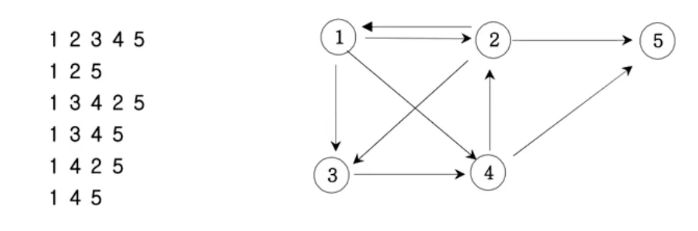

<a id="1c3eda9b0fe18124ba9fce25e295d7e3"></a>

# 문제

<a id="1c3eda9b0fe181bb8a6aca683b9b2510"></a>

## 12&#46; 경로 탐색(인접행렬)

<a id="1c3eda9b0fe1814d8b32f8a80174485f"></a>

### 설명

<a id="1c3eda9b0fe1816dba9ec2046546e951"></a>

방향그래프가 주어지면 1번 정점에서 N번 정점으로 가는 모든 경로의 가지 수를 출력하는 프로그램을 작성하세요&#46; 아래 그래프에서 1번 정점에서 5번 정점으로 가는 가지 수는 총 6가지 입니다&#46; 



<a id="1c3eda9b0fe1819f88dffcdc0f69ced3"></a>

### 입력

<a id="1c3eda9b0fe181e28f1ddbdc55039701"></a>

첫번쨰 줄에는 정점의 수(1≤N≤20)와 간선의 수 M가 주어진다&#46; 그 다음부터 M줄에 걸쳐 연결 정보가 주어진다&#46; 

<a id="1c3eda9b0fe18146b585e1c7993d07f2"></a>

### 출력

<a id="1c3eda9b0fe18101a6b7c56dac7ef5ab"></a>

총 가지수를 출력한다&#46;

---

<a id="1c3eda9b0fe18150b151dd71d5ef09b1"></a>

### 입력 예제1

<a id="1c3eda9b0fe18149ad4bf5b9d9ee6483"></a>

```plaintext
5 9
1 2
1 3
1 4
2 1
2 3
2 5
3 4
4 2
4 5
```

<a id="1c3eda9b0fe18162b495e4e4b1836641"></a>

### 입력 출력1

<a id="1c3eda9b0fe181adb543f62b9d07c12e"></a>

```plaintext
6
```

<a id="1c3eda9b0fe18152b0afef0ee8e1b583"></a>

# 풀이

<a id="1c3eda9b0fe1812582cad675018e5395"></a>

## 풀이1) <code>내풀이</code>  graph(이중배열), DFS(재귀), 백트래킹

<a id="1c3eda9b0fe18117ba91f85562d56a12"></a>

```java
import java.lang.reflect.Array;
import java.util.*;

public class Main {
    static int cnt;
    static int[] ch;
    static int[][] graph;
    public void DFS(int startNode, int endNode){
        if(startNode==endNode){
            ch[startNode]=0;  // 중복 로직, 백트래킹에서 체크 품.
            cnt++;
            return;
        }
        for(int i=1; i<=endNode; i++){
            if(ch[i]==0 && graph[startNode][i]==1){
                ch[i]=1;
                DFS(i, endNode);
                ch[i]=0;  // 백트레킹
            }
        }
    }

    public static void main(String args[]) {
        Main T=new Main();
        Scanner sc=new Scanner(System.in);
        int n=sc.nextInt();
        int m=sc.nextInt();
        cnt=0;
        ch=new int[n+1];
        graph=new int[n+1][n+1];
        for(int i=0; i<m; i++){
            int a=sc.nextInt();
            int b=sc.nextInt();
            graph[a][b]=1;
        }
        ch[1]=1;
        T.DFS(1, n);
        System.out.println(cnt);
    }
}
```

<a id="1c3eda9b0fe181dbaa1fe8aac8c706d1"></a>

## 풀이2) <code>강의풀이</code>   graph(이중 배열)

- n, m을 static으로 전역변수 처리를 하였음&#46;  

- DFS에 return 로직을 없에고, if&#45;else문으로 작성함&#46;

- <code>내 풀이</code>에서&#46; 도달해야하는 노드에 도착하였을 때, 체크 배열(ch)에 마지막 노드를 check를 푸는데, 백트래킹하면서 다시 해당 로직이 실행됨&#46; →<strong>중복 코드  </strong>

<a id="1c3eda9b0fe1818fae3bdfcb10cb5567"></a>

⇒ 해당 로직이 <code>강의 풀이</code>에서는 개선됨 → <code>내 풀이</code> 개선함

<a id="1c3eda9b0fe1816b9fedcf77a590ee48"></a>

```java
import java.lang.reflect.Array;
import java.util.*;

public class Main {
    // static 변수(cnt) 바로 할당 가능, (n, m, ch, graph) 변수는 입력값을 받아야 할당 가능해서 main()에 작성하는 것임
    static int n, m, cnt=0;
    static int[] ch;
    static int[][] graph;
    public void DFS(int startNode){
        if(startNode==m)  cnt++;
        else {
            for(int i=1; i<=n; i++){
                if(ch[i]==0 && graph[startNode][i]==1){
                    ch[i]=1;
                    DFS(i);
                    ch[i]=0;
                }
            }
        }
    }

    public static void main(String args[]) {
        Main T=new Main();
        Scanner sc=new Scanner(System.in);
        n=sc.nextInt();
        m=sc.nextInt();
        ch=new int[n+1];
        graph=new int[n+1][n+1];
        for(int i=0; i<m; i++){
            int a=sc.nextInt();
            int b=sc.nextInt();
            graph[a][b]=1;
        }
        ch[1]=1;
        T.DFS(1);
        System.out.println(cnt);
    }
}
```

<a id="1c3eda9b0fe181eda9aec5ab2dee687d"></a>

## 풀이3) <code>클린코드</code>

<a id="1c3eda9b0fe181ae9f08edba7af863e2"></a>

요세 클린코드를 읽고 있는데, 해당 책에서  ‘변수명은 명시적으로 표시해야 한다’ 고 강조하여 나름대로? 수정해 보았다&#46;ㅛ₩

<a id="1c3eda9b0fe181d89806f03706fa680f"></a>

```java
import java.lang.reflect.Array;
import java.util.*;

public class Main {
    // Adjacent Line: 인접라인 , 간선
    static int totalNodeNum, totalAdjacentLineNum, cnt=0;
    static int[] nodeCheckList;
    static int[][] graph;
    public void DFS(int currentNode){
        if(currentNode==totalNodeNum) cnt++;   // total node number == end Node number
        else {
            for(int nextNode=1; nextNode<=totalNodeNum; nextNode++){
                if(nodeCheckList[nextNode]==0 &&  graph[currentNode][nextNode]==1){
                    nodeCheckList[nextNode]=1;
                    DFS(nextNode);
                    nodeCheckList[nextNode]=0;
                }
            }
        }
    }

    public static void main(String args[]) {
        Main T=new Main();
        Scanner sc=new Scanner(System.in);
        totalNodeNum=sc.nextInt();
        totalAdjacentLineNum=sc.nextInt();
        graph=new int[totalNodeNum+1][totalNodeNum+1];
        for(int i=0; i<totalAdjacentLineNum; i++){
            int currentNode=sc.nextInt();
            int nextNode=sc.nextInt();
            graph[currentNode][nextNode]=1;
        }
        nodeCheckList=new int[totalNodeNum+1];
        nodeCheckList[1]=1;
        T.DFS(1);
        System.out.println(cnt);
    }
}
```

<a id="1c3eda9b0fe181d39048c834ac8bfa8f"></a>

## 풀이4) 2차 풀이, graph(이중 ArrayList)
