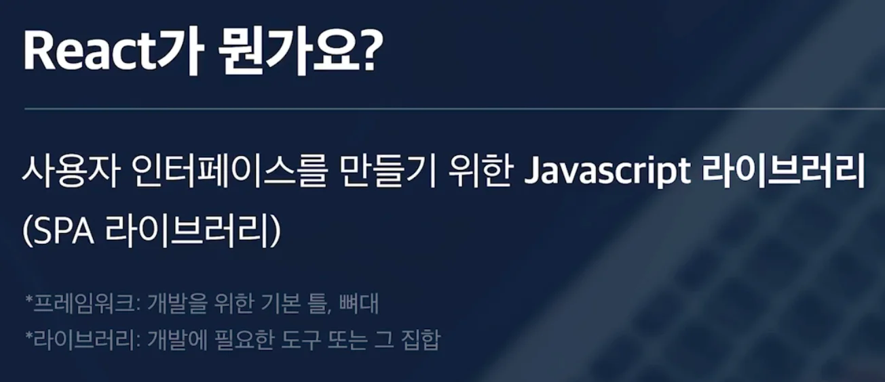
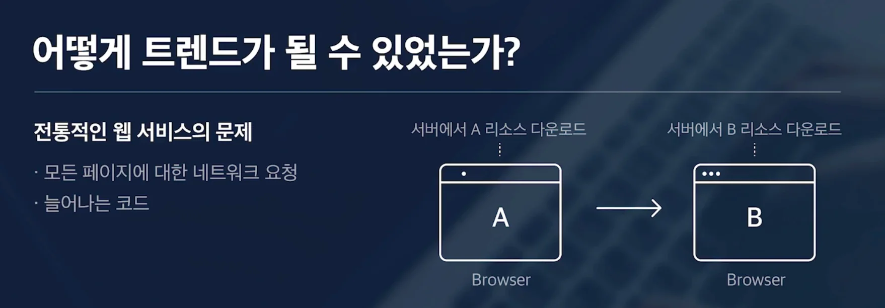
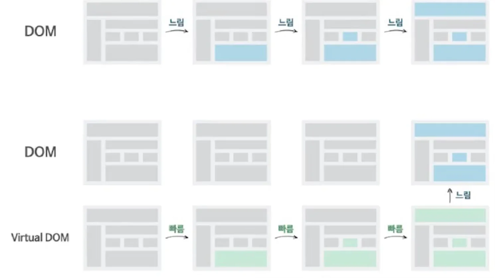

## 리액트

---

리액트가 어떻게 트랜드가 될 수 있었는지 이해하려면 전통적인 웹 서비스의 문제점에 대해 알아야 한다&#46;

모든 페이지에 진입할 때마다 반복적으로 서버의 페이지에 관련된 리소스를 요청했다&#46;

간단한 페이지라면 큰 문제가 없지만, 서비스의 규모가 커져서 코드의 양이 늘어나면, 그만큼 반복적으로 다운로드 되는 리소스도 늘어난다&#46; 

그래서 이에 대한 문제점을 개선하기 위해 나온 웹 개발 방식이 SPA ( Single Page Application ) 이다&#46;

SPA는 서버에서 미리 A, B와 관련된 리소스(데이터)를 모두 받고 브라우저에서 동적으로 화면을 그린다&#46; 

즉, 자바스크립트를 통해 현재 페이지의 HTML을 생성한다&#46;

그리고 페이지에 대한 이동이 발생했을 때, 이전 처럼 B에 대한 리소스를 새로 받아오는 것이 아닌, 이미 받았던 리소스를 가지고 B 페이지를 생성한다&#46;

이때 페이지 전환 시 전통적인 웹 서비스처럼 새로고침이 되는 것이 아닌, 자바스크립에 의해 화면의 콘텐츠만 바뀌는 것이기 때문에 싱글페이지 어플리케이션이라 부르는 것이다&#46;

이렇게 SPA 방식을 사용하는 프레임워크 or 라이브러리 중 대표적인 것이 리액트, Vue, Angular라는 라이브러리이다&#46; 

## 리액트 특징

---

### 컴포넌트 기반 설계

- 의미 단위로 컴포넌트 구성

- 재사용성, 유지보수성 증가
    - 한번 만든 컴포넌트는 재사용할 수 있다&#46;

- 부모, 자식 관계를 가짐
    - 최상위 페이지, 안에 header, banner, recentLectureSection 등 하위 컴포넌트들이 포함된다&#46; 

### Virtual DOM ( 가상돔 )

실제 DOM의 복사본,  SPA에서 동적인 변화를 효율적으로 관리하기 위해 사용

일반적으로 JavaScript를 사용하여 DOM(HTML)을 변경하면, 브라우저가 이를 다시 재구축하고 화면을 그린다&#46; 

이는 상대적으로 빠르지 않아 잦은 DOM 변경은 웹서비스의 성능 문제를 야기한다&#46;

따라서 리액트에서는 <strong><u>가상돔을 만</u></strong>들고 <strong><u>변경되어할 돔 요소를 미리 가상돔에서 모두 변경</u></strong>하고, 이를 <strong><u>DOM에 동기화하는 방식</u></strong>으로 사용한다&#46; 

이를 통해 DOM을 직접 변경하면서 생기는 비율을 어느 정도 해결할 수 있다&#46; 

### 클라이언트 렌더링 방식(CSR)

SPA ( Single Page Rendering ) 방식

자바스크립트를 통해 서버가 아닌 클라이언트에서 화면을 렌더링한다&#46; 

api 통신으로 json을 사용하여 서버와 데이터를 주고 받음

## 정리 

---

- 리액트는 스스로 상태를 관리하는 캡슐화된 코드 조각이라 할 수 있는 컴포넌트로 설계가 되어있다&#46; 

- 가상돔을 사용하여 동기화하는 방식으로 DOM에 적용하여 직접 변경하여 발생하는 비효율 문제를 해결한다&#46;  

- 클라이언트 사이드에서 렌더링하는 방식으로 브라우저에서 화면을 렌더링한다&#46; 

- 트랜드 기술로 굉장히 풍부한 생태계를 가지고 있다&#46;
