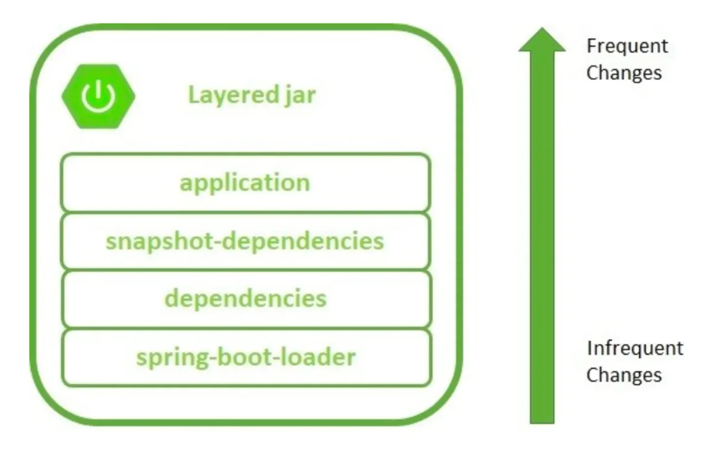

[Spring Boot에서 Docker 이미지 최적화하기]()

[Gradle, Layered Jar 그리고 Dockerbuild 최적화]()

<a id="1c3eda9b0fe1815991edc6008d9f6945"></a>

## 🤬 문제) Docker를 통해  jar 파일을 통째로 build 시, 캐시 기능의 효율성이 낮다&#46; 

---

<a id="1c3eda9b0fe181e0943ae8eed0a3b5da"></a>

일반적으로 Spring Boot 애플리케이션을 Docker를 이용해 배포할 경우 아래와 같이 작성한다&#46;

<a id="1c3eda9b0fe18194b76dd76e9216c18f"></a>

```docker
FROM openjdk:11-jdk
ARG JAR_FILE=./build/libs/*-SNAPSHOT.jar
COPY ${JAR_FILE} app.jar
EXPOSE 8080
ENTRYPOINT [ "java", "-jar", "/app.jar" ]
```

<a id="1c3eda9b0fe18157bdf4db5e27d3149a"></a>

그러나 위 같이 Docker 이미지를 만드는 것은 <strong>Jar 파일 전체를 빌드하기 때문에 캐시 기능을 사용할 수 없다&#46;</strong>

<a id="1c3eda9b0fe181a694bdf1bad4e91c58"></a>

즉, <strong><u>레이어 마다 캐시 기능을 사용할 수 없</u></strong>기 때문에 상당히 비효율적이다&#46; 

- Docker는 빌드 시 <strong><u>레이어마다 캐시 기능을 사용</u></strong>할 수 있기 때문에 <strong><u>빠른 빌드가 가능</u></strong>하다&#46;
    -  변경된 부분이 없다면 캐시를 활용해 기존에 빌드 했던 레이어를 재사용한다&#46; 

<a id="1c3eda9b0fe181268bd7d15737380631"></a>

## 🤓 해결1) <strong>Layered Jar 사용</strong>

---



<a id="1c3eda9b0fe18170bd32f2e8559ee67e"></a>

위와 같이<strong><u> jar파일을 4개의 영역으로 분리</u></strong>하여 런타임 시 모듈화 및 커스터마이징 가능하도록 한다&#46; 

<a id="1c3eda9b0fe18189bfadc1b553796a57"></a>

따라서 이를 통해, jar 레이어를 세부적으로 나눠 캐시 기능을 효율적으로 활용할 수 있다&#46; 

- 구성
    > 위로 갈수록 변경이 잦은 부분이며, 아래로 갈수록 변경이 잦지 않다&#46;

    - <code>application</code>&#58; 애플리케이션 소스코드

    - <code>snapshot&#45;dependencies</code>&#58; 프로젝트 클래스 경로에 존재하는 스냅샷 종속성 jar 파일

    - <code>spring&#45;boot&#45;loader</code>&#58; jar loader와 luncher

    - <code>dependencies</code>&#58; 프로젝트 클래스 경로에 존재하는 라이브러리 jar 파일

<a id="1c3eda9b0fe181acb25afc934696feb6"></a>

따라서  Docker 캐시 기능을 사용하기 위해, COPY 순서를 역순으로 배치한다&#46;

<a id="1c3eda9b0fe181ca89d3ee1b53ea7887"></a>

## 🤓  해결 2)  CI를 통해 개선

---

<a id="1c3eda9b0fe181818cebcc9fcda57e9b"></a>

<strong> jar 파일을 가져오는 과정은 변함이 없기 때문에  여전히 속도가 느리다&#46; </strong>

<a id="1c3eda9b0fe181688ee3fa2c6f05f6a2"></a>

기존 방식에서 jar 파일을 통째로 COPY하는 과정을 제외하고, 자동화 배포 시 layer를 분리하여 해당 레이어들만 복사하는 방식으로 변형

<a id="1c3eda9b0fe181cdbe5cfe99a60f0bbd"></a>

```docker
FROM adoptopenjdk:11-jre-hotspot
WORKDIR application
COPY ./dependencies ./
COPY ./spring-boot-loader ./
COPY ./snapshot-dependencies ./
COPY ./application ./

ENTRYPOINT ["java", "-Dspring.profiles.active=dev", "-Duser.timezone=Asia/Seoul", "org.springframework.boot.loader.JarLauncher"]
```

<a id="1c3eda9b0fe1810fbf0bdfdc70ef3113"></a>

배포 GitHub Actions에는 아래와 같이 jar 파일을 분리하는 명령을 추가

<a id="1c3eda9b0fe181b0b1d4eaf2455d7629"></a>

```docker
- name: Build Docker & push
  run: |
    cd ./api-module
    java -Djarmode=layertools -jar build/libs/${{ secrets.JAR_NAME }} extract   # 해당 부분 추가
    docker login -u ${{ secrets.DOCKER_USERNAME }} -p ${{ secrets.DOCKER_PASSWORD }}
    docker build -t ${{ secrets.DOCKER_USERNAME }}/${{ secrets.DOCKER_REPOSITORY }}:server-dev-blue .
    docker build -t ${{ secrets.DOCKER_USERNAME }}/${{ secrets.DOCKER_REPOSITORY }}:server-dev-green .
    docker push ${{ secrets.DOCKER_USERNAME }}/${{ secrets.DOCKER_REPOSITORY }}:server-dev-blue
    docker push ${{ secrets.DOCKER_USERNAME }}/${{ secrets.DOCKER_REPOSITORY }}:server-dev-green

```
