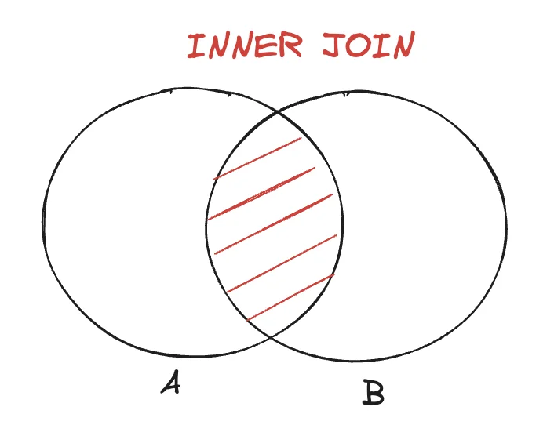
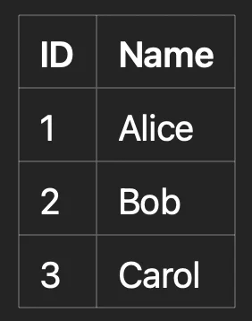
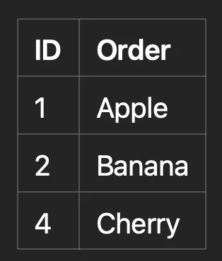
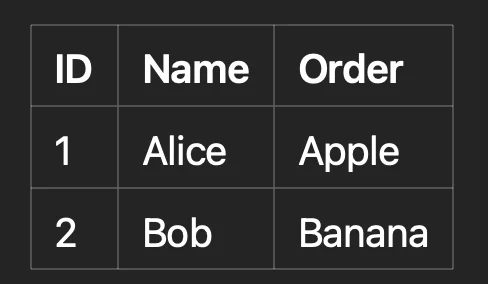
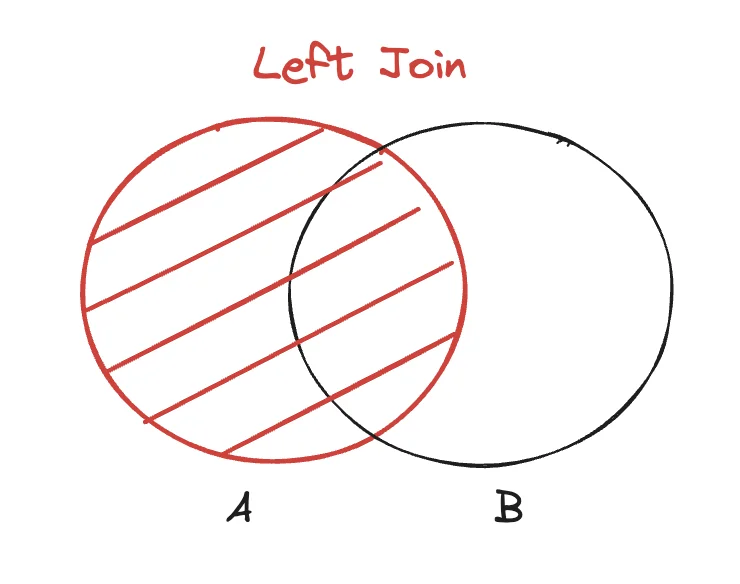
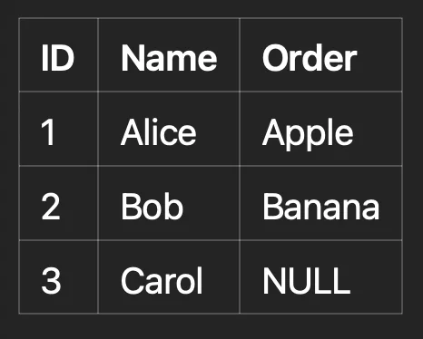
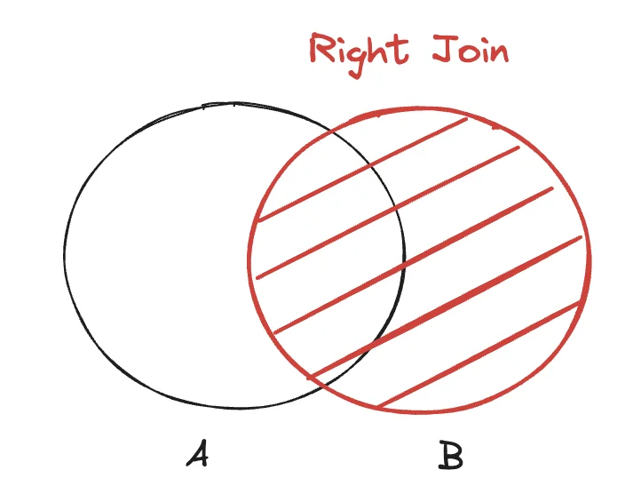
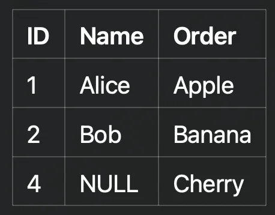
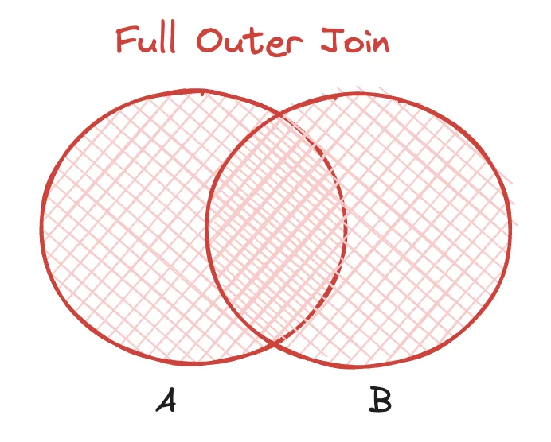
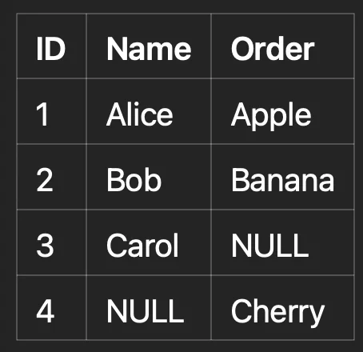

<a id="1c3eda9b0fe181509112f166dc57acba"></a>

## 기본 조인

---

> 📖 
> 
> <a id="1c3eda9b0fe181959acfddf69ee45940"></a>
> 
> 조인의 기본 문법은 <u>첫 번쨰 파리미터에 조인 대상을 지</u>정하고, <u>두 번째 파라미터에 별칭(alias)으로 Q 타입을 지정</u>해 사용한다&#46; 
> 
> - <code>join(조인 대상, 별칭으로 사용할 Q타입)</code>

<details>
<summary>🧐 내부 조인, 외부 조인 </summary>

- 내부 조인
    - 교집합 레코드들을 나타냄
        

    <details>
    <summary>ex) </summary>

    - 테이블 A
        

    - 테이블 B
        

    - SQL &#45; inner join
        <a id="1c3eda9b0fe181db9225f3cb36142d9a"></a>

        ```sql
        SELECT A.ID, A.Name, B.Order
        FROM A
        INNER JOIN B
        ON A.ID = B.ID;
        ```

    - 결과 
        - 중복된 레코드 값만 출력됨

        

    </details>

- 외부 조인
    - <strong>LEFT OUTER JOIN</strong>
        - 왼쪽 테이블의 모든 데이터 포함, 매칭되지 않는 경우 NULL&#46;
            

        <details>
        <summary>ex) </summary>

        - 테이블 A
            

        - 테이블 B
            

        - SQL &#45; inner join
            <a id="1c3eda9b0fe181a7901af97230fe24d0"></a>

            ```sql
            SELECT A.ID, A.Name, B.Order
            FROM A
            LEFT OUTER JOIN B
            ON A.ID = B.ID;
            ```

        - 결과 
            - left(첫 인자) 테이블인 A 테이블의 모든 값을 나타냄
                

        </details>

    - <strong>RIGHT OUTER JOIN</strong>
        - 오른쪽 테이블의 모든 데이터 포함, 매칭되지 않는 경우 NULL&#46;
            

            <details>
            <summary>ex) </summary>

            - 테이블 A
                

            - 테이블 B
                

            - SQL &#45; inner join
                <a id="1c3eda9b0fe18182b583fd73fb952db2"></a>

                ```sql
                SELECT A.ID, A.Name, B.Order
                FROM A
                RIGHT OUTER JOIN B
                ON A.ID = B.ID;
                ```

            - 결과 
                - right(두번째 인자) 테이블인 B 테이블의 모든 값을 나타냄
                    

            </details>

    - <strong>FULL OUTER JOIN</strong>
        - 양쪽 테이블의 모든 데이터 포함, 매칭되지 않는 경우 NULL&#46;
            

            <details>
            <summary>ex) </summary>

            - 테이블 A
                

            - 테이블 B
                

            - SQL &#45; inner join
                <a id="1c3eda9b0fe181e9b01ad293e4f0fd72"></a>

                ```sql
                SELECT A.ID, A.Name, B.Order
                FROM A
                FULL OUTER JOIN B
                ON A.ID = B.ID;
                ```

            - 결과 
                - 모든 테이블 ( A, B)의 레코드들을 모두 나타냄
                    

            </details>

</details>

<details>
<summary>기본 조인</summary>

<a id="1c3eda9b0fe18174b1ccd5d716367fab"></a>

```java
/**
 * 팀 A에 소속된 모든 회원 
*/
@Test
public void join() throws Exception {
		QMember member = QMember member;
		QTeam team = QTeam.member;
		
		List<Member> result = queryFactory
						.selectFrom(member)
						.join(member.team, team)
						.where(team.name.eq("teamA"))
						.fetch();
						
		asswertThat(result)
						.extracting("username")
						.containsExactly("member1", "member2");
}
```

- <code>join()</code>, <code>innerJoin()</code>&#58; 내부 조인(inner join)

- <code>leftJoin()</code>&#58; left 외부 조인 ( left outer join )

- <code>rightJoin()</code>&#58; right 외부 조인 ( right outer join )

- JPQL의 <code>on</code> 과 성능 최적화를 위한 <code>fetch</code> 조인 제공  
    - <a href="#/post/1c3eda9b-0fe1-8190-b18d-d6153b6c76ad">페이지</a> 

</details>

<details>
<summary>세타 조인 </summary>

> 연관관계가 없는 필드로 조인

<a id="1c3eda9b0fe181a6a445e52413718f7e"></a>

```java

/**
* 세타 조인(연관관계가 없는 필드로 조인) 
* 회원의 이름이 팀 이름과 같은 회원 조회 
*/
@Test
public void theta_join() throws Exception {
			em.persist(new Member("teamA"));
			em.persist(new Member("teamB"));
			
			List<Member> result = qeueryFactory
							.select(member)
							.from(member, team)
							.where(memebr.username.eq(team.name))
							.fetch();
							
			assertThat(result)
							.extracting("username")
							.containsExactly("teamA", "teamB");
			
```

- from 절에 여러 엔티티를 선택해서 세타 조인

- <u>외부 조인 불가능 </u> → 조인 <code>on</code> 사용 시 외부 조인 가능

</details>
