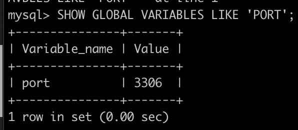

- 
    <a id="1c3eda9b0fe181269c12d9d21bb6cba5"></a>

    ```shell
    mysql server status
    ```

<a id="1c3eda9b0fe181e28e26c542e0c7f577"></a>

### MySQL 쿼리로 확인 

- MySQL 접속
    <a id="1c3eda9b0fe181e5a0a2f0c633e83204"></a>

    ```shell
    mysql -u root -p
    ```

- 글로벌 변수 ‘PORT’ 확인
    <a id="1c3eda9b0fe18196a130eb9d13494a45"></a>

    ```shell
    SHOW GLOBAL VARIABLES LIKE 'PORT';
    ```

- MySQL 포트 번호 출력 확인
    
