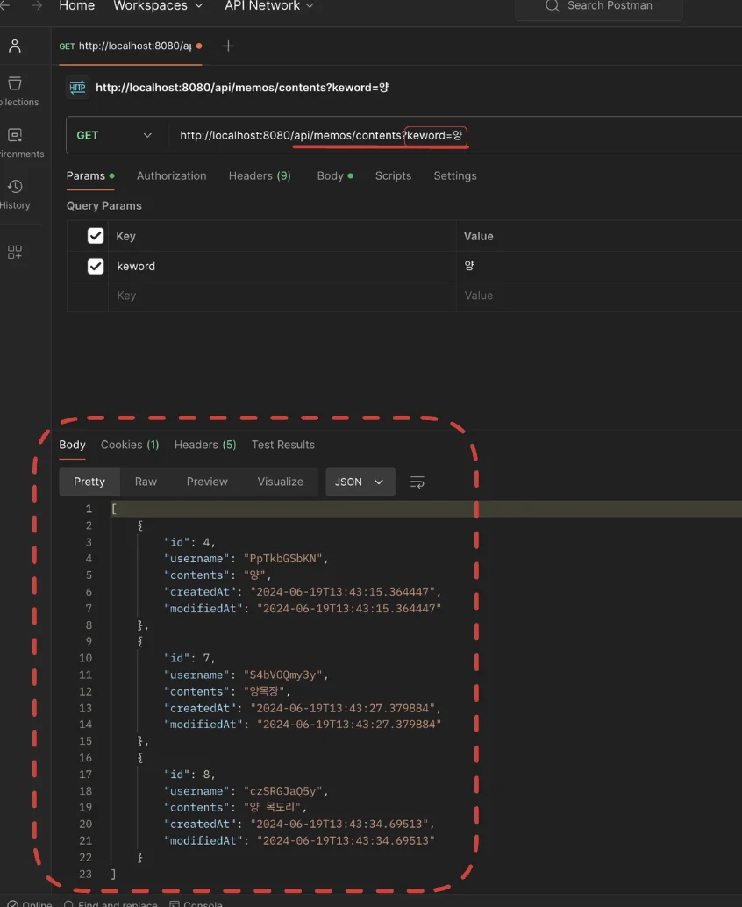

<a id="1c3eda9b0fe18100a9d0d9c2144d1d55"></a>

### 과제

---

> 📌 Query Methods 기능을 사용하여 내용(contents)에 특정 키워드가 포함된 메모를 조회하는 API를 구현

- Controller를 통해 keyword를 Query String 방식으로 전달받아 메모를 조회하는 API를 추가
    - <a href="http://localhost:8080/api/memos/contents?keyword=">http&#58;//localhost&#58;8080/api/memos/contents?keyword=</a>

    - 메서드명&#58; <code>getMemosByKeyword</code>

- MemoService에 getMemosByKeyword 기능을 수행하는 메서드를 구현합

- ‘Postman’을 사용해서 테스트

- 정렬 방법은 수정 시간을 기준으로 내림차순을 적용<br>

> 👉 Tip)
> 
> - “Query Methods contains” 같은 검색어를 구글링하여 방법을 찾기
> 
> - Spring Data JPA DOCS를 사용하여 방법을 찾기

<a id="1c3eda9b0fe18158815dfb525d3f2225"></a>

### 풀이

---

- <strong>코드</strong>
    <details>
    <summary><strong>MemoController&#46;java</strong></summary>

    <a id="1c3eda9b0fe18148920ee40426dc0d84"></a>

    ```java
    @RestController
    @RequestMapping("/api")
    public class MemoController {

    		. . .

        @GetMapping("/memos/contents")
        public List<MemoResponseDto> getMemosByKeyword(String keyword) {
            return memoService.getMemosByKeyword(keyword);
        }
    }
    ```

    </details>

    <details>
    <summary><strong>MemoRepository&#46;java</strong></summary>

    <a id="1c3eda9b0fe181059f7ef98d7bbc2e9c"></a>

    ```java
    public interface MemoRepository extends JpaRepository<Memo, Long> {
        
           . . .
        
        List<Memo> findAllByContentsContainsOrderByModifiedAtDesc(String keyword);
    }
    ```

    </details>

    <details>
    <summary><strong>MemoService&#46;java</strong></summary>

    <a id="1c3eda9b0fe181b0a082f312d3bc0af4"></a>

    ```java
    @Service
    public class MemoService {
    			
    	  	. . .

        public List<MemoResponseDto> getMemosByKeyword(String keyword) {
            return memoRepository.findAllByContentsContainsOrderByModifiedAtDesc(keyword).stream().map(MemoResponseDto::new).toList();
        }
    }
    ```

    </details>

<details>
<summary><strong>Postman 테스트 </strong></summary>



</details>
