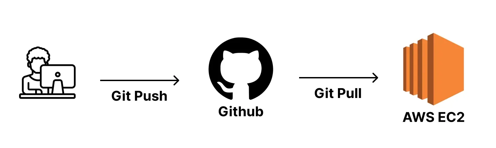
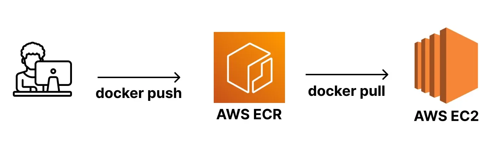

## AWS ECR

---

> 📖 
> 
> 
> 
> 필요한 앱의 이미지를 다운로드 받을 때 <code>Dockerhub</code>를 사용한다&#46;
> 
> - Dockerhub는 이미지를 저장 및 다운할 수 있는 저장소이다&#46; 
> 
> 
> 
>  이런 <strong><u><code>Dockerhub</code></u></strong><strong><u>와 동일한 역할</u></strong>을 하는 서비스가<code>AWS ECR</code>이다&#46; 
> 
> - <strong><u>이미지를 저장 및 다운</u></strong><em><strong>  </strong></em>가능한 <strong><u>저장소</u></strong><strong><u> 역할</u></strong>을 한다&#46; 

> 🤔 
> 
> 
> 
> 왜 Dockerhub 대신 AWS ECR을 사용하는가?
> 
> 
> 
> AWS 클라우드 환경에서 인프라 구축 시, <u><code>AWS ECR</code></u><u>을 사용</u>하면 다른 <strong><u>AWS Resource와의 연동이 편</u></strong>하고, <strong><u>AWS 내에서 한 번에 관리</u></strong>할 수 있다&#46;
> 
> - Dockerhub을 사용해도 크게 문제는 없다&#46;

Docker를 사용하지 않을 적에는 많은 사람들이 Github를 사용하여 프로젝틀 코드를 Push  후 EC2에 접속하여 pull 받아 실행시키는  방식을 많이 사용했다&#46; 

이 방식은 <strong><u>프로젝트 코드 전체를 EC2로 이동</u></strong>시켜야 하며,  프로젝트 <strong><u>코드를 실행시킬 런타임 환경(Node, JDK 등)도 설치</u></strong>되어 있어야만 실행이 가능하다&#46;

Docker의 가장 큰 장점은 <strong><u>이식성</u></strong>이다&#46; 

- Docker만 깔려있다면 어디서든 내가 원하는 프로젝트를 실행시킬 수 있다&#46; 

Gitbub를 활용해 프로젝트 코드 전체를 EC2로 옮겨 Docker 기반으로 실행해도 되지만,

프로젝트의 <strong><u>필요한 코드만 Docker image로 빌드</u></strong>하고<strong><u> EC2에서 해당 이미지만 다운</u></strong> 받아서 실행하는 것이 훨<u>씬 더 심플</u>하다&#46;

정리하자면 <strong><u>AWS ECR을 배우는 이유</u></strong><strong>는 </strong><strong>훨씬 간단하게 프로젝트를 배포하고 실행</strong><strong>하기 위해서이다&#46; </strong>
