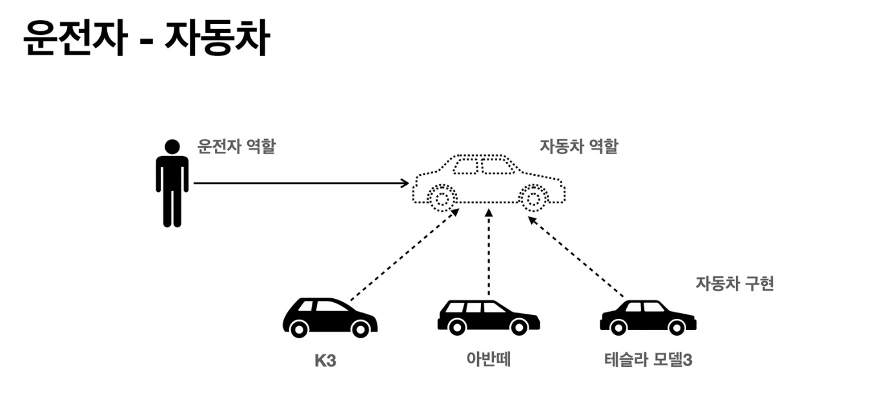
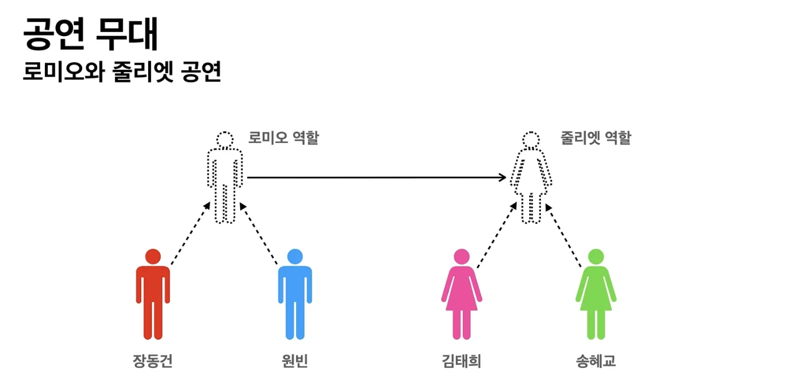
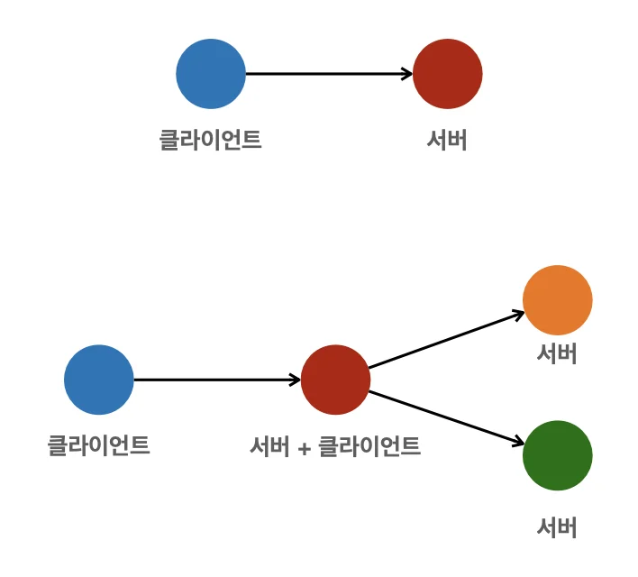
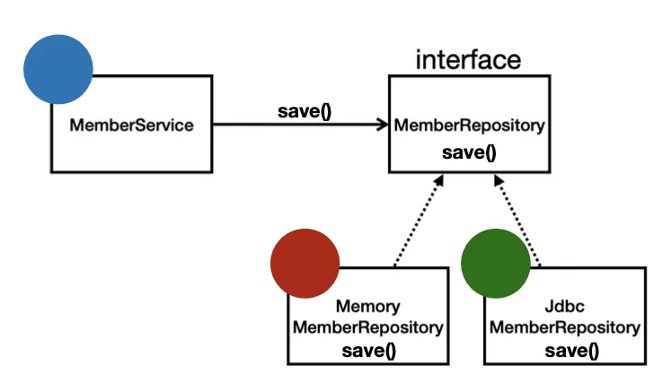

> 📌 <strong>객체 지향 특징</strong>
> 
> 
> 
> • <strong>추상화</strong> • <strong>캡슐화</strong> •  <strong>상속</strong> •<strong> </strong><strong> 다형성 </strong>

### 객체 지향 프로그래밍

객체 지향 프로그래밍은 컴퓨터 프로그램을 명령어의 목록으로 보는 시각 벗어나 <u>여러 개의 독립된 단위, 즉 </u><u>“</u><strong><u>객체</u></strong><u>”들의 </u><strong><u>모임</u></strong><u>으로</u> 파악하고자 하는 것이다&#46;  <u>각각의 </u><strong><u>객체</u></strong><u>는 </u><u>메세지를 주고 받</u><u>고, </u><u>데이터를 처리</u>할 수 있다&#46;(협력)

객체 지향 프로그래밍은 프로그램을 <strong>유연</strong>하고 <strong>변경</strong>이 용이하게 만들기 때문에 대규모 소프트웨어 개발에 많이 사용된다&#46; 

### 유연하고, 변경 용이?

레고 블럭 조립하 듯, 컴퓨터 부품을 갈아 끼우듯이

<u>컴포넌트를 쉽고 유연하게 변경</u><u>하면서 개발</u>할 수 있는 방법  → <code>다향성</code>(객체지향의 핵심)

### 다형성(Polymorphism) 실세계 비유

> <strong>실세계 &#58;  객체 지향  → 1&#58; 1 매칭 X</strong> (그래도 실세계 비유가 이해하기 가장 수월함&#46;)

세상을 <strong><code>역활(인터페이스)</code></strong><strong> </strong>과 <strong><code>구현(인스턴스)</code></strong><strong> </strong>으로 구분

### 예시1 ) 운전자 &#45; 자동차

> 자동차 역활(인터페이스) → 3개의 자동차 구현( K3, 아반떼, 테슬라 모델3)

운전자는 K3를 타다가 아반떼로 자동차를 바꿔도 운전을 할 수 있다&#46;  왜냐하면 자동차의 종류(구현)만 변화하였을 뿐, 자동차 내부 동작(역할)은 동일하기 때문이다&#46; 

따라서 자동차가 바뀌어도 운전자가 운전을 하는데 있어서 필요한, 운전면허증, 운전 방법에 영향을 주지 않는다&#46; 즉, 자동차의 구현체가 변해도 자동차의 역할(인터페이스)은 변하지 않으며,  운전자(클라이언트)에게 아무런 영향을 주지 않는다&#46; (운전자는 자동차 역활에 대해서만 의존한다&#46;)

이것을 ‘유연하고 변경이 용이하다’고 표현하며, 이러한 방식이 객체지향의 다형성의 특징이다&#46; 

<code>클라이언트</code>는 <strong>내부 애플리케이션의 구현이 변경</strong>되어도, <code>인터페이스</code>에만 의존하기 때문에,영향을 받지 않는다&#46; 

즉, <strong> 클라이언트에 영향을 주지 않고 내부 구현 로직을 변경 할 수 있다</strong>는 엄청난 확장성과 유연성을 가진다&#46; 

예시2) 공연무대

위 공연처럼 극 중 <code>캐릭터 역할</code> 과 <code>그 역할을 연기하는 배우</code> 가 나눠서 각 역할(interface)가 독립적이고, 배우가 바뀌어도 캐릭터 역할 자체에는 아무런 영향을 주지 않는다&#46; 

## <code>역활</code> , <code>구현</code> 분리 (객체 지향(<code>다형성)</code>의 핵심 의미)

> <strong>• 역할  =  인터페이스</strong> <strong>• 구현  =  인터페이스를 구현한 클래스, 구현 객체(인스턴스)</strong>

<code>역활</code>과 <code>구현</code>으로 구분하면 세상이 <strong>단순</strong>해지고, <strong>유연</strong>해지며 <strong>변경도 편리</strong>해진다&#46; 

## 장점

> <strong>• 클라이언트</strong>는 대상의 <strong>역활(인터페이스)만 의존</strong>한다&#46;  <strong>• 클라이언트</strong>는 구현 대상의 <strong>내부 구조를 몰</strong>라도 된다&#46;  <strong>• 클라이언트</strong>는 <u>구현 대상의 </u><strong><u>내부 구조가 변경</u></strong><u>되어도 영향을 받지 않</u>는다&#46; <strong>• 클라이언트</strong>는 구현 <strong>대상 자체를 변경</strong>해도 영향을 받지 않는다&#46; 

### 객체 설계

> • <code>역할</code> 과 <code>구현</code> 을 명확히 분리 • <u><code>역할(인터페이스)</code></u><u> 정의</u> → <u>그 역할을 수행하는 </u><u><code>구현 객체</code></u><u>를 생성</u>

<strong>인터페이스</strong>가 아닌 <strong>일반 상속 관계</strong>도 다형성 구현이 가능하다&#46;

그러나, <strong><u>인터페이스</u></strong><u>는</u><strong><u> 다중</u></strong><u>으로 </u><strong><u>상속</u></strong><u> 구현이 가능</u>하지만, <strong>일반 상속 관계</strong>는 <strong>단일 상속</strong>만 되며, 그 외 여러가지의 문제점들이 존재한다&#46; 

> <strong>인터페이스를 상속 ⇒ 다형성 구현(권장)</strong>  ( <code>역활(인터페이스)</code>  &#62;&#62;&#62;  구현)

### 객체의 협력 관계(클라이언트 ↔ 서버)

혼자 있는 객체는 없다&#46; 

> 클라이언트(요청) ↔ 서버(응답)

수많은 객체 클라이언트 와 객체 서버는 서로 협력 관계를 가진다&#46;

## 오버라이딩 (자바&#45;다형성)

> <a href="https://beautiful-college-c84.notion.site/11beda9b0fe180d19947c51365c8c1a9">페이지</a> 

- 위와 같이 interface(역할)을 만들고 그것을 확장(상속)하여 클래스를 만든다&#46; 
    - 인터페이스 설계 중요, 위 <strong><u>SOLID</u></strong> &#45; <code>LSP</code>, <code>ISP</code> 참조

- 이로 인해 코드는 SRP&#46; OCP, LSP, ISP, DIP를 준수한 객체지향적으로 설계된다&#46;

## 정리

실세계의 &#91; 역할 &#45; 구현 &#93; 이라는 편리한 컨셉을 다형성을 통해 객체 세상으로 가져올 수 있다&#46;

유연, 변경 용이

확장 가능한 설계

클라이언트에 영향을 주지 않는 변경

⇒ 인터페이스를 안정적으로 잘 설계해야함&#46;

### 스프링 &#45; 객체 지향(<code>다형성</code>)

- 스프링은 다형성을 극대화해서 이용할 수 있게 도와준다&#46; 

- 스프링에서 이야기하는 제어의 역전(IOC), 의존관계 주입(DI)은  다형성을 활용해서 역활 과 구현을 편리하게 다룰 수 있도록 지원한다&#46;

- 스프링을 사용하면 마치 레고 블럭을 조립하듯, 구현을 편리하게 변경할 수 있다&#46;
