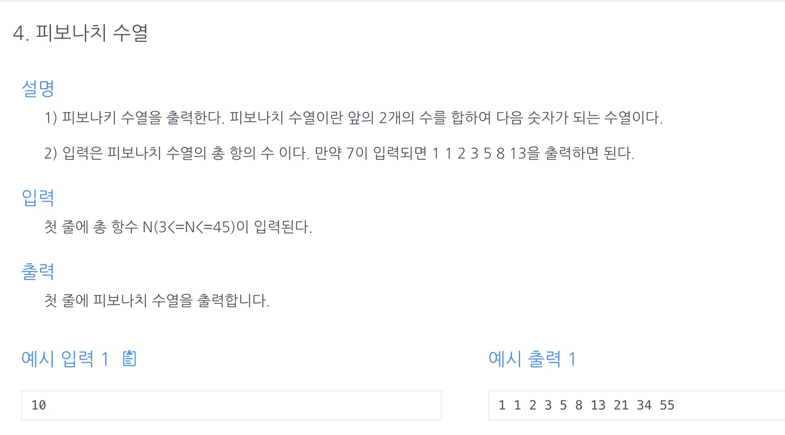

<a id="1c3eda9b0fe181cc8575eaa4f576179c"></a>

## 문제)



<a id="1c3eda9b0fe181e68431cc7a5239cc51"></a>

## 풀이)

<a id="1c3eda9b0fe181fb84bdc8cdcaa7c09a"></a>

### 내 풀이) 

<a id="1c3eda9b0fe18183bf8ad18cb3ce14d0"></a>

좀더 깔끔한데… <del>list를 선언해서 공간복잡도는 더 높은 듯</del> → 둘다 메모리 값이 27MB임&#46;

<a id="1c3eda9b0fe181b7891bc5b66c54a3ff"></a>

```java
import java.util.Scanner;

public class Main {
    public int[] solution(int n){
        int[] answer = new int[n];
        answer[0]=1;
        answer[1]=1;
        for(int i=2; i<n; i++){
            answer[i]=answer[i-1]+answer[i-2];
        }
        return answer;
    }
    public static void main(String[] args) {
        Main m = new Main();
        Scanner sc = new Scanner(System.in);
        int n = sc.nextInt();
        for (int x : m.solution(n)) System.out.print(x+" ");
    }
}
```

<a id="1c3eda9b0fe181cfb069dd15f2e9ea20"></a>

### 강의 풀이)

<a id="1c3eda9b0fe18148a415cc98c5b349ca"></a>

```java
import java.util.Scanner;

public class Main {
    public void solution(int n){
        int a=1, b=1, c;
        for(int i=2; i<n; i++){
            c=a+b;
            System.out.print(c+" ");
            a=b; b=c;
        }
    }
    public static void main(String[] args) {
        Main m = new Main();
        Scanner sc = new Scanner(System.in);
        int n = sc.nextInt();
        m.solution(n);
    }
}
```
