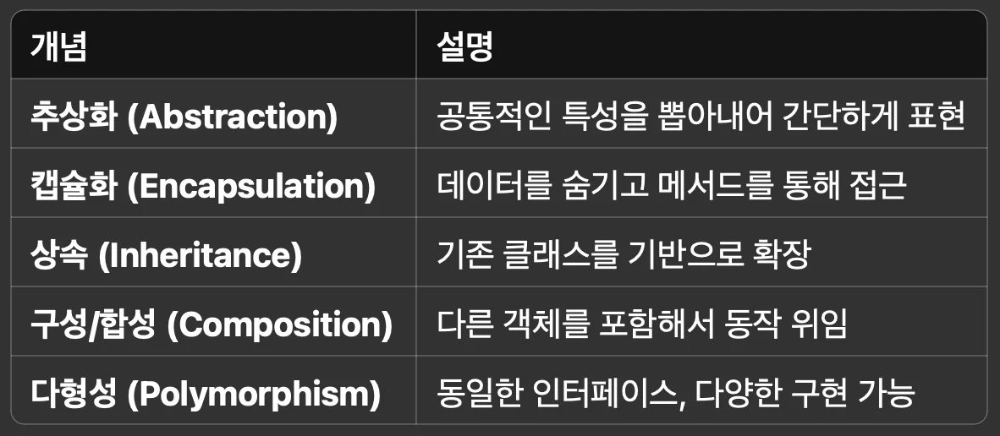
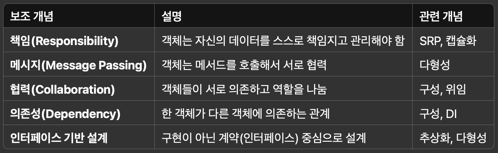

| <strong>OOP 특징</strong> | <strong>설명</strong> | <strong>디자인 패턴에서의 활용 예</strong> |
| --- | --- | --- |
| <strong><code>추상화</code></strong> | 공통된 개념을 일반화 | Strategy, Template Method, Factory 등 |
| <strong><code>캡슐화</code></strong> | 내부 구현을 숨기고 인터페이스만 제공 | Facade, Adapter, Decorator 등 |
| <strong><code>상속</code></strong> | 코드 재사용과 계층화 | Template Method, Observer, Chain of Responsibility |
| <strong><code>구성 (합성)</code></strong> | 다른 객체를 포함하여 기능 조합 | Strategy, Decorator, Composite, Bridge 등 |
| <strong><code>다형성</code></strong> | 동일한 인터페이스, 다양한 구현 | 대부분의 패턴이 이를 전제로 함 |

<details>
<summary>🧐 객체지향의 본질적 개념은 추상화, 캡슐화, 상속, 구성, 다형성 이 5개 밖에 없나?</summary>

| <strong>질문</strong> | <strong>답변</strong> |
| --- | --- |
| OOP의 핵심 개념은 5가지가 전부인가요? | ✅ <strong>핵심적으로는 맞습니다&#46;</strong> |
| 그 외에도 중요하게 여겨지는 개념이 있나요? | ✅ <strong>있습니다&#46;</strong> 협력, 책임, 의존성, 메시지 전달 등은 현실적 OOP 설계에서 매우 중요합니다&#46; |
| Spring, 디자인 패턴, SOLID 같은 고급 주제로 가면요? | ✅ 그 개념들을 <strong>기반으로 한 응용/확장</strong>이라고 보면 됩니다&#46; |

</details>

<a id="1c3eda9b0fe181c2b360f2def04299ae"></a>

```java
[OOP 핵심 개념]
 ├── 추상화
 ├── 캡슐화
 ├── 상속
 ├── 구성(합성)
 └── 다형성
 ---------------------------------------------------
      │
      └── [확장되는 개념들]
           ├── 인터페이스 기반 설계
           ├── 메시지 기반 협력
           └── 책임 분리, SOLID, 디자인 패턴 등
```

<a id="1c3eda9b0fe181b5800fd07217aef16c"></a>

### <strong>객체지향의 핵심 5가지 개념 (기본 원리)</strong>



- 이 다섯 가지는 OOP의 <strong>뼈대</strong>이자, <strong>디자인 패턴</strong>, <strong>SOLID 원칙</strong> 등으로 확장되는 기초이다&#46;

<a id="1c3eda9b0fe181afa88ef4f081d64041"></a>

### <strong>보조적으로 함께 이해하면 좋은 객체지향 개념</strong>



- 해당 개념들은  <strong>Spring 같은 프레임워크</strong>를 설계할 때 특히 중요하게 작용한다&#46;

<a id="1c3eda9b0fe181719c34eef26a0445c5"></a>

### 스프링 예시

| <strong>Spring 기능</strong> | <strong>내부 개념</strong> |
| --- | --- |
| <code>&#64;Autowired</code> | 구성(합성) &#43; 의존성 주입 |
| <code>&#64;Service</code>, <code>&#64;Repository</code> | 책임 분리 (SRP) |
| AOP (관점 지향) | 메시지 위임, 관심사의 분리 |
| 인터페이스 기반 프로그래밍 | 추상화 &#43; 다형성 |

<a id="1c3eda9b0fe1810ba8f5d3c9a712030a"></a>

### <strong><code>책임(Responsibility)</code></strong><strong>과 </strong><strong><code>협력(Collaboration)</code></strong><strong>,</strong> <code>메시지 기반 설계</code>

<a id="1c3eda9b0fe1817ba3cef8ac1ab515f9"></a>

### <strong>1&#46; 객체지향 설계는 “객체들 사이의 책임과 협력”이 핵심이다</strong>

> ✏️ 
> 
> - <strong><code>책임(Responsibility)</code></strong>&#58; 객체가 “무엇을 해야 하는가”
> 
> - <strong><code>협력(Collaboration)</code></strong>&#58; 객체들이 서로 <strong>메시지를 주고받으며 함께 일</strong>하는 것
> 
> <a id="1c3eda9b0fe181f989b7fe14f590f88b"></a>
> 
> → 객체지향 설계는 “<strong>누가 어떤 일을 맡고</strong>, <strong>어떻게 서로 협력하는가</strong>“를 고민하는 방식이다&#46;

<details>
<summary>ex) <strong>주문(Order) 처리 시스템</strong></summary>

<a id="1c3eda9b0fe1819fab33d35dee6ffae9"></a>

```java
class Order {
    private Customer customer;
    private List<Item> items;

    public int calculateTotalPrice() {
        int total = 0;
        for (Item item : items) {
            total += item.getPrice();
        }
        return total;
    }
}
```

- <code>Order</code>&#58; 주문 총액 계산 책임

- <code>Item</code>&#58; 자신의 가격을 알려주는 책임

- <code>Customer</code>&#58; 누가 주문했는지에 대한 정보 보유 책임

<a id="1c3eda9b0fe1819f970cf2b5f38cba04"></a>

  → 책임을 잘 나누면, 각 객체가 <strong>자기 역할만 하면 되고</strong>, 협력을 통해 전체 시스템을 구성할 수있다&#46; 

</details>

<a id="1c3eda9b0fe18138a007e203bdc05e26"></a>

### <strong>2&#46; 협력(Collaboration)은 ‘메시지 기반’으로 이루어진다&#46;</strong>

> ✏️ 
> 
> <a id="1c3eda9b0fe181d5a90ffba9b58b0891"></a>
> 
> <strong> 메시지 기반 설계란?</strong>
> 
> <a id="1c3eda9b0fe181c1be11e7fa7fae13ac"></a>
> 
> 객체는 서로 메서드 호출을 통해 메세지를 주고 받는다&#46;
> 
> - <code>메시지</code>는 <strong><u>메서드 호출</u></strong>이디
> 
> - <code>협력</code>은 해당 메세지를 통해 같이 동작하는 것이다&#46; 
> 
> <a id="1c3eda9b0fe18107be32d47d7105eb3e"></a>
> 
> → <strong>누가 누구에게 메시지를 보내고</strong>, <strong>누가 그 메시지를 처리할 책임이 있는가</strong>가 협력의 핵심이다&#46;

<details>
<summary>ex) 주문 서비스</summary>

<a id="1c3eda9b0fe1818d995df1aaa7291659"></a>

```java
@Service
public class OrderService {
    private final OrderRepository orderRepository;
    private final PaymentProcessor paymentProcessor;

    public OrderService(OrderRepository repo, PaymentProcessor processor) {
        this.orderRepository = repo;
        this.paymentProcessor = processor;
    }

    public void placeOrder(Order order) {
        orderRepository.save(order);              // 협력 1
        paymentProcessor.process(order);          // 협력 2
    }
}
```

- <code>OrderService</code>의 책임&#58; 전체 주문 처리 흐름 관리

- <code>OrderRepository</code>의 책임&#58; 주문 저장

- <code>PaymentProcessor</code>의 책임&#58; 결제 처리

<a id="1c3eda9b0fe181a78d49f31c763b4a0f"></a>

     ⇒  각각 책임이 명확히 분리되어 있고 OrderService는 필요한 기능을 <strong>협력 객체에 메시지를 보내 위임한다&#46;  ( 메서드를 호출한다&#46; )</strong>

</details>

> ✏️ 
> 
> <a id="1c3eda9b0fe18180bb81c957e98fd99b"></a>
> 
> 객체 지향 스러운 코딩 방식
> 
> - “이 기능은 누가 담당해야 할까?” → <strong>책임 분리</strong>
> 
> - “이 객체는 누구한테 도움을 요청해야 할까?” → <strong>협력 설계</strong>
> 
> - “내가 직접 하지 말고, 그 객체에게 시키자” → <strong>메시지 전달과 위임</strong>
> 
> <a id="1c3eda9b0fe1814fa3ffe43762a661e8"></a>
> 
> ⇒ 객체지향 프로그래밍은 단순히 “클래스를 나누는 것”이 아니라,<br>    <strong>“객체들이 현실처럼 역할을 나누고 협력하게 만드는 것”</strong>이다&#46;

-  <strong>메시지 전달과 위임</strong>
    - 책임을 분리하고, 해당 객체를 가져와 (협력) 해당되는 동작을 시킨다&#46; ( 메서드 호출 )


<a id="1c3eda9b0fe1815a89e5dff017f549c7"></a>

‣
