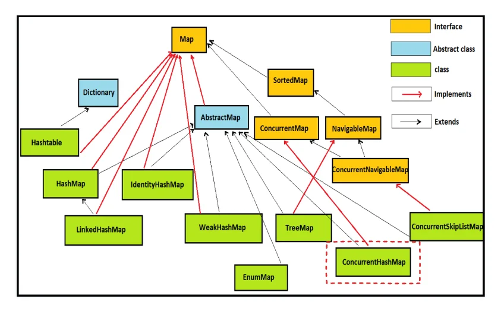
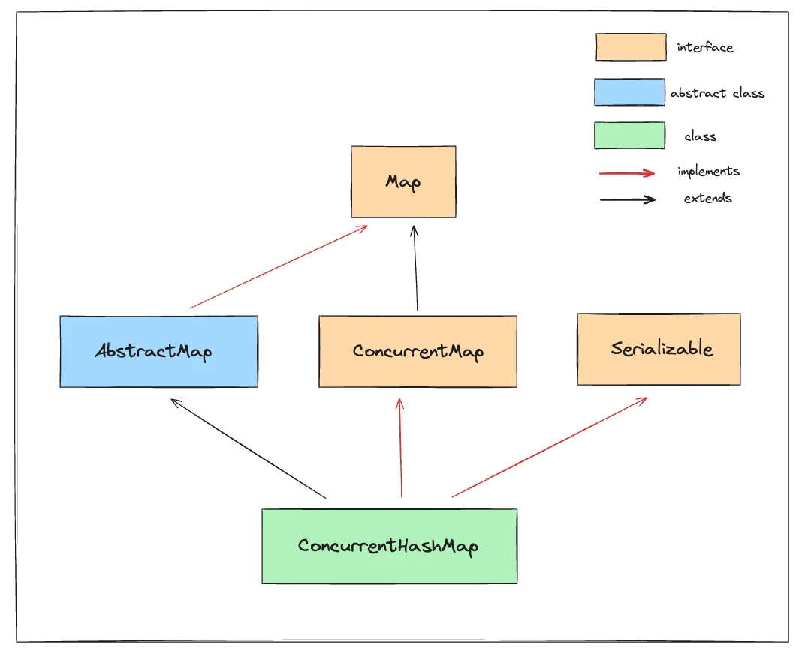
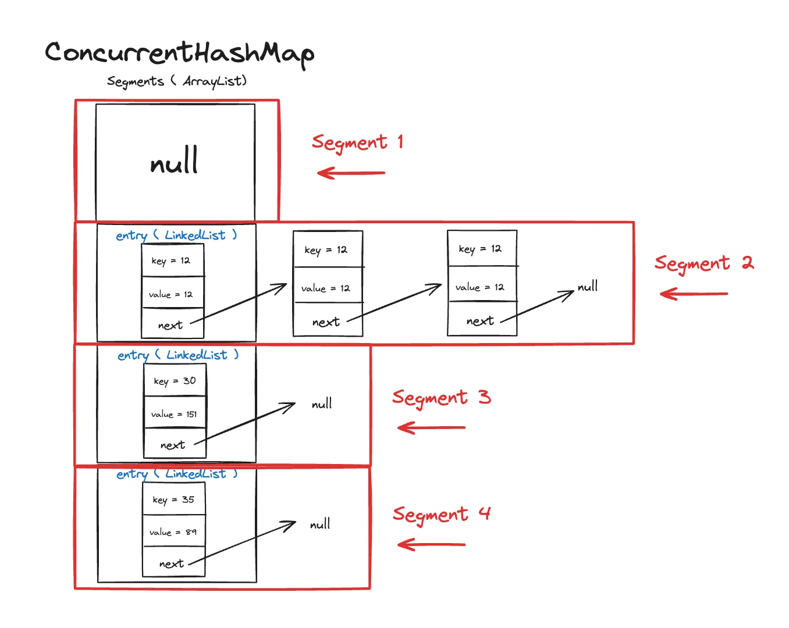

Reference

‣

‣

‣

## HashMap의 단점 및 이를 보안하는 ConcurrentHashmap

---

일반적으로 HashMap은 멀티스레드 환경에서 <strong><u>스레드 안전을 보장 하지 않</u></strong>는다&#46;

따라서<strong> race condition(경쟁 조건)</strong><strong>,</strong><strong> invalid state(잘못된 상태)</strong>가 발생될 수있다&#46; 

- 쓰기에서 원자적인 연산 처리가 되지 않아, 한 값이 다른 값을 덮어쓸 수 있고,  이는 Map이 일관되지 않는 상태가 될 수 있다&#46; 

- 데이터의 <strong><u>일관성, 정합성</u></strong>을 보장하지 않음

이를 해결하기 위해 Java에서는 <strong><u>스레드 안정선이 내장된 ConcurrentHashMap을 제공</u></strong>한다&#46; 

> 탄생 배경

- <strong>ConcurrentHashMap</strong>은 자바 1&#46;5에서 도입되었으며, 주로 멀티스레드 환경에서의 성능 문제를 해결하기 위해 설계되었다&#46; 

- 기존의 HashMap이나 Hashtable은 멀티스레드 환경에서 <strong><u>데이터 정합성을 보장하지 못</u></strong>하거나<strong><u> 성능이 크게 저하</u></strong>되는 문제가 있었다&#46; <code>Hashtable</code>은 <strong><u>모든 메서드에 대해 동기화를 사용</u></strong>하여 <u>안전성을 확보</u>했지만, 그로 인해 <strong><u>성능이 크게 떨</u></strong>어졌다&#46;

- 이를 해결하기 위해 <strong>ConcurrentHashMap</strong>이 도입되었으며, <strong><u>부분적인 락(lock)</u></strong>을 사용하여 <strong><u>성능을 향상</u></strong>시키면서도 <strong><u>Thread Safety를 보장</u></strong>할 수 있었다&#46;

