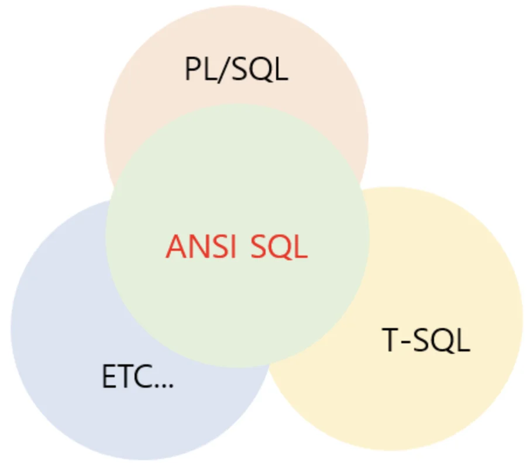
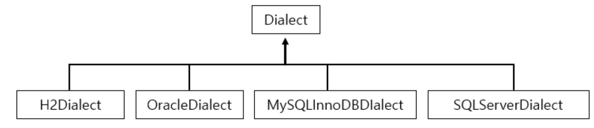

> 📌 Reference)<br><a href="https://dololak.tistory.com/465">https&#58;//dololak&#46;tistory&#46;com/465</a>
> 
> <a id="1c3eda9b0fe181edb899ca6d0e7a8e34"></a>
> 
> <a href="https://velog.io/@gillog/ANSI-SQL%EC%9D%B4%EB%9E%80">https&#58;//velog&#46;io/&#64;gillog/ANSI&#45;SQL이란</a>
> 
> <a id="1c3eda9b0fe18155bb73e467d22c406e"></a>
> 
> <a href="https://velog.io/@choidongkuen/Spring-JPA-%EB%8D%B0%EC%9D%B4%ED%84%B0%EB%B2%A0%EC%9D%B4%EC%8A%A4-%EB%B0%A9%EC%96%B8Dialect-%EC%9D%B4%EB%9E%80">https&#58;//velog&#46;io/&#64;choidongkuen/Spring&#45;JPA&#45;데이터베이스&#45;방언Dialect&#45;이란</a>

> <strong>RDBMS</strong>

<a id="1c3eda9b0fe1813e80d4c40a9ede926b"></a>

Relational database management system, 관계형 데이터베이스 관리 시스템



> <strong>ANSI SQL</strong>

<a id="1c3eda9b0fe181089d87da4ebe33c27c"></a>

Oracle, MySQL, MS&#45;SQL, DB2 등 다양한 데이터 베이스 공급업체가 존재한다&#46; 이렇게 다양한 공급업체들이 서로 자신만의 고유한 SQL을 가지고 있었기에, 미국 표준 협회(ANSI)에서 표준화된 SQL 문을 정리한 것이 ANSI SQL 이다&#46; 

> <strong>방언 SQL</strong>

<a id="1c3eda9b0fe1815d99f9ebce70977af4"></a>

각 RDBNS Vender&#58;  ANSI SQL &#43; 고유 SQL 문법 

<a id="1c3eda9b0fe1819fb53be5061ff1a622"></a>

ex) 

- MS&#45;SQL의 T&#45;SQL, Oracle의 PL/SQL

- 기본키를 할당&#58; MySQL &#45; AUTO&#95;INCREMENT, 오라클 DB &#45; 시퀀스

> <strong>방언(Dialect) </strong>

<a id="1c3eda9b0fe181ca8889ee918aa564f5"></a>

Dialect&#58; JPA 제공하는추상화된 방언 클래스, 옵션 수정을 통해 각 Vender에 맞게 쿼리 생성 



> <strong>하이버네이트 Dialect 설정, 종류</strong>

<a id="1c3eda9b0fe181829b80d8b482ba20ca"></a>

 설정 파일&#58; <code>persistence&#46;xml</code>의 <code>hibernate&#46;dialect</code> 에서 설정 파일 변경

<details>
<summary>ex) </summary>

<a id="1c3eda9b0fe181e6a6dbfb0cd0396c20"></a>

```plaintext
// MySQL InnoDB
<property name="hibernate.dialect" value="org.hibernate.dialect.MySQL5InnoDBDialect" />

// h2
<property name="hibernate.dialect" value="org.hibernate.dialect.H2Dialect"/>
```

</details>
