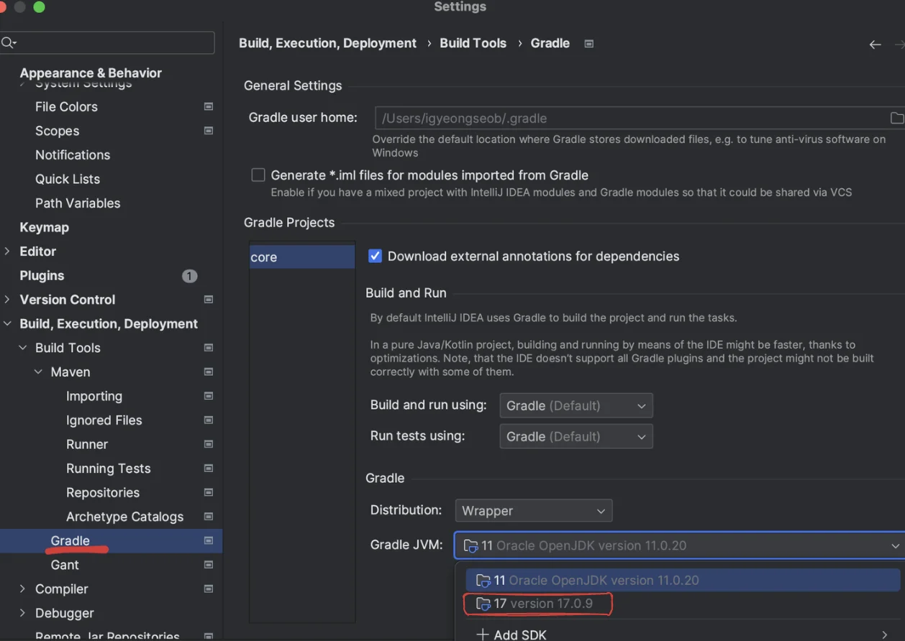
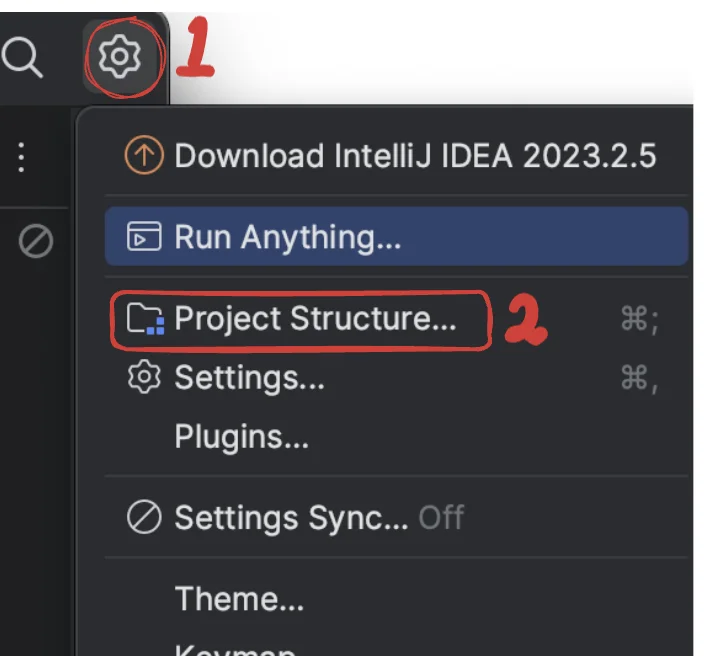
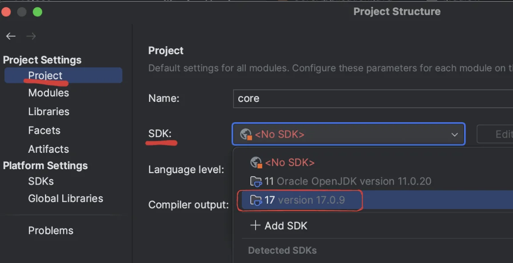
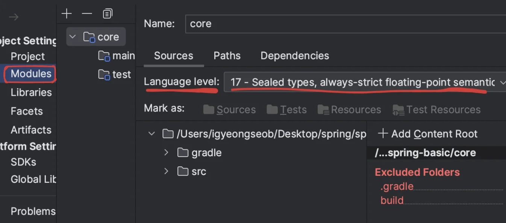
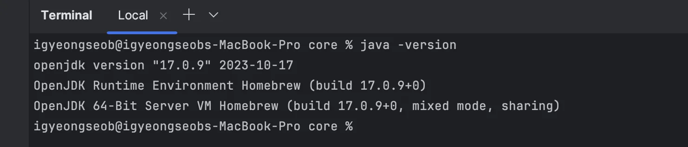
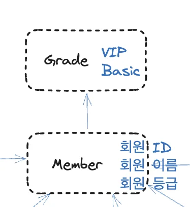
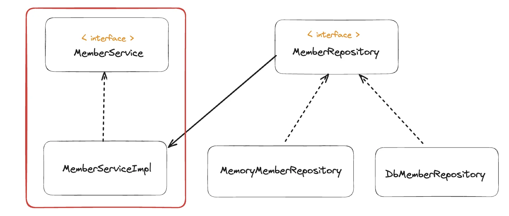
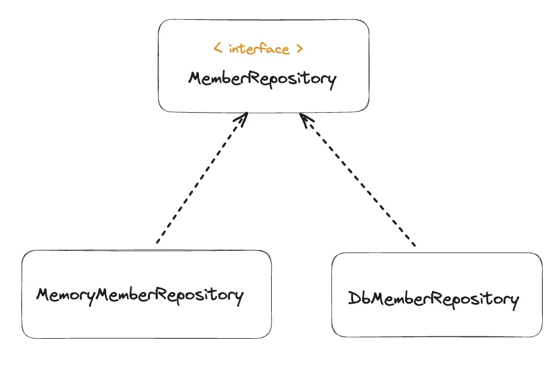

<a id="1c3eda9b0fe181df9206ef7f2f6c1e76"></a>

## Error

<a id="1c3eda9b0fe18126a98de424904c4bc1"></a>

### Error 1 &#45; 자바 버전 안맞음 

<a id="1c3eda9b0fe181d0ac7dd4bca3daae16"></a>

스프링부트<strong> 3&#46;xx </strong>부터는 Java 17 이상만 지원된다고 함&#46;

<a id="1c3eda9b0fe181d2baa5d1234fa73127"></a>

그러나 Java 11을 사용하고 있었음

<details>
<summary>해결</summary>

> 해당 <a href="https://velog.io/@may_yun/Mac-M1-Java-17-설치">링크</a> 참조

<a id="1c3eda9b0fe1813396ffe0a065619304"></a>

<strong> Java 11 → 17 로 변경</strong>

</details>

<a id="1c3eda9b0fe1813689c3f4c1ac346589"></a>

### Error2 &#45; IntelliJ에서 자바 버전 업데이트가 안됨

<details>
<summary>해결</summary>

> 구글링 결과 해당<a href="https://jojoldu.tistory.com/698"> 링크</a> 에서 답을 찾을 수 있었다&#46; 

<a id="1c3eda9b0fe181318a28dbcb9aba8b31"></a>

IntelliJ에서도 업데이트한 자바 버전으로 설정을 변경해줘야 한다&#46; 

<details>
<summary>1&#46; IntelliJ 설정 &#45; Gradle&#58; 자바 버전 업데이트(11 → 17) </summary>



</details>

<details>
<summary>2&#46; Project Settings &#45; SDK 설정</summary>





</details>

<details>
<summary>3&#46; Modules </summary>



</details>

</details>

<a id="1c3eda9b0fe181d78e86d90d47dd9984"></a>

Java 17를 설치하였는데도,  Error 발생



<details>
<summary>Error Message</summary>

<a id="1c3eda9b0fe181a6afadef6c392d0143"></a>

```java
A problem occurred configuring root project 'core'.
> Could not resolve all files for configuration ':classpath'.
   > Could not resolve org.springframework.boot:spring-boot-gradle-plugin:3.2.1.
     Required by:
         project : > org.springframework.boot:org.springframework.boot.gradle.plugin:3.2.1
      > No matching variant of org.springframework.boot:spring-boot-gradle-plugin:3.2.1 was found. The consumer was configured to find a library for use during runtime, compatible with Java 11, packaged as a jar, and its dependencies declared externally, as well as attribute 'org.gradle.plugin.api-version' with value '8.5' but:
          - Variant 'apiElements' capability org.springframework.boot:spring-boot-gradle-plugin:3.2.1 declares a library, packaged as a jar, and its dependencies declared externally:
              - Incompatible because this component declares a component for use during compile-time, compatible with Java 17 and the consumer needed a component for use during runtime, compatible with Java 11
              - Other compatible attribute:
                  - Doesn't say anything about org.gradle.plugin.api-version (required '8.5')
          - Variant 'javadocElements' capability org.springframework.boot:spring-boot-gradle-plugin:3.2.1 declares a component for use during runtime, and its dependencies declared externally:
              - Incompatible because this component declares documentation and the consumer needed a library
              - Other compatible attributes:
                  - Doesn't say anything about its target Java version (required compatibility with Java 11)
                  - Doesn't say anything about its elements (required them packaged as a jar)
                  - Doesn't say anything about org.gradle.plugin.api-version (required '8.5')
          - Variant 'mavenOptionalApiElements' capability org.springframework.boot:spring-boot-gradle-plugin-maven-optional:3.2.1 declares a library, packaged as a jar, and its dependencies declared externally:
              - Incompatible because this component declares a component for use during compile-time, compatible with Java 17 and the consumer needed a component for use during runtime, compatible with Java 11
              - Other compatible attribute:
                  - Doesn't say anything about org.gradle.plugin.api-version (required '8.5')
          - Variant 'mavenOptionalRuntimeElements' capability org.springframework.boot:spring-boot-gradle-plugin-maven-optional:3.2.1 declares a library for use during runtime, packaged as a jar, and its dependencies declared externally:
              - Incompatible because this component declares a component, compatible with Java 17 and the consumer needed a component, compatible with Java 11
              - Other compatible attribute:
                  - Doesn't say anything about org.gradle.plugin.api-version (required '8.5')
          - Variant 'runtimeElements' capability org.springframework.boot:spring-boot-gradle-plugin:3.2.1 declares a library for use during runtime, packaged as a jar, and its dependencies declared externally:
              - Incompatible because this component declares a component, compatible with Java 17 and the consumer needed a component, compatible with Java 11
              - Other compatible attribute:
                  - Doesn't say anything about org.gradle.plugin.api-version (required '8.5')
          - Variant 'sourcesElements' capability org.springframework.boot:spring-boot-gradle-plugin:3.2.1 declares a component for use during runtime, and its dependencies declared externally:
              - Incompatible because this component declares documentation and the consumer needed a library
              - Other compatible attributes:
                  - Doesn't say anything about its target Java version (required compatibility with Java 11)
                  - Doesn't say anything about its elements (required them packaged as a jar)
                  - Doesn't say anything about org.gradle.plugin.api-version (required '8.5')

* Try:
> Run with --info or --debug option to get more log output.
> Run with --scan to get full insights.
> Get more help at https://help.gradle.org.

* Exception is:
org.gradle.api.ProjectConfigurationException: A problem occurred configuring root project 'core'.
	at org.gradle.configuration.project.LifecycleProjectEvaluator.wrapException(LifecycleProjectEvaluator.java:84)
	at org.gradle.configuration.project.LifecycleProjectEvaluator.addConfigurationFailure(LifecycleProjectEvaluator.java:77)
	at org.gradle.configuration.project.LifecycleProjectEvaluator.access$500(LifecycleProjectEvaluator.java:55)
	at org.gradle.configuration.project.LifecycleProjectEvaluator$EvaluateProject.lambda$run$0(LifecycleProjectEvaluator.java:111)
	at org.gradle.api.internal.project.DefaultProjectStateRegistry$ProjectStateImpl.lambda$applyToMutableState$1(DefaultProjectStateRegistry.java:406)
	at org.gradle.api.internal.project.DefaultProjectStateRegistry$ProjectStateImpl.lambda$fromMutableState$2(DefaultProjectStateRegistry.java:429)
	at org.gradle.internal.work.DefaultWorkerLeaseService.withReplacedLocks(DefaultWorkerLeaseService.java:360)
	at org.gradle.api.internal.project.DefaultProjectStateRegistry$ProjectStateImpl.fromMutableState(DefaultProjectStateRegistry.java:429)
	at org.gradle.api.internal.project.DefaultProjectStateRegistry$ProjectStateImpl.applyToMutableState(DefaultProjectStateRegistry.java:405)
	at org.gradle.configuration.project.LifecycleProjectEvaluator$EvaluateProject.run(LifecycleProjectEvaluator.java:100)
	at org.gradle.internal.operations.DefaultBuildOperationRunner$1.execute(DefaultBuildOperationRunner.java:29)
	at org.gradle.internal.operations.DefaultBuildOperationRunner$1.execute(DefaultBuildOperationRunner.java:26)
	at org.gradle.internal.operations.DefaultBuildOperationRunner$2.execute(DefaultBuildOperationRunner.java:66)
	at org.gradle.internal.operations.DefaultBuildOperationRunner$2.execute(DefaultBuildOperationRunner.java:59)
	at org.gradle.internal.operations.DefaultBuildOperationRunner.execute(DefaultBuildOperationRunner.java:157)
	at org.gradle.internal.operations.DefaultBuildOperationRunner.execute(DefaultBuildOperationRunner.java:59)
	at org.gradle.internal.operations.DefaultBuildOperationRunner.run(DefaultBuildOperationRunner.java:47)
	at org.gradle.internal.operations.DefaultBuildOperationExecutor.run(DefaultBuildOperationExecutor.java:68)
	at org.gradle.configuration.project.LifecycleProjectEvaluator.evaluate(LifecycleProjectEvaluator.java:72)
	at org.gradle.api.internal.project.DefaultProject.evaluate(DefaultProject.java:790)
	at org.gradle.api.internal.project.DefaultProject.evaluate(DefaultProject.java:156)
	at org.gradle.api.internal.project.ProjectLifecycleController.lambda$ensureSelfConfigured$2(ProjectLifecycleController.java:84)
	at org.gradle.internal.model.StateTransitionController.lambda$doTransition$14(StateTransitionController.java:255)
	at org.gradle.internal.model.StateTransitionController.doTransition(StateTransitionController.java:266)
	at org.gradle.internal.model.StateTransitionController.doTransition(StateTransitionController.java:254)
	at org.gradle.internal.model.StateTransitionController.lambda$maybeTransitionIfNotCurrentlyTransitioning$10(StateTransitionController.java:199)
	at org.gradle.internal.work.DefaultSynchronizer.withLock(DefaultSynchronizer.java:34)
	at org.gradle.internal.model.StateTransitionController.maybeTransitionIfNotCurrentlyTransitioning(StateTransitionController.java:195)
	at org.gradle.api.internal.project.ProjectLifecycleController.ensureSelfConfigured(ProjectLifecycleController.java:84)
	at org.gradle.api.internal.project.DefaultProjectStateRegistry$ProjectStateImpl.ensureConfigured(DefaultProjectStateRegistry.java:380)
	at org.gradle.execution.TaskPathProjectEvaluator.configure(TaskPathProjectEvaluator.java:34)
	at org.gradle.execution.TaskPathProjectEvaluator.configureHierarchy(TaskPathProjectEvaluator.java:48)
	at org.gradle.configuration.DefaultProjectsPreparer.prepareProjects(DefaultProjectsPreparer.java:42)
	at org.gradle.configuration.BuildTreePreparingProjectsPreparer.prepareProjects(BuildTreePreparingProjectsPreparer.java:65)
	at org.gradle.configuration.BuildOperationFiringProjectsPreparer$ConfigureBuild.run(BuildOperationFiringProjectsPreparer.java:52)
	at org.gradle.internal.operations.DefaultBuildOperationRunner$1.execute(DefaultBuildOperationRunner.java:29)
	at org.gradle.internal.operations.DefaultBuildOperationRunner$1.execute(DefaultBuildOperationRunner.java:26)
	at org.gradle.internal.operations.DefaultBuildOperationRunner$2.execute(DefaultBuildOperationRunner.java:66)
	at org.gradle.internal.operations.DefaultBuildOperationRunner$2.execute(DefaultBuildOperationRunner.java:59)
	at org.gradle.internal.operations.DefaultBuildOperationRunner.execute(DefaultBuildOperationRunner.java:157)
	at org.gradle.internal.operations.DefaultBuildOperationRunner.execute(DefaultBuildOperationRunner.java:59)
	at org.gradle.internal.operations.DefaultBuildOperationRunner.run(DefaultBuildOperationRunner.java:47)
	at org.gradle.internal.operations.DefaultBuildOperationExecutor.run(DefaultBuildOperationExecutor.java:68)
	at org.gradle.configuration.BuildOperationFiringProjectsPreparer.prepareProjects(BuildOperationFiringProjectsPreparer.java:40)
	at org.gradle.initialization.VintageBuildModelController.lambda$prepareProjects$2(VintageBuildModelController.java:84)
	at org.gradle.internal.model.StateTransitionController.lambda$doTransition$14(StateTransitionController.java:255)
	at org.gradle.internal.model.StateTransitionController.doTransition(StateTransitionController.java:266)
	at org.gradle.internal.model.StateTransitionController.doTransition(StateTransitionController.java:254)
	at org.gradle.internal.model.StateTransitionController.lambda$transitionIfNotPreviously$11(StateTransitionController.java:213)
	at org.gradle.internal.work.DefaultSynchronizer.withLock(DefaultSynchronizer.java:34)
	at org.gradle.internal.model.StateTransitionController.transitionIfNotPreviously(StateTransitionController.java:209)
	at org.gradle.initialization.VintageBuildModelController.prepareProjects(VintageBuildModelController.java:84)
	at org.gradle.initialization.VintageBuildModelController.getConfiguredModel(VintageBuildModelController.java:64)
	at org.gradle.internal.build.DefaultBuildLifecycleController.lambda$withProjectsConfigured$1(DefaultBuildLifecycleController.java:133)
	at org.gradle.internal.model.StateTransitionController.lambda$notInState$3(StateTransitionController.java:132)
	at org.gradle.internal.work.DefaultSynchronizer.withLock(DefaultSynchronizer.java:44)
	at org.gradle.internal.model.StateTransitionController.notInState(StateTransitionController.java:128)
	at org.gradle.internal.build.DefaultBuildLifecycleController.withProjectsConfigured(DefaultBuildLifecycleController.java:133)
	at org.gradle.internal.build.DefaultBuildToolingModelController.locateBuilderForTarget(DefaultBuildToolingModelController.java:57)
	at org.gradle.internal.buildtree.DefaultBuildTreeModelCreator$DefaultBuildTreeModelController.lambda$locateBuilderForTarget$0(DefaultBuildTreeModelCreator.java:73)
	at org.gradle.internal.build.DefaultBuildLifecycleController.withToolingModels(DefaultBuildLifecycleController.java:327)
	at org.gradle.internal.build.AbstractBuildState.withToolingModels(AbstractBuildState.java:140)
	at org.gradle.internal.buildtree.DefaultBuildTreeModelCreator$DefaultBuildTreeModelController.locateBuilderForTarget(DefaultBuildTreeModelCreator.java:73)
	at org.gradle.internal.buildtree.DefaultBuildTreeModelCreator$DefaultBuildTreeModelController.locateBuilderForDefaultTarget(DefaultBuildTreeModelCreator.java:68)
	at org.gradle.tooling.internal.provider.runner.DefaultBuildController.getTarget(DefaultBuildController.java:157)
	at org.gradle.tooling.internal.provider.runner.DefaultBuildController.getModel(DefaultBuildController.java:101)
	at org.gradle.tooling.internal.consumer.connection.ParameterAwareBuildControllerAdapter.getModel(ParameterAwareBuildControllerAdapter.java:39)
	at org.gradle.tooling.internal.consumer.connection.UnparameterizedBuildController.getModel(UnparameterizedBuildController.java:113)
	at org.gradle.tooling.internal.consumer.connection.NestedActionAwareBuildControllerAdapter.getModel(NestedActionAwareBuildControllerAdapter.java:31)
	at org.gradle.tooling.internal.consumer.connection.UnparameterizedBuildController.findModel(UnparameterizedBuildController.java:97)
	at org.gradle.tooling.internal.consumer.connection.NestedActionAwareBuildControllerAdapter.findModel(NestedActionAwareBuildControllerAdapter.java:31)
	at org.gradle.tooling.internal.consumer.connection.UnparameterizedBuildController.findModel(UnparameterizedBuildController.java:81)
	at org.gradle.tooling.internal.consumer.connection.NestedActionAwareBuildControllerAdapter.findModel(NestedActionAwareBuildControllerAdapter.java:31)
	at org.gradle.tooling.internal.consumer.connection.UnparameterizedBuildController.findModel(UnparameterizedBuildController.java:66)
	at org.gradle.tooling.internal.consumer.connection.NestedActionAwareBuildControllerAdapter.findModel(NestedActionAwareBuildControllerAdapter.java:31)
	at org.jetbrains.plugins.gradle.model.ProjectImportAction.execute(ProjectImportAction.java:126)
	at org.jetbrains.plugins.gradle.model.ProjectImportAction.execute(ProjectImportAction.java:43)
	at org.gradle.tooling.internal.consumer.connection.InternalBuildActionAdapter.execute(InternalBuildActionAdapter.java:64)
	at org.gradle.tooling.internal.provider.runner.AbstractClientProvidedBuildActionRunner$ActionAdapter.runAction(AbstractClientProvidedBuildActionRunner.java:131)
	at org.gradle.tooling.internal.provider.runner.AbstractClientProvidedBuildActionRunner$ActionAdapter.beforeTasks(AbstractClientProvidedBuildActionRunner.java:99)
	at org.gradle.internal.buildtree.DefaultBuildTreeModelCreator.beforeTasks(DefaultBuildTreeModelCreator.java:52)
	at org.gradle.internal.buildtree.DefaultBuildTreeLifecycleController.lambda$fromBuildModel$2(DefaultBuildTreeLifecycleController.java:82)
	at org.gradle.internal.buildtree.DefaultBuildTreeLifecycleController.lambda$runBuild$4(DefaultBuildTreeLifecycleController.java:119)
	at org.gradle.internal.model.StateTransitionController.lambda$transition$6(StateTransitionController.java:169)
	at org.gradle.internal.model.StateTransitionController.doTransition(StateTransitionController.java:266)
	at org.gradle.internal.model.StateTransitionController.lambda$transition$7(StateTransitionController.java:169)
	at org.gradle.internal.work.DefaultSynchronizer.withLock(DefaultSynchronizer.java:44)
	at org.gradle.internal.model.StateTransitionController.transition(StateTransitionController.java:169)
	at org.gradle.internal.buildtree.DefaultBuildTreeLifecycleController.runBuild(DefaultBuildTreeLifecycleController.java:116)
	at org.gradle.internal.buildtree.DefaultBuildTreeLifecycleController.fromBuildModel(DefaultBuildTreeLifecycleController.java:81)
	at org.gradle.tooling.internal.provider.runner.AbstractClientProvidedBuildActionRunner.runClientAction(AbstractClientProvidedBuildActionRunner.java:43)
	at org.gradle.tooling.internal.provider.runner.ClientProvidedPhasedActionRunner.run(ClientProvidedPhasedActionRunner.java:53)
	at org.gradle.launcher.exec.ChainingBuildActionRunner.run(ChainingBuildActionRunner.java:35)
	at org.gradle.internal.buildtree.ProblemReportingBuildActionRunner.run(ProblemReportingBuildActionRunner.java:49)
	at org.gradle.launcher.exec.BuildOutcomeReportingBuildActionRunner.run(BuildOutcomeReportingBuildActionRunner.java:65)
	at org.gradle.tooling.internal.provider.FileSystemWatchingBuildActionRunner.run(FileSystemWatchingBuildActionRunner.java:140)
	at org.gradle.launcher.exec.BuildCompletionNotifyingBuildActionRunner.run(BuildCompletionNotifyingBuildActionRunner.java:41)
	at org.gradle.launcher.exec.RootBuildLifecycleBuildActionExecutor.lambda$execute$0(RootBuildLifecycleBuildActionExecutor.java:40)
	at org.gradle.composite.internal.DefaultRootBuildState.run(DefaultRootBuildState.java:123)
	at org.gradle.launcher.exec.RootBuildLifecycleBuildActionExecutor.execute(RootBuildLifecycleBuildActionExecutor.java:40)
	at org.gradle.internal.buildtree.InitDeprecationLoggingActionExecutor.execute(InitDeprecationLoggingActionExecutor.java:62)
	at org.gradle.internal.buildtree.InitProblems.execute(InitProblems.java:38)
	at org.gradle.internal.buildtree.DefaultBuildTreeContext.execute(DefaultBuildTreeContext.java:40)
	at org.gradle.launcher.exec.BuildTreeLifecycleBuildActionExecutor.lambda$execute$0(BuildTreeLifecycleBuildActionExecutor.java:58)
	at org.gradle.internal.buildtree.BuildTreeState.run(BuildTreeState.java:58)
	at org.gradle.launcher.exec.BuildTreeLifecycleBuildActionExecutor.execute(BuildTreeLifecycleBuildActionExecutor.java:58)
	at org.gradle.launcher.exec.RunAsBuildOperationBuildActionExecutor$3.call(RunAsBuildOperationBuildActionExecutor.java:61)
	at org.gradle.launcher.exec.RunAsBuildOperationBuildActionExecutor$3.call(RunAsBuildOperationBuildActionExecutor.java:57)
	at org.gradle.internal.operations.DefaultBuildOperationRunner$CallableBuildOperationWorker.execute(DefaultBuildOperationRunner.java:204)
	at org.gradle.internal.operations.DefaultBuildOperationRunner$CallableBuildOperationWorker.execute(DefaultBuildOperationRunner.java:199)
	at org.gradle.internal.operations.DefaultBuildOperationRunner$2.execute(DefaultBuildOperationRunner.java:66)
	at org.gradle.internal.operations.DefaultBuildOperationRunner$2.execute(DefaultBuildOperationRunner.java:59)
	at org.gradle.internal.operations.DefaultBuildOperationRunner.execute(DefaultBuildOperationRunner.java:157)
	at org.gradle.internal.operations.DefaultBuildOperationRunner.execute(DefaultBuildOperationRunner.java:59)
	at org.gradle.internal.operations.DefaultBuildOperationRunner.call(DefaultBuildOperationRunner.java:53)
	at org.gradle.internal.operations.DefaultBuildOperationExecutor.call(DefaultBuildOperationExecutor.java:73)
	at org.gradle.launcher.exec.RunAsBuildOperationBuildActionExecutor.execute(RunAsBuildOperationBuildActionExecutor.java:57)
	at org.gradle.launcher.exec.RunAsWorkerThreadBuildActionExecutor.lambda$execute$0(RunAsWorkerThreadBuildActionExecutor.java:36)
	at org.gradle.internal.work.DefaultWorkerLeaseService.withLocks(DefaultWorkerLeaseService.java:264)
	at org.gradle.internal.work.DefaultWorkerLeaseService.runAsWorkerThread(DefaultWorkerLeaseService.java:128)
	at org.gradle.launcher.exec.RunAsWorkerThreadBuildActionExecutor.execute(RunAsWorkerThreadBuildActionExecutor.java:36)
	at org.gradle.tooling.internal.provider.continuous.ContinuousBuildActionExecutor.execute(ContinuousBuildActionExecutor.java:110)
	at org.gradle.tooling.internal.provider.SubscribableBuildActionExecutor.execute(SubscribableBuildActionExecutor.java:64)
	at org.gradle.internal.session.DefaultBuildSessionContext.execute(DefaultBuildSessionContext.java:46)
	at org.gradle.tooling.internal.provider.BuildSessionLifecycleBuildActionExecuter$ActionImpl.apply(BuildSessionLifecycleBuildActionExecuter.java:92)
	at org.gradle.tooling.internal.provider.BuildSessionLifecycleBuildActionExecuter$ActionImpl.apply(BuildSessionLifecycleBuildActionExecuter.java:80)
	at org.gradle.internal.session.BuildSessionState.run(BuildSessionState.java:69)
	at org.gradle.tooling.internal.provider.BuildSessionLifecycleBuildActionExecuter.execute(BuildSessionLifecycleBuildActionExecuter.java:62)
	at org.gradle.tooling.internal.provider.BuildSessionLifecycleBuildActionExecuter.execute(BuildSessionLifecycleBuildActionExecuter.java:41)
	at org.gradle.tooling.internal.provider.StartParamsValidatingActionExecuter.execute(StartParamsValidatingActionExecuter.java:64)
	at org.gradle.tooling.internal.provider.StartParamsValidatingActionExecuter.execute(StartParamsValidatingActionExecuter.java:32)
	at org.gradle.tooling.internal.provider.SessionFailureReportingActionExecuter.execute(SessionFailureReportingActionExecuter.java:51)
	at org.gradle.tooling.internal.provider.SessionFailureReportingActionExecuter.execute(SessionFailureReportingActionExecuter.java:39)
	at org.gradle.tooling.internal.provider.SetupLoggingActionExecuter.execute(SetupLoggingActionExecuter.java:47)
	at org.gradle.tooling.internal.provider.SetupLoggingActionExecuter.execute(SetupLoggingActionExecuter.java:31)
	at org.gradle.launcher.daemon.server.exec.ExecuteBuild.doBuild(ExecuteBuild.java:65)
	at org.gradle.launcher.daemon.server.exec.BuildCommandOnly.execute(BuildCommandOnly.java:37)
	at org.gradle.launcher.daemon.server.api.DaemonCommandExecution.proceed(DaemonCommandExecution.java:104)
	at org.gradle.launcher.daemon.server.exec.WatchForDisconnection.execute(WatchForDisconnection.java:39)
	at org.gradle.launcher.daemon.server.api.DaemonCommandExecution.proceed(DaemonCommandExecution.java:104)
	at org.gradle.launcher.daemon.server.exec.ResetDeprecationLogger.execute(ResetDeprecationLogger.java:29)
	at org.gradle.launcher.daemon.server.api.DaemonCommandExecution.proceed(DaemonCommandExecution.java:104)
	at org.gradle.launcher.daemon.server.exec.RequestStopIfSingleUsedDaemon.execute(RequestStopIfSingleUsedDaemon.java:35)
	at org.gradle.launcher.daemon.server.api.DaemonCommandExecution.proceed(DaemonCommandExecution.java:104)
	at org.gradle.launcher.daemon.server.exec.ForwardClientInput$2.create(ForwardClientInput.java:78)
	at org.gradle.launcher.daemon.server.exec.ForwardClientInput$2.create(ForwardClientInput.java:75)
	at org.gradle.util.internal.Swapper.swap(Swapper.java:38)
	at org.gradle.launcher.daemon.server.exec.ForwardClientInput.execute(ForwardClientInput.java:75)
	at org.gradle.launcher.daemon.server.api.DaemonCommandExecution.proceed(DaemonCommandExecution.java:104)
	at org.gradle.launcher.daemon.server.exec.LogAndCheckHealth.execute(LogAndCheckHealth.java:64)
	at org.gradle.launcher.daemon.server.api.DaemonCommandExecution.proceed(DaemonCommandExecution.java:104)
	at org.gradle.launcher.daemon.server.exec.LogToClient.doBuild(LogToClient.java:63)
	at org.gradle.launcher.daemon.server.exec.BuildCommandOnly.execute(BuildCommandOnly.java:37)
	at org.gradle.launcher.daemon.server.api.DaemonCommandExecution.proceed(DaemonCommandExecution.java:104)
	at org.gradle.launcher.daemon.server.exec.EstablishBuildEnvironment.doBuild(EstablishBuildEnvironment.java:84)
	at org.gradle.launcher.daemon.server.exec.BuildCommandOnly.execute(BuildCommandOnly.java:37)
	at org.gradle.launcher.daemon.server.api.DaemonCommandExecution.proceed(DaemonCommandExecution.java:104)
	at org.gradle.launcher.daemon.server.exec.StartBuildOrRespondWithBusy$1.run(StartBuildOrRespondWithBusy.java:52)
	at org.gradle.launcher.daemon.server.DaemonStateCoordinator$1.run(DaemonStateCoordinator.java:297)
	at org.gradle.internal.concurrent.ExecutorPolicy$CatchAndRecordFailures.onExecute(ExecutorPolicy.java:64)
	at org.gradle.internal.concurrent.AbstractManagedExecutor$1.run(AbstractManagedExecutor.java:47)
Caused by: org.gradle.api.internal.artifacts.ivyservice.DefaultLenientConfiguration$ArtifactResolveException: Could not resolve all files for configuration ':classpath'.
	at org.gradle.api.internal.artifacts.ResolveExceptionContextualizer.mapFailure(ResolveExceptionContextualizer.java:81)
	at org.gradle.api.internal.artifacts.ResolveExceptionContextualizer.mapFailures(ResolveExceptionContextualizer.java:60)
	at org.gradle.api.internal.artifacts.configurations.DefaultConfiguration$DefaultResolutionHost.mapFailure(DefaultConfiguration.java:2310)
	at org.gradle.api.internal.artifacts.configurations.ResolutionHost.rethrowFailure(ResolutionHost.java:30)
	at org.gradle.api.internal.artifacts.configurations.ResolutionBackedFileCollection.maybeThrowResolutionFailures(ResolutionBackedFileCollection.java:84)
	at org.gradle.api.internal.artifacts.configurations.ResolutionBackedFileCollection.visitContents(ResolutionBackedFileCollection.java:74)
	at org.gradle.api.internal.file.AbstractFileCollection.getFiles(AbstractFileCollection.java:123)
	at org.gradle.api.internal.file.AbstractFileCollection.iterator(AbstractFileCollection.java:164)
	at org.gradle.internal.classpath.DefaultClassPath.of(DefaultClassPath.java:56)
	at org.gradle.api.internal.initialization.DefaultScriptClassPathResolver.resolveToClasspathWithoutGradleApi(DefaultScriptClassPathResolver.java:81)
	at org.gradle.api.internal.initialization.DefaultScriptClassPathResolver.resolveClassPath(DefaultScriptClassPathResolver.java:72)
	at org.gradle.api.internal.initialization.DefaultBuildLogicBuilder.lambda$resolveClassPath$0(DefaultBuildLogicBuilder.java:58)
	at org.gradle.api.internal.initialization.DefaultBuildLogicBuildQueue.build(DefaultBuildLogicBuildQueue.java:56)
	at org.gradle.api.internal.initialization.DefaultBuildLogicBuilder.resolveClassPath(DefaultBuildLogicBuilder.java:55)
	at org.gradle.api.internal.initialization.DefaultScriptHandler.getInstrumentedScriptClassPath(DefaultScriptHandler.java:102)
	at org.gradle.plugin.use.internal.DefaultPluginRequestApplicator.defineScriptHandlerClassScope(DefaultPluginRequestApplicator.java:211)
	at org.gradle.plugin.use.internal.DefaultPluginRequestApplicator.resolvePluginRequests(DefaultPluginRequestApplicator.java:118)
	at org.gradle.plugin.use.internal.DefaultPluginRequestApplicator.applyPlugins(DefaultPluginRequestApplicator.java:103)
	at org.gradle.configuration.DefaultScriptPluginFactory$ScriptPluginImpl.apply(DefaultScriptPluginFactory.java:119)
	at org.gradle.configuration.BuildOperationScriptPlugin$1.run(BuildOperationScriptPlugin.java:68)
	at org.gradle.internal.operations.DefaultBuildOperationRunner$1.execute(DefaultBuildOperationRunner.java:29)
	at org.gradle.internal.operations.DefaultBuildOperationRunner$1.execute(DefaultBuildOperationRunner.java:26)
	at org.gradle.internal.operations.DefaultBuildOperationRunner$2.execute(DefaultBuildOperationRunner.java:66)
	at org.gradle.internal.operations.DefaultBuildOperationRunner$2.execute(DefaultBuildOperationRunner.java:59)
	at org.gradle.internal.operations.DefaultBuildOperationRunner.execute(DefaultBuildOperationRunner.java:157)
	at org.gradle.internal.operations.DefaultBuildOperationRunner.execute(DefaultBuildOperationRunner.java:59)
	at org.gradle.internal.operations.DefaultBuildOperationRunner.run(DefaultBuildOperationRunner.java:47)
	at org.gradle.internal.operations.DefaultBuildOperationExecutor.run(DefaultBuildOperationExecutor.java:68)
	at org.gradle.configuration.BuildOperationScriptPlugin.lambda$apply$0(BuildOperationScriptPlugin.java:65)
	at org.gradle.internal.code.DefaultUserCodeApplicationContext.apply(DefaultUserCodeApplicationContext.java:43)
	at org.gradle.configuration.BuildOperationScriptPlugin.apply(BuildOperationScriptPlugin.java:65)
	at org.gradle.api.internal.project.DefaultProjectStateRegistry$ProjectStateImpl.lambda$applyToMutableState$1(DefaultProjectStateRegistry.java:406)
	at org.gradle.api.internal.project.DefaultProjectStateRegistry$ProjectStateImpl.fromMutableState(DefaultProjectStateRegistry.java:424)
	at org.gradle.api.internal.project.DefaultProjectStateRegistry$ProjectStateImpl.applyToMutableState(DefaultProjectStateRegistry.java:405)
	at org.gradle.configuration.project.BuildScriptProcessor.execute(BuildScriptProcessor.java:46)
	at org.gradle.configuration.project.BuildScriptProcessor.execute(BuildScriptProcessor.java:27)
	at org.gradle.configuration.project.ConfigureActionsProjectEvaluator.evaluate(ConfigureActionsProjectEvaluator.java:35)
	at org.gradle.configuration.project.LifecycleProjectEvaluator$EvaluateProject.lambda$run$0(LifecycleProjectEvaluator.java:109)
	at org.gradle.api.internal.project.DefaultProjectStateRegistry$ProjectStateImpl.lambda$applyToMutableState$1(DefaultProjectStateRegistry.java:406)
	at org.gradle.api.internal.project.DefaultProjectStateRegistry$ProjectStateImpl.lambda$fromMutableState$2(DefaultProjectStateRegistry.java:429)
	at org.gradle.internal.work.DefaultWorkerLeaseService.withReplacedLocks(DefaultWorkerLeaseService.java:360)
	at org.gradle.api.internal.project.DefaultProjectStateRegistry$ProjectStateImpl.fromMutableState(DefaultProjectStateRegistry.java:429)
	at org.gradle.api.internal.project.DefaultProjectStateRegistry$ProjectStateImpl.applyToMutableState(DefaultProjectStateRegistry.java:405)
	at org.gradle.configuration.project.LifecycleProjectEvaluator$EvaluateProject.run(LifecycleProjectEvaluator.java:100)
	at org.gradle.internal.operations.DefaultBuildOperationRunner$1.execute(DefaultBuildOperationRunner.java:29)
	at org.gradle.internal.operations.DefaultBuildOperationRunner$1.execute(DefaultBuildOperationRunner.java:26)
	at org.gradle.internal.operations.DefaultBuildOperationRunner$2.execute(DefaultBuildOperationRunner.java:66)
	at org.gradle.internal.operations.DefaultBuildOperationRunner$2.execute(DefaultBuildOperationRunner.java:59)
	at org.gradle.internal.operations.DefaultBuildOperationRunner.execute(DefaultBuildOperationRunner.java:157)
	at org.gradle.internal.operations.DefaultBuildOperationRunner.execute(DefaultBuildOperationRunner.java:59)
	at org.gradle.internal.operations.DefaultBuildOperationRunner.run(DefaultBuildOperationRunner.java:47)
	at org.gradle.internal.operations.DefaultBuildOperationExecutor.run(DefaultBuildOperationExecutor.java:68)
	at org.gradle.configuration.project.LifecycleProjectEvaluator.evaluate(LifecycleProjectEvaluator.java:72)
	at org.gradle.api.internal.project.DefaultProject.evaluate(DefaultProject.java:790)
	at org.gradle.api.internal.project.DefaultProject.evaluate(DefaultProject.java:156)
	at org.gradle.api.internal.project.ProjectLifecycleController.lambda$ensureSelfConfigured$2(ProjectLifecycleController.java:84)
	at org.gradle.internal.model.StateTransitionController.lambda$doTransition$14(StateTransitionController.java:255)
	at org.gradle.internal.model.StateTransitionController.doTransition(StateTransitionController.java:266)
	at org.gradle.internal.model.StateTransitionController.doTransition(StateTransitionController.java:254)
	at org.gradle.internal.model.StateTransitionController.lambda$maybeTransitionIfNotCurrentlyTransitioning$10(StateTransitionController.java:199)
	at org.gradle.internal.work.DefaultSynchronizer.withLock(DefaultSynchronizer.java:34)
	at org.gradle.internal.model.StateTransitionController.maybeTransitionIfNotCurrentlyTransitioning(StateTransitionController.java:195)
	at org.gradle.api.internal.project.ProjectLifecycleController.ensureSelfConfigured(ProjectLifecycleController.java:84)
	at org.gradle.api.internal.project.DefaultProjectStateRegistry$ProjectStateImpl.ensureConfigured(DefaultProjectStateRegistry.java:380)
	at org.gradle.execution.TaskPathProjectEvaluator.configure(TaskPathProjectEvaluator.java:34)
	at org.gradle.execution.TaskPathProjectEvaluator.configureHierarchy(TaskPathProjectEvaluator.java:48)
	at org.gradle.configuration.DefaultProjectsPreparer.prepareProjects(DefaultProjectsPreparer.java:42)
	at org.gradle.configuration.BuildTreePreparingProjectsPreparer.prepareProjects(BuildTreePreparingProjectsPreparer.java:65)
	at org.gradle.configuration.BuildOperationFiringProjectsPreparer$ConfigureBuild.run(BuildOperationFiringProjectsPreparer.java:52)
	at org.gradle.internal.operations.DefaultBuildOperationRunner$1.execute(DefaultBuildOperationRunner.java:29)
	at org.gradle.internal.operations.DefaultBuildOperationRunner$1.execute(DefaultBuildOperationRunner.java:26)
	at org.gradle.internal.operations.DefaultBuildOperationRunner$2.execute(DefaultBuildOperationRunner.java:66)
	at org.gradle.internal.operations.DefaultBuildOperationRunner$2.execute(DefaultBuildOperationRunner.java:59)
	at org.gradle.internal.operations.DefaultBuildOperationRunner.execute(DefaultBuildOperationRunner.java:157)
	at org.gradle.internal.operations.DefaultBuildOperationRunner.execute(DefaultBuildOperationRunner.java:59)
	at org.gradle.internal.operations.DefaultBuildOperationRunner.run(DefaultBuildOperationRunner.java:47)
	at org.gradle.internal.operations.DefaultBuildOperationExecutor.run(DefaultBuildOperationExecutor.java:68)
	at org.gradle.configuration.BuildOperationFiringProjectsPreparer.prepareProjects(BuildOperationFiringProjectsPreparer.java:40)
	at org.gradle.initialization.VintageBuildModelController.lambda$prepareProjects$2(VintageBuildModelController.java:84)
	at org.gradle.internal.model.StateTransitionController.lambda$doTransition$14(StateTransitionController.java:255)
	at org.gradle.internal.model.StateTransitionController.doTransition(StateTransitionController.java:266)
	at org.gradle.internal.model.StateTransitionController.doTransition(StateTransitionController.java:254)
	at org.gradle.internal.model.StateTransitionController.lambda$transitionIfNotPreviously$11(StateTransitionController.java:213)
	at org.gradle.internal.work.DefaultSynchronizer.withLock(DefaultSynchronizer.java:34)
	at org.gradle.internal.model.StateTransitionController.transitionIfNotPreviously(StateTransitionController.java:209)
	at org.gradle.initialization.VintageBuildModelController.prepareProjects(VintageBuildModelController.java:84)
	at org.gradle.initialization.VintageBuildModelController.getConfiguredModel(VintageBuildModelController.java:64)
	at org.gradle.internal.build.DefaultBuildLifecycleController.lambda$withProjectsConfigured$1(DefaultBuildLifecycleController.java:133)
	at org.gradle.internal.model.StateTransitionController.lambda$notInState$3(StateTransitionController.java:132)
	at org.gradle.internal.work.DefaultSynchronizer.withLock(DefaultSynchronizer.java:44)
	at org.gradle.internal.model.StateTransitionController.notInState(StateTransitionController.java:128)
	at org.gradle.internal.build.DefaultBuildLifecycleController.withProjectsConfigured(DefaultBuildLifecycleController.java:133)
	at org.gradle.internal.build.DefaultBuildToolingModelController.locateBuilderForTarget(DefaultBuildToolingModelController.java:57)
	at org.gradle.internal.buildtree.DefaultBuildTreeModelCreator$DefaultBuildTreeModelController.lambda$locateBuilderForTarget$0(DefaultBuildTreeModelCreator.java:73)
	at org.gradle.internal.build.DefaultBuildLifecycleController.withToolingModels(DefaultBuildLifecycleController.java:327)
	at org.gradle.internal.build.AbstractBuildState.withToolingModels(AbstractBuildState.java:140)
	at org.gradle.internal.buildtree.DefaultBuildTreeModelCreator$DefaultBuildTreeModelController.locateBuilderForTarget(DefaultBuildTreeModelCreator.java:73)
	at org.gradle.internal.buildtree.DefaultBuildTreeModelCreator$DefaultBuildTreeModelController.locateBuilderForDefaultTarget(DefaultBuildTreeModelCreator.java:68)
	at org.gradle.tooling.internal.provider.runner.DefaultBuildController.getTarget(DefaultBuildController.java:157)
	at org.gradle.tooling.internal.provider.runner.DefaultBuildController.getModel(DefaultBuildController.java:101)
	at org.gradle.tooling.internal.consumer.connection.ParameterAwareBuildControllerAdapter.getModel(ParameterAwareBuildControllerAdapter.java:39)
	at org.gradle.tooling.internal.consumer.connection.UnparameterizedBuildController.getModel(UnparameterizedBuildController.java:113)
	at org.gradle.tooling.internal.consumer.connection.NestedActionAwareBuildControllerAdapter.getModel(NestedActionAwareBuildControllerAdapter.java:31)
	at org.gradle.tooling.internal.consumer.connection.UnparameterizedBuildController.findModel(UnparameterizedBuildController.java:97)
	at org.gradle.tooling.internal.consumer.connection.NestedActionAwareBuildControllerAdapter.findModel(NestedActionAwareBuildControllerAdapter.java:31)
	at org.gradle.tooling.internal.consumer.connection.UnparameterizedBuildController.findModel(UnparameterizedBuildController.java:81)
	at org.gradle.tooling.internal.consumer.connection.NestedActionAwareBuildControllerAdapter.findModel(NestedActionAwareBuildControllerAdapter.java:31)
	at org.gradle.tooling.internal.consumer.connection.UnparameterizedBuildController.findModel(UnparameterizedBuildController.java:66)
	at org.gradle.tooling.internal.consumer.connection.NestedActionAwareBuildControllerAdapter.findModel(NestedActionAwareBuildControllerAdapter.java:31)
	at org.jetbrains.plugins.gradle.model.ProjectImportAction.execute(ProjectImportAction.java:126)
	at org.jetbrains.plugins.gradle.model.ProjectImportAction.execute(ProjectImportAction.java:43)
	at org.gradle.tooling.internal.consumer.connection.InternalBuildActionAdapter.execute(InternalBuildActionAdapter.java:64)
	at org.gradle.tooling.internal.provider.runner.AbstractClientProvidedBuildActionRunner$ActionAdapter.runAction(AbstractClientProvidedBuildActionRunner.java:131)
	at org.gradle.tooling.internal.provider.runner.AbstractClientProvidedBuildActionRunner$ActionAdapter.beforeTasks(AbstractClientProvidedBuildActionRunner.java:99)
	at org.gradle.internal.buildtree.DefaultBuildTreeModelCreator.beforeTasks(DefaultBuildTreeModelCreator.java:52)
	at org.gradle.internal.buildtree.DefaultBuildTreeLifecycleController.lambda$fromBuildModel$2(DefaultBuildTreeLifecycleController.java:82)
	at org.gradle.internal.buildtree.DefaultBuildTreeLifecycleController.lambda$runBuild$4(DefaultBuildTreeLifecycleController.java:119)
	at org.gradle.internal.model.StateTransitionController.lambda$transition$6(StateTransitionController.java:169)
	at org.gradle.internal.model.StateTransitionController.doTransition(StateTransitionController.java:266)
	at org.gradle.internal.model.StateTransitionController.lambda$transition$7(StateTransitionController.java:169)
	at org.gradle.internal.work.DefaultSynchronizer.withLock(DefaultSynchronizer.java:44)
	at org.gradle.internal.model.StateTransitionController.transition(StateTransitionController.java:169)
	at org.gradle.internal.buildtree.DefaultBuildTreeLifecycleController.runBuild(DefaultBuildTreeLifecycleController.java:116)
	at org.gradle.internal.buildtree.DefaultBuildTreeLifecycleController.fromBuildModel(DefaultBuildTreeLifecycleController.java:81)
	at org.gradle.tooling.internal.provider.runner.AbstractClientProvidedBuildActionRunner.runClientAction(AbstractClientProvidedBuildActionRunner.java:43)
	at org.gradle.tooling.internal.provider.runner.ClientProvidedPhasedActionRunner.run(ClientProvidedPhasedActionRunner.java:53)
	at org.gradle.launcher.exec.ChainingBuildActionRunner.run(ChainingBuildActionRunner.java:35)
	at org.gradle.internal.buildtree.ProblemReportingBuildActionRunner.run(ProblemReportingBuildActionRunner.java:49)
	at org.gradle.launcher.exec.BuildOutcomeReportingBuildActionRunner.run(BuildOutcomeReportingBuildActionRunner.java:65)
	at org.gradle.tooling.internal.provider.FileSystemWatchingBuildActionRunner.run(FileSystemWatchingBuildActionRunner.java:140)
	at org.gradle.launcher.exec.BuildCompletionNotifyingBuildActionRunner.run(BuildCompletionNotifyingBuildActionRunner.java:41)
	at org.gradle.launcher.exec.RootBuildLifecycleBuildActionExecutor.lambda$execute$0(RootBuildLifecycleBuildActionExecutor.java:40)
	at org.gradle.composite.internal.DefaultRootBuildState.run(DefaultRootBuildState.java:123)
	at org.gradle.launcher.exec.RootBuildLifecycleBuildActionExecutor.execute(RootBuildLifecycleBuildActionExecutor.java:40)
	at org.gradle.internal.buildtree.InitDeprecationLoggingActionExecutor.execute(InitDeprecationLoggingActionExecutor.java:62)
	at org.gradle.internal.buildtree.InitProblems.execute(InitProblems.java:38)
	at org.gradle.internal.buildtree.DefaultBuildTreeContext.execute(DefaultBuildTreeContext.java:40)
	at org.gradle.launcher.exec.BuildTreeLifecycleBuildActionExecutor.lambda$execute$0(BuildTreeLifecycleBuildActionExecutor.java:58)
	at org.gradle.internal.buildtree.BuildTreeState.run(BuildTreeState.java:58)
	at org.gradle.launcher.exec.BuildTreeLifecycleBuildActionExecutor.execute(BuildTreeLifecycleBuildActionExecutor.java:58)
	at org.gradle.launcher.exec.RunAsBuildOperationBuildActionExecutor$3.call(RunAsBuildOperationBuildActionExecutor.java:61)
	at org.gradle.launcher.exec.RunAsBuildOperationBuildActionExecutor$3.call(RunAsBuildOperationBuildActionExecutor.java:57)
	at org.gradle.internal.operations.DefaultBuildOperationRunner$CallableBuildOperationWorker.execute(DefaultBuildOperationRunner.java:204)
	at org.gradle.internal.operations.DefaultBuildOperationRunner$CallableBuildOperationWorker.execute(DefaultBuildOperationRunner.java:199)
	at org.gradle.internal.operations.DefaultBuildOperationRunner$2.execute(DefaultBuildOperationRunner.java:66)
	at org.gradle.internal.operations.DefaultBuildOperationRunner$2.execute(DefaultBuildOperationRunner.java:59)
	at org.gradle.internal.operations.DefaultBuildOperationRunner.execute(DefaultBuildOperationRunner.java:157)
	at org.gradle.internal.operations.DefaultBuildOperationRunner.execute(DefaultBuildOperationRunner.java:59)
	at org.gradle.internal.operations.DefaultBuildOperationRunner.call(DefaultBuildOperationRunner.java:53)
	at org.gradle.internal.operations.DefaultBuildOperationExecutor.call(DefaultBuildOperationExecutor.java:73)
	at org.gradle.launcher.exec.RunAsBuildOperationBuildActionExecutor.execute(RunAsBuildOperationBuildActionExecutor.java:57)
	at org.gradle.launcher.exec.RunAsWorkerThreadBuildActionExecutor.lambda$execute$0(RunAsWorkerThreadBuildActionExecutor.java:36)
	at org.gradle.internal.work.DefaultWorkerLeaseService.withLocks(DefaultWorkerLeaseService.java:264)
	at org.gradle.internal.work.DefaultWorkerLeaseService.runAsWorkerThread(DefaultWorkerLeaseService.java:128)
	at org.gradle.launcher.exec.RunAsWorkerThreadBuildActionExecutor.execute(RunAsWorkerThreadBuildActionExecutor.java:36)
	at org.gradle.tooling.internal.provider.continuous.ContinuousBuildActionExecutor.execute(ContinuousBuildActionExecutor.java:110)
	at org.gradle.tooling.internal.provider.SubscribableBuildActionExecutor.execute(SubscribableBuildActionExecutor.java:64)
	at org.gradle.internal.session.DefaultBuildSessionContext.execute(DefaultBuildSessionContext.java:46)
	at org.gradle.tooling.internal.provider.BuildSessionLifecycleBuildActionExecuter$ActionImpl.apply(BuildSessionLifecycleBuildActionExecuter.java:92)
	at org.gradle.tooling.internal.provider.BuildSessionLifecycleBuildActionExecuter$ActionImpl.apply(BuildSessionLifecycleBuildActionExecuter.java:80)
	at org.gradle.internal.session.BuildSessionState.run(BuildSessionState.java:69)
	at org.gradle.tooling.internal.provider.BuildSessionLifecycleBuildActionExecuter.execute(BuildSessionLifecycleBuildActionExecuter.java:62)
	at org.gradle.tooling.internal.provider.BuildSessionLifecycleBuildActionExecuter.execute(BuildSessionLifecycleBuildActionExecuter.java:41)
	at org.gradle.tooling.internal.provider.StartParamsValidatingActionExecuter.execute(StartParamsValidatingActionExecuter.java:64)
	at org.gradle.tooling.internal.provider.StartParamsValidatingActionExecuter.execute(StartParamsValidatingActionExecuter.java:32)
	at org.gradle.tooling.internal.provider.SessionFailureReportingActionExecuter.execute(SessionFailureReportingActionExecuter.java:51)
	at org.gradle.tooling.internal.provider.SessionFailureReportingActionExecuter.execute(SessionFailureReportingActionExecuter.java:39)
	at org.gradle.tooling.internal.provider.SetupLoggingActionExecuter.execute(SetupLoggingActionExecuter.java:47)
	at org.gradle.tooling.internal.provider.SetupLoggingActionExecuter.execute(SetupLoggingActionExecuter.java:31)
	at org.gradle.launcher.daemon.server.exec.ExecuteBuild.doBuild(ExecuteBuild.java:65)
	at org.gradle.launcher.daemon.server.exec.BuildCommandOnly.execute(BuildCommandOnly.java:37)
	at org.gradle.launcher.daemon.server.api.DaemonCommandExecution.proceed(DaemonCommandExecution.java:104)
	at org.gradle.launcher.daemon.server.exec.WatchForDisconnection.execute(WatchForDisconnection.java:39)
	at org.gradle.launcher.daemon.server.api.DaemonCommandExecution.proceed(DaemonCommandExecution.java:104)
	at org.gradle.launcher.daemon.server.exec.ResetDeprecationLogger.execute(ResetDeprecationLogger.java:29)
	at org.gradle.launcher.daemon.server.api.DaemonCommandExecution.proceed(DaemonCommandExecution.java:104)
	at org.gradle.launcher.daemon.server.exec.RequestStopIfSingleUsedDaemon.execute(RequestStopIfSingleUsedDaemon.java:35)
	at org.gradle.launcher.daemon.server.api.DaemonCommandExecution.proceed(DaemonCommandExecution.java:104)
	at org.gradle.launcher.daemon.server.exec.ForwardClientInput$2.create(ForwardClientInput.java:78)
	at org.gradle.launcher.daemon.server.exec.ForwardClientInput$2.create(ForwardClientInput.java:75)
	at org.gradle.util.internal.Swapper.swap(Swapper.java:38)
	at org.gradle.launcher.daemon.server.exec.ForwardClientInput.execute(ForwardClientInput.java:75)
	at org.gradle.launcher.daemon.server.api.DaemonCommandExecution.proceed(DaemonCommandExecution.java:104)
	at org.gradle.launcher.daemon.server.exec.LogAndCheckHealth.execute(LogAndCheckHealth.java:64)
	at org.gradle.launcher.daemon.server.api.DaemonCommandExecution.proceed(DaemonCommandExecution.java:104)
	at org.gradle.launcher.daemon.server.exec.LogToClient.doBuild(LogToClient.java:63)
	at org.gradle.launcher.daemon.server.exec.BuildCommandOnly.execute(BuildCommandOnly.java:37)
	at org.gradle.launcher.daemon.server.api.DaemonCommandExecution.proceed(DaemonCommandExecution.java:104)
	at org.gradle.launcher.daemon.server.exec.EstablishBuildEnvironment.doBuild(EstablishBuildEnvironment.java:84)
	at org.gradle.launcher.daemon.server.exec.BuildCommandOnly.execute(BuildCommandOnly.java:37)
	at org.gradle.launcher.daemon.server.api.DaemonCommandExecution.proceed(DaemonCommandExecution.java:104)
	at org.gradle.launcher.daemon.server.exec.StartBuildOrRespondWithBusy$1.run(StartBuildOrRespondWithBusy.java:52)
	at org.gradle.launcher.daemon.server.DaemonStateCoordinator$1.run(DaemonStateCoordinator.java:297)
	at org.gradle.internal.concurrent.ExecutorPolicy$CatchAndRecordFailures.onExecute(ExecutorPolicy.java:64)
	at org.gradle.internal.concurrent.AbstractManagedExecutor$1.run(AbstractManagedExecutor.java:47)
Caused by: org.gradle.internal.resolve.ModuleVersionResolveException: Could not resolve org.springframework.boot:spring-boot-gradle-plugin:3.2.1.
Required by:
    project : > org.springframework.boot:org.springframework.boot.gradle.plugin:3.2.1
Caused by: org.gradle.internal.component.NoMatchingGraphVariantsException: No matching variant of org.springframework.boot:spring-boot-gradle-plugin:3.2.1 was found. The consumer was configured to find a library for use during runtime, compatible with Java 11, packaged as a jar, and its dependencies declared externally, as well as attribute 'org.gradle.plugin.api-version' with value '8.5' but:
  - Variant 'apiElements' capability org.springframework.boot:spring-boot-gradle-plugin:3.2.1 declares a library, packaged as a jar, and its dependencies declared externally:
      - Incompatible because this component declares a component for use during compile-time, compatible with Java 17 and the consumer needed a component for use during runtime, compatible with Java 11
      - Other compatible attribute:
          - Doesn't say anything about org.gradle.plugin.api-version (required '8.5')
  - Variant 'javadocElements' capability org.springframework.boot:spring-boot-gradle-plugin:3.2.1 declares a component for use during runtime, and its dependencies declared externally:
      - Incompatible because this component declares documentation and the consumer needed a library
      - Other compatible attributes:
          - Doesn't say anything about its target Java version (required compatibility with Java 11)
          - Doesn't say anything about its elements (required them packaged as a jar)
          - Doesn't say anything about org.gradle.plugin.api-version (required '8.5')
  - Variant 'mavenOptionalApiElements' capability org.springframework.boot:spring-boot-gradle-plugin-maven-optional:3.2.1 declares a library, packaged as a jar, and its dependencies declared externally:
      - Incompatible because this component declares a component for use during compile-time, compatible with Java 17 and the consumer needed a component for use during runtime, compatible with Java 11
      - Other compatible attribute:
          - Doesn't say anything about org.gradle.plugin.api-version (required '8.5')
  - Variant 'mavenOptionalRuntimeElements' capability org.springframework.boot:spring-boot-gradle-plugin-maven-optional:3.2.1 declares a library for use during runtime, packaged as a jar, and its dependencies declared externally:
      - Incompatible because this component declares a component, compatible with Java 17 and the consumer needed a component, compatible with Java 11
      - Other compatible attribute:
          - Doesn't say anything about org.gradle.plugin.api-version (required '8.5')
  - Variant 'runtimeElements' capability org.springframework.boot:spring-boot-gradle-plugin:3.2.1 declares a library for use during runtime, packaged as a jar, and its dependencies declared externally:
      - Incompatible because this component declares a component, compatible with Java 17 and the consumer needed a component, compatible with Java 11
      - Other compatible attribute:
          - Doesn't say anything about org.gradle.plugin.api-version (required '8.5')
  - Variant 'sourcesElements' capability org.springframework.boot:spring-boot-gradle-plugin:3.2.1 declares a component for use during runtime, and its dependencies declared externally:
      - Incompatible because this component declares documentation and the consumer needed a library
      - Other compatible attributes:
          - Doesn't say anything about its target Java version (required compatibility with Java 11)
          - Doesn't say anything about its elements (required them packaged as a jar)
          - Doesn't say anything about org.gradle.plugin.api-version (required '8.5')
	at org.gradle.internal.component.ResolutionFailureHandler.noMatchingGraphVariantFailure(ResolutionFailureHandler.java:328)
	at org.gradle.internal.component.model.GraphVariantSelector.selectVariants(GraphVariantSelector.java:138)
	at org.gradle.internal.component.model.GraphVariantSelector.selectVariants(GraphVariantSelector.java:74)
	at org.gradle.internal.component.external.model.ConfigurationBoundExternalDependencyMetadata.selectVariants(ConfigurationBoundExternalDependencyMetadata.java:109)
	at org.gradle.api.internal.artifacts.ivyservice.resolveengine.graph.builder.EdgeState.calculateTargetConfigurations(EdgeState.java:262)
	at org.gradle.api.internal.artifacts.ivyservice.resolveengine.graph.builder.EdgeState.attachToTargetConfigurations(EdgeState.java:147)
	at org.gradle.api.internal.artifacts.ivyservice.resolveengine.graph.builder.DependencyGraphBuilder.attachToTargetRevisionsSerially(DependencyGraphBuilder.java:364)
	at org.gradle.api.internal.artifacts.ivyservice.resolveengine.graph.builder.DependencyGraphBuilder.resolveEdges(DependencyGraphBuilder.java:256)
	at org.gradle.api.internal.artifacts.ivyservice.resolveengine.graph.builder.DependencyGraphBuilder.traverseGraph(DependencyGraphBuilder.java:193)
	at org.gradle.api.internal.artifacts.ivyservice.resolveengine.graph.builder.DependencyGraphBuilder.resolve(DependencyGraphBuilder.java:166)
	at org.gradle.api.internal.artifacts.ivyservice.resolveengine.DependencyGraphResolver.resolveGraph(DependencyGraphResolver.java:170)
	at org.gradle.api.internal.artifacts.ivyservice.DefaultConfigurationResolver.resolveGraph(DefaultConfigurationResolver.java:251)
	at org.gradle.api.internal.artifacts.ivyservice.ShortCircuitEmptyConfigurationResolver.resolveGraph(ShortCircuitEmptyConfigurationResolver.java:88)
	at org.gradle.api.internal.artifacts.ivyservice.ErrorHandlingConfigurationResolver.resolveGraph(ErrorHandlingConfigurationResolver.java:77)
	at org.gradle.api.internal.artifacts.configurations.DefaultConfiguration$1.call(DefaultConfiguration.java:711)
	at org.gradle.api.internal.artifacts.configurations.DefaultConfiguration$1.call(DefaultConfiguration.java:703)
	at org.gradle.internal.operations.DefaultBuildOperationRunner$CallableBuildOperationWorker.execute(DefaultBuildOperationRunner.java:204)
	at org.gradle.internal.operations.DefaultBuildOperationRunner$CallableBuildOperationWorker.execute(DefaultBuildOperationRunner.java:199)
	at org.gradle.internal.operations.DefaultBuildOperationRunner$2.execute(DefaultBuildOperationRunner.java:66)
	at org.gradle.internal.operations.DefaultBuildOperationRunner$2.execute(DefaultBuildOperationRunner.java:59)
	at org.gradle.internal.operations.DefaultBuildOperationRunner.execute(DefaultBuildOperationRunner.java:157)
	at org.gradle.internal.operations.DefaultBuildOperationRunner.execute(DefaultBuildOperationRunner.java:59)
	at org.gradle.internal.operations.DefaultBuildOperationRunner.call(DefaultBuildOperationRunner.java:53)
	at org.gradle.internal.operations.DefaultBuildOperationExecutor.call(DefaultBuildOperationExecutor.java:73)
	at org.gradle.api.internal.artifacts.configurations.DefaultConfiguration.resolveGraphInBuildOperation(DefaultConfiguration.java:703)
	at org.gradle.api.internal.artifacts.configurations.DefaultConfiguration.lambda$resolveExclusivelyIfRequired$3(DefaultConfiguration.java:695)
	at org.gradle.api.internal.project.DefaultProjectStateRegistry$CalculatedModelValueImpl.update(DefaultProjectStateRegistry.java:504)
	at org.gradle.api.internal.artifacts.configurations.DefaultConfiguration.resolveExclusivelyIfRequired(DefaultConfiguration.java:687)
	at org.gradle.api.internal.artifacts.configurations.DefaultConfiguration.resolveGraphIfRequired(DefaultConfiguration.java:680)
	at org.gradle.api.internal.artifacts.configurations.DefaultConfiguration.access$1800(DefaultConfiguration.java:167)
	at org.gradle.api.internal.artifacts.configurations.DefaultConfiguration$VisitedArtifactsSetProvider.getValue(DefaultConfiguration.java:1622)
	at org.gradle.api.internal.artifacts.configurations.DefaultConfiguration$VisitedArtifactsSetProvider.getValue(DefaultConfiguration.java:1613)
	at org.gradle.api.internal.artifacts.configurations.DefaultConfiguration$SelectedArtifactsProvider.getValue(DefaultConfiguration.java:1659)
	at org.gradle.api.internal.artifacts.configurations.DefaultConfiguration$SelectedArtifactsProvider.getValue(DefaultConfiguration.java:1626)
	at org.gradle.api.internal.artifacts.configurations.ResolutionBackedFileCollection.getSelectedArtifacts(ResolutionBackedFileCollection.java:95)
	at org.gradle.api.internal.artifacts.configurations.ResolutionBackedFileCollection.visitContents(ResolutionBackedFileCollection.java:73)
	at org.gradle.api.internal.file.AbstractFileCollection.getFiles(AbstractFileCollection.java:123)
	at org.gradle.api.internal.file.AbstractFileCollection.iterator(AbstractFileCollection.java:164)
	at org.gradle.internal.classpath.DefaultClassPath.of(DefaultClassPath.java:56)
	at org.gradle.api.internal.initialization.DefaultScriptClassPathResolver.resolveToClasspathWithoutGradleApi(DefaultScriptClassPathResolver.java:81)
	at org.gradle.api.internal.initialization.DefaultScriptClassPathResolver.resolveClassPath(DefaultScriptClassPathResolver.java:72)
	at org.gradle.api.internal.initialization.DefaultBuildLogicBuilder.lambda$resolveClassPath$0(DefaultBuildLogicBuilder.java:58)
	at org.gradle.api.internal.initialization.DefaultBuildLogicBuildQueue.build(DefaultBuildLogicBuildQueue.java:56)
	at org.gradle.api.internal.initialization.DefaultBuildLogicBuilder.resolveClassPath(DefaultBuildLogicBuilder.java:55)
	at org.gradle.api.internal.initialization.DefaultScriptHandler.getInstrumentedScriptClassPath(DefaultScriptHandler.java:102)
	at org.gradle.plugin.use.internal.DefaultPluginRequestApplicator.defineScriptHandlerClassScope(DefaultPluginRequestApplicator.java:211)
	at org.gradle.plugin.use.internal.DefaultPluginRequestApplicator.resolvePluginRequests(DefaultPluginRequestApplicator.java:118)
	at org.gradle.plugin.use.internal.DefaultPluginRequestApplicator.applyPlugins(DefaultPluginRequestApplicator.java:103)
	at org.gradle.configuration.DefaultScriptPluginFactory$ScriptPluginImpl.apply(DefaultScriptPluginFactory.java:119)
	at org.gradle.configuration.BuildOperationScriptPlugin$1.run(BuildOperationScriptPlugin.java:68)
	at org.gradle.internal.operations.DefaultBuildOperationRunner$1.execute(DefaultBuildOperationRunner.java:29)
	at org.gradle.internal.operations.DefaultBuildOperationRunner$1.execute(DefaultBuildOperationRunner.java:26)
	at org.gradle.internal.operations.DefaultBuildOperationRunner$2.execute(DefaultBuildOperationRunner.java:66)
	at org.gradle.internal.operations.DefaultBuildOperationRunner$2.execute(DefaultBuildOperationRunner.java:59)
	at org.gradle.internal.operations.DefaultBuildOperationRunner.execute(DefaultBuildOperationRunner.java:157)
	at org.gradle.internal.operations.DefaultBuildOperationRunner.execute(DefaultBuildOperationRunner.java:59)
	at org.gradle.internal.operations.DefaultBuildOperationRunner.run(DefaultBuildOperationRunner.java:47)
	at org.gradle.internal.operations.DefaultBuildOperationExecutor.run(DefaultBuildOperationExecutor.java:68)
	at org.gradle.configuration.BuildOperationScriptPlugin.lambda$apply$0(BuildOperationScriptPlugin.java:65)
	at org.gradle.internal.code.DefaultUserCodeApplicationContext.apply(DefaultUserCodeApplicationContext.java:43)
	at org.gradle.configuration.BuildOperationScriptPlugin.apply(BuildOperationScriptPlugin.java:65)
	at org.gradle.api.internal.project.DefaultProjectStateRegistry$ProjectStateImpl.lambda$applyToMutableState$1(DefaultProjectStateRegistry.java:406)
	at org.gradle.api.internal.project.DefaultProjectStateRegistry$ProjectStateImpl.fromMutableState(DefaultProjectStateRegistry.java:424)
	at org.gradle.api.internal.project.DefaultProjectStateRegistry$ProjectStateImpl.applyToMutableState(DefaultProjectStateRegistry.java:405)
	at org.gradle.configuration.project.BuildScriptProcessor.execute(BuildScriptProcessor.java:46)
	at org.gradle.configuration.project.BuildScriptProcessor.execute(BuildScriptProcessor.java:27)
	at org.gradle.configuration.project.ConfigureActionsProjectEvaluator.evaluate(ConfigureActionsProjectEvaluator.java:35)
	at org.gradle.configuration.project.LifecycleProjectEvaluator$EvaluateProject.lambda$run$0(LifecycleProjectEvaluator.java:109)
	at org.gradle.api.internal.project.DefaultProjectStateRegistry$ProjectStateImpl.lambda$applyToMutableState$1(DefaultProjectStateRegistry.java:406)
	at org.gradle.api.internal.project.DefaultProjectStateRegistry$ProjectStateImpl.lambda$fromMutableState$2(DefaultProjectStateRegistry.java:429)
	at org.gradle.internal.work.DefaultWorkerLeaseService.withReplacedLocks(DefaultWorkerLeaseService.java:360)
	at org.gradle.api.internal.project.DefaultProjectStateRegistry$ProjectStateImpl.fromMutableState(DefaultProjectStateRegistry.java:429)
	at org.gradle.api.internal.project.DefaultProjectStateRegistry$ProjectStateImpl.applyToMutableState(DefaultProjectStateRegistry.java:405)
	at org.gradle.configuration.project.LifecycleProjectEvaluator$EvaluateProject.run(LifecycleProjectEvaluator.java:100)
	at org.gradle.internal.operations.DefaultBuildOperationRunner$1.execute(DefaultBuildOperationRunner.java:29)
	at org.gradle.internal.operations.DefaultBuildOperationRunner$1.execute(DefaultBuildOperationRunner.java:26)
	at org.gradle.internal.operations.DefaultBuildOperationRunner$2.execute(DefaultBuildOperationRunner.java:66)
	at org.gradle.internal.operations.DefaultBuildOperationRunner$2.execute(DefaultBuildOperationRunner.java:59)
	at org.gradle.internal.operations.DefaultBuildOperationRunner.execute(DefaultBuildOperationRunner.java:157)
	at org.gradle.internal.operations.DefaultBuildOperationRunner.execute(DefaultBuildOperationRunner.java:59)
	at org.gradle.internal.operations.DefaultBuildOperationRunner.run(DefaultBuildOperationRunner.java:47)
	at org.gradle.internal.operations.DefaultBuildOperationExecutor.run(DefaultBuildOperationExecutor.java:68)
	at org.gradle.configuration.project.LifecycleProjectEvaluator.evaluate(LifecycleProjectEvaluator.java:72)
	at org.gradle.api.internal.project.DefaultProject.evaluate(DefaultProject.java:790)
	at org.gradle.api.internal.project.DefaultProject.evaluate(DefaultProject.java:156)
	at org.gradle.api.internal.project.ProjectLifecycleController.lambda$ensureSelfConfigured$2(ProjectLifecycleController.java:84)
	at org.gradle.internal.model.StateTransitionController.lambda$doTransition$14(StateTransitionController.java:255)
	at org.gradle.internal.model.StateTransitionController.doTransition(StateTransitionController.java:266)
	at org.gradle.internal.model.StateTransitionController.doTransition(StateTransitionController.java:254)
	at org.gradle.internal.model.StateTransitionController.lambda$maybeTransitionIfNotCurrentlyTransitioning$10(StateTransitionController.java:199)
	at org.gradle.internal.work.DefaultSynchronizer.withLock(DefaultSynchronizer.java:34)
	at org.gradle.internal.model.StateTransitionController.maybeTransitionIfNotCurrentlyTransitioning(StateTransitionController.java:195)
	at org.gradle.api.internal.project.ProjectLifecycleController.ensureSelfConfigured(ProjectLifecycleController.java:84)
	at org.gradle.api.internal.project.DefaultProjectStateRegistry$ProjectStateImpl.ensureConfigured(DefaultProjectStateRegistry.java:380)
	at org.gradle.execution.TaskPathProjectEvaluator.configure(TaskPathProjectEvaluator.java:34)
	at org.gradle.execution.TaskPathProjectEvaluator.configureHierarchy(TaskPathProjectEvaluator.java:48)
	at org.gradle.configuration.DefaultProjectsPreparer.prepareProjects(DefaultProjectsPreparer.java:42)
	at org.gradle.configuration.BuildTreePreparingProjectsPreparer.prepareProjects(BuildTreePreparingProjectsPreparer.java:65)
	at org.gradle.configuration.BuildOperationFiringProjectsPreparer$ConfigureBuild.run(BuildOperationFiringProjectsPreparer.java:52)
	at org.gradle.internal.operations.DefaultBuildOperationRunner$1.execute(DefaultBuildOperationRunner.java:29)
	at org.gradle.internal.operations.DefaultBuildOperationRunner$1.execute(DefaultBuildOperationRunner.java:26)
	at org.gradle.internal.operations.DefaultBuildOperationRunner$2.execute(DefaultBuildOperationRunner.java:66)
	at org.gradle.internal.operations.DefaultBuildOperationRunner$2.execute(DefaultBuildOperationRunner.java:59)
	at org.gradle.internal.operations.DefaultBuildOperationRunner.execute(DefaultBuildOperationRunner.java:157)
	at org.gradle.internal.operations.DefaultBuildOperationRunner.execute(DefaultBuildOperationRunner.java:59)
	at org.gradle.internal.operations.DefaultBuildOperationRunner.run(DefaultBuildOperationRunner.java:47)
	at org.gradle.internal.operations.DefaultBuildOperationExecutor.run(DefaultBuildOperationExecutor.java:68)
	at org.gradle.configuration.BuildOperationFiringProjectsPreparer.prepareProjects(BuildOperationFiringProjectsPreparer.java:40)
	at org.gradle.initialization.VintageBuildModelController.lambda$prepareProjects$2(VintageBuildModelController.java:84)
	at org.gradle.internal.model.StateTransitionController.lambda$doTransition$14(StateTransitionController.java:255)
	at org.gradle.internal.model.StateTransitionController.doTransition(StateTransitionController.java:266)
	at org.gradle.internal.model.StateTransitionController.doTransition(StateTransitionController.java:254)
	at org.gradle.internal.model.StateTransitionController.lambda$transitionIfNotPreviously$11(StateTransitionController.java:213)
	at org.gradle.internal.work.DefaultSynchronizer.withLock(DefaultSynchronizer.java:34)
	at org.gradle.internal.model.StateTransitionController.transitionIfNotPreviously(StateTransitionController.java:209)
	at org.gradle.initialization.VintageBuildModelController.prepareProjects(VintageBuildModelController.java:84)
	at org.gradle.initialization.VintageBuildModelController.getConfiguredModel(VintageBuildModelController.java:64)
	at org.gradle.internal.build.DefaultBuildLifecycleController.lambda$withProjectsConfigured$1(DefaultBuildLifecycleController.java:133)
	at org.gradle.internal.model.StateTransitionController.lambda$notInState$3(StateTransitionController.java:132)
	at org.gradle.internal.work.DefaultSynchronizer.withLock(DefaultSynchronizer.java:44)
	at org.gradle.internal.model.StateTransitionController.notInState(StateTransitionController.java:128)
	at org.gradle.internal.build.DefaultBuildLifecycleController.withProjectsConfigured(DefaultBuildLifecycleController.java:133)
	at org.gradle.internal.build.DefaultBuildToolingModelController.locateBuilderForTarget(DefaultBuildToolingModelController.java:57)
	at org.gradle.internal.buildtree.DefaultBuildTreeModelCreator$DefaultBuildTreeModelController.lambda$locateBuilderForTarget$0(DefaultBuildTreeModelCreator.java:73)
	at org.gradle.internal.build.DefaultBuildLifecycleController.withToolingModels(DefaultBuildLifecycleController.java:327)
	at org.gradle.internal.build.AbstractBuildState.withToolingModels(AbstractBuildState.java:140)
	at org.gradle.internal.buildtree.DefaultBuildTreeModelCreator$DefaultBuildTreeModelController.locateBuilderForTarget(DefaultBuildTreeModelCreator.java:73)
	at org.gradle.internal.buildtree.DefaultBuildTreeModelCreator$DefaultBuildTreeModelController.locateBuilderForDefaultTarget(DefaultBuildTreeModelCreator.java:68)
	at org.gradle.tooling.internal.provider.runner.DefaultBuildController.getTarget(DefaultBuildController.java:157)
	at org.gradle.tooling.internal.provider.runner.DefaultBuildController.getModel(DefaultBuildController.java:101)
	at org.gradle.tooling.internal.consumer.connection.ParameterAwareBuildControllerAdapter.getModel(ParameterAwareBuildControllerAdapter.java:39)
	at org.gradle.tooling.internal.consumer.connection.UnparameterizedBuildController.getModel(UnparameterizedBuildController.java:113)
	at org.gradle.tooling.internal.consumer.connection.NestedActionAwareBuildControllerAdapter.getModel(NestedActionAwareBuildControllerAdapter.java:31)
	at org.gradle.tooling.internal.consumer.connection.UnparameterizedBuildController.findModel(UnparameterizedBuildController.java:97)
	at org.gradle.tooling.internal.consumer.connection.NestedActionAwareBuildControllerAdapter.findModel(NestedActionAwareBuildControllerAdapter.java:31)
	at org.gradle.tooling.internal.consumer.connection.UnparameterizedBuildController.findModel(UnparameterizedBuildController.java:81)
	at org.gradle.tooling.internal.consumer.connection.NestedActionAwareBuildControllerAdapter.findModel(NestedActionAwareBuildControllerAdapter.java:31)
	at org.gradle.tooling.internal.consumer.connection.UnparameterizedBuildController.findModel(UnparameterizedBuildController.java:66)
	at org.gradle.tooling.internal.consumer.connection.NestedActionAwareBuildControllerAdapter.findModel(NestedActionAwareBuildControllerAdapter.java:31)
	at org.jetbrains.plugins.gradle.model.ProjectImportAction.execute(ProjectImportAction.java:126)
	at org.jetbrains.plugins.gradle.model.ProjectImportAction.execute(ProjectImportAction.java:43)
	at org.gradle.tooling.internal.consumer.connection.InternalBuildActionAdapter.execute(InternalBuildActionAdapter.java:64)
	at org.gradle.tooling.internal.provider.runner.AbstractClientProvidedBuildActionRunner$ActionAdapter.runAction(AbstractClientProvidedBuildActionRunner.java:131)
	at org.gradle.tooling.internal.provider.runner.AbstractClientProvidedBuildActionRunner$ActionAdapter.beforeTasks(AbstractClientProvidedBuildActionRunner.java:99)
	at org.gradle.internal.buildtree.DefaultBuildTreeModelCreator.beforeTasks(DefaultBuildTreeModelCreator.java:52)
	at org.gradle.internal.buildtree.DefaultBuildTreeLifecycleController.lambda$fromBuildModel$2(DefaultBuildTreeLifecycleController.java:82)
	at org.gradle.internal.buildtree.DefaultBuildTreeLifecycleController.lambda$runBuild$4(DefaultBuildTreeLifecycleController.java:119)
	at org.gradle.internal.model.StateTransitionController.lambda$transition$6(StateTransitionController.java:169)
	at org.gradle.internal.model.StateTransitionController.doTransition(StateTransitionController.java:266)
	at org.gradle.internal.model.StateTransitionController.lambda$transition$7(StateTransitionController.java:169)
	at org.gradle.internal.work.DefaultSynchronizer.withLock(DefaultSynchronizer.java:44)
	at org.gradle.internal.model.StateTransitionController.transition(StateTransitionController.java:169)
	at org.gradle.internal.buildtree.DefaultBuildTreeLifecycleController.runBuild(DefaultBuildTreeLifecycleController.java:116)
	at org.gradle.internal.buildtree.DefaultBuildTreeLifecycleController.fromBuildModel(DefaultBuildTreeLifecycleController.java:81)
	at org.gradle.tooling.internal.provider.runner.AbstractClientProvidedBuildActionRunner.runClientAction(AbstractClientProvidedBuildActionRunner.java:43)
	at org.gradle.tooling.internal.provider.runner.ClientProvidedPhasedActionRunner.run(ClientProvidedPhasedActionRunner.java:53)
	at org.gradle.launcher.exec.ChainingBuildActionRunner.run(ChainingBuildActionRunner.java:35)
	at org.gradle.internal.buildtree.ProblemReportingBuildActionRunner.run(ProblemReportingBuildActionRunner.java:49)
	at org.gradle.launcher.exec.BuildOutcomeReportingBuildActionRunner.run(BuildOutcomeReportingBuildActionRunner.java:65)
	at org.gradle.tooling.internal.provider.FileSystemWatchingBuildActionRunner.run(FileSystemWatchingBuildActionRunner.java:140)
	at org.gradle.launcher.exec.BuildCompletionNotifyingBuildActionRunner.run(BuildCompletionNotifyingBuildActionRunner.java:41)
	at org.gradle.launcher.exec.RootBuildLifecycleBuildActionExecutor.lambda$execute$0(RootBuildLifecycleBuildActionExecutor.java:40)
	at org.gradle.composite.internal.DefaultRootBuildState.run(DefaultRootBuildState.java:123)
	at org.gradle.launcher.exec.RootBuildLifecycleBuildActionExecutor.execute(RootBuildLifecycleBuildActionExecutor.java:40)
	at org.gradle.internal.buildtree.InitDeprecationLoggingActionExecutor.execute(InitDeprecationLoggingActionExecutor.java:62)
	at org.gradle.internal.buildtree.InitProblems.execute(InitProblems.java:38)
	at org.gradle.internal.buildtree.DefaultBuildTreeContext.execute(DefaultBuildTreeContext.java:40)
	at org.gradle.launcher.exec.BuildTreeLifecycleBuildActionExecutor.lambda$execute$0(BuildTreeLifecycleBuildActionExecutor.java:58)
	at org.gradle.internal.buildtree.BuildTreeState.run(BuildTreeState.java:58)
	at org.gradle.launcher.exec.BuildTreeLifecycleBuildActionExecutor.execute(BuildTreeLifecycleBuildActionExecutor.java:58)
	at org.gradle.launcher.exec.RunAsBuildOperationBuildActionExecutor$3.call(RunAsBuildOperationBuildActionExecutor.java:61)
	at org.gradle.launcher.exec.RunAsBuildOperationBuildActionExecutor$3.call(RunAsBuildOperationBuildActionExecutor.java:57)
	at org.gradle.internal.operations.DefaultBuildOperationRunner$CallableBuildOperationWorker.execute(DefaultBuildOperationRunner.java:204)
	at org.gradle.internal.operations.DefaultBuildOperationRunner$CallableBuildOperationWorker.execute(DefaultBuildOperationRunner.java:199)
	at org.gradle.internal.operations.DefaultBuildOperationRunner$2.execute(DefaultBuildOperationRunner.java:66)
	at org.gradle.internal.operations.DefaultBuildOperationRunner$2.execute(DefaultBuildOperationRunner.java:59)
	at org.gradle.internal.operations.DefaultBuildOperationRunner.execute(DefaultBuildOperationRunner.java:157)
	at org.gradle.internal.operations.DefaultBuildOperationRunner.execute(DefaultBuildOperationRunner.java:59)
	at org.gradle.internal.operations.DefaultBuildOperationRunner.call(DefaultBuildOperationRunner.java:53)
	at org.gradle.internal.operations.DefaultBuildOperationExecutor.call(DefaultBuildOperationExecutor.java:73)
	at org.gradle.launcher.exec.RunAsBuildOperationBuildActionExecutor.execute(RunAsBuildOperationBuildActionExecutor.java:57)
	at org.gradle.launcher.exec.RunAsWorkerThreadBuildActionExecutor.lambda$execute$0(RunAsWorkerThreadBuildActionExecutor.java:36)
	at org.gradle.internal.work.DefaultWorkerLeaseService.withLocks(DefaultWorkerLeaseService.java:264)
	at org.gradle.internal.work.DefaultWorkerLeaseService.runAsWorkerThread(DefaultWorkerLeaseService.java:128)
	at org.gradle.launcher.exec.RunAsWorkerThreadBuildActionExecutor.execute(RunAsWorkerThreadBuildActionExecutor.java:36)
	at org.gradle.tooling.internal.provider.continuous.ContinuousBuildActionExecutor.execute(ContinuousBuildActionExecutor.java:110)
	at org.gradle.tooling.internal.provider.SubscribableBuildActionExecutor.execute(SubscribableBuildActionExecutor.java:64)
	at org.gradle.internal.session.DefaultBuildSessionContext.execute(DefaultBuildSessionContext.java:46)
	at org.gradle.tooling.internal.provider.BuildSessionLifecycleBuildActionExecuter$ActionImpl.apply(BuildSessionLifecycleBuildActionExecuter.java:92)
	at org.gradle.tooling.internal.provider.BuildSessionLifecycleBuildActionExecuter$ActionImpl.apply(BuildSessionLifecycleBuildActionExecuter.java:80)
	at org.gradle.internal.session.BuildSessionState.run(BuildSessionState.java:69)
	at org.gradle.tooling.internal.provider.BuildSessionLifecycleBuildActionExecuter.execute(BuildSessionLifecycleBuildActionExecuter.java:62)
	at org.gradle.tooling.internal.provider.BuildSessionLifecycleBuildActionExecuter.execute(BuildSessionLifecycleBuildActionExecuter.java:41)
	at org.gradle.tooling.internal.provider.StartParamsValidatingActionExecuter.execute(StartParamsValidatingActionExecuter.java:64)
	at org.gradle.tooling.internal.provider.StartParamsValidatingActionExecuter.execute(StartParamsValidatingActionExecuter.java:32)
	at org.gradle.tooling.internal.provider.SessionFailureReportingActionExecuter.execute(SessionFailureReportingActionExecuter.java:51)
	at org.gradle.tooling.internal.provider.SessionFailureReportingActionExecuter.execute(SessionFailureReportingActionExecuter.java:39)
	at org.gradle.tooling.internal.provider.SetupLoggingActionExecuter.execute(SetupLoggingActionExecuter.java:47)
	at org.gradle.tooling.internal.provider.SetupLoggingActionExecuter.execute(SetupLoggingActionExecuter.java:31)
	at org.gradle.launcher.daemon.server.exec.ExecuteBuild.doBuild(ExecuteBuild.java:65)
	at org.gradle.launcher.daemon.server.exec.BuildCommandOnly.execute(BuildCommandOnly.java:37)
	at org.gradle.launcher.daemon.server.api.DaemonCommandExecution.proceed(DaemonCommandExecution.java:104)
	at org.gradle.launcher.daemon.server.exec.WatchForDisconnection.execute(WatchForDisconnection.java:39)
	at org.gradle.launcher.daemon.server.api.DaemonCommandExecution.proceed(DaemonCommandExecution.java:104)
	at org.gradle.launcher.daemon.server.exec.ResetDeprecationLogger.execute(ResetDeprecationLogger.java:29)
	at org.gradle.launcher.daemon.server.api.DaemonCommandExecution.proceed(DaemonCommandExecution.java:104)
	at org.gradle.launcher.daemon.server.exec.RequestStopIfSingleUsedDaemon.execute(RequestStopIfSingleUsedDaemon.java:35)
	at org.gradle.launcher.daemon.server.api.DaemonCommandExecution.proceed(DaemonCommandExecution.java:104)
	at org.gradle.launcher.daemon.server.exec.ForwardClientInput$2.create(ForwardClientInput.java:78)
	at org.gradle.launcher.daemon.server.exec.ForwardClientInput$2.create(ForwardClientInput.java:75)
	at org.gradle.util.internal.Swapper.swap(Swapper.java:38)
	at org.gradle.launcher.daemon.server.exec.ForwardClientInput.execute(ForwardClientInput.java:75)
	at org.gradle.launcher.daemon.server.api.DaemonCommandExecution.proceed(DaemonCommandExecution.java:104)
	at org.gradle.launcher.daemon.server.exec.LogAndCheckHealth.execute(LogAndCheckHealth.java:64)
	at org.gradle.launcher.daemon.server.api.DaemonCommandExecution.proceed(DaemonCommandExecution.java:104)
	at org.gradle.launcher.daemon.server.exec.LogToClient.doBuild(LogToClient.java:63)
	at org.gradle.launcher.daemon.server.exec.BuildCommandOnly.execute(BuildCommandOnly.java:37)
	at org.gradle.launcher.daemon.server.api.DaemonCommandExecution.proceed(DaemonCommandExecution.java:104)
	at org.gradle.launcher.daemon.server.exec.EstablishBuildEnvironment.doBuild(EstablishBuildEnvironment.java:84)
	at org.gradle.launcher.daemon.server.exec.BuildCommandOnly.execute(BuildCommandOnly.java:37)
	at org.gradle.launcher.daemon.server.api.DaemonCommandExecution.proceed(DaemonCommandExecution.java:104)
	at org.gradle.launcher.daemon.server.exec.StartBuildOrRespondWithBusy$1.run(StartBuildOrRespondWithBusy.java:52)
	at org.gradle.launcher.daemon.server.DaemonStateCoordinator$1.run(DaemonStateCoordinator.java:297)
	at org.gradle.internal.concurrent.ExecutorPolicy$CatchAndRecordFailures.onExecute(ExecutorPolicy.java:64)
	at org.gradle.internal.concurrent.AbstractManagedExecutor$1.run(AbstractManagedExecutor.java:47)
```

</details>

<a id="1c3eda9b0fe181339146d97be954cab4"></a>

# 회원 도메인 


<a id="1c3eda9b0fe181169f4cd55baa648f14"></a>

## 회원 엔티티



<a id="1c3eda9b0fe181b08b43d8d3f2eb0406"></a>

### 회원 등급(Grade)

<details>
<summary><strong>🧐 </strong><strong><a href="https://www.inflearn.com/questions/823977"><code>enum</code></a></strong><strong><a href="https://www.inflearn.com/questions/823977"> 이란? </a></strong></summary>

<a id="1c3eda9b0fe181f5b27dc85c1e9ec69b"></a>

데이터 중 몇가지 한정된 값을 갖는 것이 있다&#46;

<a id="1c3eda9b0fe1817d8134c9aadb4a66ea"></a>

이를, 자바에서는 <code>Enum</code>(열거 타입)이라 한다&#46;

> • 계절&#58; 봄, 여름, 가을, 겨울 <br>• 요일&#58; 월, 화, 수, 목, 금, 토, 일

<a id="1c3eda9b0fe181ffbf1cfcfa31ccad76"></a>

<br>Enum을 사용하면, 지정된 값만 들어올 수 있기 때문에, 오류 발생 확률이 줄고, 가독성이 좋은 코드를 작성할 수있다&#46; 

<a id="1c3eda9b0fe1815d89b6c3d8ff461329"></a>

```java
if (member.getGrade() == Grade.VIP) {...}
```

</details>

<a id="1c3eda9b0fe181fdb109ee0d5be495d9"></a>

```java
package hello.core.member;

public enum Grade {
    BASIC,
    VIP
}
```

<a id="1c3eda9b0fe181f384f6c86838e71f10"></a>

### 회원 엔티티(member)

<a id="1c3eda9b0fe18147b6efc72bae988d52"></a>

회원 정보

- 회원 아이디

- 회원 이름

- 회원 등급

> 가급적 setter를 사용 X

<a id="1c3eda9b0fe18111a904f03835eeafe1"></a>

```java
package hello.core.member;

public class Member {
    private Long id;
    private String name;
    private Grade grade;

    public Member (Long id, String name, Grade  grage) {
        this.id = id;
        this.name = name;
        this.grade = grage;
    }

    public Long getId() {
        return id;
    }

    public void setId(Long id) {
        this.id = id;
    }

    public String getName() {
        return name;
    }

    public void setName(String name) {
        this.name = name;
    }

    public Grade getGrade() {
        return grade;
    }

    public void setGrade(Grade grade) {
        this.grade = grade;
    }


}
```

<a id="1c3eda9b0fe1815f884cc882e697e516"></a>

## 회원 서비스



<a id="1c3eda9b0fe181bb9dcef52d51956013"></a>

### &#60;  interface &#62; MemberService

<a id="1c3eda9b0fe18138b141e37b76fc7612"></a>

```java
package hello.core.service;

import hello.core.member.Member;

public interface MemberService {
    void join(Member member);
    Member findMember(Long memberId);
}
```

<a id="1c3eda9b0fe181b3a3b8e0dc927bca3b"></a>

### MemberServiceImpl

> 구현체가 하나인 경우, 관례상  구현체명을 &#91; <code>interface명</code>  &#43; <code>Impl</code> &#93; 으로 많이 씀

<a id="1c3eda9b0fe181a9bfdef494739ee924"></a>

```java
package hello.core.service;

import hello.core.member.Member;
import hello.core.repository.MemberRepository;
import hello.core.repository.MemoryMemberRepository;

public class MemberserviceImpl implements  MemberService{
    private final MemberRepository memberRepository = new MemoryMemberRepository();

    @Override
    public void join(Member member) {
        memberRepository.save(member);
    }

    @Override
    public Member findMember(Long memberId) {
        return memberRepository.findById(memberId);
    }
}
```

<a id="1c3eda9b0fe1818d8638fcad146b146d"></a>

## 회원 저장소



<a id="1c3eda9b0fe181b285e6d7ed2cf3ac5c"></a>

### &#60; interface &#62; MemberRepository

<a id="1c3eda9b0fe181c6b98dde73f659c5bd"></a>

```java
package hello.core.member;
 public interface MemberRepository {
     void save(Member member);
     Member findById(Long memberId);
}
```

<a id="1c3eda9b0fe181edbf51caf76aa97d06"></a>

### memoryMemberRepository

<a id="1c3eda9b0fe1817a8f78c30f7d039334"></a>

아직 데이터베이스가 확정되지 않은 경우, memory 형태로 간단하게 구현 하면서 개발 진행 (<code>테스트용</code> 으로만 사용)

<details>
<summary><strong>🧐 </strong><strong><code>ConcurrentHashMap</code></strong><strong> 이란?</strong></summary>

<a id="1c3eda9b0fe1813aacadf26179b41a5a"></a>

<a href="https://devlog-wjdrbs96.tistory.com/269">https&#58;//devlog&#45;wjdrbs96&#46;tistory&#46;com/269</a>

</details>

> 동시성 이슈가 발생할 수 있어, 실무에서는 <code>ConcurrentHashMap</code>을 사용 해야함

<a id="1c3eda9b0fe18157a845fbb72fff9317"></a>

```java
package hello.core.member;
 import java.util.HashMap;
 import java.util.Map;
 public class MemoryMemberRepository implements MemberRepository {
     private static Map<Long, Member> store = new HashMap<>();    // 예제 -> 간단하게 HashMap으로 구현
     @Override
     public void save(Member member) {
         store.put(member.getId(), member);
     }
     @Override
     public Member findById(Long memberId) {
         return store.get(memberId);
     }
}
```
