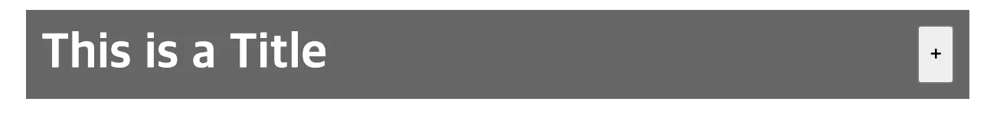
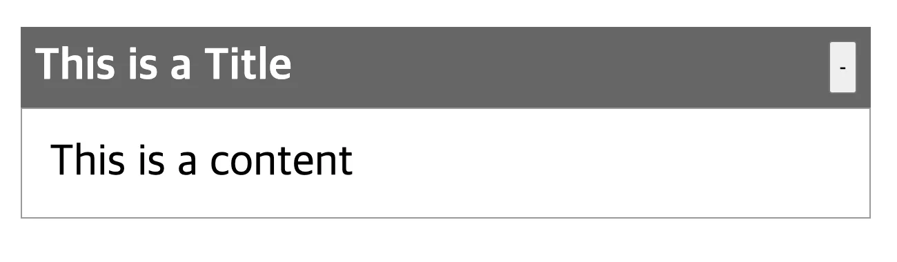
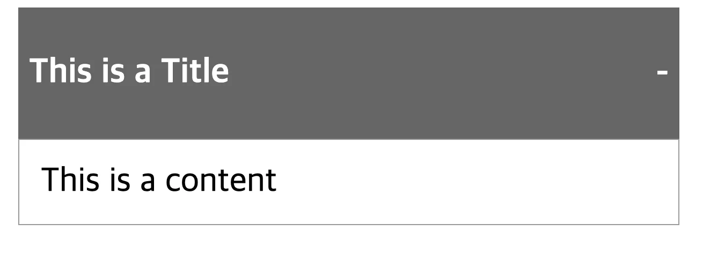

<a id="1c3eda9b0fe181a9a24bf533fa0967e8"></a>

## 아코디언(toggle 창)  실습

---

> 📖 
> 
> <a id="1c3eda9b0fe181bb870cf49508d3d33e"></a>
> 
> 클릭 이벤트를 통해 toggle 창 구현

> ‣

<details>
<summary>View</summary>

- 클릭 전
    

- 클릭 후
    

</details>

<details>
<summary>Tip?</summary>

- 삼항연산자&#58; <code>Boolean state</code> ? <code>truthy</code> &#58; <code>falsy</code>
    <a id="1c3eda9b0fe181f8be5cdfdaacb165e9"></a>

    ```javascript
    <button onClick={handlerOpen}>{isOpen ? "-" : "+"}</button>
    ```

- setter 내부 state 의존성 제거
    <a id="1c3eda9b0fe18109a2c7e4a8fba4f9c2"></a>

    ```javascript
    const handlerOpen = () => {
      setIsOpen((state) => !state);
    };
    ```

    - 위와 같이 실제 state 명칭(<code>isOpen</code>)이 아닌, <code>state</code>라는 명칭을 통해 값을 변경할 수 있다&#46;<br>

- <code>{ Boolean State &#38;&#38; DOM }</code>
    <a id="1c3eda9b0fe181caa223cb05b8019736"></a>

    ```javascript
    {isOpen && (
      <di
        style={{
          border: "1px solid #999",
          padding: 20,
        }}
      >
        This is a content
      </div>
    )}
    ```

    - Boolean state와 <code>&#38;&#38;</code> 연산자를 통해  특정 DOM을 <code>true</code>면 보이게, <code>false</code>면 보이지 않게 설정할 수 있다&#46; 

</details>

<details>
<summary>코드 </summary>

<details>
<summary>&#91; 코드 &#93; App&#46;js</summary>

<a id="1c3eda9b0fe1819e9bc3e9401f4cb643"></a>

```
import Accordion from "./components/Accordion";

function App() {
  return (
    <div style={{ fontSize: "2rem", padding: 30 }}>
      <Accordion title="This is a Title" content="This is a content" />
    </div>
  );
}

export default App;

```

</details>

<details>
<summary>&#91; 코드 &#93; Accordion&#46;js</summary>

<a id="1c3eda9b0fe18159bc52f350ad8c2538"></a>

```javascript
import { useState } from "react";

function Accordion({ title, content }) {
  const [isOpen, setIsOpen] = useState(false);

  const handlerOpen = () => {
    setIsOpen((state) => !state);
  };

  return (
    <div>
      <div
        style={{
          background: "#666",
          color: "white",
          fontWeight: "bold",
          padding: 10,
          display: "flex",
          justifyContent: "space-between",
        }}
      >
        This is a Title
        <button onClick={handlerOpen}>{isOpen ? "-" : "+"}</button>
      </div>

      {isOpen && (
        <div
          style={{
            border: "1px solid #999",
            padding: 20,
          }}
        >
          This is a content
        </div>
      )}
    </div>
  );
}

export default Accordion;

```

</details>

<details>
<summary>&#91; 코드 &#93; Accordion&#46;js</summary>

<a id="1c3eda9b0fe181d2a8f6d78cefe82e4c"></a>

```javascript
import { useState } from "react";

function Accordion({ title, content }) {
  const [isOpen, setIsOpen] = useState(false);

  return (
    <div>
      <div
        style={{
          background: "#666",
          color: "white",
          fontWeight: "bold",
          padding: 10,
          display: "flex",
          justifyContent: "space-between",
        }}
        onClick={() => {
          setIsOpen((state) => !state);
        }}
      >
        <p>This is a Title</p>
        <p>{isOpen ? "-" : "+"}</p>
      </div>

      {isOpen && (
        <div
          style={{
            border: "1px solid #999",
            padding: 20,
          }}
        >
          This is a content
        </div>
      )}
    </div>
  );
}

export default Accordion;

```



</details>

</details>
