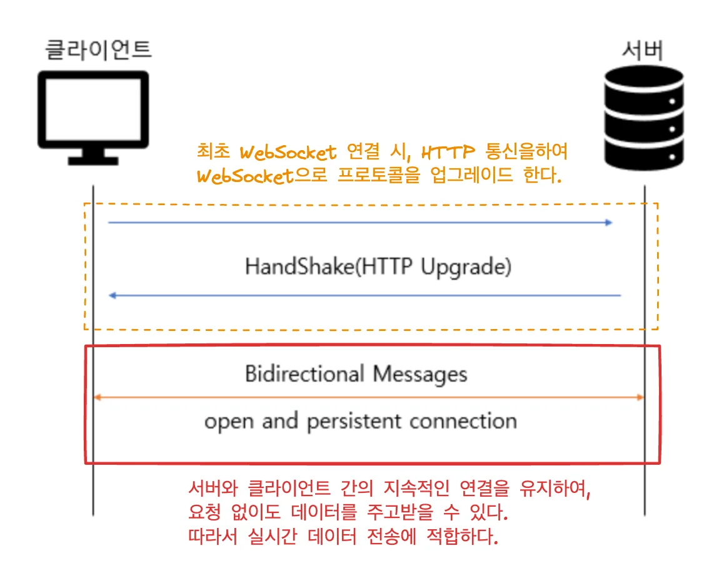
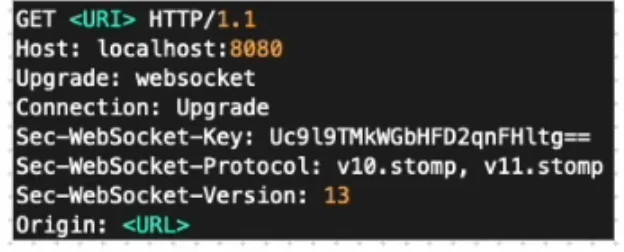
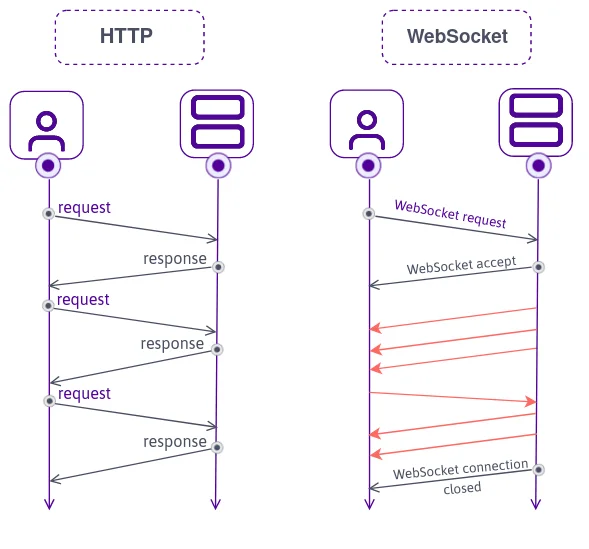

<details>
<summary>reference</summary>

<a id="1c3eda9b0fe1811aa09ef11bccae9497"></a>

‣

<a id="1c3eda9b0fe181e5956df2dd098d7e85"></a>

‣

</details>

<a id="1c3eda9b0fe181efb096f703ce00d319"></a>

## WebSocket

---

> 📖 
> 
> <a id="1c3eda9b0fe1818cb1e1c83dcb73924c"></a>
> 
> <strong><code>WebSocket</code></strong><strong>이란</strong> <u>양방향 실시간 통신</u>을 가능하게 하는 프로토콜이다&#46;
> 
> - <strong><code>WebSocket&#58; </code></strong><code>Connection(연결 유지)</code>, <code>Stateful(상태 유지)</code>
>     - <strong><code>양방향 통신</code></strong><strong>, </strong><strong><code>실시간 통신</code></strong><strong> 가능</strong>
> 
> -  <code>HTTP 통신&#58;</code>  <code>Connectionless(비연결성)</code>, <code>Stateless(무상태)</code>

<details>
<summary>WebSocket 이란?</summary>



<a id="1c3eda9b0fe18188adb6f3340dd7fdf0"></a>

WebSocket은 클라이언트와 서버 간에 <strong><u>양방향 실시간 통신</u></strong>을 가능하게 하는 프로토콜이다&#46; 

<a id="1c3eda9b0fe181b4b642e1094fddd4c2"></a>

HTML5에서 소개되었으며, T<strong><u>CP 기반의 전이중(Full&#45;Duplex) 통신을 지원</u></strong>한다&#46;

- 서버와 클라이언트 간의 지속적인 연결을 유지하여, 요청 없이도 데이터를 주고받을 수 있다&#46; <br>따라서 실시간 데이터 전송에 적합하다&#46;

<a id="1c3eda9b0fe181a78f70f5cc7b801c5f"></a>

초기 연결은 HTTP를 사용하여 Hand Shake 과정을 거친 후 WebSocket 프로토콜로 전환된다 &#46;

<details>
<summary>ex) 초기 HTTP를 사용한 WebSocket 프로토콜 전환(Upgrade)</summary>

- 요청
    

    <a id="1c3eda9b0fe181259e69f66fe1b6f173"></a>

    ```plaintext
    GET /ws HTTP/1.1
    Host: localhost:8080
    Upgrade: websocket
    Connection: Upgrade
    Sec-WebSocket-Key: x3JJHMbDL1EzLkh9GBhXDw==
    Sec-WebSocket-Version: 13
    ```

    - <code>/ws</code>&#58; 웹소캣 연결 엔드포인트 

- 응답&#58; WebSocket 프로토콜 전환
    <a id="1c3eda9b0fe181fc933dcbe022a9a244"></a>

    ```plaintext
    HTTP/1.1 101 Switching Protocols
    Upgrade: websocket
    Connection: Upgrade
    Sec-WebSocket-Accept: HSmrc0sMlYUkAGmm5OPpG2HaGWk=
    ```

</details>

</details>

<details>
<summary><code>HTTP</code>  vs <code>WebSocket</code></summary>



| 특징 | HTTP | WebSocket |
| --- | --- | --- |
| 통신 방식 | 요청&#45;응답 (클라이언트 주도)<br>• Response가 있기 전에 무조건 Request가 있어야 한다 | 양방향 통신 <br>(서버와 클라이언트 모두 데이터 전송 가능) |
| 연결 유지 여부 | 비연결성 <br>(요청마다 새로운 연결 생성<br> 따라서 <code>TCP 연결 &#45; 3 way handshake 비용</code> 발생 ) | 지속적인 연결 유지 <br>(한 번 연결 후 닫힐 때까지 유지) |
| 오버헤드 | 높은 오버헤드 <br>(매번 헤더 포함 요청/응답) | 낮은 오버헤드 <br>(초기 핸드셰이크 후 지속적 데이터 교환) |
| 데이터 전송 속도 | 상대적으로 느림 (매번 연결 설정 필요) | 빠름 (지속적 연결로 대기 시간 감소) |
| 사용 사례 | 정적 리소스 제공, 비동기 요청 처리 | 실시간 채팅, 게임, 주식 거래 등 실시간 데이터 전송 |

</details>

<details>
<summary>WebSocket을 사용해야 하는 이유(장점)는?</summary>

- 새로고침을 누르지 않아도 <strong><u>실시간으로 다른 사용자가 편집한 부분이 자동으로 적용 가능</u></strong>

- 웹소켓은 HTTP와 다르게 <strong><u>상태(Stateful) 프로토콜</u></strong>이다&#46;<br>따라서  클라이언트와 서버가<u> </u><u>한 번 연결되면 같은 연결을 이용해 통신</u>하므로 <u>TCP 커넥션 비용을 아낄 수 있</u>다&#46;
    - <strong><u>트래픽이 빈번하게 요청</u></strong>되는 경우, 해당 <u>통신의 리소스를 절감</u>하기 위해<strong> </strong><strong><u>WebSocket을 사용</u></strong>한다&#46; 

    - HTTP 사용시 필요없이 발생되는 HTTP와 TCP 연결 트래픽을 피할 수 있다

    <details>
    <summary>TCP 커넥션 &#45; 3 Way HandShake</summary>

    

    <a id="1c3eda9b0fe18139bf3fcd11a4e15ba8"></a>

     

    </details>

- <strong><u>Web Socket</u></strong>은 HTTP와 같은 <strong><u>포트(80)을 사용</u></strong>하기에 기업용 어플리케이션에 적용할 때 방<strong><u>화벽은 재설정 하지 않아도 되는 장점</u></strong>이 있다&#46;

</details>

<details>
<summary>WebSocket 사용사례</summary>

- 게이트웨이 패턴 ( 체인 게이트웨이 ) 

- 주식, 코인 거래와 같은 트레이딩 시스템

- SNS 애플리케이션

</details>

<details>
<summary>추가) <code>HTTP 지속 연결 ( Persistent Connections)</code> vs <code>WebSocket</code> </summary>


</details>

<details>
<summary>질문) WebSocket이 stateful 하다고 하는데, 여기서의 state는 어떤 값을 가리키는가?</summary>

- <strong>웹소켓의 Stateful 의미</strong>
    - 웹소켓은 한 번 연결이 맺어진 이후 동일한 연결을 유지한다&#46;

    -  이는 HTTP처럼 요청&#45;응답 주기가 끝날 때마다 연결을 끊는 방식이 아닌, <br><strong><u>지속적으로 열려 있는 상태로 데이터를 주고받는다는 의미</u></strong>이다&#46;

    - 여기서 

</details>

<details>
<summary>추가 질문) 그렇다면 stateful의 state 값에 유저 정보를 포함할 수 있는가?</summary>

- 웹소켓 자체는 클라이언트와 서버 간의 지속적인 연결만을 제공하며, 유저의 상태 정보(예&#58; <code>from</code>, <code>to</code>)는 별도로 관리해야 한다&#46;
    <a id="1c3eda9b0fe18121a6c7dc61de6fd4c6"></a>

    유저 상태 정보 관리<br>웹소켓 자체는 클라이언트와 서버 간의 지속적인 연결만을 제공하며, 유저의 상태 정보(예&#58; <code>from</code>, <code>to</code>)는 별도로 관리해야 합니다&#46; 상태 정보는 일반적으로 다음과 같은 방식으로 처리됩니다&#58;<br>1&#46;	클라이언트 측&#58;<br>•	클라이언트가 웹소켓 연결을 생성할 때, 사용자 식별 정보를 포함한 메시지를 서버로 전송합니다(예&#58; 사용자 ID, 채팅방 ID)&#46;<br>•	JavaScript의 <code>WebSocket</code> 객체를 사용하여 메시지를 전송할 수 있습니다&#46;

    - 클라이언트

    <a id="1c3eda9b0fe181fb9f1deb80dbd5de8b"></a>

    ```javascript
    // ex 1
    const socket = new WebSocket("ws://example.com/socket");
    socket.onopen = () => {
        socket.send(JSON.stringify({ type: "connect", userId: "user123", roomId: "room456" }));
    };

    // ex 2
    socket.send(JSON.stringify({ from: "user123", to: "user456", message: "Hello!" }));
    ```

- 서버
    <a id="1c3eda9b0fe18126a5efcd180a831daf"></a>

    ```javascript
    @OnMessage
    public void handleMessage(Session session, String message) {
        // JSON 메시지 파싱 후 상태 저장
        JSONObject json = new JSONObject(message);
        String userId = json.getString("userId");
        String roomId = json.getString("roomId");
        
        // 상태 저장 로직 (예: Map에 저장)
        userSessions.put(session.getId(), new UserState(userId, roomId));
    }

    ```

    <a id="1c3eda9b0fe18140a1d0c3de1aac3d9a"></a>

    ```javascript
    public void sendMessage(String toUserId, String message) {
        Session session = userSessions.get(toUserId);
        if (session != null) {
            session.getBasicRemote().sendText(message);
        }
    }
    ```

<a id="1c3eda9b0fe181e2940eca77c2a69ffb"></a>

```plaintext
3.	상태 정보 활용:
•	서버는 저장된 상태 정보를 사용하여 메시지를 적절한 클라이언트로 라우팅합니다.
•	예를 들어, 특정 채팅방에 있는 모든 사용자에게 메시지를 전송하려면 해당 방에 속한 사용자 세션을 조회하여 메시지를 브로드캐스트합니다.
4.	상태 동기화:
•	연결이 끊어지거나 재연결되는 상황에서도 상태를 유지하려면 Redis나 데이터베이스 같은 외부 스토리지를 활용할 수 있습니다.


`from`과 `to` 정보 처리
	•	클라이언트에서 전송: 메시지에 발신자(`from`)와 수신자(`to`) 정보를 포함해 서버로 전송합니다.
```

<a id="1c3eda9b0fe181c3ba64feffb56a42db"></a>

실제 구현 시 주의점<br>•	연결 관리&#58; 클라이언트의 연결 상태를 주기적으로 확인하고 끊어진 연결을 정리해야 합니다&#46;<br>•	보안&#58; 민감한 데이터를 주고받는 경우, WSS(WebSocket Secure)를 사용하여 암호화된 통신을 보장해야 합니다&#46;<br>•	확장성&#58; 다수의 클라이언트를 처리하기 위해 Redis와 같은 Pub/Sub 시스템을 도입해 확장성을 확보할 수 있습니다&#46;

</details>
