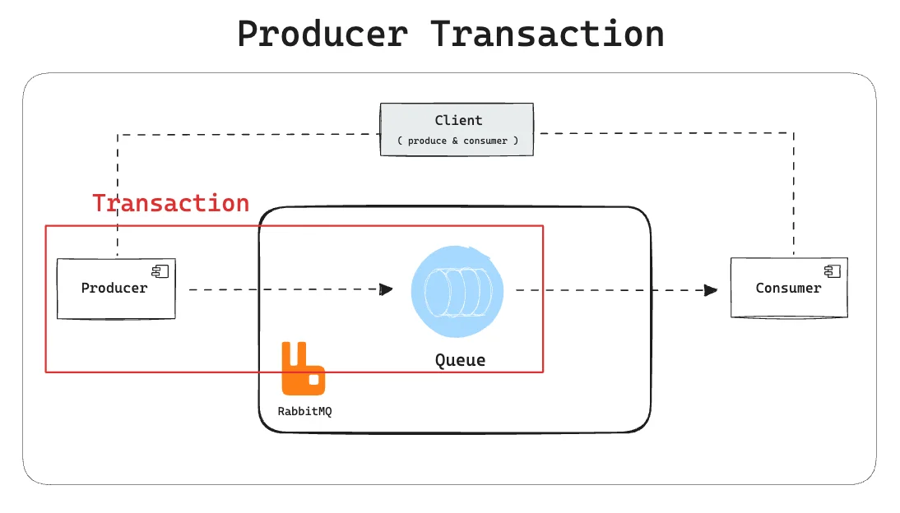
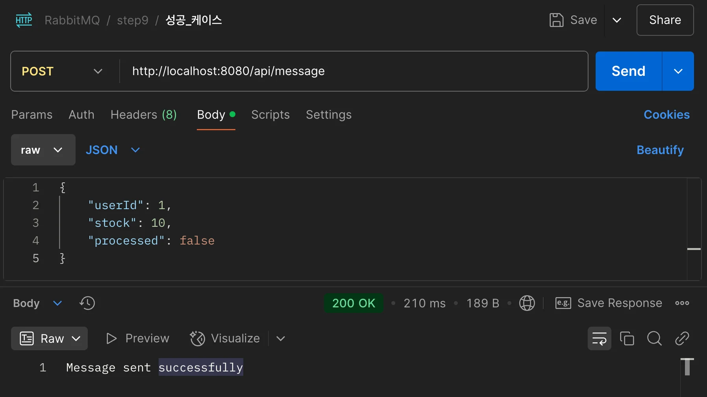
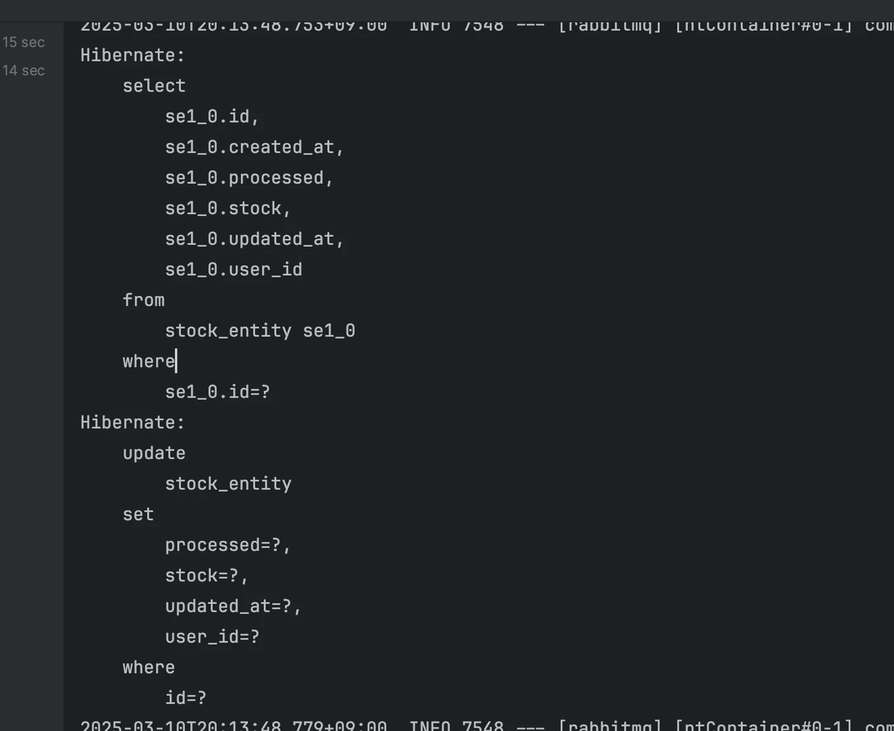
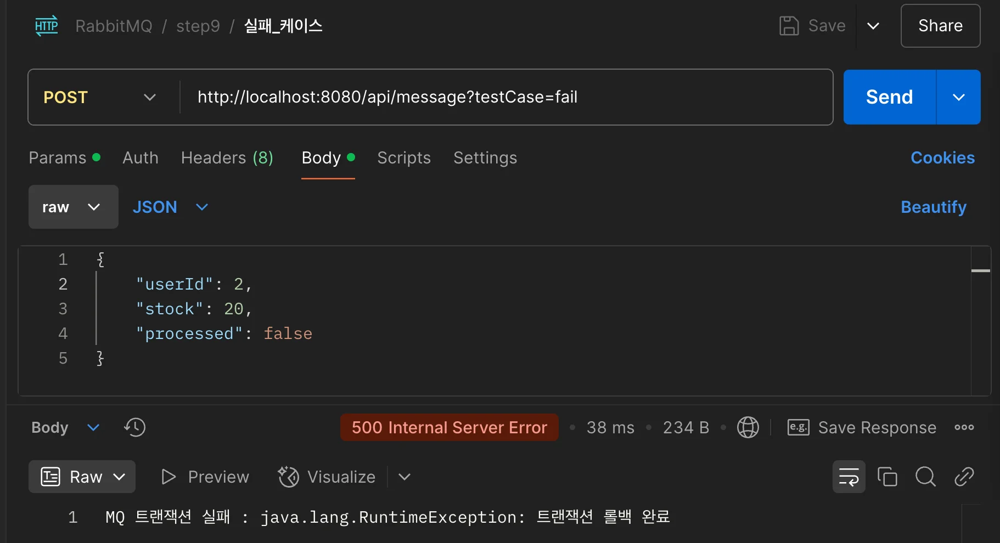
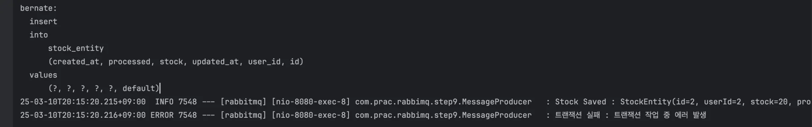
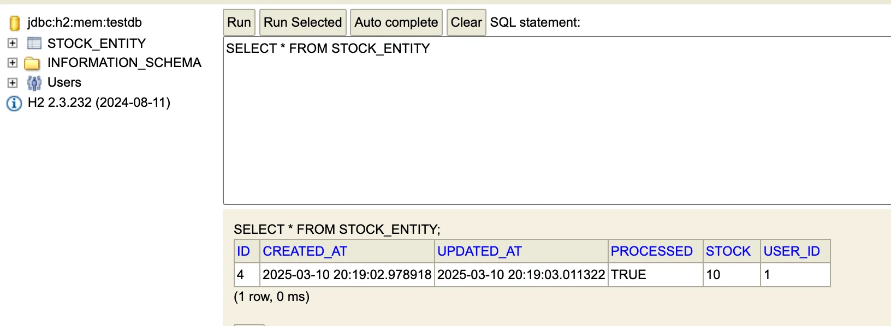

<a id="1c3eda9b0fe181ca99e3da5f8f4b20e2"></a>

## 1&#46; 명시적인 큐 트랜잭션 처리 &#91; 권장 ❌ &#93;

---



<a id="1c3eda9b0fe181629b26f669ca69a393"></a>

### 코드

---

[step9&#58; &#91;Producer Transaction&#93; DB 연동 메시지 큐의 Transaction  처리 · gyungsubLee/RabbitMQ&#95;prac&#64;2122d24]()

<details>
<summary><code>Repository</code>&#58; &#91; 코드 &#93; StockRepository</summary>

<a id="1c3eda9b0fe1815d8621e19f1275a69c"></a>

```java
package com.prac.rabbimq.step9;

import org.springframework.data.jpa.repository.JpaRepository;

public interface StockRepository extends JpaRepository<StockEntity, Long> {
}
```

</details>

<details>
<summary><code>JpaAutiding</code>&#58; <strong><code>createdAt</code></strong>, <strong><code>updatedAt</code></strong> 자동 생성</summary>

<details>
<summary>&#91; 코드 &#93; RabbimqApplication &#45; <code>&#64;EnableJpaAuditing</code> 적용</summary>

<a id="1c3eda9b0fe181bea598f6d4eeedbfab"></a>

```java
@SpringBootApplication
@EnableJpaAuditing
@ComponentScan(basePackages = "com.prac.rabbimq.step9")
public class RabbimqApplication {

	public static void main(String[] args) {
		SpringApplication.run(RabbimqApplication.class, args);
	}
}

```

</details>

<details>
<summary>&#91; 코드 &#93; BaseEntity &#45; createdAt, updatedAt 자동 생성</summary>

<a id="1c3eda9b0fe181fd98a7ebdc420e3bf1"></a>

```java
import jakarta.persistence.Column;
import jakarta.persistence.EntityListeners;
import jakarta.persistence.MappedSuperclass;
import lombok.Getter;
import org.springframework.data.annotation.CreatedDate;
import org.springframework.data.annotation.LastModifiedDate;
import org.springframework.data.jpa.domain.support.AuditingEntityListener;

import java.time.LocalDateTime;

@MappedSuperclass
@EntityListeners(AuditingEntityListener.class)
@Getter
public class BaseEntity {

    @CreatedDate
    @Column(updatable = false)
    private LocalDateTime createdAt;

    @LastModifiedDate
    private LocalDateTime updatedAt;


    public void updateTime() {
        updatedAt = LocalDateTime.now();
    }
}
```

</details>

</details>

<details>
<summary><code>DTO</code></summary>

<details>
<summary>&#91; 코드 &#93; StockReqDto</summary>

<a id="1c3eda9b0fe18158b563e22c6c11e747"></a>

```java
import com.prac.rabbimq.step9.StockEntity;
import lombok.Getter;
import lombok.RequiredArgsConstructor;
import lombok.ToString;

@Getter
@ToString
@RequiredArgsConstructor
public class StockReqDto {

    private final Long userId;
    private final int stock;
    private final boolean processed;

    public StockEntity toEntity() {
        return StockEntity.builder()
                .userId(userId)
                .stock(stock)
                .processed(processed)
                .build();
    }
}

```

</details>

<details>
<summary>&#91; 코드 &#93; StockResDto</summary>

<a id="1c3eda9b0fe181bc875adcbbf75a7ebf"></a>

```java
import lombok.Builder;
import lombok.Getter;

import java.time.LocalDateTime;

@Getter
public class StockResDto {

    private final Long id;
    private final Long userId;
    private final int stock;
    private final boolean processed;
    private final LocalDateTime createdAt;
    private final LocalDateTime updatedAt;

    @Builder
    public StockResDto(Long id, Long userId, int stock, boolean processed, LocalDateTime createdAt, LocalDateTime updatedAt) {
        this.id = id;
        this.userId = userId;
        this.stock = stock;
        this.processed = processed;
        this.createdAt = createdAt;
        this.updatedAt = updatedAt;
    }
}
```

</details>

</details>

<details>
<summary><code>Entity</code>&#58; &#91; 코드 &#93; StockEntity</summary>

<a id="1c3eda9b0fe18197b457e9024dc49352"></a>

```java
package com.prac.rabbimq.step9;

import com.prac.rabbimq.step9.dto.StockResDto;
import jakarta.persistence.*;
import lombok.*;


@Entity
@ToString
@Getter
@NoArgsConstructor(access = AccessLevel.PROTECTED)
public class StockEntity extends BaseEntity {

    @Id
    @GeneratedValue(strategy = GenerationType.IDENTITY)
    private Long id;
    private Long userId;
    private int stock;
    private boolean processed;

    @Builder
    public StockEntity(Long userId, int stock, boolean processed) {
        this.userId = userId;
        this.stock = stock;
        this.processed = processed;
    }

    public void msgReceiveProcessed() {
        this.processed = true;
        this.updateTime();
    }

    public StockResDto toDto() {
        return StockResDto.builder()
                .id(id)
                .userId(userId)
                .stock(stock)
                .processed(processed)
                .createdAt(getCreatedAt())
                .updatedAt(getUpdatedAt())
                .build();
    }
}
```

</details>

<details>
<summary><code>Config</code>&#58; &#91; 코드 &#93; RabbitMQConfig</summary>

<a id="1c3eda9b0fe1815cb0b7c7bc4e4e3909"></a>

```java
package com.prac.rabbimq.step9;

import org.springframework.amqp.core.Queue;
import org.springframework.amqp.rabbit.connection.ConnectionFactory;
import org.springframework.amqp.rabbit.core.RabbitTemplate;
import org.springframework.amqp.support.converter.Jackson2JsonMessageConverter;
import org.springframework.amqp.support.converter.MessageConverter;
import org.springframework.context.annotation.Bean;
import org.springframework.context.annotation.Configuration;


@Configuration
public class RabbitMQConfig {

    @Bean
    public Queue queue() {
        return new Queue("transactionQueue", true);
    }

    @Bean
    public MessageConverter messageConverter() {
        return new Jackson2JsonMessageConverter();
    }

    @Bean
    public RabbitTemplate rabbitTemplate(ConnectionFactory connectionFactory) {
        RabbitTemplate rabbitTemplate = new RabbitTemplate(connectionFactory);
        rabbitTemplate.setMessageConverter(messageConverter());
        rabbitTemplate.setChannelTransacted(true); // 트랜잭션 활성화

        return rabbitTemplate;
    }
}

```

</details>

<details>
<summary><code>Producer</code>&#58; &#91; 코드 &#93; MessageProducer</summary>

<a id="1c3eda9b0fe181ecb80ed41c9505ca8a"></a>

```java
package com.prac.rabbimq.step9;

import com.prac.rabbimq.step9.dto.StockReqDto;
import jakarta.transaction.Transactional;
import lombok.RequiredArgsConstructor;
import lombok.extern.slf4j.Slf4j;
import org.springframework.amqp.rabbit.core.RabbitTemplate;
import org.springframework.stereotype.Component;

@Slf4j
@Component
@RequiredArgsConstructor
public class MessageProducer {

    private final StockRepository stockRepository;
    private final RabbitTemplate rabbitTemplate;

    @Transactional
    public void sendMessage(StockReqDto stockReqDto, String testCase) {
        rabbitTemplate.execute(channel -> {
            try {
                channel.txSelect(); // 트랜잭션 시작
                StockEntity stockEntity = stockReqDto.toEntity();
                StockEntity savedStockEntity = stockRepository.save(stockEntity);

                log.info("Stock Saved : {}", savedStockEntity);

                // 메세지 발행
                rabbitTemplate.convertAndSend("transactionQueue", savedStockEntity);

                if ("fail".equalsIgnoreCase(testCase)) {
                    throw new RuntimeException("트랜잭션 작업 중 에러 발생");
                }

                channel.txCommit();
                log.info("message.producer:트랜잭션 정상 처리");
            } catch (Exception e) {
                log.error("트랜잭션 실패 : {}", e.getMessage());
                channel.txRollback();
                throw new RuntimeException("트랜잭션 롤백 완료 ", e);
            } finally {
                if (channel != null) {
                    try {
                        channel.close();
                    } catch (Exception e) {
                        e.printStackTrace();
                    }
                }
            }
            return null;
        });
    }

}

```

</details>

<details>
<summary><code>Consumer</code>&#58; &#91; 코드 &#93; MessageConsumer</summary>

<a id="1c3eda9b0fe181869b34f3d39eb4d498"></a>

```java
package com.prac.rabbimq.step9;

import com.prac.rabbimq.step9.dto.StockReqDto;
import com.prac.rabbimq.step9.dto.StockResDto;
import lombok.RequiredArgsConstructor;
import lombok.extern.slf4j.Slf4j;
import org.springframework.amqp.rabbit.annotation.RabbitListener;
import org.springframework.stereotype.Component;

@Component
@Slf4j
@RequiredArgsConstructor
public class MessageConsumer {
    private final StockRepository stockRepository;

    @RabbitListener(queues = "transactionQueue")
    public void receiveTransaction(StockEntity stockEntity) {
        log.info("# received message  = {}", stockEntity.toString());

        try {
            stockEntity.msgReceiveProcessed();
            stockRepository.save(stockEntity);
            log.info("# StockENtity 저장 완료");

            // TODO: 클라이언트로 전송
            StockResDto stockResDto = stockEntity.toDto();
            // simplMessageTemplate.convertAndSend("클라이언트 엔드포인트", )

        } catch (Exception e) {
            log.error("MessageConsumer - stockEntity 저장 오류: {}", e.getMessage());
            throw e;
            // TODO: 메세지 데드레터 큐로 이동
        }
    }
}

```

</details>

<details>
<summary><code>Controller</code>&#58; &#91; 코드 &#93; TransactionController</summary>

<a id="1c3eda9b0fe181caaef0da78739e1074"></a>

```java
package com.prac.rabbimq.step9;

import com.prac.rabbimq.step9.dto.StockReqDto;
import lombok.RequiredArgsConstructor;
import lombok.extern.slf4j.Slf4j;
import org.springframework.http.HttpStatus;
import org.springframework.http.ResponseEntity;
import org.springframework.web.bind.annotation.*;

@Slf4j
@RestController
@RequestMapping("/api/message")
@RequiredArgsConstructor
public class TransactionController {
    private final MessageProducer messageProducer;

    @PostMapping
    public ResponseEntity<String> sendMessage(@RequestBody StockReqDto stockReqDto,
                                              @RequestParam(required = false, defaultValue = "success") String testCase) {

        log.info("Send Message : {}", stockReqDto.toString());

        try {
            messageProducer.sendMessage(stockReqDto, testCase);
            return ResponseEntity.ok("Message sent successfully");
        } catch (RuntimeException e) {
            return ResponseEntity.status(HttpStatus.INTERNAL_SERVER_ERROR).body("MQ 트랜잭션 실패 : " + e.getMessage());
        }
    }
}
```

</details>

---

<details>
<summary>포스트맨 호출</summary>

<details>
<summary>성공 케이스</summary>





</details>

<details>
<summary>실패 케이스</summary>





</details>

</details>

<details>
<summary>DB 확인</summary>



- 트랜잭션 실패 시, rollback 되어 DB 저장되지 않아, 조회할 수 없는 것을 확인 가능하다&#46; 

</details>

<a id="1c3eda9b0fe181f7a0e5d5f0392e021c"></a>

### <strong>트랜잭션 메시징의 한계</strong>

---

1. <strong><code>성능 오버헤드</code></strong>
    - 트랜잭션은 추가적인 작업(예&#58; 디스크 동기화)을 요구 하므로 성능이 떨어질 수 있다&#46;

    - <strong>대량 메시지 처리</strong>가 필요한 경우 부적합하다&#46;

1. <strong><code>복잡성</code></strong>
    - 트랜잭션 처리를 잘못 구성하면 메시지가 중복 처리되거나 손실될 가능성 증가한다&#46;

1. <code>분산 트랜잭션을 완벽하게 보장하지는 않음</code>
    - <strong><u>데이터베이스 작업과 메시지 전송 사이</u></strong>의 <strong>완벽한 원자성</strong>을 위해서는 <strong><u>추가적인 메커니즘</u></strong>(ex&#46; <code>2 Phase Commit</code> 또는 <code>보상 트랜잭션</code>)이 필요함

> ✏️ 
> 
> <a id="1c3eda9b0fe1816aa5f2d94e768cb09b"></a>
> 
> <strong> </strong><strong>AMQP Confirm Selec</strong><strong>t 추천</strong>
> 
> - RabbitMQ에서는 트랜잭션 대신 <strong><u>Publisher Confirms(AMQP Confirm Select) </u></strong>방식이 더 효율적
> 
> <a id="1c3eda9b0fe181af9d9ded7790d1396a"></a>
> 
>        ⇒ <a href="../2.%20Publisher-confirms%EC%9D%84%20%EC%9D%B4%EC%9A%A9%ED%95%9C%20%ED%8A%B8%EB%9E%9C%EC%9E%AD%EC%85%98%20%EC%B2%98%EB%A6%AC-e4f60dd1e2f7/index.md">페이지</a>
