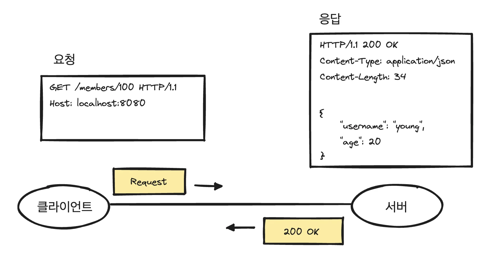
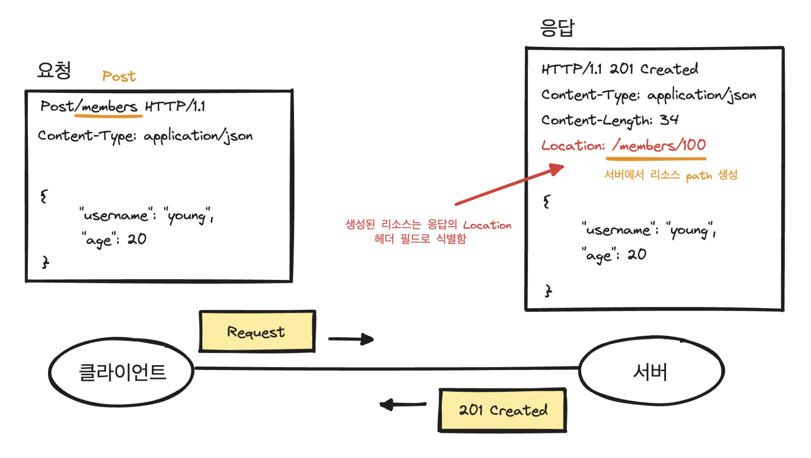
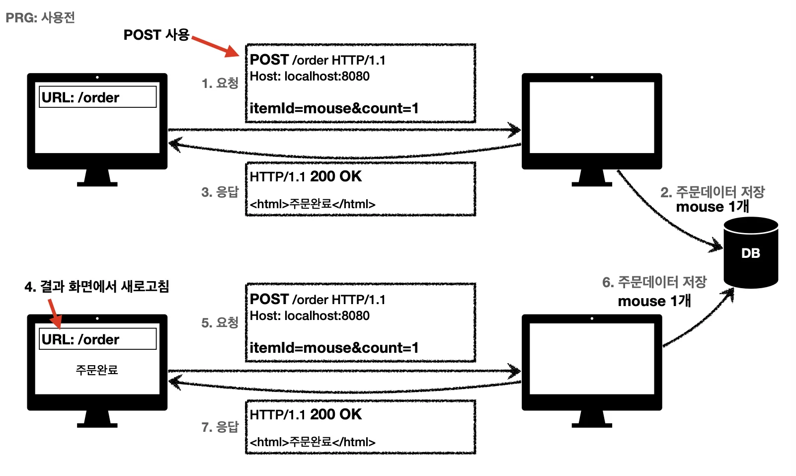
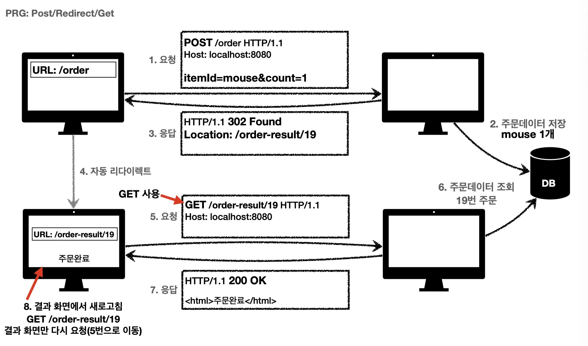

> 📌 1xx ( Informational )&#58; 요청이 수신되어 처리중
> 
> 
> 
> 2xx ( Successful )&#58; 요청 정상 처리 
> 
> 
> 
> 3xx ( Redirection )&#58; 요청을 완료하려면 추가 행동이 필요
> 
> 
> 
> 4xx ( Client Error )&#58; 클라이언트 오류, 잘못된 문법 등으로 서버가 요청을 수행할 수 없음
> 
> 
> 
> 5xx ( Server Error )&#58; 서버 오류, 서버가 정상 요청 처리하지 못함

# 2xx &#45; 성공

### 200  OK  

> 요청 성공 

### 201 Created

> 요청 성공해서 새로운 리소스가 생성됨

 POST 메시지 → 서버에서 리소스 위치(path) 생성 및 관리 

    → 응답 메서지의 Location 헤더 필드로 식별함

### 202 Accepted   → 거의 안씀

> 요청이 접수되었으나 처리가 완료되지 않았음 → 잘 사용 X

특정 시간에, 나중에 실행되어야 하는 경우 

배치 처리 같은 곳에서 사용

ex) 요청 접수 후 1시간 뒤에 배치 프로세스가 요청을 처리함 

ex) 설정한 시간마다 반복적으로 동작하는 특정 작업&#46;

### 204 No Content

> 서버가 요청을 성공적으로 수행 했지만, 응답 페이로드 본문에 보낼 데이터가 없음

- 웹 문서 편집기에서  저장 시, 데이터가 POST로 서버로 넘어감 
    

    → 응답에 <strong><u>정상 응답</u></strong><code>(204)</code> 상태만 있어도 됨, 본문 내용 전송할 필요 없음

    

    이때 사용함, <code>204 메시지(2xx)</code>만으로 <strong><u>성공을 인식</u></strong>할 수 있다&#46;

# 3xx &#45; 리다이렉션 

## 영구 리다이렉션 ( 301, 308 )

> 리소스의 URI가 완전히(영구적으로) 바뀜 → 이전 URL 사용 X (검색 엔진 등에서도 변경 인지) 

### 301 Moved Permanently

> 리다이렉트 시 요청 메서드가 GET으로 변하고, 본문 제거 될 수 있음<strong>(MAY)</strong>

### 308 Permanent Redirect

> 리다이텍트 시 <strong><u>요청 메서드</u></strong>와 <strong><u>본문 </u></strong><code>유지</code>(처음 POST를 보내면 리다이렉트도 POST 유지)

## 일시적인 리다이렉션 (302, 307, 303 )

> 리소스의 URI가 일시적으로 변경됨 (검색 엔진 등에서 URL 변경 X )

## PRG&#58; Post/Redirect/Get

> <strong>Error)</strong><strong> </strong>POST 사용으로 인한 중복 주문 

POST로 주문후에 웹 브라우저를 새로고침하면?

→ 새로고침은 다시 요청 → 중복 주문이 될 수 있다&#46;

> <code>POST</code>로 주문 후에 <strong><u>새로 고침으로 인한 중복 주문 방지</u></strong>

POST로 주문후에 <strong><u>주문 결과 화면을 </u></strong><strong><u><code>GET</code></u></strong><strong><u> 메서드로 리다이렉트</u></strong> <strong>새로고침해도 결과 화면을 </strong><strong><code>GET</code></strong><strong>으로 조회</strong> 중복 주문 대신에 <strong><u>결과 화면만 GET으로 다시 요청</u></strong>

### 302 Found 

> 리다이텍트 시 요청 메서드가 <strong><u>GET으로 변</u></strong>하고, 본문이 제거될 수 있음<strong>(MAY)</strong>
> 
> 
> 
> ( 307, 303 더 적절한 사용이나, 여전히 302도 실무에서 많이 사용됨 )

### 307 Temporary Redirect

> <strong>리다이렉트시 </strong><strong><code>요청 메서드</code></strong><strong>와 </strong><strong><code>본문</code></strong><strong> </strong><strong>유지</strong><strong>(요청 메서드를 변경하면 안된다&#46; MUST NOT)</strong>

### 303 See Other

> 리다이렉트 시, 요청 메서드가 GET으로 변경 

### 🤔 무엇을 쓰는 것이 올바른가?

> 302 Found &#45;&#62; GET으로 변할 수 있음 307 Temporary Redirect &#45;&#62; 메서드가 변하면 안됨 303 See Other &#45;&#62; 메서드가 GET으로 변경

처음 302 스펙의 의도는 HTTP 메서드를 유지하는 것이었다&#46;

그런데 대부분 웹 브라우저들이 동작하면서 GET으로 변경되었다&#46;(일부는 다르게 동작)

그래서 모호한 302를 대신하는 명확한 307, 303이 나오게 되었다&#46; (이와 유사하게 301 대응으로 308도 등장힘)

307, 303을 권장하지만 현실적으로 이미 많은 애플리케이션 라이브러리들이 302를 기본값으로 사용하고 있다&#46;따라서 302도 그냥 사용 ( 자동 리다이렉션시 에 GET으로 변해도 되면 그냥 302를 사용해도 큰 문제 없음 )

## 기타 리다이렉션 ( 304 )

- 300 Muptiple Choices → 안씀

### 304 Not Modifled

캐시를 목적으로 사용 클라이언트에게 리소스가 수정되지 않았음을 알려준다&#46; 따라서 클라이언트 로컬PC에 저장된 캐시를 재사용한다&#46; (캐시로 리다이텍트 한다&#46;) 

304 응답은 응답에 메세지 바디를 포함하면 안된다&#46; (로컬 캐시를 사용해야 하므로)

조건부 GET, HEAD 요청 시 사용

# 4xx &#45; Client Error

> 클라이언트의 요청에 잘못된 문법 등으로 서버가 요청을 수행할 수 없음

⇒ <strong>클라이언트가 이미 잘못된 요청, 데이터를 보내고 있기 때문에, 똑같은 요청 재시도 시 </strong>→ <code>실패</code> 

## 400 Bad Request

> 클라이언트가 잘못된 요청 보냄 → 서버가 요청을 처리 못함

요청 구문, 메시지 등등 오류

→  클라이언트는 요청 내용을 다시 검토하고, 보내야함 → 예) 요청 파라미터가 잘못되거나, API 스펙이 맞지 않을 때

## 401 Unauthorized

> 클라이언트가 해당 리소스에 대한 인증이 필요함

인증(Authentication) 되지 않음

401 오류 발생 시 응답에 <code>WWW&#45;Authenticate</code> 헤더와 함께 인증 방법을 설명

> ⚠️ <strong>참고</strong><strong> </strong>인증(Authentication)&#58; 본인이 누구인지 확인, (로그인) 인가(Authorization)&#58; 권한부여 (ADMIN 권한처럼 특정 리소스에 접근할 수 있는 권한, 인증이 있어야 인가가 있음)
> 
> > 오류 메시지가 Unauthorized 이지만 인증 되지 않음 (이름이 아쉬움)

## 403 Forbidden

> 서버가 요청을 이해했지만 승인을 거부함

주로 인증 자격 증명은 있지만, 접근 권한이 불충분한 경우 ex) 어드민 등급이 아닌 사용자가 로그인은 했지만, 어드민 등급의 리소스에 접근하는 경우

## 404 Not Found

> 요청 리소스를 찾을 수 없음 

요청 리소스가 서버에 없거나 

클라이언트가 권한이 부족한 리소스에 접근하여 해당 리소스를 숨기고 싶을 때 발생됨

# 5xx &#45; Server Error

> 서버 문제로 오류 발생 서버에 문제가 있기 때문에 재시도 하면 성공할 수도 있음 (복구 등) 

## 500  Internal Server Error

> 서버 문제로 오류 발생 ( 애매 → 500 오류 )

##  503  Service Unavailable

> 서비스 이용 불가

서버가 일시적인 과부하 또는 예정된 작업으로 잠시 요청을 처리할 수 없음

Retry&#45;After 헤더 필드로 얼마 뒤에 복구되는지 보낼 수도 있음
