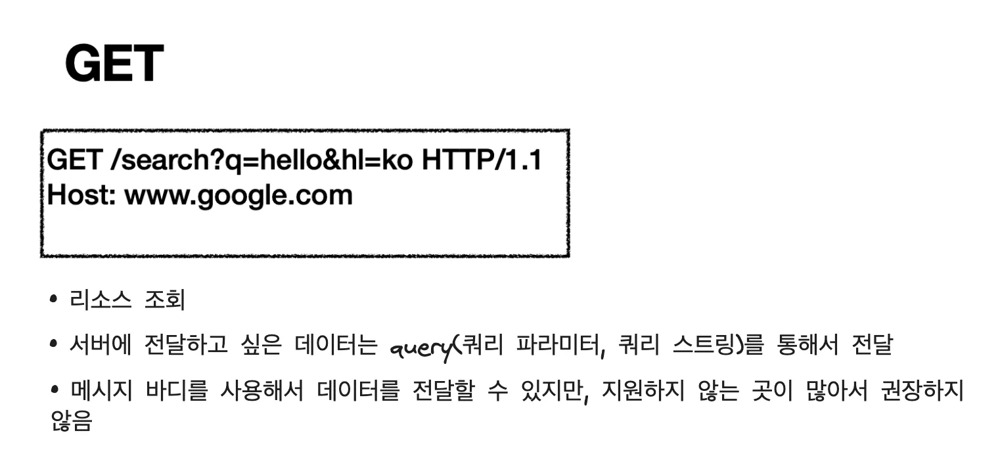
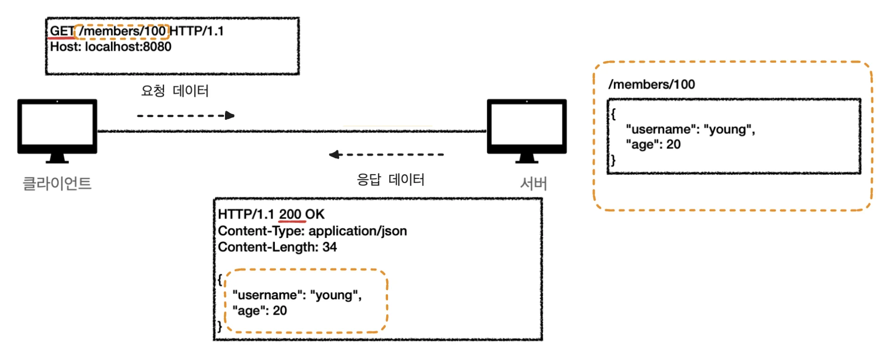
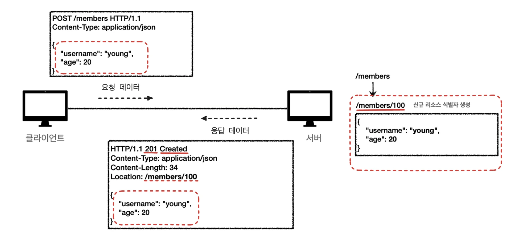
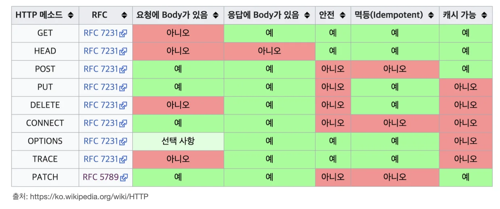

<a id="1c3eda9b0fe1812592f8c544a511c522"></a>

# API URI 설계

> 📌 <strong>회원 정보 관련 API 만들기</strong>
> 
> - 회원 목록 조회
> 
> -  회원 조회
> 
> -  회원 등록
> 
> -  회원 수정
> 
> -  회원 삭제 

<a id="1c3eda9b0fe1815f8c37ed25197aea40"></a>

### URI 설계 시 가장 중요한 것은 리소스의 식별이다&#46; 

<details>
<summary>🧐 ’리소스’의 의미란?</summary>

<a id="1c3eda9b0fe181fcabfbf93f046d66af"></a>

회원을 등록하고, 수정하고, 조회하는 것이 리소스가 아닌<br>’<strong>회원</strong>’이라는 개념 자체가 <strong>리소스</strong>이다&#46; 

<a id="1c3eda9b0fe1818caad7e415ce0cf5f1"></a>

ex)  돈을 벌다, 돈을 쓰다&#46;  → ‘돈’  즉, 행위의 주체(명사) 

<a id="1c3eda9b0fe181dab46cded14791222e"></a>

ex) 스타크래프트&#45;scv&#58; 미네랄을 캐다 → ‘미네랄’

</details>

<a id="1c3eda9b0fe181f8a415ea4c8a6bd62a"></a>

회원이라는 리소스만 식별도록, <strong>회원 리소스(명사)</strong>를 <strong>URI 매핑</strong>하여 설계해야 한다&#46;

<details>
<summary>ex) 잘못된 API URL 설계 </summary>

- 회원 목록 조회&#58;  /read&#45;member&#45;list

- 회원 조회&#58;  /read&#45;member&#45;by&#45;id

-  회원 등록&#58;  /create&#45;member

- 회원 수정&#58;  /update&#45;member

- 회원 삭제&#58;  /delete&#45;member

</details>

<a id="1c3eda9b0fe181a186e1d30e59214cde"></a>

### 회원 리소스 식별하여 API URI 설계 

- <strong>회원</strong> 목록 조회&#58; /<strong>members</strong>

- <strong>회원</strong> 조회&#58; /<strong>members </strong>/ {id}       

- <strong>회원</strong> 등록&#58; /<strong>members </strong>/ {id}   

- <strong>회원</strong> 수정&#58; /<strong>members </strong>/ {id}   

- <strong>회원</strong> 삭제&#58;  /<strong>members </strong>/ {id}  

<a id="1c3eda9b0fe18140971fdbc64914ed4f"></a>

             &#58; 어떻<strong>게 구분할 것인가? </strong>

> URI가 회원 리소스만을 식별하게 설계<br>그러나 <strong>조회, 등록, 수정, 삭제</strong> 등 행위(동사)에 대한 <strong><u>구분이 되지 않</u></strong>는다&#46; <br>여기서 <strong><u>HTTP 메서드</u></strong>를 사용하여 행위를 식별한다&#46; 

<a id="1c3eda9b0fe1815e8dd1d485d4ab0f21"></a>

# HTTP 메서드

---

<a id="1c3eda9b0fe181379863f661e4ab6952"></a>

### 주요 메서드 

- <strong>GET</strong>&#58; 리소스 조회

- <strong>POST</strong>&#58; 요청 데이터 처리, 주로 등록에 사용

- PUT&#58; 리소스를 대체, 해당 리소스가 없으면 생성

- PATCH&#58; 리소스 부분 변경

- DELETE&#58; 리소스 삭제

<details>
<summary>기타 메서드</summary>

- <strong>HEAD&#58;</strong> GET과 동일하지만 메시지 부분을 제외하고, 상태 줄과 헤더만 반환

- <strong>OPTIONS&#58;</strong> 대상 리소스에 대한 통신 가능 옵션(메서드)을 설명(주로 CORS에서 사용)

- <strong>CONNECT&#58;</strong> 대상 리소스로 식별되는 서버에 대한 터널을 설정

- <strong>TRACE&#58;</strong> 대상 리소스에 대한 경로를 따라 메시지 루프백 테스트를 수행

</details>

<a id="1c3eda9b0fe181b79c82e88f4cd01f74"></a>

## GET





<a id="1c3eda9b0fe18123a6f7d937ce0f28f9"></a>

## POST




<a id="1c3eda9b0fe181b8a165dc3e49a03098"></a>

## PUT

> 📌 <strong>정리</strong>
> 
> <a id="1c3eda9b0fe181b09343e5f33b3112b7"></a>
> 
> ### 리소스 대체 
> 
> <a id="1c3eda9b0fe181d9b1b3ed6d72d89878"></a>
> 
> 리소스가 있으면 대체(덮어쓰기), 리소스가 없으면 생성 
> 
> <a id="1c3eda9b0fe1814c9a4afd6c033105ef"></a>
> 
> ### 클라이언트가 리소스 식별
> 
> <a id="1c3eda9b0fe18179bc96d7f653f8af13"></a>
> 
> 클라이언트가 리소스 위치를 알고 URI 지정

> ⚠️ <strong>POST 와 PUT 차이</strong>
> 
> <a id="1c3eda9b0fe181df865fde6f5758e377"></a>
> 
> <code>POST</code>의 경우, 서버에서 해당 리소스의 path를 직접 할당하고 관리하지만, <br><code>PUT</code> 의 경우, <strong><u>클라이언트에서  직접  PATH를 부여</u></strong>하여 서버에 전달한다&#46;<br>  즉,  <strong>클라이언트에서 리소스를 식별하여 관리</strong>한다&#46; 

<a id="1c3eda9b0fe18190b9aec5ca5a3d3889"></a>

### <strong>1) 리소스가 있는 경우</strong>


<a id="1c3eda9b0fe181a3a939e94dcda064bb"></a>

### 2) 리소스가 없는 경우 (POST 동일)


<a id="1c3eda9b0fe1817fbd7edfdf01ebee2f"></a>

## PATCH

>  ● 리소스 부분 변경

<a id="1c3eda9b0fe1819faba3cbe8ecd2fa7c"></a>

따라서 리소스를 식별할 path 필요


<a id="1c3eda9b0fe1811a9c8de36e7f124cd2"></a>

## DELETE

> ● 리소스 제거


<a id="1c3eda9b0fe181b88d86ee0e2e1b9f71"></a>

## HTTP 메서드 속성

>  •    안전(Safe Methods)
> 
> - 멱등(Idempotent Methods)
> 
> - 캐시가능(Cacheable Methods)



<a id="1c3eda9b0fe181078ac0d3bb064277ea"></a>

### 안전 ( Safe )

> 호출 시, 서버에서 로그가 쌓임

<details>
<summary>🧐  계속 호출하여, 로그 같은게 쌓여서 장애가 발생하면?</summary>

<a id="1c3eda9b0fe181d4aa07e75a23650914"></a>

안전은 해당 리소스만 고려한 판단이다&#46; 리소스의 외부 요소들(로그 등)은 고려하지 않음

</details>

<a id="1c3eda9b0fe18133a271e2b14e50dce9"></a>

### 멱등 ( Idempotent )

> f(f(x)) = f(x) 

<a id="1c3eda9b0fe18154bbf8eb0c108ec94f"></a>

→ 몇번을 실행해도 항상 같은 결과를 도출한다&#46; (입력 조건이 같은 경우) 

<a id="1c3eda9b0fe181cbb61cf206f0286c58"></a>

→ 기존함수가 역함수와 동일한 경우

<a id="1c3eda9b0fe1812d8131f6208304893b"></a>

### 멱등 메서드

- <strong>GET</strong>&#58; 한 번 조회하든, 두 번 조회하든 같은 결과가 조회된다&#46;

- <strong>PUT</strong>&#58; 결과를 대체한다&#46; 따라서 같은 요청을 여러번 해도 최종 결과는 같다&#46;

- <strong>DELETE</strong>&#58; 결과를 삭제한다&#46; 같은 요청을 여러번 해도 삭제된 결과는 똑같다&#46;

- <strong>POST</strong>&#58; <strong>멱등이 아님</strong><strong>, </strong>두 번 호출하면 같은 결제가 중복해서 발생할 수 있다&#46;

<a id="1c3eda9b0fe1811481d0cbcbb032df36"></a>

### <strong>활용</strong>

- 자동 복구 메커니즘

<a id="1c3eda9b0fe181e092bafbd2acee0d2d"></a>

        ex) <code>DELTE</code>호출, 서버 응답 X → 다시 <code>DELTE</code> 호출, 멱등 메서드이기 때문에, 재호출해도 결과 동일

- 서버가 TIMEOUT 등으로 정상 응답을 못주었을 때, 클라이언트가 같은 요청을 다시 해도 되는가? 판단 근거

<a id="1c3eda9b0fe181d892eaef2037a07e7c"></a>

### <strong>멱등은 외부 요인으로 중간에 리소스가 변경되는 것 까지는 고려하지는 않는다&#46;</strong>

<a id="1c3eda9b0fe1815e9d26f70f0c8018b8"></a>

```java
사용자1: GET -> username:A, age:20
사용자2: PUT -> username:A, age:30
사용자1: GET -> username:A, age:30 -> 사용자2의 영향으로 바뀐 데이터 조회
```

> <strong>재요청 중간에 외부에서 리소스를 변경 시, 변경된 데이터가 조회됨 → 멱등 X</strong>

<a id="1c3eda9b0fe181d0803dc344a48626ee"></a>

### <strong>캐시가능 ( Cacheable ) </strong><strong><code>중요</code></strong>

<details>
<summary>🧐 캐시란?</summary>

<a id="1c3eda9b0fe18186a2e1f87f69e6056b"></a>

리소스 파일들의 <strong>임시 저장소</strong><br>웹 브라우저가 동일한 주소로 연속으로 요청하는 경우, 첫번째 요청 결과를 로컬 PC의 캐시에 저장해두고, 두번째 요청 시 서버에서 접근하는 것 대신에 로컬 PC 캐시를 가져오는 방식<br>  ⇒ <a href="https://readinggeneral.tistory.com/39">추가 정리 reference</a>

</details>

>  Q&#58; 응답 결과 리소스를 캐시해서 사용 가능한가?

<a id="1c3eda9b0fe181a48688f25d6c87c713"></a>

웹 서버에 크기가 큰 리소스를 다운 받고, 다시 해당 요청을 하는 것은 너무 cost가 큰 행위이다&#46;<br>따라서 캐시를 통해 이전 리소스를 저장하여 다시 재사용한다&#46;

<a id="1c3eda9b0fe181f69f83f7d5a483ce27"></a>

<code>GET</code>, HEAD, <code>POST</code>, <code>PATCH</code> 캐시가능

> 실제로는 <code>GET</code>, <code>HEAD</code> 정도만 캐시로 사용

> POST, PATCH는 본문(Body) 내용까지 캐시 키로 고려해야 하는데, 구현이 쉽지 않음

<details>
<summary>🧐 why?) </summary>

<a id="1c3eda9b0fe18100aeb6e150992227b1"></a>

동일한 리소스 캐시로 저장 시,  http Message를  key로 두고 캐시에 저장하여 사용한다&#46; 따라서 POST, PATCH 같은 경우 body의 내용까지 key로 고려해야 하기 때문에, 구현 및 식별이 어렵다 따라서  GET, HEAD 만 캐쉬 사용을 고려한다&#46; 

</details>

<a id="1c3eda9b0fe181879dfae09a0b9000f5"></a>

<strong>→ 실무에서는 거의 </strong><strong><code>get</code></strong><strong>만 캐시로 사용함</strong>
